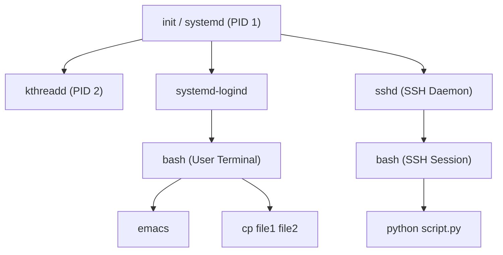
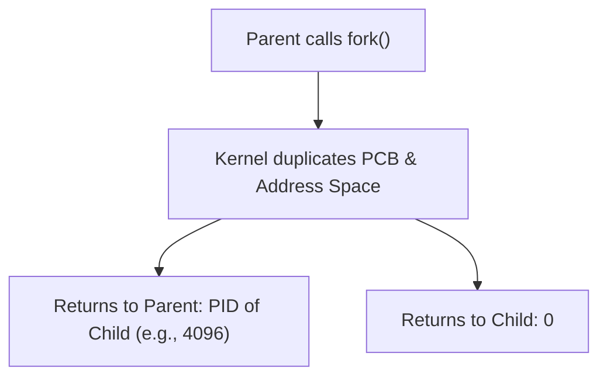
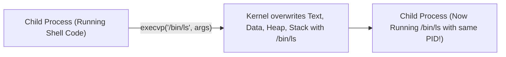
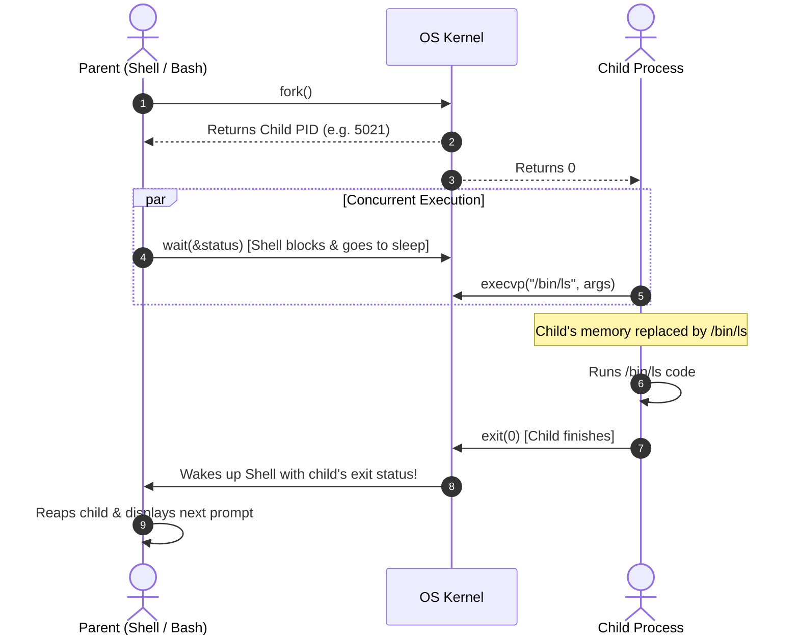
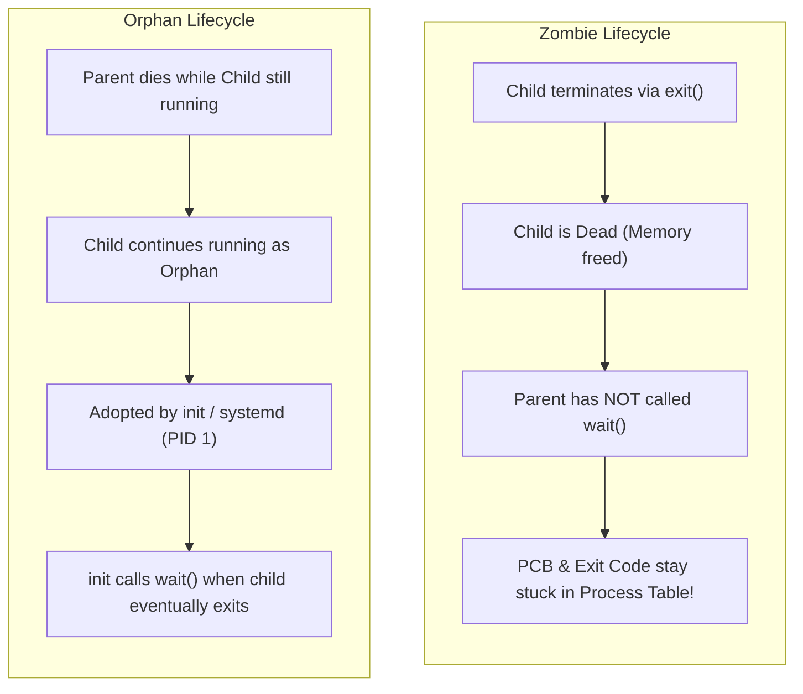
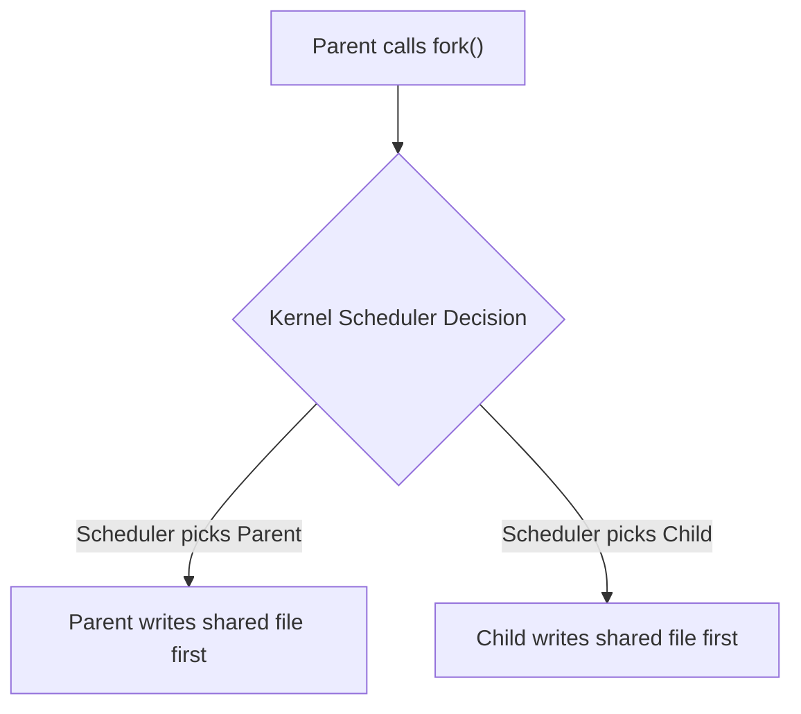
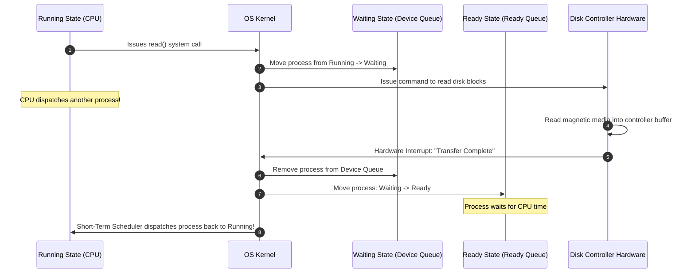

[OS Index](../README.md) / [Unit 1: OS Architecture](Introduction.md)

---

In the previous lecture, we discovered what a process is: a living, breathing program in execution, mapped into memory segments (text, data, heap, stack) and tracked by the operating system through a Process Control Block (PCB).

Now a practical question emerges: where do processes come from in the first place? How are they born, how do they run new programs, and what happens when they die?

If you are coming from Windows, you might expect an operating system to provide a single system call like `CreateProcess("my_program.exe")` that takes an executable path and runs it from scratch.

Unix takes a completely different, elegant, and orthogonal approach:
> **In Unix, you cannot create a process from nothing.** 
> 
> There is no single system call to spawn an arbitrary program. Instead, Unix splits process creation into two distinct primitives: **`fork()`** (which duplicates the calling process) and **`exec()`** (which replaces the calling process with a new binary).

Every user process running on a Linux system today is descended through repeated duplication from a single root ancestor: **`init`** (or **`systemd`**), which is given PID 1 by the kernel at boot.

---

## The Process Hierarchy: The Process Tree

Because every process is created by an existing process, the relationships between all running processes naturally form a **tree hierarchy**:



Whenever a process spawns another:
- The creator is called the **parent process**.
- The newly created process is the **child process**.
- Every child has exactly **one parent**, identified by a Parent Process ID (**`PPID`**).
- A parent can spawn multiple children.

### Options During Process Creation

When an operating system creates a child process, it must decide on three design dimensions:

1. **Resource Sharing Options:**
   - *Parent and child share all resources:* Both have access to the same open files, shared memory segments, and network sockets.
   - *Child shares a subset of parent resources:* The parent restricts the child to only a specific partition of its memory or file descriptors to avoid resource starvation.
   - *Parent and child share no resources:* The kernel allocates completely independent pools of memory and descriptors to the child.
2. **Execution Options:**
   - *Concurrent Execution:* The parent and child continue executing simultaneously after creation, competing as peers for CPU time.
   - *Parent Waits:* The parent halts execution and enters the Waiting state until the child finishes executing and exits.
3. **Address Space Options:**
   - *Duplication:* The child is a replica of the parent process, containing identical code and variable states at the time of creation.
   - *Program Replacement:* A new executable binary is loaded directly into the child's address space.

In Unix and Linux, the system defaults to duplicating the address space (via `fork()`), allowing concurrent execution, and sharing open file descriptions.

---

## Process Creation in Unix: `fork()`

The system call used to create a new process in Unix is `fork()`:

```c
#include <sys/types.h>
#include <unistd.h>

pid_t fork(void);
```

### The Miracle of `fork()`: Called Once, Returns Twice!

`fork()` is unique among system calls: **it is called once by the parent, but returns twice**—once in the parent process, and once in the newly created child process!



The return value tells the code which process it is currently executing in:
- **In the Parent Process:** `fork()` returns the **Process ID (PID) of the newly created child** (a positive integer). This gives the parent a handle to track or wait for its child.
- **In the Child Process:** `fork()` returns **`0`**. The child does not need to be told its own PID because it can simply call `getpid()`.
- **On Failure:** `fork()` returns **`-1`** to the parent, and no child process is created (e.g., if the system has reached its maximum process limit).

### What the Child Inherits vs. What is Unique

When `fork()` executes, the child receives a near-clone of the parent:

| Inherited by Child | Unique to Child |
| :--- | :--- |
| Exact copy of user address space (code, data, heap, stack) | Unique **PID** (Process ID) |
| Duplicated **File Descriptors** (sharing read/write file offsets!) | Unique **PPID** (set to parent's PID) |
| Environment variables and working directory | Child gets its own copy of CPU registers and stack pointer |
| Signal masks and handling settings | Resource utilization counters reset to zero |
| User and Group credentials (UID, GID) | Pending signals are cleared |

### Copy-on-Write (COW): How Modern Kernels Avoid Wasted Work
Historically, duplicating an entire 8 GB process during `fork()` required allocating another 8 GB of physical RAM and copying every single byte. If the child immediately called `exec()` to run a new program, all that copying was completely wasted!

Modern operating systems solve this with **Copy-on-Write (COW)**:
- When `fork()` is called, the kernel does **not** copy the parent's physical memory pages.
- Instead, the child's page tables are populated with pointers to the **exact same physical pages** as the parent.
- Both parent and child mark those shared pages as **Read-Only**.
- If neither process modifies memory, they share the physical RAM indefinitely.
- The instant either the parent or the child attempts to write to a page, a hardware page fault occurs. The kernel intercepts the fault, makes an isolated physical copy of *just that single 4 KB page*, marks the new page as writable, and lets the write proceed.

---

## Replacing the Address Space: The `exec()` Family

Creating an identical twin of yourself is helpful for worker pools, but how do we run an entirely different program—like running `ls` from inside `bash`?

We use the **`exec()`** family of system calls:

```c
#include <unistd.h>

int execlp(const char *file, const char *arg, ... /*, (char *) NULL */);
int execvp(const char *file, char *const argv[]);
```



### Critical Rules About `exec()`:

1. **Does `exec()` create a new process? NO!**
   The process ID does not change. Its parent PID does not change. Its open file descriptors remain open. Only its internal executable code, static data, heap, and stack are wiped clean and replaced by the new binary from disk.
2. **`exec()` NEVER returns on success.**
   Think about why: the machine instructions that called `exec()` no longer exist in memory! They were wiped out and overwritten by the instructions of the new program. The CPU begins executing the `main()` function of the new binary.
3. **If `exec()` returns at all, an error occurred.**
   If `exec()` returns to the caller (returning `-1`), it means the executable file was not found, permissions were denied, or memory was exhausted.

---

## The Fundamental Unix Pattern: Fork, Exec, and Wait

Every command you type into a Linux shell executes the classic **Fork-Exec-Wait** triad:



### Complete C Code Implementation

Here is how this looks in standard, production-grade C:

```c
#include <stdio.h>
#include <stdlib.h>
#include <unistd.h>
#include <sys/types.h>
#include <sys/wait.h>

int main() {
    pid_t pid;

    // 1. Fork a child process
    pid = fork();

    if (pid < 0) {
        // Fork failed
        perror("Fork failed");
        exit(EXIT_FAILURE);
    } 
    else if (pid == 0) {
        // 2. Child process executes this branch
        printf("[Child] I am the child! PID = %d, Parent PPID = %d\n", getpid(), getppid());
        
        char *args[] = {"ls", "-l", NULL};
        // Replace child image with /bin/ls
        execvp("ls", args);

        // If execvp succeeds, this line NEVER executes!
        perror("execvp failed");
        exit(EXIT_FAILURE);
    } 
    else {
        // 3. Parent process executes this branch
        int status;
        printf("[Parent] I am the parent! Waiting for child PID = %d to finish...\n", pid);
        
        // Wait for the specific child process to terminate
        wait(&status);
        
        if (WIFEXITED(status)) {
            printf("[Parent] Child exited normally with status code = %d\n", WEXITSTATUS(status));
        }
        printf("[Parent] All done. Resuming parent work.\n");
    }

    return 0;
}
```

---

## Process Termination

A process can terminate in two ways:

1. **Normal Termination:**
   - The process executes its final statement and returns from `main()`.
   - The process explicitly invokes the system call `exit(status)` or `_exit(status)`.
2. **Abnormal Termination:**
   - The process receives an unhandled terminating signal (e.g., `SIGSEGV` on illegal memory access, `SIGFPE` on division by zero, or `SIGKILL` / `SIGINT` from pressing `Ctrl+C`).
   - The process calls `abort()`.

### What the Operating System Does on Termination:
When a process calls `exit()`:
1. All dynamic memory allocations (heap, stack) and physical frames are freed.
2. All open file descriptors and socket handles are closed.
3. System locks and shared memory bindings are released.
4. **Crucial detail:** The kernel does **not** delete the process's entry from the system process table! It preserves the PCB containing the process's PID and its 8-bit exit status code (`status`), waiting for its parent to call `wait()`.

### Cascading Termination
In some operating systems (like VMS or certain database engines), if a parent process terminates, all of its children, grandchildren, and descendants are automatically terminated by the kernel. This is known as **Cascading Termination**.

Unix and Linux do **not** enforce cascading termination by default. In Unix, when a parent dies, its active children are allowed to keep running—they simply become **orphans** and are adopted by the system.

---

## Zombies and Orphans

Understanding the relationship between a parent calling `wait()` and a child calling `exit()` is essential for systems programming and exams.



### 1. Zombie Processes
- **Definition:** A process that has finished execution (called `exit()`), but whose parent has **not yet called `wait()`** to collect its exit status.
- **State in Memory:** A zombie consumes **no CPU time and zero physical RAM**. Its address space is completely released. However, its entry in the kernel's **Process Table** (including its PID and PCB) remains intact.
- **Why the OS keeps it:** Because the parent might call `wait()` in the future to ask: *"Did my child succeed or fail?"* The OS cannot discard the exit status until the parent acknowledges it.
- **The Danger of Zombies:** While a single zombie is harmless, PIDs are a finite resource (typically 32,768 by default). If a poorly written server creates thousands of child processes and never calls `wait()`, the process table fills with zombies, preventing any new processes from launching.
- **How to kill a zombie:** **You cannot kill a zombie with `kill -9`!** It is already dead. The only way to remove a zombie is to kill its **parent**. Once the parent dies, the zombie becomes an orphan, gets adopted by `init`, and `init` immediately calls `wait()` to reap it.

### 2. Orphan Processes
- **Definition:** A process that is actively running while its parent process has already terminated.
- **What happens to it:** The Unix kernel automatically **re-parents** orphaned processes to the root process: `init` (PID 1) or a modern process supervisor like `systemd`.
- `init` periodically calls `wait()`, ensuring that when an orphaned child eventually exits, its exit code is promptly reaped and it never remains a permanent zombie.

### Summary Comparison: Zombie vs. Orphan

| Property | Zombie Process | Orphan Process |
| :--- | :--- | :--- |
| **Is the process alive?** | **No** (Execution has ended) | **Yes** (Still actively running) |
| **Parent status** | Parent is still alive, but neglecting `wait()` | Parent has already terminated |
| **Resource usage** | Consumes 0 RAM, 0 CPU; only consumes a PID slot | Consumes normal CPU, RAM, and file handles |
| **Resolution** | Parent must call `wait()`, or kill parent | Kernel re-parents child to `init` (PID 1) |

---

## Process Management System Calls in Detail

Let's review the exact signatures and semantics of the POSIX process management family:

### 1. `getpid()` and `getppid()`
```c
#include <unistd.h>

pid_t getpid(void);   // Returns process ID of calling process (Always succeeds)
pid_t getppid(void);  // Returns process ID of caller's parent
```

### 2. `wait()`
```c
#include <sys/wait.h>

pid_t wait(int *status);
```
- Suspends execution of the calling parent process until **any one** of its children terminates.
- **Returns:** The PID of the terminated child on success, or `-1` on error (e.g., if the process has no children).
- If `status` is not `NULL`, the kernel populates it with status information that can be inspected with POSIX macros:
  - `WIFEXITED(status)`: Evaluates to true if the child terminated normally.
  - `WEXITSTATUS(status)`: Extracts the lower 8 bits of the child's `exit()` status code.
  - `WIFSIGNALED(status)`: Evaluates to true if the child was killed by an unhandled signal.
  - `WTERMSIG(status)`: Returns the signal number that killed the child.

### 3. `waitpid()`
What if a parent has 10 children, but specifically needs to wait for child number 4? Or what if a parent wants to check if a child is done without freezing? `wait()` cannot do this, but `waitpid()` can:

```c
pid_t waitpid(pid_t pid, int *status, int options);
```
- **`pid > 0`:** Wait for the specific child whose PID matches `pid`.
- **`pid == -1`:** Wait for *any* child process (identical to `wait()`).
- **`options = WNOHANG`:** Non-blocking mode! If no child has terminated yet, `waitpid()` **returns `0` immediately** rather than blocking. This allows a server or GUI to poll its children while continuing to do useful work.

### 4. `waitid()`
The modern POSIX interface providing distinct separation of arguments and richer state inspection:
```c
int waitid(idtype_t idtype, id_t id, siginfo_t *infop, int options);
```
- Allows waiting for children that have stopped (`WSTOPPED`), continued (`WCONTINUED`), or exited (`WEXITED`), populating a detailed `siginfo_t` structure.

---

## Race Conditions

A **Race Condition** occurs when multiple processes (or threads) access and manipulate shared state concurrently, and the final outcome depends on the exact, unpredictable order in which instructions execute.

Consider what happens immediately after a `fork()`:



Both parent and child are in the `Ready` state. **You must never assume which one runs first!** 

On a single CPU, the scheduler might pick the child first; on a multicore CPU, both might execute on different cores in the exact same nanosecond.

### Why Polling is a Terrible Synchronization Solution
Programmers unfamiliar with synchronization often try to fix race conditions by **polling** (busy-waiting):

```c
// Anti-pattern: DO NOT DO THIS!
while (parent_done_flag == 0) {
    // Spin in a loop burning CPU cycles!
}
```

Polling is terrible for two reasons:
1. **Wasted CPU Time:** The spinning process burns 100% of a CPU core doing zero productive work, starving other processes.
2. **Added Latency:** The waiting process can only react when its next time slice comes around.

The correct solution is to use kernel-level synchronization primitives: **signals**, **pipes**, **semaphores**, and **mutexes**, which put the waiting process to sleep (Waiting state) and wake it up only when the event actually occurs.

---

## The I/O Request Lifecycle of an I/O-Bound Process

To see how process states, system calls, and interrupts tie together in practice, trace the lifecycle of an **I/O-Bound Process**:



1. **Running State:** The process executes code on the CPU until it calls `read()`.
2. **Trap to Kernel:** A software trap switches mode bit to Kernel Mode. The kernel recognizes an I/O request.
3. **Move to Waiting:** The kernel removes the process from the CPU, changes its state from `Running` to `Waiting`, and places its PCB into the **Disk Device Queue**. The CPU is dispatched to another process.
4. **Hardware Transfer:** The disk controller reads physical sectors into its internal buffer.
5. **Hardware Interrupt:** When the transfer finishes, the disk controller fires a hardware interrupt.
6. **Move to Ready:** The kernel interrupt handler moves the process from the Device Queue to the **Ready Queue** (state: `Waiting` $\rightarrow$ `Ready`). Notice again: it does *not* jump directly to Running!
7. **Dispatch:** The short-term CPU scheduler picks the process and dispatches it back to the CPU (`Ready` $\rightarrow$ `Running`).

Because an I/O-bound process executes only a few machine instructions before issuing its next I/O call, its CPU bursts are tiny. If long CPU-bound tasks block it in the Ready Queue, I/O devices sit idle. This fundamental reality drives the design of the CPU scheduling algorithms we study next.

---

## Key Takeaways

- In Unix, process creation is split into two independent primitives: **`fork()`** (which duplicates the process) and **`exec()`** (which replaces the process image with a new binary).
- `fork()` is called once, but **returns twice**: `0` in the child, and the child's `PID` in the parent. On failure, it returns `-1`.
- **Copy-on-Write (COW)** defers copying physical memory pages during `fork()` until one of the processes performs a write operation, making process creation exceptionally fast.
- `exec()` wipes clean the process's code, data, heap, and stack, replacing them with a new executable. It **never returns on success**.
- A **Zombie** process has terminated (`exit()`), but its parent has not yet reaped it with `wait()`. Its PCB remains in the process table. Zombies cannot be killed; their parents must be killed or reap them.
- An **Orphan** process is still actively running after its parent has died. The kernel re-parents orphans to `init` / `systemd` (PID 1), which reaps them when they terminate.
- A **Race Condition** occurs when program correctness depends on the unpredictable execution order of concurrent processes.
- An I/O-bound process moves `Running` $\rightarrow$ `Waiting` during I/O, and `Waiting` $\rightarrow$ `Ready` upon interrupt completion.

---

Now that we know how processes are created, run, and transitioned through queues, a fundamental challenge remains for the operating system:

When multiple processes are sitting in the Ready Queue demanding CPU time, which one should the kernel choose to run next? How do we balance fairness, waiting time, and system throughput?

That brings us to the foundational CPU scheduling algorithms in [**Lecture 5: CPU Scheduling - FCFS and SJF**](L05%20-%20CPU%20Scheduling%20-%20FCFS%20and%20SJF.md).
