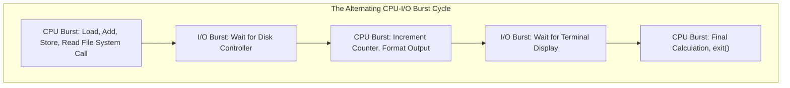
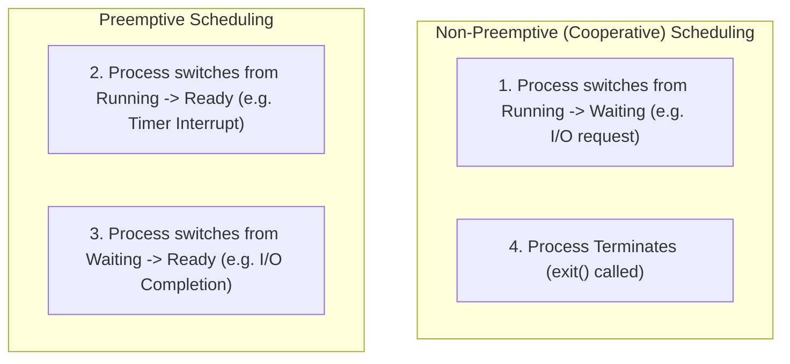
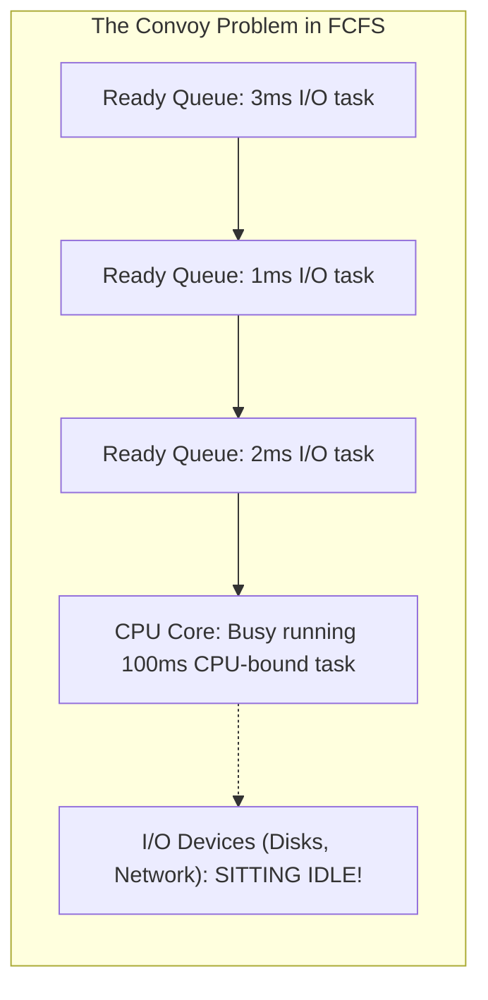
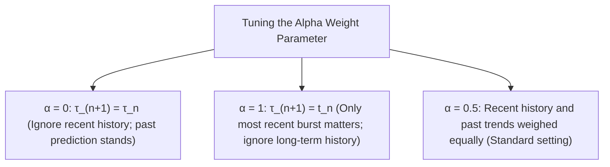

[OS Index](../README.md) / [Unit 1: OS Architecture](Introduction.md)

---

In the earlier lectures, we saw that modern operating systems keep multiple processes resident in main memory simultaneously. Whenever a running process has to wait—whether for a disk read, a network packet, or a keyboard keypress—the CPU is left sitting completely idle unless the kernel steps in.

The goal of multiprogramming is simple: **keep the CPU busy 100% of the time**.

When the CPU becomes free, the operating system must look across the Ready Queue and make a decision: which process gets the CPU next, and for how long?

This decision-making logic is the heart of **CPU Scheduling**. In this lecture, we examine the fundamental scheduling framework, the exact metrics used to judge algorithms, and the two foundational algorithms: **First-Come, First-Served (FCFS)** and **Shortest-Job-First (SJF)**.

---

## The CPU–I/O Burst Cycle

To understand why scheduling works, look at how programs actually behave:



Every program execution consists of an alternating sequence of two phases:
1. **CPU Bursts:** The process is actively executing instructions on the processor (computations, memory reads/writes, branching).
2. **I/O Bursts:** The process is paused, waiting for an I/O device to transfer data.

If you measure thousands of processes across a real operating system and plot the frequency of their CPU bursts, an unmistakable pattern appears:

```mermaid
flowchart TD
    subgraph BURSTS["Frequency of CPU Burst Durations (Hyperexponential Decay)"]
        direction TB
        B1["0 - 2 ms: 52% of all bursts (Massive Majority: Short / I/O-bound)"]
        B2["2 - 4 ms: 21% of all bursts"]
        B3["4 - 6 ms: 11% of all bursts"]
        B4["6 - 8 ms: 6% of all bursts"]
        B5["8 - 10 ms: 4% of all bursts"]
        B6["&gt; 10 ms: 6% of all bursts (Rare: Heavy CPU-bound computation)"]
        B1 --- B2 --- B3 --- B4 --- B5 --- B6
    end```

Notice the extreme skew:
- The vast majority of CPU bursts are **extremely short** (typically under 4 milliseconds). These belong to interactive apps and I/O-bound processes that do a quick calculation and immediately issue an I/O system call.
- A tiny fraction of CPU bursts are **very long** (dozens of milliseconds or seconds). These belong to CPU-bound jobs performing heavy mathematical computation.

CPU scheduling exists to take advantage of this reality: by quickly dispatching short bursts, we can satisfy interactive users and keep hardware I/O devices running at maximum capacity.

---

## The CPU Scheduler vs. The Dispatcher

People often use the terms "scheduler" and "dispatcher" interchangeably, but in operating system design, they are two completely distinct components:

```mermaid
flowchart TD
    READY["Processes in Ready Queue"] --> SCHED["CPU Scheduler (Short-Term Scheduler)"]
    SCHED -->|"Selects Next Process (The Decision Maker)"| DISP["Dispatcher (The Physical Executor)"]
    DISP -->|"Context Switches CPU Core"| CPU["CPU Core (User Mode Execution)"]
```

### 1. The CPU Scheduler (The Brain)
- Selects a process from the Ready Queue according to a specific scheduling algorithm (e.g., FCFS, SJF, Priority, Round Robin).
- It simply answers the question: **"Which process should run next?"**

### 2. The Dispatcher (The Muscle)
- The low-level kernel module that physically gives control of the CPU core to the process selected by the short-term scheduler.
- To hand the CPU to the selected process, the dispatcher performs three critical tasks:
  1. **Switching context:** Saving the registers and program counter of the outgoing process to its PCB, and restoring the registers and program counter of the incoming process from its PCB.
  2. **Switching to User Mode:** Clearing the mode bit from `0` (kernel) to `1` (user).
  3. **Jumping to the instruction:** Reloading the Program Counter register with the instruction address where the chosen process previously left off, resuming user execution.

### Dispatch Latency
The time it takes for the dispatcher to stop one process, execute the context switch, and start the new process running is called **Dispatch Latency**:

$$\text{Dispatch Latency} = \text{Time to stop } P_0 + \text{Context Switch Overhead} + \text{Time to start } P_1$$

Dispatch latency is pure overhead. While the dispatcher runs, no application work gets done. Therefore, dispatch routines are written in highly optimized assembly to run in mere microseconds.

---

## Preemptive vs. Non-Preemptive Scheduling

Operating system scheduling decisions occur under four specific lifecycle circumstances:



### 1. Non-Preemptive (Cooperative) Scheduling
Under circumstances **1** and **4**, the CPU has no choice: the running process has voluntarily yielded the CPU (either because it is waiting for an event or because it has died). A new process *must* be chosen.

When scheduling takes place **only** under circumstances 1 and 4, we call the system **Non-Preemptive (or Cooperative)**:
- Once a process is allocated the CPU, it keeps running until it voluntarily surrenders control (by issuing an I/O request or terminating).
- Advantage: Simple to implement; free from race conditions on shared kernel data because a process is never yanked off the CPU unexpectedly.
- Disadvantage: Vulnerable to rogue or buggy programs. A single process with an infinite loop (`while(1);`) will seize the CPU and permanently freeze the entire machine! (Early Windows 3.1 and Mac OS 9 were cooperative).

### 2. Preemptive Scheduling
Under circumstances **2** and **3**, the currently running process is still completely capable of continuing execution! However, the OS forcibly intervenes:
- In circumstance 2, a hardware timer interrupts the process because its allocated time quantum expired.
- In circumstance 3, an I/O device finishes a transfer for a higher-priority process, so the kernel steps in to run the newly ready task.

When the OS can forcibly seize the CPU from an active process, the system is **Preemptive**:
- Advantage: Responsive. Prevents long tasks from starving short tasks; stops infinite loops from hanging the system.
- Cost: Requires hardware timer support and introduces concurrency risks. If process $P_0$ is halfway through updating a shared data structure when the kernel preempts it to run $P_1$, $P_1$ might read inconsistent data.

---

## Scheduling Criteria: The Five Yardsticks

To compare different scheduling algorithms objectively, computer scientists evaluate them against five performance criteria:

1. **CPU Utilization (Maximize):**
   - The percentage of time the CPU is actively executing user or system code. In a well-tuned system, CPU utilization should range from 40% (lightly loaded) to 90% (heavily loaded).
2. **Throughput (Maximize):**
   - The number of complete processes executed per unit of time (e.g., 50 processes per minute).
3. **Turnaround Time ($T_{TAT}$) (Minimize):**
   - The total elapsed time from the instant a process is submitted (Arrival Time $A$) to the instant it fully completes execution (Completion Time $C$).
   $$\text{Turnaround Time} = C - A$$
   - This includes all time spent waiting in memory, sitting in queues, executing on the CPU, and doing I/O.
4. **Waiting Time ($T_{WT}$) (Minimize):**
   - The total amount of time a process spends sitting helplessly in the **Ready Queue** waiting to be allocated the CPU.
   $$\text{Waiting Time} = \text{Turnaround Time} - \text{Burst Time} = (C - A) - B$$
   - The scheduling algorithm cannot alter how much CPU computation ($B$) a process needs; it only controls how long the process is forced to wait in the Ready Queue!
5. **Response Time ($T_{RT}$) (Minimize):**
   - In an interactive time-sharing system, turnaround time is not the best metric. A user does not care how long a background batch process takes; they care how quickly the system *reacts* after they click a button or press a key.
   - **Response Time** is the time from process submission (Arrival Time $A$) until the **first response** is produced (the first instant the process is dispatched onto the CPU).
   $$\text{Response Time} = \text{Time of First CPU Dispatch} - A$$

---

## First-Come, First-Served (FCFS) Scheduling

The simplest of all scheduling algorithms is **First-Come, First-Served (FCFS)**:
- Processes are allocated the CPU strictly in the order they arrive in the Ready Queue.
- Implemented trivially using a standard **FIFO (First-In, First-Out) queue**.
- FCFS is completely **Non-Preemptive**: once a process gets the CPU, it holds it until it finishes its CPU burst.

Let's work through the arithmetic of how FCFS behaves under different arrival orders.

### Worked Example 1: Long Process Arrives First
Suppose three processes arrive at time $t = 0$ in the order $P_1, P_2, P_3$:

| Process | Arrival Time ($A$) | Burst Time ($B$) |
| :---: | :---: | :---: |
| $P_1$ | 0 | 24 |
| $P_2$ | 0 | 3 |
| $P_3$ | 0 | 3 |

Since $P_1$ arrived first, it runs to completion, followed by $P_2$, then $P_3$. We represent execution chronologically using a **Gantt Chart**:

```mermaid
gantt
    title Gantt Chart: FCFS (Order: P1, P2, P3)
    dateFormat X
    axisFormat %s
    section Execution
    P1 : 0, 24
    P2 : 24, 27
    P3 : 27, 30
```



Now let's compute completion, turnaround, and waiting times:
- **Completion Times ($C$):** $P_1 = 24$, $P_2 = 27$, $P_3 = 30$.
- **Waiting Times ($T_{WT} = C - A - B$):**
  - $P_1 = 24 - 0 - 24 = 0\text{ ms}$
  - $P_2 = 27 - 0 - 3 = 24\text{ ms}$
  - $P_3 = 30 - 0 - 3 = 27\text{ ms}$

$$\text{Average Waiting Time} = \frac{0 + 24 + 27}{3} = \frac{51}{3} = \mathbf{17.0\text{ ms}}$$

### Worked Example 2: Short Processes Arrive First
Now consider what happens if the exact same three processes arrive at $t = 0$, but in the order $P_2, P_3, P_1$:

```mermaid
gantt
    title Gantt Chart: FCFS (Order: P2, P3, P1)
    dateFormat X
    axisFormat %s
    section Execution
    P2 : 0, 3
    P3 : 3, 6
    P1 : 6, 30
```



Let's compute the waiting times:
- $P_2 = 3 - 0 - 3 = 0\text{ ms}$
- $P_3 = 6 - 0 - 3 = 3\text{ ms}$
- $P_1 = 30 - 0 - 24 = 6\text{ ms}$

$$\text{Average Waiting Time} = \frac{0 + 3 + 6}{3} = \frac{9}{3} = \mathbf{3.0\text{ ms}}$$

Look at that staggering difference: **17.0 ms down to 3.0 ms!** 

The average waiting time under FCFS is exceptionally sensitive to arrival order.

---

## The Convoy Effect

The vulnerability revealed above leads directly to the primary defect of FCFS: the **Convoy Effect**.

Imagine a long, heavy CPU-bound process running on the CPU. Behind it in the Ready Queue sit three small, interactive I/O-bound processes:



1. The CPU-bound process seizes the CPU for 100 milliseconds.
2. The short I/O-bound processes are forced to wait in the Ready Queue, unable to run their tiny 2 ms bursts.
3. Because the I/O-bound processes cannot run, they cannot issue their I/O requests! As a result, the hard drives and network cards sit completely **idle**.
4. When the big CPU-bound process finally finishes its burst and yields to perform I/O, the three short processes blitz through the CPU in rapid succession and immediately pile up at the I/O devices.
5. Now the CPU sits completely **idle** waiting for the I/O devices!

This phenomenon—where a flock of short processes trails helplessly behind one long process like cars trapped behind a tractor on a single-lane highway—is the **Convoy Effect**. It results in poor CPU utilization and poor device utilization.

---

## Shortest-Job-First (SJF) Scheduling

To eliminate the convoy effect and minimize waiting time, we turn to **Shortest-Job-First (SJF)**:
- Associates with each process the length of its **next CPU burst**.
- When the CPU becomes available, it is assigned to the process that has the **smallest next CPU burst**.
- If two processes have equal bursts, FCFS is used as a tie-breaker.

### SJF is Provably Optimal
SJF is mathematically **optimal**: it produces the minimum average waiting time for any given set of stationary processes.

Why? Moving a short process ahead of a long process decreases the waiting time of the short process by *more* than it increases the waiting time of the long process. The net sum of waiting times strictly decreases.

### Worked Example: Non-Preemptive SJF
Suppose four processes arrive at time $t = 0$ with the following burst times:

| Process | Arrival Time ($A$) | Burst Time ($B$) |
| :---: | :---: | :---: |
| $P_1$ | 0 | 6 |
| $P_2$ | 0 | 8 |
| $P_3$ | 0 | 7 |
| $P_4$ | 0 | 3 |

SJF sorts the ready queue by burst length: $P_4 (3) \rightarrow P_1 (6) \rightarrow P_3 (7) \rightarrow P_2 (8)$.

```mermaid
gantt
    title Gantt Chart: Non-Preemptive SJF
    dateFormat X
    axisFormat %s
    section Execution
    P4 : 0, 3
    P1 : 3, 9
    P3 : 9, 16
    P2 : 16, 24
```



Let's compute the metrics:
- $T_{WT}(P_4) = 3 - 0 - 3 = 0\text{ ms}$
- $T_{WT}(P_1) = 9 - 0 - 6 = 3\text{ ms}$
- $T_{WT}(P_3) = 16 - 0 - 7 = 9\text{ ms}$
- $T_{WT}(P_2) = 24 - 0 - 8 = 16\text{ ms}$

$$\text{Average Waiting Time} = \frac{0 + 3 + 9 + 16}{4} = \frac{28}{4} = \mathbf{7.0\text{ ms}}$$

*(Compare this to FCFS on the same data in order $P_1, P_2, P_3, P_4$, which yields an average waiting time of $10.25\text{ ms}$!)*

---

## The Great Dilemma: Why Can't We Implement SJF?

If SJF is provably optimal, why doesn't every operating system use pure SJF for short-term CPU scheduling?

Because of a fundamental physical limitation:
> **The operating system cannot know the future!**

When a user launches a program or a process unblocks from disk, the kernel has no magical way of knowing whether the upcoming CPU burst will last 2 milliseconds or 20 minutes!

While SJF is frequently used in long-term batch job scheduling (where users must declare estimated run times), for short-term CPU scheduling we can only **predict** the next CPU burst based on past behavior.

### Predicting Future Bursts: Exponential Averaging
The standard method to predict future burst lengths is **Exponential Averaging** (or Exponential Smoothing):

$$\tau_{n+1} = \alpha t_n + (1 - \alpha)\tau_n$$

Where:
- $t_n$: The **actual length** of the process's most recent ($n$-th) CPU burst.
- $\tau_n$: The **predicted value** that was calculated for that $n$-th burst.
- $\tau_{n+1}$: The **new predicted value** for the next ($(n+1)$-th) CPU burst.
- $\alpha$: A weighting smoothing factor ($0 \le \alpha \le 1$).



If we expand the recurrence relation:

$$\tau_{n+1} = \alpha t_n + (1 - \alpha)\alpha t_{n-1} + \dots + (1 - \alpha)^j \alpha t_{n-j} + \dots + (1 - \alpha)^{n+1}\tau_0$$

Because $(1 - \alpha) < 1$, each successive older term has less and less weight. Recent history dominates the prediction, while distant history gently decays away.

### The Downside of SJF: Starvation
SJF suffers from a dangerous flaw: **Starvation (Indefinite Blocking)**.

If a long CPU-bound process is sitting in the Ready Queue, and a continuous stream of short processes enters the system, the short processes will perpetually jump ahead in line. The long process will starve, never receiving CPU time.

---

## Shortest-Remaining-Time-First (SRTF): Preemptive SJF

SJF can be implemented as either non-preemptive or **preemptive**.

The preemptive version of SJF is known as **Shortest-Remaining-Time-First (SRTF)**:
- Whenever a new process arrives in the Ready Queue, the scheduler compares its burst time against the **remaining execution time** of the currently running process.
- If the newly arrived process has a shorter burst time than what remains of the currently executing process, the running process is **preempted** (kicked off the CPU and moved back to the Ready Queue)!
- If the new process's burst is equal to or longer than the running process's remaining time, the running process continues uninterrupted.

Let's trace through a complete, exam-standard numerical problem with staggered arrival times.

### Fully Worked Example: SRTF with Staggered Arrivals

Consider the following four processes:

| Process | Arrival Time ($A$) | Initial Burst Time ($B$) |
| :---: | :---: | :---: |
| $P_1$ | 0 | 8 |
| $P_2$ | 1 | 4 |
| $P_3$ | 2 | 9 |
| $P_4$ | 3 | 5 |

#### Step 1: Trace the Event Timeline Step-by-Step

- **Time $t = 0$:**
  - Only $P_1$ has arrived.
  - Ready Queue: $\{P_1 \text{ (rem: 8)}\}$.
  - $P_1$ is scheduled and starts running.
- **Time $t = 1$:**
  - $P_2$ arrives with burst $4$.
  - $P_1$ has run for $1\text{ ms}$, so its remaining time is $8 - 1 = 7\text{ ms}$.
  - **Comparison:** $P_2$ remaining ($4$) $<$ $P_1$ remaining ($7$).
  - **Decision:** **Preempt $P_1$!** $P_1$ moves back to Ready Queue. $P_2$ gets the CPU.
- **Time $t = 2$:**
  - $P_3$ arrives with burst $9$.
  - $P_2$ has run for $1\text{ ms}$ (remaining: $4 - 1 = 3\text{ ms}$).
  - **Comparison:** $P_2$ remaining ($3$) $<$ $P_3$ remaining ($9$).
  - **Decision:** No preemption. $P_2$ continues.
- **Time $t = 3$:**
  - $P_4$ arrives with burst $5$.
  - $P_2$ has run for another $1\text{ ms}$ (remaining: $3 - 1 = 2\text{ ms}$).
  - **Comparison:** $P_2$ remaining ($2$) $<$ $P_4$ remaining ($5$).
  - **Decision:** No preemption. $P_2$ continues.
- **Time $t = 5$:**
  - $P_2$ finishes its remaining $2\text{ ms}$ and **terminates**!
  - Active remaining times in Ready Queue:
    - $P_1$: remaining $7$
    - $P_3$: remaining $9$
    - $P_4$: remaining $5$
  - Smallest remaining time is $P_4$ ($5\text{ ms}$).
  - $P_4$ gets the CPU and runs until $t = 5 + 5 = 10$.
- **Time $t = 10$:**
  - $P_4$ **terminates**!
  - Active remaining times in Ready Queue:
    - $P_1$: remaining $7$
    - $P_3$: remaining $9$
  - Smallest remaining time is $P_1$ ($7\text{ ms}$).
  - $P_1$ gets the CPU and runs until $t = 10 + 7 = 17$.
- **Time $t = 17$:**
  - $P_1$ **terminates**!
  - Only $P_3$ remains (remaining: $9\text{ ms}$).
  - $P_3$ gets the CPU and runs until $t = 17 + 9 = 26$.
- **Time $t = 26$:**
  - $P_3$ terminates. All processes completed!

#### Step 2: Draw the Gantt Chart

```mermaid
gantt
    title Gantt Chart: Preemptive SJF (SRTF)
    dateFormat X
    axisFormat %s
    section Execution
    P1 : 0, 1
    P2 : 1, 5
    P4 : 5, 10
    P1 : 10, 17
    P3 : 17, 26
```



#### Step 3: Compute Completion, Turnaround, and Waiting Times

Always use the robust general formulas:
- **Turnaround Time:** $T_{TAT} = C - A$
- **Waiting Time:** $T_{WT} = T_{TAT} - B = C - A - B$

| Process | Arrival ($A$) | Burst ($B$) | Completion ($C$) | Turnaround ($C - A$) | Waiting ($C - A - B$) |
| :---: | :---: | :---: | :---: | :---: | :---: |
| $P_1$ | 0 | 8 | 17 | $17 - 0 = 17$ | $17 - 8 = \mathbf{9}$ |
| $P_2$ | 1 | 4 | 5 | $5 - 1 = 4$ | $4 - 4 = \mathbf{0}$ |
| $P_3$ | 2 | 9 | 26 | $26 - 2 = 24$ | $24 - 9 = \mathbf{15}$ |
| $P_4$ | 3 | 5 | 10 | $10 - 3 = 7$ | $7 - 5 = \mathbf{2}$ |

$$\text{Average Waiting Time} = \frac{9 + 0 + 15 + 2}{4} = \frac{26}{4} = \mathbf{6.5\text{ ms}}$$
$$\text{Average Turnaround Time} = \frac{17 + 4 + 24 + 7}{4} = \frac{52}{4} = \mathbf{13.0\text{ ms}}$$

### Comparing SRTF with Non-Preemptive SJF
If we ran non-preemptive SJF on this exact same data set:
- At $t = 0$, $P_1$ starts and *cannot be preempted*, running all the way from $t = 0$ to $t = 8$.
- By $t = 8$, all other processes ($P_2, P_3, P_4$) have arrived. The scheduler then picks $P_2$ ($8$ to $12$), then $P_4$ ($12$ to $17$), then $P_3$ ($17$ to $26$).
- Waiting times under Non-Preemptive SJF:
  - $P_1 = 0$
  - $P_2 = 8 - 1 = 7$
  - $P_3 = 17 - 2 = 15$
  - $P_4 = 12 - 3 = 9$
  - Average Waiting Time = $\frac{0 + 7 + 15 + 9}{4} = \mathbf{7.75\text{ ms}}$.

SRTF achieved an average waiting time of **6.5 ms**, easily beating non-preemptive SJF's **7.75 ms**. Preemption allowed the newly arrived short job ($P_2$) to cut in immediately, shrinking its waiting time to zero.

---

## Comparison Summary: FCFS vs. Non-Preemptive SJF vs. SRTF

| Feature | FCFS | Non-Preemptive SJF | SRTF (Preemptive SJF) |
| :--- | :--- | :--- | :--- |
| **Selection Rule** | Earliest arrival time | Shortest next CPU burst | Shortest remaining burst |
| **Preemptive?** | No | No | Yes |
| **Average Waiting Time** | High; highly variable | Provably optimal (non-preemptive) | Optimal with staggered arrivals |
| **Starvation Possible?** | No | Yes (long jobs starve) | Yes (long jobs starve) |
| **Direct Implementation**| Yes (trivial FIFO queue)| No (future burst unknown) | No (future burst unknown) |
| **Primary Defect** | Convoy Effect | Needs future prediction; starvation | High context-switch overhead |

---

## Key Takeaways

- Programs alternate between **CPU bursts** and **I/O bursts**. Most CPU bursts are short ($< 4\text{ ms}$).
- The **CPU Scheduler** selects *which* process runs next; the **Dispatcher** physically executes the context switch, restores registers, and transitions to user mode.
- **Dispatch Latency** is the pure overhead required to stop one process and start another.
- Scheduling is **Non-Preemptive** if processes voluntarily yield the CPU (states: Running $\rightarrow$ Waiting or Terminated). It is **Preemptive** if the kernel forcibly strips the CPU via timer interrupts or high-priority arrivals.
- The five optimization metrics are **CPU Utilization**, **Throughput**, **Turnaround Time** ($C - A$), **Waiting Time** ($C - A - B$), and **Response Time** (First dispatch $- A$).
- **FCFS** is simple but suffers severely from the **Convoy Effect**, where short I/O-bound jobs wait behind one long CPU-bound process.
- **SJF** is provably optimal for minimizing average waiting time, but cannot be directly implemented for short-term scheduling because future burst durations are unknown. It is approximated via **Exponential Averaging** ($\tau_{n+1} = \alpha t_n + (1 - \alpha)\tau_n$).
- **SRTF** is the preemptive version of SJF, evaluating remaining times at every new process arrival. It provides lower average waiting times than non-preemptive SJF at the expense of higher context switch overhead.

---

While SJF and SRTF give optimal waiting times in theory, their vulnerability to starvation makes them challenging for general-purpose interactive systems.

What if we explicitly assign importance levels to tasks? And more importantly, how do modern operating systems guarantee that every process gets a fair share of the CPU without any starvation at all?

That brings us to time slicing and fair-share scheduling in [**Lecture 6: Priority and Round Robin Scheduling**](L06%20-%20Priority%20and%20Round%20Robin%20Scheduling.md).
