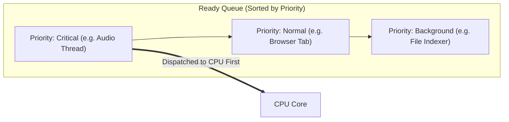
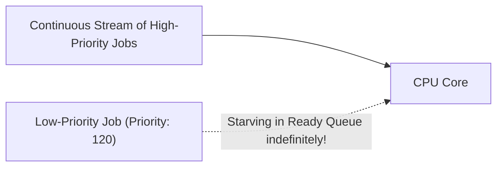
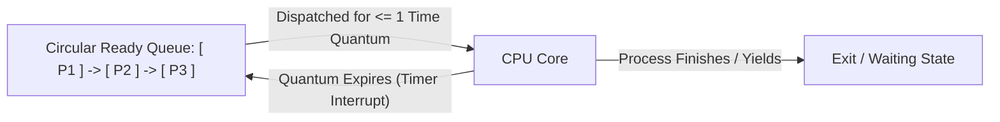
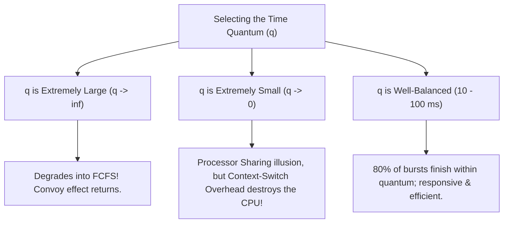

[OS Index](../README.md) / [Unit 1: OS Architecture](Introduction.md)

---

In the previous lecture, we evaluated two contrasting scheduling strategies. First-Come, First-Served (FCFS) was simple and fair in arrival order, but fell victim to the convoy effect. Shortest-Job-First (SJF) and its preemptive twin, SRTF, achieved provably optimal average waiting times, but required predicting an unknowable future and introduced the risk of starving long jobs.

To build general-purpose systems, we need algorithms that can express real-world priorities and provide guaranteed responsiveness for interactive computing.

In this lecture, we explore two algorithms that tackle these challenges directly:
1. **Priority Scheduling**: Generalizes the concept of ranking. Instead of ranking tasks purely by CPU burst length, we rank them by an explicit integer priority reflecting urgency or importance.
2. **Round Robin (RR) Scheduling**: The cornerstone of modern time-sharing systems. It prevents CPU monopolization by chopping execution into fixed time slices, eliminating the convoy effect while guaranteeing interactive responsiveness.

---

## Priority Scheduling

The central principle of **Priority Scheduling** is straightforward:
- Every process in the system is assigned a **priority number** (an integer).
- When the CPU becomes idle, the short-term scheduler selects the process with the **highest priority** from the Ready Queue.
- Processes with equal priority are scheduled in FCFS order.

### The Priority Convention Trap
Before solving any priority scheduling problem, you must always verify the convention being used:

- **Convention A (Silberschatz / Unix Standard):** **Smallest Integer $\equiv$ Highest Priority**. For example, priority `0` is the highest possible priority, while priority `127` is low. (This originates from Unix `nice` values, where a process that is "less nice" takes higher precedence).
- **Convention B (Windows / Real-Time Standard):** **Largest Integer $\equiv$ Highest Priority**. For example, priority `31` is the highest real-time priority, and priority `0` is the lowest idle priority.

There is no universal standard across textbooks and exam questions. **Always check the problem definition, and explicitly state your convention in your calculations!**

---

## SJF as a Special Case of Priority Scheduling

Priority scheduling is not merely one algorithm—it is an overarching mathematical framework.

Notice that if you define a process's priority function as:

$$\text{Priority} = \frac{1}{\text{predicted next CPU burst}}$$

Then "schedule the highest priority process" becomes mathematically identical to "schedule the process with the shortest CPU burst"!

**Shortest-Job-First (SJF) is simply Priority Scheduling where priority is the inverse of the next CPU burst.**

Similarly, FCFS is simply Priority Scheduling where priority is the inverse of the process's arrival timestamp.

---

## Preemptive vs. Non-Preemptive Priority Scheduling

Like SJF, Priority Scheduling comes in two distinct flavors:

1. **Non-Preemptive Priority Scheduling:**
   - When a newly arrived process enters the Ready Queue with a priority higher than the currently executing process, the kernel simply places the newcomer at the very front of the Ready Queue.
   - The currently running process is allowed to finish its ongoing CPU burst uninterrupted.
2. **Preemptive Priority Scheduling:**
   - When a new process arrives with a priority strictly higher than the currently running process, the kernel **immediately preempts** the running process!
   - The running process is pushed back into the Ready Queue, and the CPU is immediately context-switched to the new high-priority process.

---

## The Starvation Problem and the Aging Solution

Priority scheduling inherits the fatal flaw of SJF: **Starvation (Indefinite Blocking)**.

In an active multi-user system, if a continuous stream of high-priority processes enters the Ready Queue, low-priority processes will perpetually be pushed to the back. A low-priority process may sit in the Ready Queue for hours, days, or forever without ever receiving a single cycle of CPU time.

> A famous real-world example occurred in 1973 when computer scientists shut down the IBM 7094 mainframe at MIT. Upon inspecting the system queues, they discovered a low-priority job that had been submitted in **1967** and had sat waiting in the queue for **6 years**, continuously starved by newer, higher-priority jobs!

### The Solution: Aging
To prevent starvation, operating systems implement **Aging**:
- **Aging** is a technique of gradually **increasing the priority** of processes that have been waiting in the Ready Queue for an extended period of time.

For example, if priorities range from `127` (lowest) down to `0` (highest):
- The kernel can decrement the priority integer of a waiting process by `1` every 15 minutes of queue wait time.
- Even a process that entered the system with the lowest possible priority (`127`) will eventually climb to priority `0` within approximately 32 hours.
- Once it reaches the highest priority rank, no newly arriving process can supersede it, guaranteeing that every process will eventually run.

---

## Worked Example 1: Non-Preemptive Priority Scheduling

Suppose five processes arrive at time $t = 0$ with the following burst times and priorities. 

*(Convention: **Smaller integer = Higher priority**)*

| Process | Arrival Time ($A$) | Burst Time ($B$) | Priority |
| :---: | :---: | :---: | :---: |
| $P_1$ | 0 | 10 | 3 |
| $P_2$ | 0 | 1 | 1 (Highest) |
| $P_3$ | 0 | 2 | 4 |
| $P_4$ | 0 | 1 | 5 (Lowest) |
| $P_5$ | 0 | 5 | 2 |

Sorting the Ready Queue by priority: $P_2 (\text{pri } 1) \rightarrow P_5 (\text{pri } 2) \rightarrow P_1 (\text{pri } 3) \rightarrow P_3 (\text{pri } 4) \rightarrow P_4 (\text{pri } 5)$.

### Step 1: Draw the Gantt Chart

```mermaid
gantt
    title Gantt Chart: Non-Preemptive Priority
    dateFormat X
    axisFormat %s
    section Execution
    P2 : 0, 1
    P5 : 1, 6
    P1 : 6, 16
    P3 : 16, 18
    P4 : 18, 19
```

### Step 2: Compute Completion and Waiting Times

Since all processes arrive at $t = 0$, $T_{WT} = C - B$:
- $P_2: T_{WT} = 1 - 1 = \mathbf{0\text{ ms}}$
- $P_5: T_{WT} = 6 - 5 = \mathbf{1\text{ ms}}$
- $P_1: T_{WT} = 16 - 10 = \mathbf{6\text{ ms}}$
- $P_3: T_{WT} = 18 - 2 = \mathbf{16\text{ ms}}$
- $P_4: T_{WT} = 19 - 1 = \mathbf{18\text{ ms}}$

$$\text{Average Waiting Time} = \frac{0 + 1 + 6 + 16 + 18}{5} = \frac{41}{5} = \mathbf{8.2\text{ ms}}$$
$$\text{Average Turnaround Time} = \frac{1 + 6 + 16 + 18 + 19}{5} = \frac{60}{5} = \mathbf{12.0\text{ ms}}$$

---

## Worked Example 2: Preemptive Priority Scheduling

Now consider a preemptive priority problem with staggered arrival times.

*(Convention: **Higher integer = Higher priority**)*

| Process | Arrival Time ($A$) | Burst Time ($B$) | Priority |
| :---: | :---: | :---: | :---: |
| $P_1$ | 0 | 4 | 2 |
| $P_2$ | 1 | 3 | 3 |
| $P_3$ | 2 | 1 | 4 |
| $P_4$ | 3 | 5 | 5 (Highest) |
| $P_5$ | 4 | 2 | 5 (Highest) |

### Step 1: Trace the Execution Timeline

- **Time $t = 0$:**
  - Only $P_1$ (priority 2) is present. $P_1$ starts executing.
- **Time $t = 1$:**
  - $P_2$ (priority 3) arrives.
  - Comparison: Priority of $P_2$ ($3$) $>$ Priority of running $P_1$ ($2$).
  - **Preempt $P_1$!** $P_1$ has run for $1\text{ ms}$ (remaining: $4 - 1 = 3\text{ ms}$). $P_2$ gets the CPU.
- **Time $t = 2$:**
  - $P_3$ (priority 4) arrives.
  - Comparison: Priority of $P_3$ ($4$) $>$ Priority of running $P_2$ ($3$).
  - **Preempt $P_2$!** $P_2$ has run for $1\text{ ms}$ (remaining: $3 - 1 = 2\text{ ms}$). $P_3$ gets the CPU.
- **Time $t = 3$:**
  - $P_3$ finishes its $1\text{ ms}$ burst and **terminates**!
  - At the same moment $t = 3$, $P_4$ (priority 5) arrives.
  - Ready pool: $P_4$ (pri 5), $P_2$ (pri 3, rem 2), $P_1$ (pri 2, rem 3).
  - $P_4$ has the highest priority. $P_4$ starts executing.
- **Time $t = 4$:**
  - $P_5$ (priority 5) arrives.
  - Comparison: Priority of $P_5$ ($5$) is equal to running $P_4$ ($5$).
  - Tie-breaker: Running process is not preempted by equal priority. $P_4$ continues running.
- **Time $t = 8$:**
  - $P_4$ finishes its remaining $4\text{ ms}$ (total 5 ms) and **terminates**!
  - Ready pool: $P_5$ (pri 5, rem 2), $P_2$ (pri 3, rem 2), $P_1$ (pri 2, rem 3).
  - $P_5$ has the highest priority. $P_5$ runs until $t = 8 + 2 = 10$.
- **Time $t = 10$:**
  - $P_5$ **terminates**!
  - Ready pool: $P_2$ (pri 3, rem 2), $P_1$ (pri 2, rem 3).
  - $P_2$ has higher priority. $P_2$ runs until $t = 10 + 2 = 12$.
- **Time $t = 12$:**
  - $P_2$ **terminates**!
  - Only $P_1$ remains (pri 2, rem 3). $P_1$ runs until $t = 12 + 3 = 15$.
- **Time $t = 15$:**
  - $P_1$ terminates. All processes complete.

### Step 2: Draw the Gantt Chart

```mermaid
gantt
    title Gantt Chart: Preemptive Priority
    dateFormat X
    axisFormat %s
    section Execution
    P1 : 0, 1
    P2 : 1, 2
    P3 : 2, 3
    P4 : 3, 8
    P5 : 8, 10
    P2 : 10, 12
    P1 : 12, 15
```

### Step 3: Compute Final Metrics

| Process | Arrival ($A$) | Burst ($B$) | Completion ($C$) | Turnaround ($C - A$) | Waiting ($C - A - B$) |
| :---: | :---: | :---: | :---: | :---: | :---: |
| $P_1$ | 0 | 4 | 15 | $15 - 0 = 15$ | $15 - 4 = \mathbf{11}$ |
| $P_2$ | 1 | 3 | 12 | $12 - 1 = 11$ | $11 - 3 = \mathbf{8}$ |
| $P_3$ | 2 | 1 | 3 | $3 - 2 = 1$ | $1 - 1 = \mathbf{0}$ |
| $P_4$ | 3 | 5 | 8 | $8 - 3 = 5$ | $5 - 5 = \mathbf{0}$ |
| $P_5$ | 4 | 2 | 10 | $10 - 4 = 6$ | $6 - 2 = \mathbf{4}$ |

$$\text{Average Waiting Time} = \frac{11 + 8 + 0 + 0 + 4}{5} = \frac{23}{5} = \mathbf{4.6\text{ ms}}$$
$$\text{Average Turnaround Time} = \frac{15 + 11 + 1 + 5 + 6}{5} = \frac{38}{5} = \mathbf{7.6\text{ ms}}$$

---

## Round-Robin (RR) Scheduling

Priority scheduling handles importance, but how do we provide fairness across hundreds of equal-priority interactive user sessions?

We use **Round-Robin (RR) Scheduling**:
- Specifically designed for **time-sharing systems**.
- Essentially **FCFS with preemption added**.
- The Ready Queue is treated as a **circular FIFO queue**.
- The CPU scheduler steps around the queue, allocating the CPU to each process for a fixed interval of time called a **Time Quantum** (or **Time Slice**), typically between **10 and 100 milliseconds**.

### How Round Robin Executes:
When a process is scheduled:
1. The dispatcher sets the hardware timer to interrupt after 1 time quantum.
2. Two scenarios can happen:
   - **Case A: Process finishes its burst before the quantum expires.** The process voluntarily yields the CPU (entering Waiting or Terminated state). The OS immediately dispatches the next process from the Ready Queue.
   - **Case B: Process burst is longer than the time quantum.** The hardware timer counts down to zero and fires an interrupt. The OS context-switches the running process off the CPU, puts its PCB at the **tail** of the Ready Queue, and dispatches the process at the head.

### The Mathematical Guarantee of Round Robin
If there are $n$ processes in the Ready Queue and the time quantum is $q$:
- Each process gets $\frac{1}{n}$-th of the CPU time in chunks of at most $q$ units.
- **No process waits more than $(n - 1) \times q$ time units** for its next CPU slice!

For example, if 5 interactive text editors share the CPU with a quantum of $20\text{ ms}$, no editor ever waits more than $(5 - 1) \times 20 = 80\text{ ms}$ for CPU time. To a human typing on a keyboard, typing feels completely instant and lag-free. Starvation is physically impossible under Round Robin.

---

## Worked Example: Round Robin vs. FCFS

To see the dramatic power of Round Robin over FCFS, let's reuse the exact same data set from Lecture 5 that produced a convoy effect:

| Process | Arrival Time ($A$) | Burst Time ($B$) |
| :---: | :---: | :---: |
| $P_1$ | 0 | 24 |
| $P_2$ | 0 | 3 |
| $P_3$ | 0 | 3 |

Let the **Time Quantum $q = 4\text{ ms}$**.

### Step 1: Trace the Circular Queue
- **$t = 0$ to $4$:** $P_1$ runs for 1 full quantum ($4\text{ ms}$). Remaining burst: $24 - 4 = 20\text{ ms}$. $P_1$ is preempted and moved to the back of the queue. Queue is now: $[P_2, P_3, P_1]$.
- **$t = 4$ to $7$:** $P_2$ needs only $3\text{ ms}$. It runs for $3\text{ ms}$ and **terminates at $t = 7$** (voluntarily yielding early without needing a timer preemption). Queue is now: $[P_3, P_1]$.
- **$t = 7$ to $10$:** $P_3$ needs only $3\text{ ms}$. It runs for $3\text{ ms}$ and **terminates at $t = 10$**. Queue is now: $[P_1]$.
- **$t = 10$ to $30$:** Only $P_1$ remains. It runs in 4 ms quanta until it finishes its remaining $20\text{ ms}$ at $t = 30$.

### Step 2: Draw the Gantt Chart

```mermaid
gantt
    title Gantt Chart: Round Robin (q = 4 ms)
    dateFormat X
    axisFormat %s
    section Execution
    P1 : 0, 4
    P2 : 4, 7
    P3 : 7, 10
    P1 : 10, 30
```

### Step 3: Compute Waiting Times
- $P_1$: Completed at $30$. $T_{WT} = 30 - 0 - 24 = \mathbf{6\text{ ms}}$ *(waited only between $t=4$ and $t=10$ while $P_2$ and $P_3$ executed)*.
- $P_2$: Completed at $7$. $T_{WT} = 7 - 0 - 3 = \mathbf{4\text{ ms}}$ *(waited from $0$ to $4$)*.
- $P_3$: Completed at $10$. $T_{WT} = 10 - 0 - 3 = \mathbf{7\text{ ms}}$ *(waited from $0$ to $7$)*.

$$\text{Average Waiting Time} = \frac{6 + 4 + 7}{3} = \frac{17}{3} = \mathbf{5.67\text{ ms}}$$

Remember what FCFS produced on this identical data set? **17.0 ms!**

By cutting $P_1$'s initial burst after just 4 ms, $P_2$ and $P_3$ finished almost immediately, collapsing the average waiting time from 17.0 ms down to **5.67 ms**.

---

## Tuning the Time Quantum ($q$): The Fundamental Trade-off

The performance of Round Robin depends critically on a single parameter: the **size of the time quantum $q$**.

### Extreme 1: If $q$ is Extremely Large ($q \rightarrow \infty$)
If the time quantum is larger than the longest CPU burst of any process, no process will ever be preempted by the timer. Every process will run to completion and yield voluntarily.

**Round Robin degrades into pure First-Come, First-Served (FCFS)!** The convoy effect returns, and interactive responsiveness collapses.

### Extreme 2: If $q$ is Extremely Small ($q \rightarrow 0$)
If the quantum is tiny (e.g., $1\ \mu\text{s}$), the system creates the illusion that all $n$ processes are executing simultaneously on $n$ independent virtual processors running at $1/n$ of the real CPU speed (known as **Processor Sharing**).

However, real hardware has a non-zero **Context-Switch Latency ($d$)**.

Every time a quantum expires, the CPU must execute register saves, queue re-ordering, and TLB management. The fraction of CPU time lost to pure overhead is:

$$\text{Fraction of CPU Wasted} \approx \frac{d}{q + d}$$

Suppose a context switch takes $10\ \mu\text{s}$ ($0.01\text{ ms}$):

| Time Quantum ($q$) | Context Switch Overhead ($d$) | Percentage of CPU Wasted | Verdict |
| :---: | :---: | :---: | :--- |
| **100 ms** | $10\ \mu\text{s}$ | **0.01%** | Negligible overhead |
| **10 ms** | $10\ \mu\text{s}$ | **0.1%** | Excellent balance |
| **1 ms** | $10\ \mu\text{s}$ | **1.0%** | Noticeable |
| **100 $\mu$s** | $10\ \mu\text{s}$ | **9.1%** | Heavy loss |
| **10 $\mu$s** | $10\ \mu\text{s}$ | **50.0%** | **Catastrophic!** Half the CPU wasted on switching |

If $q = d$, the CPU spends half of its entire life switching contexts instead of executing user code!

### The 80% Rule of Thumb
To strike the optimal balance between responsiveness and context switch overhead, operating system designers follow a standard guideline:

> **The time quantum $q$ should be chosen such that approximately 80% of all CPU bursts are shorter than $q$.**

Recall our empirical CPU burst distribution from Lecture 5: most bursts are under a few milliseconds. A time quantum of **10 to 100 ms** easily covers 80% of bursts. Those short processes finish their work, release the CPU voluntarily, and never suffer a timer preemption. Only long CPU-bound tasks are sliced up, keeping the system fair.

---

## Comparison Summary of the Four Algorithms

| Feature | FCFS | SJF / SRTF | Priority Scheduling | Round Robin (RR) |
| :--- | :--- | :--- | :--- | :--- |
| **Selection Basis** | Arrival timestamp | Next burst length | Assigned priority integer | Circular queue position |
| **Preemption?** | No | SJF: No / SRTF: Yes | Either (Preemptive or Non) | Always Preemptive |
| **Optimizes For** | Simplicity | Average waiting time | Importance / Urgency | Interactive response time |
| **Starvation Risk** | None | High (long jobs starve) | High (low-priority jobs starve) | **Zero (Guaranteed bound: $(n-1)q$)** |
| **Primary Defect** | Convoy effect | Requires future prediction | Starvation (needs Aging) | Turnaround sensitive to $q$ choice |

---

## Key Takeaways

- **Priority Scheduling** allocates the CPU to the highest-priority process. Always verify whether smaller or larger integers represent higher priority in a given problem.
- **SJF is mathematically identical to Priority Scheduling** where priority is defined as $\frac{1}{\text{next CPU burst}}$.
- Priority scheduling suffers from **Starvation**. The cure is **Aging**: gradually increasing the priority of processes as they wait in the Ready Queue.
- **Round-Robin (RR)** is designed for time-sharing systems. It treats the Ready Queue as a circular FIFO queue and preempts processes using a hardware timer when their **Time Quantum ($q$)** expires.
- Under Round Robin with $n$ processes and quantum $q$, **no process waits longer than $(n - 1) \times q$ time units** for its next CPU slice, eliminating starvation.
- If $q$ is too large, Round Robin degrades into **FCFS**. If $q$ is too small, **context-switch overhead** overwhelms the CPU.
- As a rule of thumb, **$q$ should be large enough that 80% of CPU bursts finish within a single quantum**.

---

Priority Scheduling gives us control over importance, while Round Robin provides fair time-sharing. But what if a modern system needs to handle *both* at once?

What if we have interactive UI threads that demand instant Round Robin response times, alongside heavy background batch computations that are better suited for FCFS? How do we separate processes into distinct categories, and how can a process dynamically move between priority tiers based on its actual runtime behavior?

That brings us to advanced multi-tier scheduling in [**Lecture 7: Multilevel Queue and Feedback Queue Scheduling**](L07%20-%20Multilevel%20Queue%20and%20Feedback%20Queue%20Scheduling.md).
