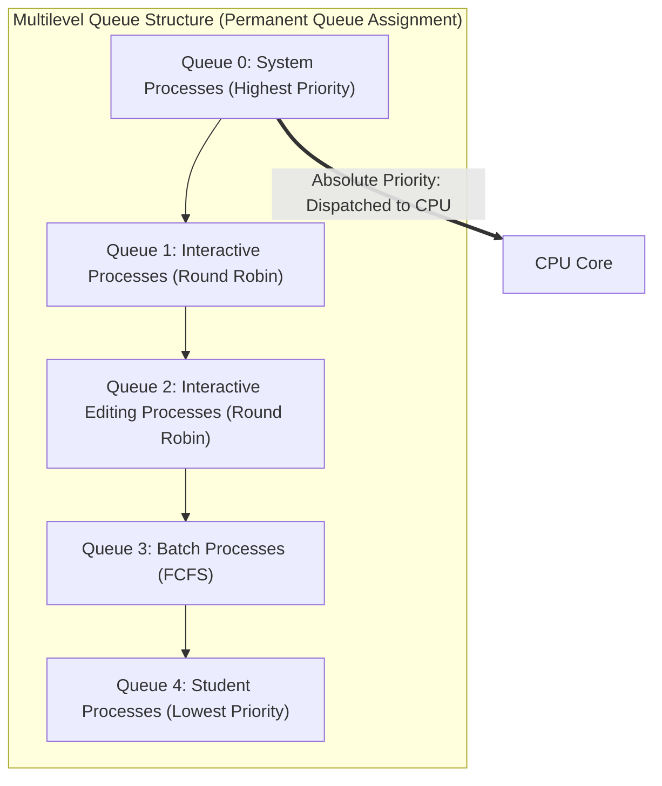
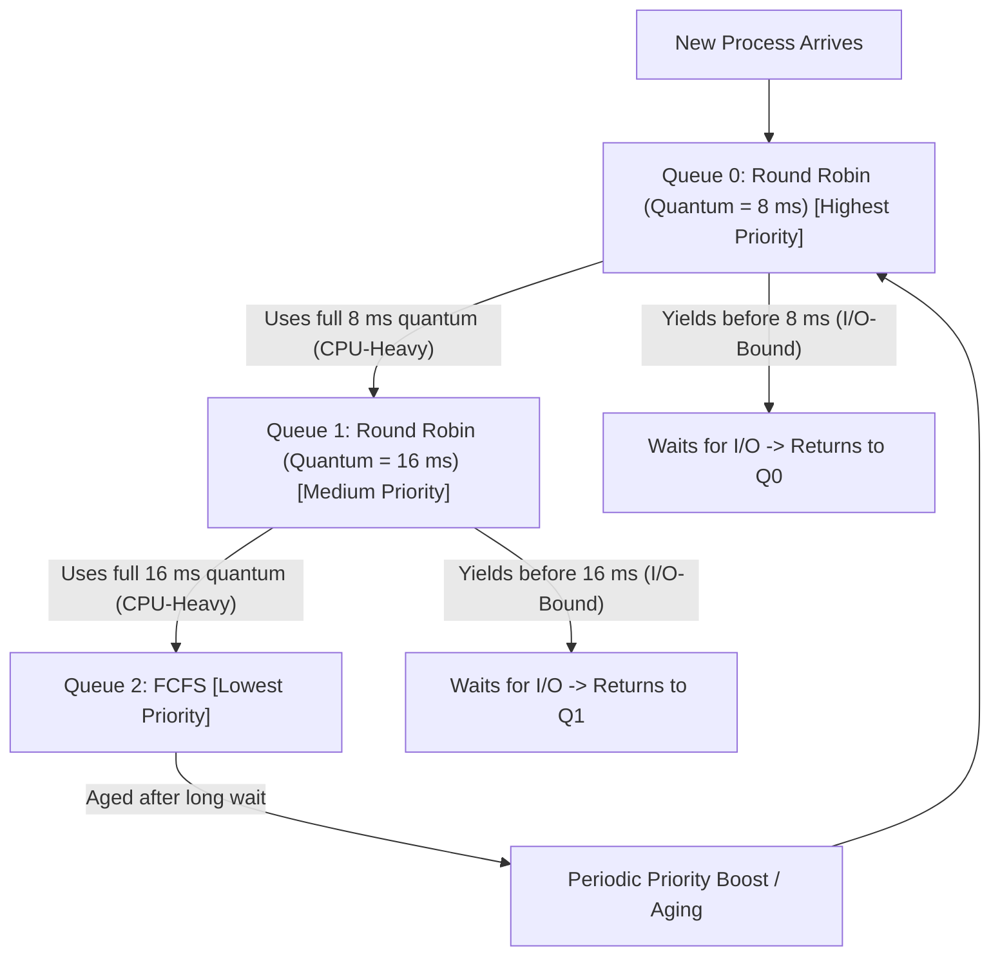

[OS Index](../README.md) / [Unit 1: OS Architecture](Introduction.md)

---

In the previous two lectures, we analyzed four classic scheduling algorithms: First-Come First-Served, Shortest-Job-First (and SRTF), Priority Scheduling, and Round Robin.

Notice that every single one of those algorithms applied a **single, uniform selection rule** across the entire Ready Queue:
- FCFS treated every process as a first-in line item.
- SJF treated every process as a burst-duration race.
- Round Robin treated every process as an identical time-share client.

In a real operating system, **processes are fundamentally different from one another**, and applying one rule to all of them is inherently flawed:
- An interactive text editor or UI compositor requires immediate CPU attention (within milliseconds of a keypress or mouse movement) but only needs to compute for a fraction of a millisecond before waiting for the next user event.
- A background scientific simulation, database indexer, or video encoder requires billions of CPU cycles and does not care if it waits an extra 50 milliseconds to run, but would suffer massive slowdown if repeatedly chopped into 10 ms slices with thousands of context-switch overheads.

If you use Round Robin with a 10 ms quantum for everything, interactive apps are snappy, but background batch jobs suffer severe context-switching overhead. If you use FCFS or a huge quantum, batch jobs run efficiently, but interactive apps become horribly laggy whenever a heavy computation starts.

The solution is simple: **stop using a single Ready Queue**.

Instead, we partition the Ready Queue into multiple distinct queues, leading to **Multilevel Queue (MLQ)** and **Multilevel Feedback Queue (MLFQ)** scheduling.

---

## Multilevel Queue (MLQ) Scheduling

The core idea of **Multilevel Queue (MLQ)** scheduling is to split the Ready Queue into separate, specialized queues based on process characteristics:

### 1. Permanent Queue Assignment
In standard MLQ scheduling, **processes are permanently assigned to one queue upon entry** based on intrinsic properties such as:
- Memory footprint
- Process type (system, interactive foreground, or background batch)
- User privilege level

A batch job enters the batch queue and remains in the batch queue until it dies. An interactive process enters the interactive queue and never leaves it.

### 2. Intra-Queue Scheduling (Within Each Queue)
Each individual queue runs whatever scheduling algorithm best matches the nature of its processes:
- **Foreground (Interactive) Queue:** Uses **Round Robin (RR)** with a small time quantum (e.g., $10\text{ ms}$) to guarantee snappy response times for user inputs.
- **Background (Batch) Queue:** Uses **First-Come, First-Served (FCFS)** because batch jobs require high throughput and minimal context-switch overhead rather than rapid responsiveness.

### 3. Inter-Queue Scheduling (Between the Queues)
Once each queue has its own internal scheduling rule, the operating system must answer a higher-level question: **Which queue gets the CPU core?**

Operating systems implement inter-queue scheduling using one of two strategies:

#### Strategy A: Fixed-Priority Preemptive Scheduling (Absolute Priority)
- The queues are ranked in strict hierarchical order: $\text{Queue } 0 > \text{Queue } 1 > \text{Queue } 2 > \dots$
- **No process in a lower-priority queue can run unless all higher-priority queues are completely empty!**
- If a batch process in Queue 3 is currently running and an interactive event occurs that places a process into Queue 1, the running batch process is **immediately preempted**, and the CPU is handed to Queue 1.
- **The Fatal Flaw: Starvation!** If users are actively clicking and typing, the interactive queues will remain constantly populated. The background batch queues will suffer indefinite starvation and may never execute.

#### Strategy B: Time-Slicing Between Queues
- To prevent starvation, the CPU time is divided proportionally among the queues:
  - For example, **80%** of total CPU cycles are allocated to the Foreground (Round Robin) queue.
  - **20%** of total CPU cycles are allocated to the Background (FCFS) queue.
- Within its 80% time share, the foreground queue runs Round Robin. Within its 20% share, the background queue runs FCFS.
- Batch jobs are guaranteed to make steady forward progress, and interactive jobs still receive the vast majority of CPU attention.

---

## The Major Inflexibility of Multilevel Queues

While Multilevel Queue scheduling is computationally cheap to implement, it has a glaring real-world defect: **inflexibility**.

Processes are not static entities:
- A program may begin as an interactive GUI (prompting the user for configuration options), then transition into a heavy 30-minute CPU-bound data compression phase, and finally return to being an interactive UI displaying results.
- In a pure MLQ system, because queue assignment is permanent, there is no way for the OS to adjust its scheduling if a process changes its personality.
- Furthermore, if a process is misclassified upon launch, it is stuck in the wrong tier for its entire lifetime.

To solve this, we need a scheduler that can **observe what a process is actually doing** and dynamically move it between queues.

---

## Multilevel Feedback Queue (MLFQ) Scheduling

**Multilevel Feedback Queue (MLFQ)** is the most sophisticated CPU scheduling architecture in modern operating system design.

In an MLFQ system:
> **Processes are NOT permanently assigned to a queue. Instead, processes move dynamically between queues based on their observed runtime behavior.**

### The Philosophical Principle Behind MLFQ
MLFQ implements the ultimate operational heuristic:
1. **Give every new process the benefit of the doubt.** Assume every incoming process is an interactive, short-burst task. Give it the highest priority and a small time quantum.
2. **If it proves itself to be CPU-heavy, demote it.** If the process consumes its entire time quantum without voluntarily yielding for I/O, it has revealed its true nature as a long CPU-bound computation. Move it down to a lower-priority queue with a larger quantum.
3. **If it yields the CPU quickly, keep it at high priority.** If a process executes for only 2 ms and yields for a disk or keyboard operation, it has proven itself to be interactive. Keep it in the top tier so it stays responsive.

By using runtime history as **feedback**, the operating system automatically separates I/O-bound interactive processes from CPU-bound background processes without requiring the user or programmer to specify anything!

---

## The Classic Three-Queue MLFQ Architecture

Let's examine the textbook, exam-standard three-queue MLFQ configuration:

| Queue | Algorithm | Time Quantum | Typical Inhabitants |
| :---: | :---: | :---: | :--- |
| **$Q_0$ (Top)** | Round Robin | **8 ms** | Brand new processes, highly interactive UI/I/O tasks |
| **$Q_1$ (Middle)** | Round Robin | **16 ms** | Moderately compute-intensive tasks |
| **$Q_2$ (Bottom)** | FCFS | **$\infty$ (Runs to completion)** | Long, heavy CPU-bound batch computations |

### Tracing a Process Through the Three Tiers:

1. **Arrival:** When a new process enters the Ready state, it is placed into $Q_0$.
2. **Execution in $Q_0$:**
   - The process is given up to **8 ms** of CPU time.
   - *Case 1 (Interactive):* The process computes for 3 ms and issues a `read()` system call. It enters the Waiting state. When its I/O finishes, it is placed back into **$Q_0$**. It gets immediate CPU attention whenever it has work to do.
   - *Case 2 (Compute-Heavy):* The process computes for the full 8 ms without yielding. The hardware timer fires! The OS kernel preempts the process and **demotes it to the tail of $Q_1$**.
3. **Execution in $Q_1$:**
   - The process can only run if $Q_0$ is completely empty!
   - When dispatched, it is granted a larger time quantum of **16 ms**.
   - If it yields before 16 ms, it stays in $Q_1$.
   - If it exhausts all 16 ms without yielding, it is **demoted to $Q_2$**.
4. **Execution in $Q_2$:**
   - The process can only run if **both $Q_0$ and $Q_1$ are empty**.
   - In $Q_2$, it is scheduled using standard **FCFS**. It runs for as long as it needs, without arbitrary timer preemptions, achieving maximum computational throughput.

### Why Does the Quantum Double as Priority Falls?
Notice the deliberate pattern in quantum sizes: **$8\text{ ms} \rightarrow 16\text{ ms} \rightarrow \text{FCFS}$**.

This design addresses both scheduling goals simultaneously:
- **Top queues prioritize latency (response time):** Quanta are short so newly arrived interactive tasks get onto the CPU within milliseconds.
- **Bottom queues prioritize efficiency (throughput):** Compute-heavy tasks need hours of execution. Chopping a 1-hour job into 8 ms slices forces hundreds of thousands of useless context switches, polluting CPU caches. Giving bottom queues large quanta or FCFS minimizes switching overhead and maximizes raw computational efficiency.

---

## The Five Defining Parameters of an MLFQ

In general, a Multilevel Feedback Queue scheduler is completely specified by five core parameters:

1. **The number of queues** (e.g., 3 queues, or 32 queues in Windows).
2. **The scheduling algorithm for each queue** (e.g., RR for upper levels, FCFS for lowest).
3. **The upgrade method:** The exact rules used to determine when a process should be promoted to a higher-priority queue (e.g., aging criteria).
4. **The demotion method:** The exact rules used to determine when a process should be demoted to a lower-priority queue (e.g., exhausting full time quantum).
5. **The entry method:** The rule determining which queue a process enters when it first requests service (typically $Q_0$).

Because of these five parameters, MLFQ is considered the **most general and configurable** CPU scheduling framework. It can be configured to mimic FCFS, SJF, Priority, or Round Robin simply by tuning these rules.

---

## Preventing Starvation: The Priority Boost (Aging in MLFQ)

Because an MLFQ uses absolute priority between queues, it is naturally vulnerable to **starvation**.

If a machine is flooded with a continuous stream of short, interactive processes entering $Q_0$, the processes sitting in $Q_1$ and $Q_2$ will **never run**.

To prevent starvation, operating systems incorporate a periodic **Priority Boost** (Aging):

### How Priority Boosting Works:
- A global system timer wakes up every $S$ seconds (e.g., every 1 or 2 seconds).
- The kernel takes **all processes** currently sitting in lower queues ($Q_1$ and $Q_2$) and **moves them all up to $Q_0$**!
- This simple rule achieves two critical objectives:
  1. **Guarantees no starvation:** Every process, no matter how compute-heavy, is periodically promoted to the top queue and guaranteed CPU time.
  2. **Self-corrects behavior changes:** If a batch job finishes its computation and transitions into an interactive user-facing mode, the priority boost allows it to live in $Q_0$ and receive snappy interactive response times.

---

## Multilevel Queue (MLQ) vs. Multilevel Feedback Queue (MLFQ)

| Feature | Multilevel Queue (MLQ) | Multilevel Feedback Queue (MLFQ) |
| :--- | :--- | :--- |
| **Queue Assignment** | **Permanent** (set at process creation) | **Dynamic** (moves between queues) |
| **Assignment Basis** | Static attributes (memory size, job type) | **Observed runtime behavior** (CPU burst length) |
| **Adaptability** | None; cannot adjust to changing workloads | **High**; automatically detects I/O vs CPU bound |
| **Aging / Starvation Fix**| Difficult; cannot promote across queues | **Built-in** via upward priority boosts |
| **Complexity & Overhead**| Low complexity; very fast | Higher complexity; must track per-process runtime |
| **Real-World Usage** | Rare in isolation | Standard foundation of modern general OSs |

---

## The Complete Picture: Summary of All Six Unit 1 Schedulers

| Algorithm | Preemptive? | Selection Basis | Ideal For | Primary Defect | Starvation Possible? |
| :--- | :---: | :--- | :--- | :--- | :---: |
| **FCFS** | No | Arrival order (FIFO) | Batch processing, simple queues | **Convoy Effect** | **No** |
| **SJF** | No | Shortest next CPU burst | Minimizing average waiting time | Unknowable future burst length | **Yes** |
| **SRTF** | Yes | Shortest remaining burst | Minimizing average wait with arrivals| High context switch overhead | **Yes** |
| **Priority** | Either | Assigned integer priority | System policies, critical tasks | Low-priority indefinite blocking | **Yes** (fixed by Aging) |
| **Round Robin**| Yes | Circular queue, time slice $q$ | Interactive time-sharing systems | Turnaround time sensitive to $q$ | **No** (bound: $(n-1)q$) |
| **MLFQ** | Yes | Multiple queues + feedback | General-purpose computing systems | Complex; 5 parameters to tune | **No** (fixed by Boost) |

---

## Key Takeaways

- Real-world workloads consist of a mix of interactive tasks and batch tasks that cannot be served well by a single uniform scheduling algorithm.
- **Multilevel Queue (MLQ)** partitions the Ready Queue into separate static queues. Processes are permanently assigned to one queue, and each queue runs its own scheduling algorithm.
- Inter-queue scheduling in MLQ can be **Fixed Priority** (absolute priority, prone to starvation) or **Time-Sliced** (e.g., 80% to foreground, 20% to background).
- **Multilevel Feedback Queue (MLFQ)** allows processes to move dynamically between queues based on their past execution history.
- In a classic three-queue MLFQ ($Q_0, Q_1, Q_2$), new processes start in $Q_0$ (small quantum). If they use their full quantum, they are demoted downward. If they yield for I/O, they stay in the top queue.
- Time quantum sizes **increase as priority drops** ($8\text{ ms} \rightarrow 16\text{ ms} \rightarrow \text{FCFS}$) to balance interactive latency against batch computation throughput.
- MLFQ is defined by five parameters: number of queues, per-queue algorithms, upgrade criteria, demotion criteria, and initial entry queue.
- Starvation in MLFQ is eliminated through periodic **Priority Boosting** (moving all waiting processes back to $Q_0$).

---

Now that we have covered the theoretical and algorithmic foundations of process creation, control, and CPU scheduling, how does a user or system administrator actually interact with these processes in practice?

How do command shells like Bash parse user instructions, manage background tasks, and automate recurring system operations?

That brings us to the command line, scripting, and task automation in [**Lecture 8: Bash Shell and cron**](L08%20-%20Bash%20Shell%20and%20cron.md).
