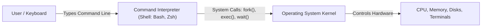
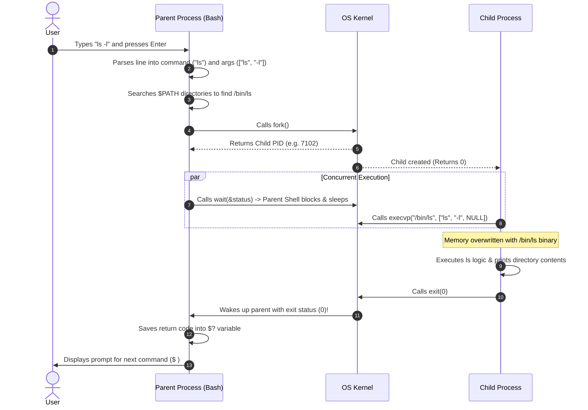
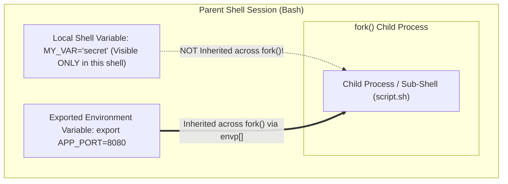
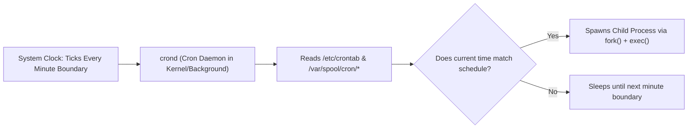

[OS Index](../README.md) / [Unit 1: OS Architecture](Introduction.md)

---

In the first seven lectures, we examined how the operating system operates internally: how hardware communicates via interrupts, how the kernel protects itself through dual-mode execution, how processes are created and tracked in memory, and how schedulers allocate CPU bursts.

Now we pivot to the user's side of the glass: **how does a human or automated script actually control these processes?**

In Unix-like systems, you interact with the operating system through the **Command-Line Shell**. And when you need tasks to run unattended at recurring intervals, you delegate them to the **cron** scheduling daemon.

What makes this topic essential is not just learning syntax—it is seeing how the operating system primitives we studied earlier come alive. Every command you type in a shell is a live demonstration of `fork()`, `exec()`, and `wait()`.

---

## What is a Shell?

A **shell** is a command-line interpreter that provides an interface between the human user and the operating system kernel.



Look back at the layered architecture of OS services from Lecture 3. Notice where the command line sits: **entirely above the system call barrier, in user space**.

The shell is **not** part of the kernel! It is an ordinary user-mode system program (`/bin/bash`). It has no special hardware privileges. Anyone can write their own shell in C by combining standard POSIX system calls.

### What Actually Happens When You Type a Command?
Whenever you type a command (such as `ls -l`) and press Enter, the shell executes the classic process management loop:



Look at how our earlier theory connects:
- **Foreground Execution:** When you run `ls -l`, the shell calls `wait()`, suspending itself until the child finishes.
- **Background Execution:** When you append an ampersand (`&`) to a command (e.g., `sleep 10 &`), the shell simply **omits the `wait()` call**! The child runs concurrently in the background, and the shell immediately prints the next prompt.

---

## The Unix Shell Family

Multiple shells have been developed throughout Unix history, differing in scripting syntax and interactive features:

| Shell Name | Binary Path | Created By | Characteristics |
| :--- | :--- | :--- | :--- |
| **sh (Bourne Shell)** | `/bin/sh` | Steve Bourne (AT&T Bell Labs, 1979) | The classic, lightweight original Unix shell. The baseline POSIX scripting standard. |
| **csh / tcsh (C Shell)** | `/bin/csh` | Bill Joy (UC Berkeley) | Uses C-like programming syntax (for, while, if). Popular in early BSD Unix. |
| **ksh (Korn Shell)** | `/bin/ksh` | David Korn (Bell Labs) | Combines Bourne shell syntax with advanced interactive C shell features. |
| **bash (Bourne-Again Shell)** | `/bin/bash` | Brian Fox & Chet Ramey (GNU Project) | The default interactive shell on almost all Linux distributions. Fully backward compatible with `sh`. |
| **zsh (Z Shell)** | `/bin/zsh` | Paul Falstad | Highly customizable shell with advanced auto-completion, now the default shell on modern macOS. |

To check which shell you are currently using, inspect the shell variable:
```bash
echo $SHELL
# Output: /bin/bash
```

---

## How the Shell Finds Commands: The `$PATH` Variable

When you type `ls`, `gcc`, or `python3`, how does the shell know where the corresponding executable binary lives on disk?

It searches the directories listed in the **`$PATH`** environment variable:

```bash
echo $PATH
# Output: /usr/local/bin:/usr/bin:/bin:/usr/games
```

`$PATH` is a **colon-separated list of directories**. 

When a command is entered without an explicit path:
1. The shell checks `/usr/local/bin/ls`. If not found:
2. It checks `/usr/bin/ls`. If found, it stops searching and executes it!
3. If it scans every directory in `$PATH` and finds no matching file, it prints the familiar error: `command not found`.

If an executable is in your current working directory, Linux intentionally does **not** search the current directory for security reasons. You must specify its relative path explicitly: `./my_program`.

---

## Shell Variables vs. Environment Variables

Variables in the shell fall into two distinct scopes:



### 1. Shell Variables (Local Variables)
- Defined exclusively within the current running shell instance.
- **Child processes created by this shell CANNOT see them.**
- Syntax: `VARIABLE_NAME=value`

> **Critical Syntax Rule:** You must **never** place spaces around the `=` sign!
> - `NAME=Alice` $\rightarrow$ Correct! Assigns `"Alice"` to `NAME`.
> - `NAME = Alice` $\rightarrow$ **Syntax Error!** The shell interprets `NAME` as an executable command, with `=` and `Alice` as its arguments.

### 2. Environment Variables (Global Variables)
- Defined in the current shell and **automatically inherited by all child processes** created via `fork()`.
- When `fork()` duplicates the parent and `exec()` runs a child program, the kernel passes the environment variable array (`char *envp[]`) down to the new program.
- Created using the **`export`** built-in command:

```bash
# Define a local variable
COURSE="OS"

# Make it an environment variable inherited by all children
export COURSE="OS"

# Or in a single step
export API_KEY="xyz123"
```

### Managing Variables
- **`env`** or **`printenv`**: Lists all exported environment variables.
- **`set`**: Lists all variables (both local shell variables and exported environment variables).
- **`unset VARIABLE_NAME`**: Deletes a variable from the shell session.

### The Sub-Shell Trap: Running Scripts vs. Sourcing Scripts
When you execute a shell script as `./myscript.sh`:
- The shell calls `fork()` to create a child shell process.
- The child executes the script commands. Any `export` statements inside the script modify **only the child's environment**!
- When the script finishes, the child terminates, and all its exported variables vanish.

To execute a script within the **current shell's memory space** (persisting its variables), you must **source** it:
```bash
# Method 1: using the 'source' command
source setup_env.sh

# Method 2: using the '.' shorthand
. setup_env.sh
```

---

## Essential Special Shell Variables

Bash provides several built-in read-only variables that expose process metadata:

| Special Variable | Meaning | Underlying OS Concept |
| :---: | :--- | :--- |
| **`$?`** | Exit status code of the last executed command (`0` = success, non-zero = error) | Exit status returned by `wait()` from `exit(status)` |
| **`$$`** | Process ID (PID) of the current shell process | `getpid()` |
| **`$!`** | Process ID (PID) of the most recently executed background job | Child PID returned by `fork()` |
| **`$0`** | Name of the shell script or binary currently running | `argv[0]` |
| **`$1`, `$2`, ...** | First, second, etc., command-line argument passed to the script | `argv[1]`, `argv[2]` |
| **`$#`** | Total number of command-line arguments passed | `argc - 1` |
| **`$*`** or **`$@`**| All command-line arguments combined as a string or array | Full argument vector |

---

## Bash Control Flow

Shell scripts are full-fledged programs capable of sophisticated decision making and iteration.

### 1. Conditional Logic: `if-then-else`

```bash
if [ condition ]; then
    # Commands executed if condition evaluates to true
elif [ another_condition ]; then
    # Commands executed if another_condition is true
else
    # Default commands
fi
```

> **Syntax Rule:** The spaces around brackets `[ condition ]` are **mandatory**! 
> In Unix, `[` is not punctuation—it is an actual executable binary program (`/usr/bin/[`, an alias for `test`). If you write `[condition]`, bash looks for a non-existent command named `[condition`.

#### Common Test Operators:

- **File Tests:**
  - `-f file`: True if `file` exists and is a regular file.
  - `-d file`: True if `file` exists and is a directory.
  - `-e file`: True if `file` exists.
  - `-r file`: True if `file` is readable.
  - `-w file`: True if `file` is writable.
  - `-x file`: True if `file` is executable.
- **String Comparisons:**
  - `"$str1" = "$str2"`: Strings are equal.
  - `"$str1" != "$str2"`: Strings are not equal.
  - `-z "$str"`: String is null/empty (length is zero).
  - `-n "$str"`: String is not empty.
- **Integer Comparisons:**
  - `-eq`: Equal to (`$a -eq $b`)
  - `-ne`: Not equal to
  - `-lt`: Less than
  - `-le`: Less than or equal to
  - `-gt`: Greater than
  - `-ge`: Greater than or equal to

#### Script Example: Checking File Existence
```bash
#!/bin/bash

FILENAME="data.txt"

if [ -f "$FILENAME" ]; then
    echo "File $FILENAME exists and is a regular file."
else
    echo "File $FILENAME does not exist. Creating it now..."
    touch "$FILENAME"
fi
```

---

### 2. Loops: `for` and `while`

#### Standard `for-in` Loop:
```bash
#!/bin/bash
for item in apple banana orange; do
    echo "Fruit: $item"
done
```

#### C-Style `for` Loop:
```bash
#!/bin/bash
for ((i = 1; i <= 5; i++)); do
    echo "Counter: $i"
done
```

#### Loop Control: `break` and `continue`
- **`continue`**: Immediately skips the remainder of the current iteration and jumps to the next evaluation.
- **`break`**: Immediately exits the loop entirely. In nested loops, `break 2` terminates two levels of enclosing loops.

```bash
#!/bin/bash
for i in 1 2 3 4 5; do
    if [ $i -eq 2 ]; then
        continue  # Skips printing 2
    fi
    if [ $i -eq 4 ]; then
        break     # Terminates loop before printing 4
    fi
    echo "Value: $i"
done
# Output will print:
# Value: 1
# Value: 3
```

---

## Background Daemons and Task Automation: `cron`

Now we turn to scheduling tasks without human intervention.

### What is a Daemon?
A **daemon** is an unattended system process that runs continuously in the background, waking up periodically to service requests or system events.
- By convention, daemon program names end with the letter **`d`**:
  - `systemd`: System and service manager (PID 1).
  - `sshd`: Secure Shell daemon (listens for remote network connections).
  - `crond`: The job-scheduling clock daemon.
- Daemons have no controlling terminal attached (`tty = ?`) and are spawned by `init`/`systemd` during system bootstrapping.

---

## What is `cron`?

**`cron`** is the standard time-based job scheduling daemon in Unix-like operating systems.

The background daemon process (`crond` or `cron`) wakes up once **every minute**, inspects configuration tables called **crontabs**, and automatically executes any jobs whose scheduled date and time match the current clock.



### Managing Crontab Files
Users configure automated tasks using the **`crontab`** command:

- **`crontab -l`**: Lists all active cron jobs for the current user.
- **`crontab -e`**: Opens the user's crontab file in the default text editor (`nano` or `vim`) to add or edit jobs.
- **`crontab -r`**: Removes the user's crontab entirely.
- **`systemctl status cron`**: Verifies whether the background cron daemon service is active and running.

---

## The Crontab Syntax: The Five-Field Time Format

Every cron job is written on a single line consisting of **five time/date fields** followed by the command to execute:

```
*     *     *     *     *     command_to_execute
┬     ┬     ┬     ┬     ┬
│     │     │     │     │
│     │     │     │     └───── Day of Week (0 - 6, where 0 = Sunday, 6 = Saturday)
│     │     │     └─────────── Month (1 - 12)
│     │     └───────────────── Day of Month (1 - 31)
│     └─────────────────────── Hour (0 - 23, 24-hour military clock)
└───────────────────────────── Minute (0 - 59)
```

### Special Syntax Characters:
- **`*` (Asterisk):** Wildcard meaning *"every possible value"*. (e.g., `*` in the minute field means *"run every minute"*).
- **`,` (Comma):** Specifies a discrete list of values. (e.g., `1,15,30` in the minute field means *"at minute 1, minute 15, and minute 30"*).
- **`-` (Hyphen):** Specifies an inclusive range. (e.g., `1-5` in the day-of-week field means *"Monday through Friday"*).
- **`/` (Slash):** Specifies step values. (e.g., `*/15` in the minute field means *"every 15 minutes"*).

---

## Concrete Crontab Examples

| Crontab Entry | Explanation |
| :--- | :--- |
| `* * * * * /home/user/script.sh` | Runs the script **every single minute**, every hour, every day. |
| `30 2 * * * /backup/backup.sh` | Runs at **02:30 AM every single day**. |
| `0 8 * * 1 /report/gen_metrics.sh` | Runs at **08:00 AM every Monday** (`1 = Monday`). |
| `0 0 1,15 * * /cleanup/purge.sh` | Runs at **midnight on the 1st and 15th** of every month. |
| `*/10 9-17 * * 1-5 /monitor/health.sh` | Runs **every 10 minutes** during working hours (**9 AM to 5 PM**), **Monday through Friday**. |

---

## The Two Critical Pitfalls of Cron Jobs

Students and administrators often write a cron job that runs perfectly when tested in an interactive terminal, but fails completely under `cron`. Why?

Because of two fundamental operating system differences:

### 1. Minimal Environment and `$PATH` Stripping
When you log in interactively, your shell reads `.bashrc` and `.profile`, configuring a rich `$PATH` containing `/home/user/.local/bin`, `/opt/bin`, and custom aliases.

**A cron job does NOT run inside an interactive login shell!**
- The cron daemon launches the job with a bare-bones environment where `$PATH` is often restricted strictly to `/usr/bin:/bin`.
- If your script calls `python3`, `node`, or a custom binary that lives in `/usr/local/bin`, the cron job will crash with `command not found`!

**The Solution:** Always use **absolute paths** for every command and file inside a cron job:
```bash
# Good practice: Explicit absolute paths
0 3 * * * /usr/bin/python3 /home/user/scripts/backup.py
```

### 2. No Controlling Terminal (I/O Redirection)
When a program prints output (`printf`) or encounters an error, it writes to standard output (`stdout`, file descriptor 1) or standard error (`stderr`, file descriptor 2).

Because cron runs as an unattended background daemon, **there is no terminal attached to receive this output!**
- If you do not redirect output, the system will attempt to send local email to the user mailbox or silently discard errors.

**The Solution:** Explicitly redirect both `stdout` and `stderr` to a log file:
```bash
* * * * * /home/user/monitor.sh >> /home/user/monitor.log 2>&1
```
- `>> /home/user/monitor.log`: Appends standard output (`stdout`) to the file.
- `2>&1`: Redirects standard error (`stderr`, descriptor 2) into standard output (descriptor 1), capturing both normal outputs and error messages into the log.

---

## How Unit 1 Concepts Connect to the Shell

| Practical Shell Syntax | Underlying Operating System Concept |
| :--- | :--- |
| Typing any command (`ls`) | `fork()` + `exec()` + `wait()` process lifecycle (Lecture 4) |
| Running with `&` (`sleep 10 &`) | Parent and child concurrent execution option (Lecture 4) |
| `export VAR=val` | Inheriting environment variables across `fork()` into `envp[]` |
| `$?` | Process exit status passed to `exit(code)` and reaped by `wait(&status)` |
| `$$` | Process ID returned by `getpid()` |
| `crond` daemon | Background system process spawned at boot by PID 1 |
| Five-field cron scheduling | Long-term batch job scheduling (Lecture 3 & 7) |

---

## Key Takeaways

- The **Shell** is a user-mode command-line interpreter sitting above the system call barrier. It executes commands through the loop of `fork()`, `exec()`, and `wait()`.
- Adding **`&`** runs a command in the background by causing the parent shell to bypass the `wait()` call.
- The **`$PATH`** environment variable is a colon-separated list of directories searched sequentially to locate command binaries.
- **Shell variables** are local to the current shell; **environment variables** (created via `export`) are inherited by all child processes across `fork()`.
- Sourcing a script (`source file.sh` or `. file.sh`) runs instructions in the current shell context rather than spawning a child sub-shell, allowing variable changes to persist.
- A **Daemon** is an unattended background process without a terminal.
- **`cron`** is the time-based job scheduling daemon that wakes up every minute to execute tasks scheduled in **crontabs**.
- Crontabs use a five-field format: `Minute Hour Day-of-Month Month Day-of-Week command`.
- Cron jobs run in a minimal environment; always use **absolute file paths** and **redirect output** (`>> log.txt 2>&1`) to avoid execution failures.

---

This completes **Unit 1: Fundamentals of Operating Systems, Process Management, CPU Scheduling, and Shell Automation**.

We have established the complete lifecycle of a single process: how it is born, how it requests services, how it is laid out in memory, and how it is scheduled on CPU cores.

In **Unit 2**, we examine what happens when multiple processes must cooperate:
- How do isolated processes communicate and exchange data?
- What are lightweight threads and concurrency models?
- What happens when multiple concurrent threads attempt to modify shared variables at the exact same time, and how do mutexes, semaphores, and synchronization hardware prevent race conditions and deadlocks?

That brings us to [**Unit 2: Inter-Process Communication, Threads, Concurrency, and Synchronization**](../Unit%202/Introduction.md).
