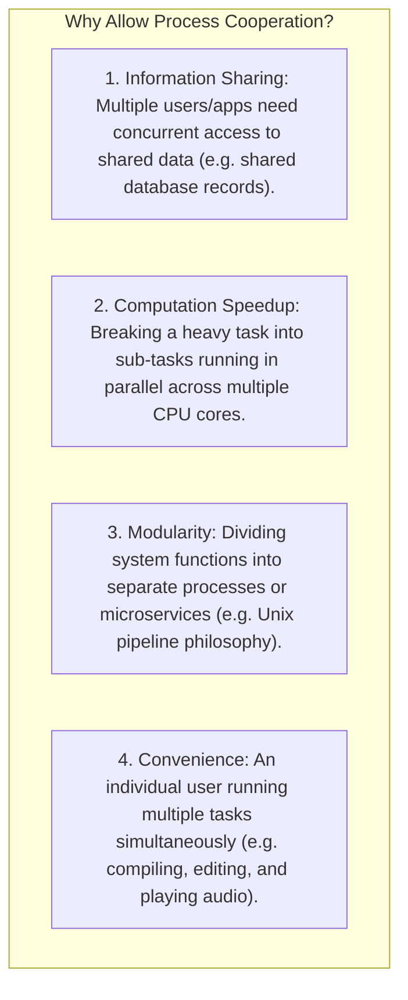
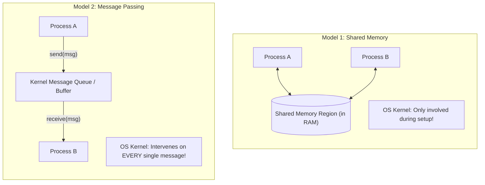
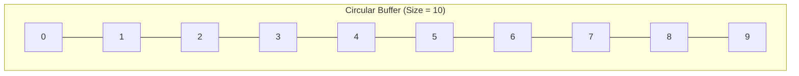
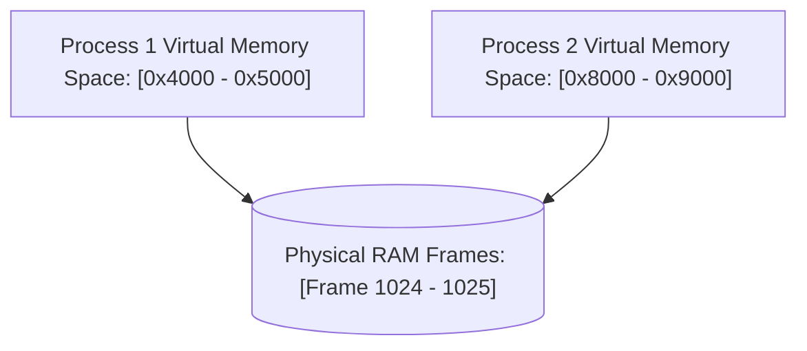
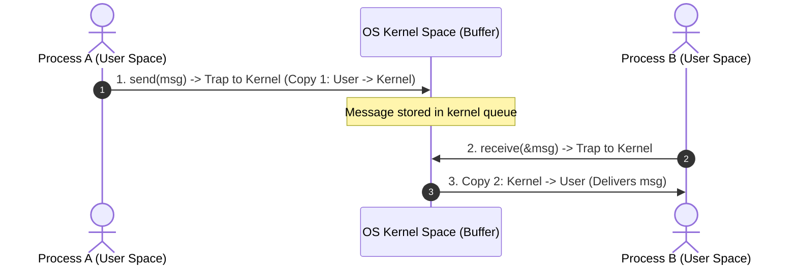
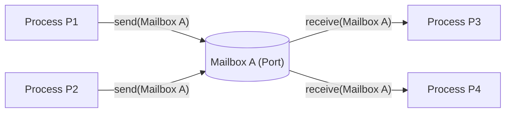
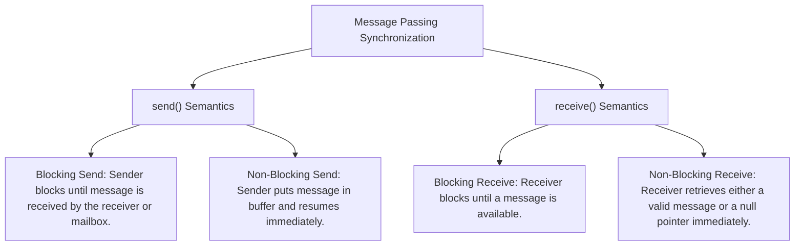
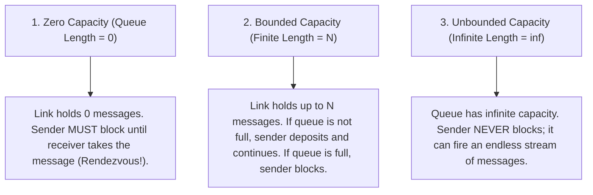

[OS Index](../README.md) / [Unit 2: Concurrency & Deadlocks](Introduction.md)

---

In Unit 1, we treated every process as an isolated island. Each had its own private virtual address space, its own stack, its own heap, and its own Process Control Block. The operating system went to great lengths—using hardware base/limit registers and page tables—to enforce strict memory boundaries so that one process could never touch the memory of another.

That isolation is essential for security and stability. But if processes were *completely* isolated, modern computing would collapse.

Think about everyday software:
- A web server accepts an incoming network request, but passes the data to worker processes to generate HTML.
- A database engine runs background threads to flush dirty cache pages to disk while foreground processes execute queries.
- A shell pipeline like `cat file.txt | grep "error" | wc -l` chains three independent programs together, passing data fluidly from left to right.

To build modular, fast, and responsive software, processes must be able to cooperate. And to cooperate, they need **Inter-Process Communication (IPC)**.

In this lecture, we examine why processes cooperate, the two foundational communication models—**Shared Memory** and **Message Passing**—and the synchronization mechanics that govern them.

---

## Independent vs. Cooperating Processes

Operating systems categorize concurrent processes into two classes based on whether they can affect or be affected by other processes:

1. **Independent Processes:**
   - A process that cannot affect or be affected by any other process executing in the system.
   - It shares no memory, no state, and no data with other processes.
   - Its execution is completely deterministic: given the same input, it will always produce the exact same output regardless of what else is running.
2. **Cooperating Processes:**
   - A process that can affect or be affected by other processes executing in the system.
   - Any process that shares data with other processes is, by definition, a cooperating process.



To enable cooperation, the operating system must provide an **Inter-Process Communication (IPC)** mechanism.

---

## The Two Fundamental IPC Models

Every IPC mechanism ever designed in computer science is built on one of two fundamental models:



Look at the structural difference between them:

- In **Shared Memory**, the operating system sets up a region of physical RAM that is mapped simultaneously into the address spaces of both Process A and Process B. Once this mapping is established, the OS steps completely out of the way. Both processes read and write to the shared memory region at raw hardware memory speeds.
- In **Message Passing**, processes share no common memory. When Process A wants to send data to Process B, it must wrap the data in a message packet and make a system call (`send()`). The kernel intercepts the call, copies the data into a kernel-space buffer, and delivers it to Process B when Process B makes a `receive()` system call.

---

## The Producer-Consumer Paradigm

To study communication models rigorously, computer science uses a canonical design pattern: the **Producer-Consumer Problem**.

- A **Producer** process produces information that is consumed by a **Consumer** process.
- Examples are everywhere:
  - A compiler produces assembly code; the assembler consumes it.
  - A web server produces HTML packets; a web browser consumes them.
  - In a shell pipeline `ps -ef | grep bash`, `ps` is the producer; `grep` is the consumer.

To allow the producer and consumer to run concurrently at different speeds, they communicate through a **Buffer**:


Buffers come in two varieties:
1. **Unbounded Buffer:** The buffer has infinite capacity. The producer can always produce new items without ever stopping. The consumer only waits if the buffer is completely empty. (A mathematical idealization).
2. **Bounded Buffer:** The buffer has a fixed, finite capacity ($N$ items). The consumer must wait if the buffer is **empty**; the producer must wait if the buffer is **full**. Every real-world system uses bounded buffers.

---

## Shared Memory: The Bounded-Buffer Implementation

Let's see how a bounded buffer is implemented in shared memory using a circular array:

```c
#define BUFFER_SIZE 10

typedef struct {
    // Arbitrary item payload data
    char data[256];
} item;

// Shared memory segment accessible by both Producer and Consumer
item buffer[BUFFER_SIZE];
int in = 0;   // Index where producer will place the next item
int out = 0;  // Index where consumer will pick the next item
```

The circular buffer wraps around using modulo arithmetic:



### The Empty and Full Conditions:
- **Buffer is Empty:** 
  $$\text{in} == \text{out}$$
  When both indices point to the exact same slot, no unconsumed items exist.
- **Buffer is Full:**
  $$((\text{in} + 1) \% \text{BUFFER\_SIZE}) == \text{out}$$
  If incrementing `in` by 1 wraps around to meet `out`, the buffer is considered full.

### Why Does This Scheme Waste Exactly One Slot?
Notice something subtle: the array has `BUFFER_SIZE` slots, but **it can only hold at most $\text{BUFFER\_SIZE} - 1$ items!**

Why? Because if we allowed all `BUFFER_SIZE` slots to be filled, `in` would wrap around and equal `out`. But `in == out` is our definition of an **empty** buffer! The code would have no way to distinguish between a completely empty buffer and a completely full buffer. 

By sacrificing one array slot, the ambiguity disappears.

### The Producer Code (Shared Memory):
```c
item next_produced;

while (1) {
    // 1. Produce an item in next_produced
    
    // 2. Busy-wait (spin) while the buffer is full
    while (((in + 1) % BUFFER_SIZE) == out)
        ; // Do nothing! Wait for consumer to free a slot

    // 3. Place item into the buffer
    buffer[in] = next_produced;
    
    // 4. Advance the producer index
    in = (in + 1) % BUFFER_SIZE;
}
```

### The Consumer Code (Shared Memory):
```c
item next_consumed;

while (1) {
    // 1. Busy-wait (spin) while the buffer is empty
    while (in == out)
        ; // Do nothing! Wait for producer to deposit an item

    // 2. Remove item from the buffer
    next_consumed = buffer[out];
    
    // 3. Advance the consumer index
    out = (out + 1) % BUFFER_SIZE;
    
    // 4. Consume the item in next_consumed
}
```

### Why This Solution is Lock-Free (for Single Producer / Single Consumer)
Look closely at the code above: **there are no locks, no mutexes, and no system calls!**

Why is this safe?
- The producer modifies **only `in`**. It reads `out`, but never writes to `out`.
- The consumer modifies **only `out`**. It reads `in`, but never writes to `in`.
- Since each process writes to a completely disjoint variable, they will not corrupt each other's pointers.

However, notice the busy-waiting loops (`while(...) ;`). If the buffer stays full or empty, the spinning process wastes 100% of a CPU core doing zero productive work. Furthermore, this code **breaks completely** if you add a second producer or a second consumer. (Solving that multi-party problem requires the synchronization primitives we study later in this unit).

---

## Deep Dive: Shared Memory Mechanics and Trade-offs

Shared memory is the **fastest possible form of IPC** in an operating system.

### How it Works Under the Hood:
Normally, the operating system forbids Process A from reading or writing memory pages allocated to Process B. If Process A tries to touch Process B's memory, the hardware MMU triggers a segmentation fault.

To establish shared memory:
1. Process A makes a system call (`shmget` in System V or `shm_open` in POSIX) requesting a shared memory segment.
2. The operating system kernel validates permissions and allocates physical memory frames.
3. Both processes call an attachment system call (`shmat` or `mmap`), which maps those **exact same physical memory frames into their respective virtual address spaces**.
4. Once attached, all reads and writes execute as normal CPU memory instructions (`MOV`). **The kernel is never consulted again!**



### Advantages and Disadvantages:
- **Advantage:** Unbeatable speed. Data is written directly to RAM without being copied into intermediate kernel buffers. Ideal for massive payloads (e.g., sharing a 4K video frame buffer between a camera driver and a machine learning model).
- **Disadvantage:** The operating system provides **zero synchronization**. If both processes write to the same byte simultaneously, data is corrupted. The programmer bears 100% of the burden of implementing locking and race-condition prevention.

---

## Deep Dive: Message Passing Mechanics

In the **Message Passing** model, processes communicate and synchronize their actions without sharing any address space.

The kernel provides a communication facility containing at least two basic primitives:
- **`send(message)`**
- **`receive(message)`**

When Process A sends a message to Process B:
1. Process A executes `send(B, msg)`. This triggers a trap to kernel mode.
2. The kernel copies the message from Process A's user space into a temporary **kernel buffer**.
3. Process B executes `receive(A, &msg)`. This triggers another trap to kernel mode.
4. The kernel copies the message from the kernel buffer into Process B's user space.



Notice the cost: every single message involves **two kernel mode transitions and two complete memory copies**. 

For tiny messages or distributed networks, this overhead is negligible. For gigabyte data transfers, it is devastatingly slow. However, message passing has an overwhelming advantage: **the kernel handles synchronization automatically**.

---

## Communication Links: Direct vs. Indirect Communication

For two processes $P$ and $Q$ to exchange messages, a **communication link** must exist between them. Link design splits into two primary naming architectures:

### 1. Direct Communication
Processes must explicitly name each other when sending or receiving:

- **Symmetric Addressing:** Both sender and receiver explicitly name each other:
  - `send(P, message)`: Send a message to process $P$.
  - `receive(Q, message)`: Receive a message from process $Q$.
- **Asymmetric Addressing:** Only the sender names the recipient; the receiver accepts from anyone:
  - `send(P, message)`: Send a message to process $P$.
  - `receive(&id, message)`: Receive a message from *any* process; the kernel sets `id` to the sender's PID.

#### Properties of Direct Links:
- A link is established automatically between every pair of processes that want to communicate; processes only need to know each other's identity.
- A link is associated with **exactly two processes**.
- Between any pair of processes, there exists **exactly one link**.

#### The Fatal Flaw of Direct Communication: Poor Modularity
Direct communication requires hard-coding process identifiers into source code. If a process crashes and restarts with a new PID, all communication links break! Changing the identity of one process requires inspecting and modifying the code of every other cooperating process.

---

### 2. Indirect Communication
To decouple processes, modern operating systems use **Indirect Communication**.

Messages are not sent directly to a process; they are sent to and received from intermediate storage locations called **Mailboxes** (or **Ports**):

- `send(A, message)`: Send a message to mailbox $A$.
- `receive(A, message)`: Receive a message from mailbox $A$.



#### Properties of Indirect Links:
- A link is established between two processes only if they share a common mailbox.
- A link can be associated with **more than two processes**.
- Between two processes, there can be **multiple different links** (each corresponding to a different mailbox).

#### The Mailbox Sharing Ambiguity:
Consider this scenario: Process $P_1$ sends a message to Mailbox $A$. Both Process $P_2$ and Process $P_3$ execute `receive(A, &msg)`. 

**Which process gets the message?**

The operating system must resolve this using one of three policies:
1. **Restrict the link:** Allow a mailbox to be associated with at most two processes (1 sender, 1 receiver).
2. **Enforce exclusivity:** Allow at most one process at a time to execute a `receive()` operation on the mailbox.
3. **System selection:** Allow any process to receive, but let the kernel arbitrate who gets the message (e.g., using Round Robin or selecting the highest-priority waiting process).

#### Mailbox Ownership:
- **Process-Owned Mailbox:** The mailbox is part of the address space of the process that created it. The owner can only receive; other processes can only send. When the owner process terminates, the mailbox is automatically destroyed.
- **OS-Owned Mailbox:** The mailbox is an independent kernel object. It has its own lifecycle independent of any single process. The OS provides system calls to:
  - Create a new mailbox (`create_mailbox()`).
  - Send messages to it (`send()`).
  - Receive messages from it (`receive()`).
  - Delete a mailbox (`destroy_mailbox()`).

---

## Message Passing Synchronization: Blocking vs. Non-Blocking

Communication between processes requires synchronization. The primitives `send()` and `receive()` can be implemented as either **blocking** (synchronous) or **non-blocking** (asynchronous):



### Rendezvous: The Pure Synchronization State
What happens when both `send()` and `receive()` are configured as **blocking**?

When a blocking sender meets a blocking receiver, we achieve a state called a **Rendezvous**:
- If the sender calls `send()` first, it halts and sleeps until the receiver calls `receive()`.
- If the receiver calls `receive()` first, it halts and sleeps until the sender calls `send()`.
- The moment both meet, the message is transferred directly from sender to receiver, and both resume execution simultaneously.
- No intermediate buffer is needed in a rendezvous!

---

## Buffering Capacities of Communication Links

Whether communication is direct or indirect, messages exchanged by processes reside in a temporary queue managed by the link. Such queues can be implemented with three buffering capacities:



### Buffering Scheme Summary

| Capacity Type | Queue Length | Sender Blocks When... | Receiver Blocks When... | Real-World Equivalent |
| :--- | :---: | :--- | :--- | :--- |
| **Zero Capacity** | $0$ | **Always** (Must wait for receiver to show up) | Queue is empty | **Rendezvous** (Ada rendezvous, CSP) |
| **Bounded Capacity** | $N$ | Queue is **Full** ($N$ items already queued) | Queue is **Empty** | **Unix Pipe** (64 KB buffer), POSIX Message Queue |
| **Unbounded Capacity**| $\infty$ | **Never** | Queue is **Empty** | Theoretical idealization (Memory is never truly infinite) |

Zero-capacity systems are referred to as having **no buffering**. Bounded and unbounded systems are referred to as having **automatic buffering** because the kernel supplies and manages the queue automatically without programmer intervention.

---

## Comparison Summary: Shared Memory vs. Message Passing

| Feature | Shared Memory | Message Passing |
| :--- | :--- | :--- |
| **Mechanism** | Shared physical memory region mapped into virtual address spaces | Kernel-mediated message queues and system calls |
| **Data Transfer Speed** | **Fastest** (Raw memory read/write instructions) | Slower (System calls + double memory copy) |
| **Kernel Involvement** | Only during initial setup and teardown | **Every single transaction** requires kernel intervention |
| **Payload Size** | Ideal for **large blocks of data** | Ideal for **small, infrequent messages** |
| **Synchronization** | **None provided by OS!** Programmer must build locks | **Built into the primitives** (blocking send/receive) |
| **Hardware Boundary** | Restricted to a **single machine** sharing physical RAM | Can span across networks to **distributed systems** |

---

## Key Takeaways

- Cooperating processes share state and need **Inter-Process Communication (IPC)** for information sharing, computation speedup, modularity, and convenience.
- The **Producer-Consumer Problem** models asynchronous communication. In a bounded buffer of size $N$, one slot is wasted ($N-1$ capacity) to cleanly differentiate between an empty buffer (`in == out`) and a full buffer (`(in + 1) % N == out`).
- **Shared Memory** maps the same physical RAM into multiple process address spaces. It provides the highest possible IPC speed, but leaves synchronization entirely up to the programmer.
- **Message Passing** moves data through kernel buffers via `send()` and `receive()`. It is slower due to kernel mode transitions and data copying, but provides built-in synchronization.
- **Direct communication** requires processes to explicitly name each other, resulting in brittle, tightly-coupled code.
- **Indirect communication** decouples processes by routing messages through intermediate **Mailboxes (Ports)**.
- When both `send()` and `receive()` are blocking, the system forms a **Rendezvous**.
- Link buffering is classified as **Zero Capacity** (sender always blocks; rendezvous), **Bounded Capacity** (sender blocks only when full), and **Unbounded Capacity** (sender never blocks).

---

Now that we understand the theoretical models of shared memory and message passing, how are they actually implemented in real code?

What are the specific POSIX and Unix system calls used to build shared memory regions, pipes, and message queues?

That brings us to the low-level API mechanics in [**Lecture 2: System Calls for IPC**](L02%20-%20System%20Calls%20for%20IPC.md).
