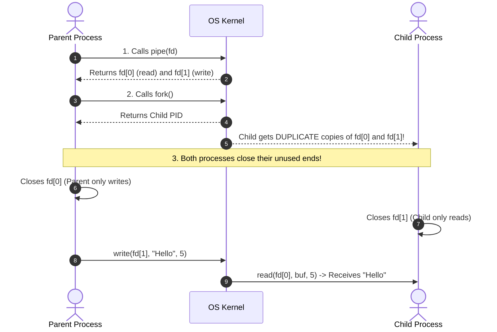
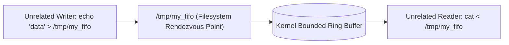
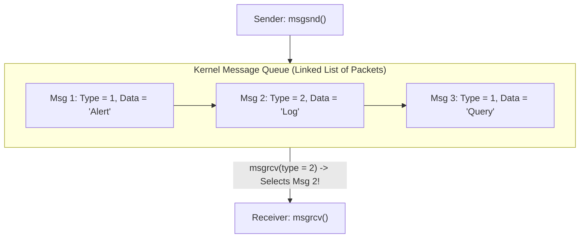
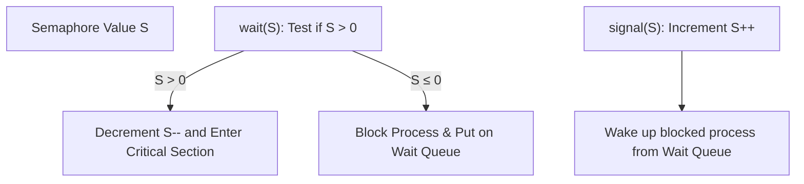

[OS Index](../README.md) / [Unit 2: Concurrency & Deadlocks](Introduction.md)

---

In the previous lecture, we established the theoretical blueprints of Inter-Process Communication: the contrast between Shared Memory and Message Passing, the distinction between Direct and Indirect naming, and how link buffering capacities dictate synchronization and rendezvous.

Now, we shift from theoretical models to concrete operating system system calls.

In Unix and POSIX systems, IPC is implemented through five foundational mechanisms:
1. **Anonymous Pipes (`pipe()`):** Bounded byte streams connecting related processes.
2. **Process Pipelines (`popen()` / `pclose()`):** Standard library wrappers automating pipeline creation.
3. **Named Pipes / FIFOs (`mkfifo()`):** Filesystem-backed byte streams connecting unrelated processes.
4. **Message Queues (`msgget()`, `msgsnd()`, `msgrcv()`):** Kernel mailboxes transferring discrete, typed messages.
5. **Semaphores (`semget()`, `semop()`, `semctl()`):** Kernel-level counters used to coordinate and synchronize access to shared memory.

Let's map each of these mechanisms directly onto the theoretical abstractions from Lecture 1:

| Practical Mechanism | Theoretical Model (Lecture 1) | Data Unit | Process Relationship |
| :--- | :--- | :--- | :--- |
| **Anonymous Pipe** | Message Passing (Indirect, Bounded) | Untyped Byte Stream | Related only (Common Ancestor) |
| **FIFO (Named Pipe)**| Message Passing (Indirect, Bounded) | Untyped Byte Stream | Unrelated (Any process with path) |
| **Message Queue** | Message Passing (Mailbox with Priority) | Discrete Typed Packets | Unrelated (Any process with Key/ID) |
| **Shared Memory** | Shared Memory Model | Raw Memory Blocks | Unrelated (Any process with Key/ID) |
| **Semaphore** | Synchronization Primitive | State Counter (No payload)| Unrelated (Any process with Key/ID) |

---

## Anonymous Pipes: `pipe()`

The **pipe** is the oldest form of Unix IPC, dating back to the third edition of Unix in 1973.

Pipes have two fundamental architectural constraints:
1. **Half-Duplex (Unidirectional):** Data flows in only one direction. One end is strictly for writing, and the other is strictly for reading. (If two-way bidirectional communication is required, you must create **two separate pipes**).
2. **Related Processes Only:** An anonymous pipe has no name in the filesystem. Therefore, it can only be used by processes that share a **common ancestor** (typically parent and child created via `fork()`).


### The System Call Signature:
```c
#include <unistd.h>

int pipe(int fd[2]);
```
- **Return Value:** Returns `0` on success, or `-1` on error.
- **The File Descriptor Array (`fd[2]`):**
  - **`fd[0]`:** The **Read End** of the pipe (open for reading).
  - **`fd[1]`:** The **Write End** of the pipe (open for writing).

> **Memory Trick:** How do you remember which index is which?
> In standard Unix file descriptors, `0` is Standard Input (`stdin` = reading) and `1` is Standard Output (`stdout` = writing). The pipe array matches this: `fd[0]` reads, `fd[1]` writes!

---

## Establishing a Pipe: The Setup Sequence

To communicate between a parent and child:



### Why Closing Unused Ends is Mandatory!
Students often ask: *"If the parent only intends to write, why must it explicitly call `close(fd[0])`? Why not just leave it open and ignore it?"*

Failing to close unused ends creates two catastrophic bugs:

1. **EOF (End-Of-File) Will Never Trigger:**
   When a reader reads from an empty pipe, `read()` blocks waiting for data. How does the reader know that the writer has finished and it should terminate?
   The kernel returns **`0` bytes read (EOF)** only when **ALL write file descriptors pointing to that pipe across the entire system are closed**.
   If the child process forgot to close its inherited copy of `fd[1]`, the kernel sees that at least one writer still exists (the child itself!). The child's `read()` will block forever, hanging the application in an infinite wait.
2. **Broken Pipe Detection (`SIGPIPE`):**
   If a process writes to a pipe where all read ends are closed, the kernel generates a **`SIGPIPE` signal** (which terminates the process by default) and causes `write()` to fail with `errno = EPIPE`. If the writer forgot to close its inherited read end, the kernel believes a reader still exists, preventing this safety mechanism from working.

### Complete C Code: Parent Writing to Child Reader
```c
#include <stdio.h>
#include <stdlib.h>
#include <unistd.h>
#include <string.h>

int main() {
    int fd[2];
    pid_t pid;
    char message[] = "Hello from parent through the pipe!";
    char buffer[128];

    // 1. Create the pipe before forking
    if (pipe(fd) < 0) {
        perror("pipe creation failed");
        exit(EXIT_FAILURE);
    }

    // 2. Fork child
    pid = fork();
    if (pid < 0) {
        perror("fork failed");
        exit(EXIT_FAILURE);
    }

    if (pid > 0) {
        // --- PARENT PROCESS (WRITER) ---
        close(fd[0]); // Close unused read end

        write(fd[1], message, strlen(message) + 1);
        close(fd[1]); // Close write end to signal EOF to reader
    } 
    else {
        // --- CHILD PROCESS (READER) ---
        close(fd[1]); // Close unused write end

        int bytes_read = read(fd[0], buffer, sizeof(buffer));
        if (bytes_read > 0) {
            printf("[Child Received]: %s\n", buffer);
        }
        close(fd[0]); // Close read end
        exit(EXIT_SUCCESS);
    }

    return 0;
}
```

---

## High-Level Pipeline Plumbing: `popen()` and `pclose()`

Manually calling `pipe()`, `fork()`, `close()`, `dup2()` (to redirect `stdin`/`stdout`), and `exec()` every time you want to send data to a utility is tedious.

The standard C library provides two convenience functions that automate this entire pipeline:

```c
#include <stdio.h>

FILE *popen(const char *command, const char *type);
int pclose(FILE *stream);
```


### What `popen()` Does Under the Hood:
In a single call, `popen()` performs five distinct operations:
1. Calls `pipe()` to create an internal anonymous pipe.
2. Calls `fork()` to create a child process.
3. Closes the unused ends of the pipe in both parent and child.
4. Redirects the child's standard input or output using `dup2()`.
5. Invokes `/bin/sh -c command` via `exec()` to run the requested shell utility.

- If `type` is **`"r"`**: The calling program can read the standard output of the command via the returned `FILE *` pointer.
- If `type` is **`"w"`**: The calling program can write data directly into the standard input of the command.
- **`pclose(stream)`** closes the standard I/O stream, waits for the child command to terminate via `waitpid()`, and returns the process exit status.

---

## Named Pipes: FIFOs (`mkfifo()`)

Anonymous pipes have one major limitation: they cannot connect unrelated processes. If Process A and Process B are started in different terminals by different users, they cannot communicate through an anonymous pipe because they have no common ancestor to inherit file descriptors from.

To solve this, Unix provides **FIFOs (Named Pipes)**:
- A FIFO is a pipe that has a **name and an entry in the filesystem**.
- Because it has a filesystem path (e.g., `/tmp/my_fifo`), **any two unrelated processes with appropriate read/write permissions can communicate through it!**

### Creating a FIFO:
From the command line:
```bash
mkfifo /tmp/my_fifo
```
From C code:
```c
#include <sys/types.h>
#include <sys/stat.h>

int mkfifo(const char *path, mode_t mode);
```



### Critical Properties of FIFOs:
1. **Zero Bytes on Disk:** Even though a FIFO appears in directory listings (with a file type indicator of `p` for pipe, e.g., `prw-r--r--`), **it consumes zero bytes of disk storage**. The filesystem node serves purely as a globally accessible rendezvous name. The data itself passes entirely through a kernel memory buffer.
2. **Rendezvous Open Semantics:**
   - When a process opens a FIFO for reading (`O_RDONLY`), the `open()` call **blocks** until another process opens the same FIFO for writing!
   - Similarly, opening for writing (`O_WRONLY`) **blocks** until a reader arrives.
   - Once both reader and writer are open, communication proceeds identically to an anonymous pipe using standard `read()` and `write()` calls.

---

## System V Message Queues

While pipes and FIFOs treat data as an unstructured, continuous **stream of bytes**, many applications need to exchange **discrete, structured messages**.

In a byte stream, if a sender writes two distinct strings `"Hello"` and `"World"`, a reader might read `"HelloWor"` in one call and `"ld"` in the next. Message boundaries are not preserved.

**Message Queues** solve this by operating as kernel-managed mailboxes that store **discrete, typed messages**:



### The System V Message Queue API:

```c
#include <sys/types.h>
#include <sys/ipc.h>
#include <sys/msg.h>

// 1. Create or access a message queue
int msgget(key_t key, int msgflg);

// 2. Send a message to the queue
int msgsnd(int msqid, const void *msgp, size_t msgsz, int msgflg);

// 3. Receive a message from the queue
ssize_t msgrcv(int msqid, void *msgp, size_t msgsz, long msgtyp, int msgflg);

// 4. Control operations (e.g., delete queue)
int msgctl(int msqid, int cmd, struct msqid_ds *buf);
```

### The Message Buffer Structure:
Every message sent to a System V queue must follow a specific template: a `long` integer type followed by an arbitrary data payload:

```c
struct my_message {
    long mtype;       // Message type (MUST be > 0!)
    char mtext[256];  // Message data payload
};
```

### The Power of Selective Retrieval (`msgtyp`):
When calling `msgrcv(msqid, &msg, size, msgtyp, flags)`, the `msgtyp` parameter allows selective, priority-based retrieval:

1. **`msgtyp == 0`:** Retrieves the **first message in the queue**, preserving strict FIFO arrival order.
2. **`msgtyp > 0`:** Retrieves the first message whose `mtype` **exactly matches `msgtyp`**. (Allows a worker to ignore general messages and grab only urgent alerts designated with `mtype = 999`!).
3. **`msgtyp < 0`:** Retrieves the first message with the **lowest `mtype` value that is less than or equal to the absolute value of `msgtyp`**. (Used for prioritized task queues).

### Kernel Persistence of System V IPC:
Unlike pipes (which vanish the moment processes close them), System V IPC objects are **kernel-persistent**:
- If a program creates a message queue and terminates, the queue **remains alive in kernel memory**.
- You can inspect active message queues using the terminal command: `ipcs -q`
- You can destroy them using: `ipcrm -q <msqid>` or by calling `msgctl(msqid, IPC_RMID, NULL)`.

---

## System V Semaphores

Why are semaphores covered in an IPC lecture?

Recall from Lecture 1: **Shared memory provides zero synchronization.** If two processes write to a shared memory block at the same time, data is corrupted. Semaphores do not transfer data; they transfer **permission to access shared data**.

### What is a Semaphore?
A **semaphore** is a kernel-protected integer counter that can only be accessed through two atomic operations:
1. **Wait (`P` or Decrement):** Tests if the counter is $> 0$. If so, decrements the counter by 1. If the counter is $\le 0$, the calling process blocks until it becomes positive.
2. **Signal (`V` or Increment):** Increments the counter by 1, waking up any sleeping processes.



> **Why Atomicity is Mandatory:** If the test-and-decrement were not atomic, two processes could both read $S = 1$ at the same microsecond, both think the resource is free, both decrement, and both enter the critical section simultaneously, corrupting data.

---

## The System V Semaphore API

System V semaphores are notoriously complex because the kernel does not allocate single semaphores—it allocates **Semaphore Sets** (arrays of semaphores under a single ID):

```c
#include <sys/types.h>
#include <sys/ipc.h>
#include <sys/sem.h>

// 1. Create or access a set of semaphores
int semget(key_t key, int nsems, int semflg);

// 2. Atomically perform an array of operations on the set
int semop(int semid, struct sembuf *sops, size_t nsops);

// 3. Control operations (initialization, querying, destruction)
int semctl(int semid, int semnum, int cmd, ...);
```

### The Architectural Advantage of `semop()`: Atomic Multi-Resource Acquisition
The real power of System V semaphores lies in `semop()`:
- `semop()` takes an array of operations (`struct sembuf sops[]`).
- It applies all requested operations across multiple semaphores **atomically in a single indivisible step**.
- Either **all** semaphore increments/decrements succeed, or the process **blocks on none of them**!

This eliminates a massive class of **deadlocks**. In classic concurrency, Deadlock occurs when Process A holds Semaphore 1 and waits for Semaphore 2, while Process B holds Semaphore 2 and waits for Semaphore 1. By allowing a process to request both semaphores atomically in a single `semop()` call, partial acquisition is impossible.

### The Initialization Trap:
When you call `semget()`, the kernel creates the semaphore set, but **does not initialize the counter values**! They default to `0` (which means "locked/blocked").

Before any process can use the semaphore, the creator must explicitly set its initial value using `semctl()`:
```c
union semun {
    int val;
    struct semid_ds *buf;
    unsigned short *array;
} arg;

arg.val = 1; // Set initial counter to 1 (Unlocked)
semctl(semid, 0, SETVAL, arg);
```
If you forget this step, every process calling `semop()` will hang permanently!

---

## Complete Comparison Matrix of Unix IPC System Calls

| Feature | Anonymous Pipe | Named Pipe (FIFO) | Message Queue | Shared Memory | Semaphore |
| :--- | :--- | :--- | :--- | :--- | :--- |
| **Creation Call** | `pipe()` | `mkfifo()` | `msgget()` | `shmget()` | `semget()` |
| **Identified By** | File descriptors (`fd[2]`) | Filesystem Path | IPC Key / `msqid` | IPC Key / `shmid` | IPC Key / `semid` |
| **Process Relation** | **Related Only** (Common ancestor) | **Unrelated** | **Unrelated** | **Unrelated** | **Unrelated** |
| **Data Format** | Continuous Byte Stream | Continuous Byte Stream | Discrete Typed Packets | Raw Memory Region | Integer State Counter |
| **Message Boundaries**| Lost (Stream) | Lost (Stream) | **Preserved** | N/A | N/A |
| **Kernel Persistence**| Dies when descriptors close | Path persists; data dies on close | **Kernel-persistent** | **Kernel-persistent** | **Kernel-persistent** |
| **Data Transfer Speed**| Fast (Memory buffer) | Fast (Memory buffer) | Fast (Memory buffer) | **Fastest (Direct RAM)**| N/A (Control only) |
| **Needs Sync?** | Built-in | Built-in | Built-in | **YES (Needs Semaphores)** | **Is the Sync!** |

---

## Key Takeaways

- **Anonymous Pipes (`pipe()`)** are half-duplex byte streams usable only between processes sharing a common ancestor. `fd[0]` is for reading; `fd[1]` is for writing.
- **Closing unused pipe ends is mandatory.** Failure to close write ends prevents readers from detecting EOF (`read() == 0`), causing infinite hangs.
- **`popen()` and `pclose()`** automate the pipeline triad (`pipe()`, `fork()`, `exec()`) to run shell utilities through standard streams.
- **FIFOs (`mkfifo()`)** are named pipes appearing in the filesystem. They consume 0 bytes of disk space and allow completely unrelated processes to communicate. Opening a FIFO blocks until both reader and writer arrive.
- **Message Queues (`msgget()`, `msgsnd()`, `msgrcv()`)** transfer discrete messages, preserving message boundaries. The `mtype` field allows selective, prioritized message retrieval.
- **Shared Memory** requires an external synchronization tool to prevent race conditions.
- **Semaphores (`semget()`, `semop()`, `semctl()`)** provide atomic test-and-decrement synchronization. `semop()` can operate on multiple semaphores atomically, providing built-in deadlock avoidance.
- System V IPC objects (Message Queues, Shared Memory, Semaphores) are **kernel-persistent** and must be explicitly destroyed via `*ctl(..., IPC_RMID)` or the terminal command `ipcrm`.

---

While IPC allows separate processes to coordinate, creating a full process with its own address space, page tables, and file descriptor tables is computationally expensive.

What if we want multiple concurrent execution streams that share the *exact same address space* without needing IPC at all?

That brings us to lightweight concurrent execution units in [**Lecture 3: Threads and Concurrency**](L03%20-%20Threads%20and%20Concurrency.md).
