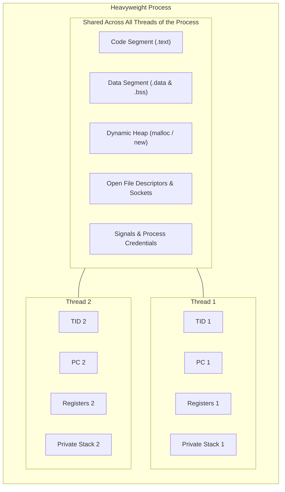
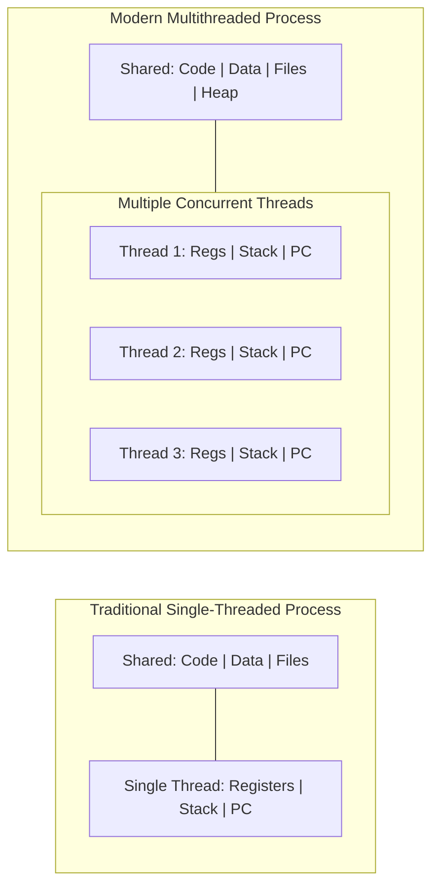
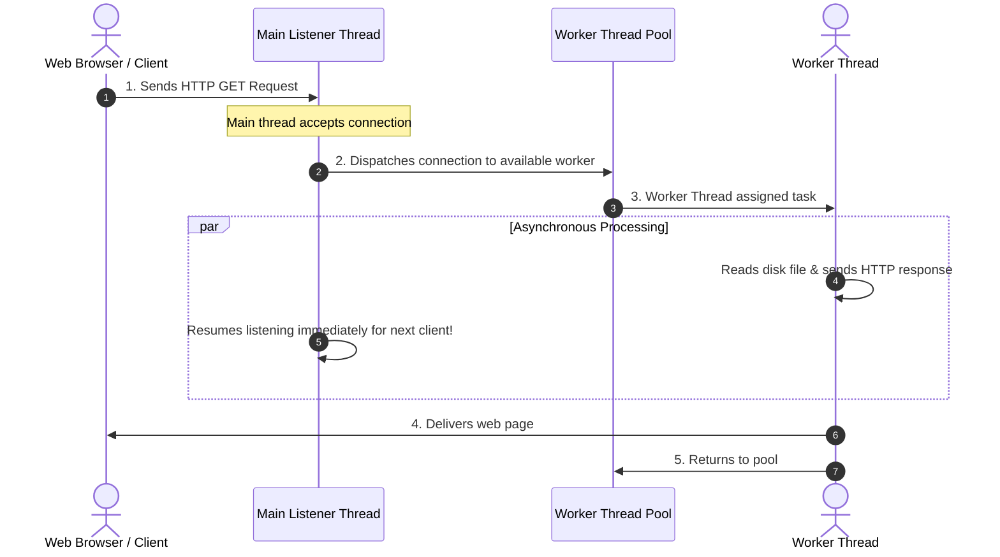
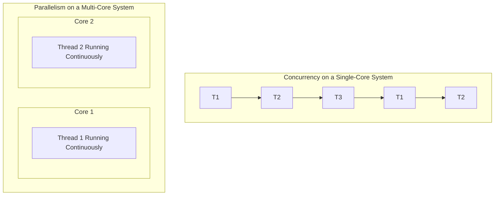
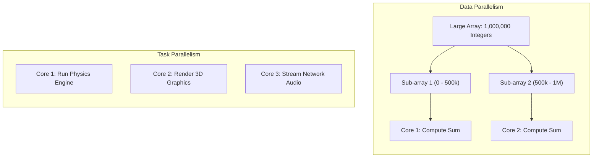
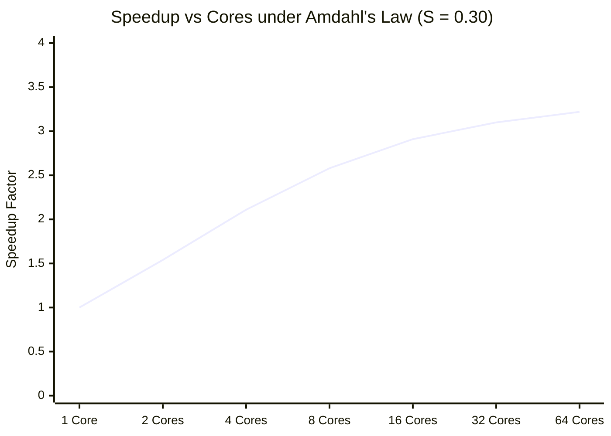

[OS Index](../README.md) / [Unit 2: Concurrency & Deadlocks](Introduction.md)

---

In the first two lectures of this unit, we studied how distinct processes communicate through IPC. We saw pipes, message queues, and shared memory. But notice the fundamental design philosophy of process-based cooperation:
> **Processes isolate by default.** 
> 
> Sharing memory or passing messages is expensive, requires explicit operating system system calls, and incurs kernel mode switching overhead.

This isolation is wonderful for security between different users. But what if you are writing a single application—like a modern web browser, a database engine, or a video game? 

Inside a single application, components *want* to cooperate. Having a separate address space for every tab, every network request, and every animation frame is like building separate houses for every member of a family and communicating only by sending postal letters.

What if we could have **multiple flows of execution running simultaneously inside the exact same address space**?

That is the concept of a **Thread** (or Lightweight Process). 

Where IPC is *isolation by default with explicit sharing*, threading is **sharing by default with explicit isolation**. It is faster, dramatically cheaper, and—as we will soon see—inherently dangerous.

---

## What is a Thread? Deconstructing the PCB

To understand what a thread is, look back at the **Process Control Block (PCB)** from Unit 1.

A traditional PCB bundles two completely different responsibilities together:
1. **Resource Ownership:** The virtual address space, the text/code segment, global variables, heap memory, open file descriptors, and system permissions.
2. **Execution State:** Where the processor currently is in the code (Program Counter), CPU general-purpose registers, condition flags, and the execution call stack.

A **Thread** is the realization that these two responsibilities can be separated:

### The State Partition:
A **Thread** is the fundamental unit of CPU utilization. It consists of:
- **Thread ID (TID):** A unique integer identifying the thread.
- **Program Counter (PC):** Points to the specific instruction this thread is currently executing. (Each thread can execute completely different functions in the same code segment!).
- **Register Set:** Hardware registers holding this thread's active local working state.
- **Private Stack:** Dedicated memory holding this thread's function call frames, parameters, and local (automatic) variables.

### Why Must Each Thread Have Its Own Private Stack?
Students often wonder: *"If threads share memory, why can't they share a stack?"*

Think about what a stack does: every time a function is called, the CPU pushes return addresses, arguments, and local variables onto the stack. 
If Thread 1 and Thread 2 shared the same stack, Thread 1 would push a return address for `calculate()`, Thread 2 would immediately push a return address for `render()`, and when Thread 1 executed `return`, it would jump into the middle of Thread 2's code! The stack would become instantly corrupted. 

Each thread must have its own private stack to track its independent chain of function calls.

---

## Single-Threaded vs. Multithreaded Processes

In a traditional single-threaded process, the process and the thread are the same thing: there is one address space and one instruction pointer.

In a multithreaded process, there is **one address space shared by multiple execution threads**, each thread executing independently on a CPU core.

---

## Practical Motivation: The Multithreaded Server

To see why multithreading transformed software engineering, consider how a high-traffic web server handles requests:

### The Old Way: Process-per-Request (`fork()`)
In early web servers (like original Apache 1.3), every incoming connection caused the server to execute `fork()`.
- Creating a process required duplicating page tables, allocating PCBs, and allocating memory.
- Under a load of 5,000 requests per second, the machine collapsed under the weight of creating and destroying 5,000 processes every second.

### The Modern Way: Thread-per-Request
In a multithreaded server:
- The main thread sits in a loop listening on a network socket.
- When a request arrives, it simply wakes up an existing **Worker Thread** from a thread pool (or spawns a lightweight thread).
- The worker thread serves the request, accessing shared caches directly in RAM.
- The main thread never blocks; it is instantly ready to accept the next incoming connection.

---

## The Four Major Benefits of Multithreading

1. **Responsiveness (Interactive Systems):**
   - In an interactive application, if an operation takes a long time (e.g., loading a 500 MB file or fetching data over a slow network), a single-threaded program freezes completely: the UI beach-balls, and mouse clicks are ignored.
   - In a multithreaded application, the long operation runs in a background worker thread, while the main thread continuously handles UI events and redraws animations. The application feels snappy and responsive.
2. **Resource Sharing:**
   - Processes can only share memory through explicit, complex IPC mechanisms (POSIX shared memory segments, pipes, sockets).
   - Threads **share the code, data, and heap segments by default**! Sharing data between threads requires no system calls—a thread simply writes to a global variable or heap pointer, and all other threads can immediately read it.
3. **Economy (Speed and Memory Overhead):**
   - **Creation Cost:** Creating a thread is dramatically cheaper than creating a process. On standard Unix benchmarks (Solaris / Linux), creating a process takes roughly **30 times longer** than creating a thread!
   - **Context-Switch Cost:** Switching between two threads of the same process is roughly **5 times faster** than switching between two separate processes.
   - *Why is a thread context switch so fast?* Because the virtual address space does not change! The kernel reloads CPU registers and the stack pointer, but the **Memory Management Unit (MMU) page table pointers remain untouched**. Crucially, the CPU's **Translation Lookaside Buffer (TLB) is NOT flushed**!
4. **Scalability (Multiprocessor Utilization):**
   - A single-threaded process can only ever run on **one CPU core** at a time, regardless of whether your computer has 2 cores or 128 cores.
   - A multithreaded process can spread its threads across all available hardware cores, running in **true physical parallel**.

---

## Processes vs. Threads: The Definitive Comparison

| Feature | Heavyweight Process | Lightweight Thread |
| :--- | :--- | :--- |
| **Address Space** | **Isolated** (Private virtual address space) | **Shared** (All threads share same address space) |
| **Creation Overhead** | Very high (Allocates page tables, PCB, segments) | Very low (~30× faster than process creation) |
| **Context Switch Overhead**| High (Flushes TLB, swaps page tables, caches cold) | Low (~5× faster; TLB preserved, caches warm) |
| **Communication** | Requires **IPC** (Pipes, Message Queues, Shared Mem)| Direct memory read/write to shared variables |
| **Fault Isolation** | **Strong** (If one process crashes, others survive) | **Zero** (If one thread segfaults, whole process dies!)|
| **Resource State** | Owns files, sockets, permissions, and signals | Shares all process resources; owns only PC, regs, stack|

---

## Concurrency vs. Parallelism

People often use the terms "concurrency" and "parallelism" as synonyms, but in systems architecture, they describe fundamentally different behaviors:

- **Concurrency:** The ability to handle multiple tasks by making progress on more than one task over **overlapping periods of time**. 
  - On a **single CPU core**, true simultaneous execution is physically impossible. The OS achieves concurrency through **time-slicing (interleaving)**: switching back and forth between threads so quickly that human users perceive simultaneous execution.
- **Parallelism:** The ability to execute multiple tasks **at the exact same physical instant**.
  - Parallelism is impossible without **multiple hardware cores or processors**. Each core runs instructions for a different thread simultaneously.

> An interactive system can be **concurrent without being parallel** (e.g., running 50 threads on a 1-core microcontroller). But a system cannot be parallel without being concurrent.

---

## Types of Parallelism in Multicore Programming

When writing multithreaded software for multicore processors, parallel architectures divide into two primary models:

### 1. Data Parallelism
- Focuses on distributing subsets of the **same data** across multiple computing cores, performing the **exact same operation** on each core.
- *Example:* Adding two arrays of 1,000,000 numbers. Core 1 adds elements $0$ to $499,999$, while Core 2 simultaneously adds elements $500,000$ to $999,999$.
- This is the standard operational model of **GPUs (Graphics Processing Units)** and SIMD (Single Instruction, Multiple Data) vector units.

### 2. Task Parallelism
- Focuses on distributing **unique, distinct tasks (threads)** across multiple computing cores.
- Each thread performs a completely different operation. The threads may operate on the same data or different data.
- *Example:* In a modern video game, Core 1 executes player physics calculations, Core 2 renders 3D graphics geometry, and Core 3 processes audio effects and network packets.

---

## Amdahl's Law: The Fundamental Limit of Parallel Speedup

If you take a program and run it on a CPU with 64 cores, will it run 64 times faster?

Almost never.

In 1967, computer architect Gene Amdahl formulated **Amdahl's Law**, a mathematical formula identifying the fundamental performance limit of parallel computing:

$$\text{Speedup} \le \frac{1}{S + \frac{1 - S}{N}}$$

Where:
- **$S$**: The **Serial (non-parallelizable) fraction** of the application ($0 \le S \le 1$).
- **$1 - S$**: The **Parallelizable fraction** of the application.
- **$N$**: The number of **processing cores**.

### Worked Example: The Mathematics of Diminishing Returns

Suppose an application has a workload where **$30\%$** of the code must run serially (e.g., reading an input file, waiting for user input, or acquiring global locks), while the remaining **$70\%$** can be parallelized.

Here: $S = 0.30$, and $1 - S = 0.70$.

Let's compute the theoretical speedup when running on a **4-core processor ($N = 4$)**:

$$\text{Speedup} \le \frac{1}{0.30 + \frac{0.70}{4}} = \frac{1}{0.30 + 0.175} = \frac{1}{0.475} \approx \mathbf{2.105\times}$$

Look at that result: you added 4 cores, but you only achieved a **$2.1\times$ speedup**!

The hardware efficiency is only:

$$\text{Efficiency} = \frac{\text{Speedup}}{N} = \frac{2.105}{4} \approx 52.6\%$$

Nearly half of your expensive 4-core silicon is wasted, not because of an operating system bug or poor programming, but because the **serial portion $S$ acts as a computational anchor**.

---

## The Asymptotic Ceiling: What Happens as Cores Go to Infinity?

What happens if you buy a supercomputer with an infinite number of cores ($N \rightarrow \infty$)?

$$\lim_{N \to \infty} \left( \frac{1}{S + \frac{1 - S}{N}} \right) = \frac{1}{S + 0} = \mathbf{\frac{1}{S}}$$

> **The absolute maximum theoretical speedup of any parallel program is strictly capped at $\frac{1}{S}$.**

For our application where $S = 0.30$:

$$\text{Maximum Theoretical Speedup} = \frac{1}{0.30} = \mathbf{3.33\times}$$

Even if you run this program on a supercomputer with **1,000,000 CPU cores**, it will **never run more than $3.33\times$ faster** than on a single core!

### Amdahl's Law Across Increasing Core Counts ($S = 0.30$):

| Processing Cores ($N$) | Theoretical Speedup | Parallel Efficiency |
| :---: | :---: | :---: |
| **1** | $1.00\times$ | $100\%$ |
| **2** | $1.54\times$ | $77\%$ |
| **4** | $2.11\times$ | $53\%$ |
| **8** | $2.58\times$ | $32\%$ |
| **16** | $2.91\times$ | $18\%$ |
| **64** | $3.22\times$ | $5\%$ |
| **$\infty$** | **$3.33\times$ (Asymptote)** | **$0\%$** |

### The Engineering Takeaway:
Notice how steeply the curve flattens. Going from 1 core to 2 cores gains $+0.54\times$ speedup. Going from 16 cores to 64 cores gains only $+0.31\times$ speedup!

The lesson for software engineers: **If your program is running slowly, simply adding more CPU cores is useless if you have serial bottlenecks.** 

The only way to achieve massive speedup is to optimize and shrink the serial fraction $S$! (If you reduce $S$ from $30\%$ to $5\%$, the speedup ceiling jumps from $3.33\times$ to $20\times$).

---

## Key Takeaways

- A **Thread** is the fundamental unit of CPU utilization, separating resource ownership (shared address space, files, heap) from execution state (private TID, PC, registers, stack).
- Each thread **must have its own private stack** to maintain its independent chain of function calls and local variables.
- Threads offer four major benefits: **Responsiveness**, **Resource Sharing**, **Economy** (30× faster creation, 5× faster context switches with no TLB flush), and **Scalability**.
- If any single thread executes an illegal operation (like a segmentation fault), the **entire process crashes**, killing all sister threads.
- **Concurrency** is managing multiple tasks in overlapping time (interleaving on a single core); **Parallelism** is physically executing multiple tasks at the exact same instant (requires multiple cores).
- **Data Parallelism** distributes subsets of the same data across cores performing identical operations; **Task Parallelism** distributes distinct tasks/functions across cores.
- **Amdahl's Law** states that $\text{Speedup} \le \frac{1}{S + \frac{1 - S}{N}}$, proving that parallel speedup is fundamentally bounded by the serial fraction $S$. The asymptotic ceiling of speedup is $\frac{1}{S}$ regardless of how many cores are added.

---

Now that we understand the concept of a thread, how are threads actually managed and scheduled by the operating system?

Who creates them—the application runtime in user space, or the kernel? How do user-level threads map onto physical kernel threads?

That brings us to thread implementations and POSIX thread programming in [**Lecture 4: Multithreading Models, Creation, and Scheduling**](L04%20-%20Multithreading%20Models,%20Creation,%20and%20Scheduling.md).
