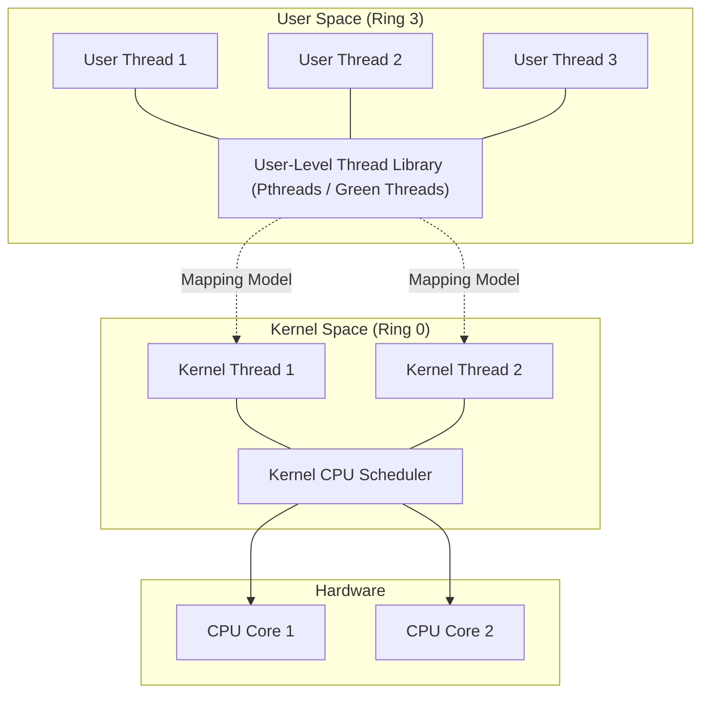
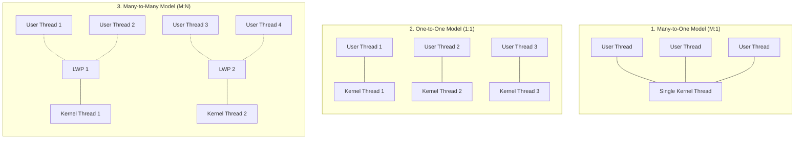
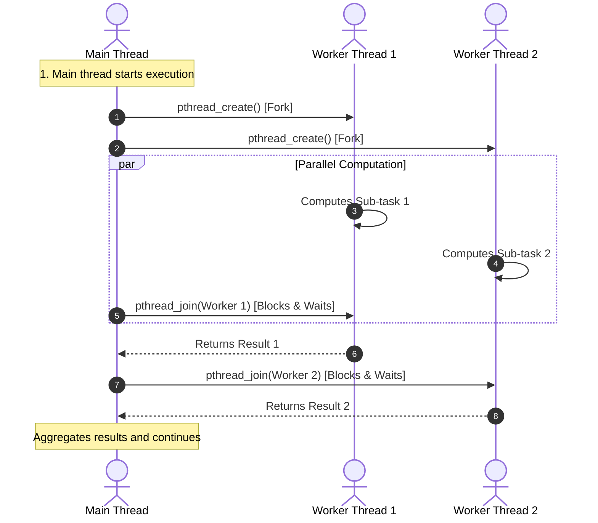
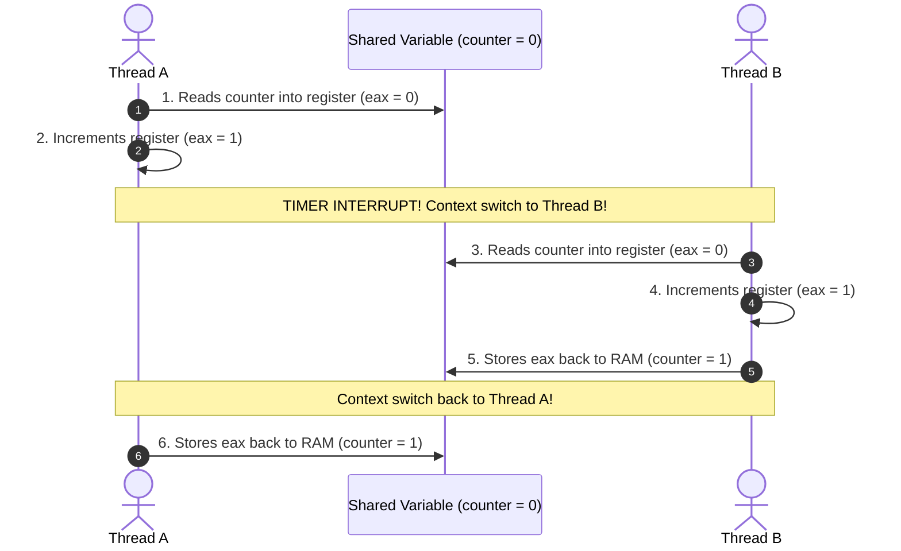
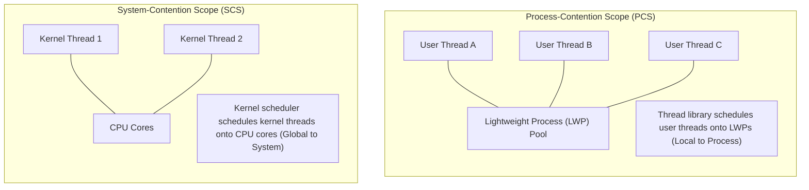

[OS Index](../README.md) / [Unit 2: Concurrency & Deadlocks](Introduction.md)

---

In the previous lecture, we established what a thread is: an independent execution stream with its own program counter, register set, and stack, sharing the code, data, and heap segments of its parent process.

Now, a fundamental engineering question emerges:
> **Who actually creates, tracks, and schedules these threads?**
> 
> Does thread management happen entirely in user space through a runtime library without the operating system's knowledge, or does the operating system kernel manage every individual thread directly?

The answer to this question leads to the distinction between **User Threads** and **Kernel Threads**, the three classic **Multithreading Models**, and the industry-standard **POSIX Pthreads API**.

---

## User Threads vs. Kernel Threads

In modern operating systems, threads exist at two distinct architectural levels:



### 1. User-Level Threads (ULT)
- Managed entirely in user space by a **user-level thread library** (e.g., POSIX Pthreads, early Java Green Threads).
- The thread table, stacks, and scheduling logic reside inside the process's own memory.
- **The Advantages:**
  - **Blazing Fast:** Creating a thread, destroying it, or switching between threads requires zero system calls! A user-level context switch simply executes a few assembly instructions to save and restore registers, taking tens of nanoseconds rather than microseconds.
  - **Platform Portability:** A user thread library can run on top of any operating system without requiring kernel modifications.
- **The Crippling Drawbacks:**
  - **The Blocking System Call Trap:** The OS kernel knows nothing about user-level threads; it sees only a single process. If any one user thread executes a blocking system call (such as waiting for a slow disk read), the kernel puts the **entire process into the Waiting state**, freezing all sister threads in that process!
  - **No True Hardware Parallelism:** Because the kernel only sees one entity, it can only schedule that process onto **one physical CPU core** at a time. A process with 100 user threads will run on only 1 core, completely wasting the remaining 63 cores of a 64-core processor!

### 2. Kernel-Level Threads (KLT)
- Directly supported and managed by the **operating system kernel**.
- The kernel maintains a Thread Control Block (TCB) for every thread in the system.
- **The Advantages:**
  - **Non-Blocking Concurrency:** If one thread blocks on an I/O operation, the kernel can freely schedule another thread from the same process to run on the CPU.
  - **True Multiprocessor Parallelism:** The kernel can dispatch different threads of the exact same process onto different physical CPU cores simultaneously.
- **The Drawback:**
  - Creating, synchronizing, and switching between kernel threads requires crossing the user-to-kernel barrier via system calls, incurring higher context-switching overhead than user-level threads.

---

## The Three Multithreading Models

To connect user-level threads with kernel-level threads, operating systems utilize one of three primary mapping models:



### 1. Many-to-One Model ($M:1$)
- Maps many user-level threads to a **single kernel thread**.
- Thread management is handled entirely by a user-space thread library.
- **Strengths:** Thread creation and context switching are exceptionally fast.
- **Weaknesses:** If one thread makes a blocking call, the entire process halts. Cannot run in parallel on multicore systems.
- **Historical Example:** Solaris Green Threads, GNU Portable Threads. (Largely abandoned in modern desktop/server OSs).

### 2. One-to-One Model ($1:1$)
- Maps each user thread directly to its own **dedicated kernel thread**.
- **Strengths:** 
  - Superb concurrency: a blocking system call in one thread does not affect others.
  - Full hardware parallelism: threads run simultaneously across multiple CPU cores.
- **Weaknesses:** Creating a user thread requires creating a corresponding kernel thread, which consumes kernel memory. Creating too many threads can overload the kernel scheduler.
- **Modern Adoption:** This is the **standard model used by almost all modern general-purpose operating systems**, including **Linux (NPTL)**, **Microsoft Windows**, and **macOS**.

### 3. Many-to-Many Model ($M:N$)
- Multiplexes many user-level threads onto a smaller or equal number of kernel threads.
- The operating system allows developers to create as many user threads as they need, while the kernel dispatches them across a pool of kernel threads running on physical cores.
- Often implemented using an intermediate data structure called a **Lightweight Process (LWP)**.
- **Strengths:** Best of both worlds: unbounded user thread creation without kernel bloat, no total-process blocking on I/O, and multicore parallel execution.
- **Weaknesses:** Tremendous complexity. Requires coordinated communication between user-space thread libraries and the kernel scheduler (Scheduler Activations).

### 4. The Two-Level Model (Hybrid)
A variation of the Many-to-Many model that multiplexes many user threads to a pool of kernel threads, but also allows critical, latency-sensitive user threads to be **permanently bound (pinned) one-to-one** to their own dedicated kernel thread (supported in legacy systems like IRIX, HP-UX, and Tru64 UNIX).

---

## POSIX Threads (Pthreads)

The dominant standard for multithreaded programming in Unix, Linux, and macOS is **Pthreads** (**POSIX standard IEEE 1003.1c**).

> **Crucial Distinction:** Pthreads is a **specification**, NOT an implementation!
> 
> The standard defines the C function names, arguments, and expected behavior. How those functions are implemented is up to the operating system vendor. On Linux, Pthreads is implemented by the **NPTL (Native POSIX Thread Library)** using the `clone()` system call in a One-to-One mapping.

---

## The Core Pthreads API

To write multithreaded C code, include `<pthread.h>` and link with `-lpthread`:

### 1. Creating a Thread: `pthread_create()`
```c
#include <pthread.h>

int pthread_create(pthread_t *thread, 
                   const pthread_attr_t *attr, 
                   void *(*start_routine)(void *), 
                   void *arg);
```

Dissecting the four parameters:
1. **`thread`:** A pointer to a `pthread_t` variable where the kernel/library writes the unique Thread ID of the newly spawned thread.
2. **`attr`:** A pointer to thread configuration attributes (stack size, scheduling priority). Passing **`NULL`** selects default attributes.
3. **`start_routine`:** A function pointer to the code the thread should begin executing. The function must take a single `void *` argument and return a `void *`.
4. **`arg`:** A single `void *` pointer passed directly as the argument to `start_routine`.

### The Dangling-Pointer Trap in `pthread_create()`:
A common bug occurs when passing a loop counter to worker threads:
```c
// DANGEROUS ANTI-PATTERN: DO NOT DO THIS!
for (int i = 0; i < 4; i++) {
    pthread_create(&tid[i], NULL, worker, (void *)&i); // BUG!
}
```
All four threads receive a pointer to the **exact same memory address `&i`**! By the time Thread 1 wakes up and dereferences the pointer, the parent's loop may have already incremented `i` to 4. 

To fix this, either allocate individual heap memory for each argument via `malloc()`, or cast integer values directly to `void *` (e.g., `(void *)(intptr_t)i`).

---

### 2. Waiting for a Thread: `pthread_join()`
```c
int pthread_join(pthread_t thread, void **retval);
```
- Suspends the calling thread until the specified `thread` terminates.
- If `retval` is not `NULL`, the pointer returned by the exiting thread (via `pthread_exit()` or `return`) is copied into `*retval`.
- **Zombie Threads:** Just like child processes in Unit 1, a terminated thread whose resources are not collected via `pthread_join()` becomes a **zombie thread**, leaking memory! If you do not plan to join a thread, detach it using `pthread_detach(thread)` so the kernel reclaims its resources immediately upon termination.

---

### 3. Exiting a Thread: `pthread_exit()`
```c
void pthread_exit(void *retval);
```
- Explicitly terminates the calling thread, returning `retval` to whichever thread calls `pthread_join()`.

### The Main Thread Trap:
What happens if the `main()` function returns while worker threads are still running?

```c
int main() {
    pthread_create(&tid, NULL, worker, NULL);
    return 0; // KILLS THE ENTIRE PROCESS!
}
```
In C, returning from `main()` invokes the `exit()` system call, which destroys the entire address space and **instantly murders all running worker threads!**

To prevent this:
1. Have `main()` call `pthread_join()` on all worker threads before returning, or:
2. Have `main()` call `pthread_exit(NULL)`. When `main()` calls `pthread_exit()`, only the main thread dies; the process and all remaining worker threads continue executing until the last worker terminates.

---

## The Fork-Join Pattern & Complete Code Example

The standard design pattern for multithreaded computing is the **Fork-Join Model**:



### Complete Working C Implementation:
```c
#include <stdio.h>
#include <stdlib.h>
#include <pthread.h>

// Shared global variable
long long sum = 0;

// Thread worker function
void *runner(void *param) {
    long long upper = atoll((char *)param);
    long long local_sum = 0;

    for (long long i = 1; i <= upper; i++) {
        local_sum += i;
    }

    sum = local_sum;
    pthread_exit(0);
}

int main(int argc, char *argv[]) {
    pthread_t tid;
    pthread_attr_t attr;

    if (argc != 2) {
        fprintf(stderr, "Usage: %s <integer_value>\n", argv[0]);
        return -1;
    }

    // Initialize default thread attributes
    pthread_attr_init(&attr);

    // Create the worker thread
    pthread_create(&tid, &attr, runner, argv[1]);

    // Wait for the worker thread to finish
    pthread_join(tid, NULL);

    printf("Total Sum = %lld\n", sum);
    return 0;
}
```

---

## The Danger of Concurrency: Revealing the Race Condition

Now we must face the dark side of multithreading.

Suppose two threads run concurrently and both attempt to increment a shared global variable:

```c
// Shared by both Thread A and Thread B
int counter = 0;

void *worker(void *arg) {
    for (int i = 0; i < 10000; i++) {
        counter++;
    }
    pthread_exit(NULL);
}
```

If Thread A increments `counter` 10,000 times, and Thread B increments `counter` 10,000 times, what will the final value of `counter` be?

You would expect **`20,000`**.

If you run this program on Linux, you will get numbers like `13,421`, `18,902`, or `11,245`! Every single run will produce a different, incorrect number!

Why?
Because the C statement `counter++` is **NOT atomic**! At the hardware CPU level, `counter++` compiles into three separate machine instructions:

```assembly
MOV eax, [counter]    ; 1. Load counter from RAM into CPU register
ADD eax, 1            ; 2. Increment value in register
MOV [counter], eax    ; 3. Store register value back to RAM
```

Look at what happens when the OS preempts Thread A halfway through:



Look at the catastrophe: two increments occurred, but the final value in memory is **`1`** instead of **`2`**! 

Thread A completely overwrote Thread B's update! This is a **Race Condition**, and fixing it is the entire motivation for the synchronization lectures that follow.

---

## Thread Scheduling: PCS vs. SCS

When multiple threads exist, how does the scheduler allocate CPU time? In multithreading architectures, scheduling operates under two distinct scopes:



### 1. Process-Contention Scope (PCS)
- In systems implementing Many-to-One or Many-to-Many models, the **user-level thread library** schedules user threads onto available LWPs.
- Contention is **local**: user threads compete only against other threads *within the same process*.
- Priority is set by the programmer and arbitrated in user space.

### 2. System-Contention Scope (SCS)
- The **operating system kernel** schedules kernel threads onto physical hardware CPU cores.
- Contention is **global**: threads compete against *all other threads across the entire operating system*.

> **The Linux / Windows Reality:** 
> Because modern Linux and Windows use the **One-to-One model**, there is no user-space LWP multiplexing. **All threads are scheduled using SCS (`PTHREAD_SCOPE_SYSTEM`)!** If you attempt to set `PTHREAD_SCOPE_PROCESS` in Linux, `pthread_attr_setscope()` will fail with error `ENOTSUP` (Not Supported).

---

## Advanced Thread Management

### 1. Thread Pools
Creating and destroying threads repeatedly for every incoming network request incurs overhead. Even worse, if 50,000 requests arrive at once, creating 50,000 threads will exhaust physical RAM and crash the machine.

A **Thread Pool** solves both problems:
- A fixed number of threads (e.g., 16 threads) are spawned at system startup and placed into a waiting pool.
- When work arrives, a thread is pulled from the pool to process the task, and returns to the pool upon completion.
- **Key Advantages:**
  1. Spawning cost is paid once at startup.
  2. **Bounds resource consumption:** Under heavy traffic spikes, requests wait in a queue rather than exploding memory, preventing server crashes (load shedding).

### 2. Thread Cancellation
Terminating a thread before it naturally completes its function:
- **Asynchronous Cancellation:** One thread terminates the target thread **immediately**.
  - *Extremely Dangerous!* If the target thread is killed while holding a mutex lock or halfway through updating a shared data structure, the lock stays locked forever, deadlocking the whole application.
- **Deferred Cancellation (POSIX Default):** The cancellation request sets a flag. The target thread terminates only when it reaches safe, predefined **Cancellation Points** (e.g., blocking calls like `read()`, `pthread_testcancel()`), allowing it to clean up resources and release locks safely before dying.

---

## Key Takeaways

- **User Threads** are managed in user space (fast, portable, but vulnerable to process blocking and no multicore parallelism). **Kernel Threads** are managed by the kernel (supports multicore parallelism and non-blocking I/O).
- The three multithreading models are **Many-to-One ($M:1$)**, **One-to-One ($1:1$)**, and **Many-to-Many ($M:N$)**. Modern Linux and Windows use **One-to-One**.
- **Pthreads** is an IEEE specification for thread creation and synchronization.
- `pthread_create()` spawns a thread; `pthread_join()` waits for a thread and reaps its resources to avoid **zombie threads**.
- If `main()` returns, the entire process terminates immediately, killing all running threads.
- Shared-memory multithreading exposes programs to **Race Conditions** because operations like `counter++` are non-atomic sequences of load, add, and store instructions.
- **PCS** schedules user threads locally within a process; **SCS** schedules kernel threads globally across the system (Linux supports only SCS).
- **Thread Pools** bound resource usage under heavy workloads; **Deferred Cancellation** allows threads to terminate safely without leaving locked mutexes.

---

Now that we have seen how threads are created and scheduled, what unique structures do specialized operating systems provide for thread management?

How does Microsoft Windows handle threads internally through executive objects, kernel blocks, and asynchronous procedure calls?

That brings us to platform-specific thread architecture in [**Lecture 5: Windows Threads**](L05%20-%20Windows%20Threads.md).
