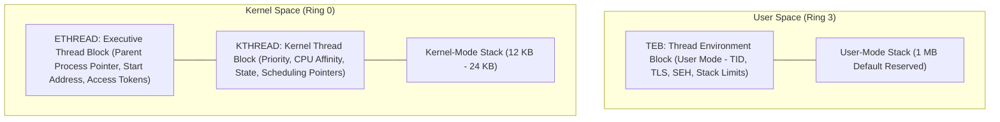

[OS Index](../README.md) / [Unit 2: Concurrency & Deadlocks](Introduction.md)

---

In the previous lecture, we studied thread management and synchronization using the POSIX Pthreads standard—the universal standard of Linux, macOS, and Unix.

Now, we examine how threads are implemented inside the world's most ubiquitous desktop operating system: **Microsoft Windows**.

Studying Windows threads provides an invaluable architectural lesson:
> **Operating system concepts are invariant; only the API spellings and internal representations change.**

Whether you are programming on Linux, Windows, macOS, or an embedded RTOS, the underlying realities of concurrency remain identical: threads have private stacks, share heap memory, require synchronization, and risk race conditions.

---

## Architectural Principles of Windows Threads

Windows implements the **Win32 API** (and Win64) as its primary application interface. Its threading subsystem is built on four core design choices:

1. **One-to-One Thread Mapping:**
   - Every user-mode thread created via the Win32 API corresponds directly to a **kernel-schedulable thread object**.
   - The Windows kernel schedules individual threads, not processes.
   - Each thread can execute on a different CPU core simultaneously, and a blocking I/O call in one thread does not stall other threads in the same process.
2. **Preemptive Priority-Based Multitasking:**
   - The Windows scheduler uses a 32-level priority queue with preemptive time slicing and dynamic priority boosting.
3. **Fibers (Many-to-Many via User Space):**
   - In addition to standard kernel threads, Windows provides a user-mode execution unit called a **Fiber**.
   - Fibers are cooperatively scheduled in user space without kernel intervention. Multiple fibers can be multiplexed onto a single kernel thread ($M:N$ mapping).
   - A fiber runs until it explicitly calls `SwitchToFiber()`. Fibers were introduced to help port legacy UNIX software and database engines that managed their own internal scheduling, and they represent the conceptual ancestor of modern C++20 coroutines and `async/await` state machines.
4. **Thread Pools:**
   - Windows natively integrates a high-performance kernel thread pool API to queue worker functions and asynchronous I/O completions without spawning threads repeatedly.

---

## The Internal Anatomy of a Windows Thread

Inside the Windows operating system, a thread is represented by three distinct data structures:



### 1. ETHREAD (Executive Thread Block)
- Resides entirely in **kernel space**.
- Represents the thread to the high-level **Windows Executive** subsystem.
- Contains:
  - Pointer to the owning `EPROCESS` (Executive Process block).
  - Thread start address (entry-point function pointer).
  - Security access tokens and impersonation credentials.
  - Pointers to its underlying `KTHREAD`.

### 2. KTHREAD (Kernel Thread Block)
- Resides in **kernel space**.
- Represents the thread to the low-level **Microkernel Scheduler**.
- Contains:
  - Scheduling parameters (base priority, dynamic priority).
  - CPU affinity mask (which physical cores this thread is permitted to run on).
  - Pointer to the thread's **Kernel-Mode Stack**.
  - Current thread execution state (Ready, Standby, Running, Waiting, Transition, Terminated).

### 3. TEB (Thread Environment Block)
- Resides in **user space**!
- Because it is located in user-accessible memory, user-mode programs can read it directly without issuing expensive system calls.
- Contains:
  - The Thread Identifier (TID).
  - Pointer to the **Thread Local Storage (TLS)** array (static per-thread data).
  - User-mode stack boundaries (stack base and limit pointers).
  - Structured Exception Handling (SEH) frame chains.

---

## Why Does a Windows Thread Have Two Stacks?

Notice that every Windows thread possesses **two independent stacks**:
1. **The User-Mode Stack:** Used during ordinary application execution to store local variables and function activation records. Windows reserves **1 MB of virtual address space** for this stack by default (committed lazily in 4 KB pages as needed).
2. **The Kernel-Mode Stack:** A compact, fixed-size stack (typically 12 KB to 24 KB) allocated in non-paged kernel pool memory.

### Why Not Use a Single Stack?
- **Security:** If the kernel used the user's stack when handling system calls, a malicious user thread could manipulate return addresses or inspect sensitive kernel data structures.
- **Reliability:** If a user program experiences a stack overflow (e.g., through infinite recursion), the user stack is exhausted. If the kernel attempted to handle the resulting trap using that same blown stack, the entire operating system would double-fault and crash (Blue Screen of Death). Having a private kernel stack guarantees the OS can always safely handle faults.

---

## The Win32 Thread Management API

In Windows C programming, thread management is accessed through the header `<windows.h>`:

### 1. Creating a Thread: `CreateThread()`
```c
HANDLE CreateThread(
    LPSECURITY_ATTRIBUTES lpThreadAttributes, // Security descriptor (NULL = default)
    SIZE_T dwStackSize,                       // Initial stack size (0 = default 1 MB)
    LPTHREAD_START_ROUTINE lpStartAddress,    // Thread function pointer
    LPVOID lpParameter,                       // Argument passed to thread function
    DWORD dwCreationFlags,                    // Flags (0 = run immediately, CREATE_SUSPENDED)
    LPDWORD lpThreadId                        // Receives the generated numeric Thread ID
);
```

### Dissecting the Six Parameters:
1. **`lpThreadAttributes`:** Pointer to security permissions. Passing `NULL` provides default access control and prevents the handle from being inherited by child processes.
2. **`dwStackSize`:** Stack size in bytes. Passing `0` tells Windows to use the default size compiled into the binary header (1 MB).
3. **`lpStartAddress`:** Pointer to the thread worker function, which must follow the signature:
   `DWORD WINAPI ThreadFunction(LPVOID lpParam)`
4. **`lpParameter`:** A single `void *` pointer passed directly to the worker function.
5. **`dwCreationFlags`:** 
   - `0`: The thread begins executing immediately upon creation.
   - `CREATE_SUSPENDED`: The thread is created in the **Suspended state**. It will not be scheduled onto a CPU until another thread explicitly calls `ResumeThread(hThread)`. This is exceptionally useful for setting affinity masks or assigning priority before execution begins.
6. **`lpThreadId`:** Out-parameter pointer receiving the 32-bit numeric Thread ID.

### Handle vs. Thread ID
Notice that Windows gives you two distinct identifiers:
- **`HANDLE`:** An opaque kernel reference used by the application to perform operations on the thread (waiting, suspending, terminating).
- **`Thread ID`:** A system-wide unique numeric integer identifying the thread.

---

### 2. Waiting for a Thread: `WaitForSingleObject()`
In Pthreads, waiting for a thread is accomplished via `pthread_join()`. In Windows, threads are kernel synchronization objects that become **Signaled** when they terminate.

```c
DWORD WaitForSingleObject(
    HANDLE hHandle,        // Handle to the thread object
    DWORD dwMilliseconds   // Timeout duration in milliseconds
);
```
- Passing **`INFINITE`** causes the calling thread to block indefinitely until the target thread terminates and enters the signaled state.
- Passing a millisecond value (e.g., `5000`) allows waiting with a timeout, returning `WAIT_TIMEOUT` if the thread does not finish in time.
- Windows also provides **`WaitForMultipleObjects()`**, which can wait for an entire array of threads simultaneously, waking up either when *any* thread finishes (`bWaitAll = FALSE`) or when *all* threads finish (`bWaitAll = TRUE`).

---

### 3. Releasing Resources: `CloseHandle()`
```c
BOOL CloseHandle(HANDLE hObject);
```

> **The Major Architectural Difference Between Pthreads and Win32:**
> 
> In Pthreads, `pthread_join()` both waits for the thread **and reclaims all its memory**.
> 
> In Win32, **waiting and resource cleanup are completely decoupled!**
> 
> `WaitForSingleObject()` only waits for the thread to terminate; it does **not** free the kernel thread object. You must explicitly call `CloseHandle(hThread)` to decrement the kernel object reference count. If you forget to call `CloseHandle()`, the kernel object leaks in memory even though the thread has finished running.

---

## Complete Working Win32 Program: Parallel Summation

Here is a complete, compilable Win32 multithreaded C program:

```c
#include <windows.h>
#include <stdio.h>

// Shared global variable
DWORD Sum = 0;

// Thread worker function matching LPTHREAD_START_ROUTINE signature
DWORD WINAPI Summation(LPVOID Param) {
    DWORD Upper = *(DWORD *)Param;
    for (DWORD i = 1; i <= Upper; i++) {
        Sum += i;
    }
    return 0;
}

int main(int argc, char *argv[]) {
    DWORD ThreadId;
    HANDLE ThreadHandle;
    DWORD Param;

    if (argc != 2) {
        fprintf(stderr, "Usage: %s <integer_value>\n", argv[0]);
        return -1;
    }

    Param = atoi(argv[1]);

    // 1. Create the worker thread
    ThreadHandle = CreateThread(
        NULL,           // Default security attributes
        0,              // Default stack size (1 MB)
        Summation,      // Thread function
        &Param,         // Argument to thread function
        0,              // Default creation flags (start running immediately)
        &ThreadId       // Receives the generated Thread ID
    );

    if (ThreadHandle == NULL) {
        fprintf(stderr, "CreateThread failed! Error code: %lu\n", GetLastError());
        return -1;
    }

    // 2. Wait for the thread to finish execution
    WaitForSingleObject(ThreadHandle, INFINITE);

    // 3. Close the thread handle to prevent kernel resource leaks
    CloseHandle(ThreadHandle);

    // 4. Safely access the shared result
    printf("sum = %lu\n", Sum);

    return 0;
}
```

---

## Comprehensive Comparison: POSIX Pthreads vs. Win32 Threads

| Feature | POSIX Pthreads (Linux/macOS) | Microsoft Win32 Threads (Windows) |
| :--- | :--- | :--- |
| **Header File** | `<pthread.h>` | `<windows.h>` |
| **Compilation Flag** | `-lpthread` | Standard Windows build |
| **Threading Model** | Implementation-dependent (One-to-One on Linux) | **One-to-One** (Fibers provide Many-to-Many) |
| **Creation Function** | `pthread_create()` | `CreateThread()` |
| **Thread Function** | `void *function(void *arg)` | `DWORD WINAPI function(LPVOID param)` |
| **Join / Wait** | `pthread_join()` | `WaitForSingleObject()` / `WaitForMultipleObjects()` |
| **Wait Timeout** | No built-in timeout | Supported (`dwMilliseconds` parameter) |
| **Resource Reclamation**| Automatic inside `pthread_join()` | **Explicit `CloseHandle()` required** |
| **Suspended Creation** | Must configure attribute object first | Native flag: `CREATE_SUSPENDED` |
| **Error Handling** | Returns error number (0 on success) | Returns `NULL` / `FALSE`; inspect with `GetLastError()` |
| **Stacks per Thread** | One user stack | **Two stacks** (User Stack + Kernel Stack) |

---

## Key Takeaways

- Windows applications utilize the **Win32 API** with a native **One-to-One** multithreading model.
- Windows **Fibers** are cooperatively scheduled user-space execution units providing **Many-to-Many** capabilities.
- A Windows thread is structured into three blocks:
  - **ETHREAD:** High-level executive state (kernel space).
  - **KTHREAD:** Low-level microkernel scheduling state (kernel space).
  - **TEB:** Thread Environment Block containing TID and TLS (user space).
- Every Windows thread has **two independent stacks**: a 1 MB default User Stack and a dedicated private Kernel Stack to ensure security and prevent kernel-crashing overflows.
- In Win32, `CreateThread()` spawns a thread, `WaitForSingleObject()` blocks until completion, and **`CloseHandle()` must be explicitly called to avoid handle leaks**.

---

Now that we have explored how threads are created across both POSIX and Windows systems, we must resolve the catastrophic problem uncovered in Lecture 4:

When multiple threads concurrently read and write to the same shared memory variables, how do we prevent race conditions?

How do we design algorithms that ensure only one thread enters the sensitive critical region of code at a time?

That brings us to the theoretical foundation of synchronization in [**Lecture 6: Mutual Exclusion - Software Approaches**](L06%20-%20Mutual%20Exclusion%20-%20Software%20Approaches.md).
