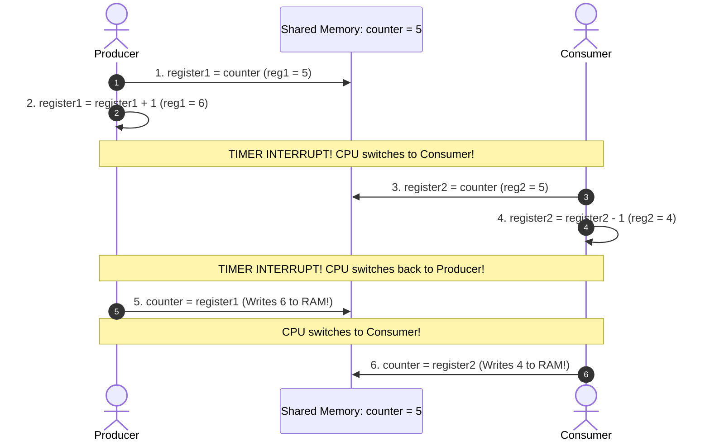
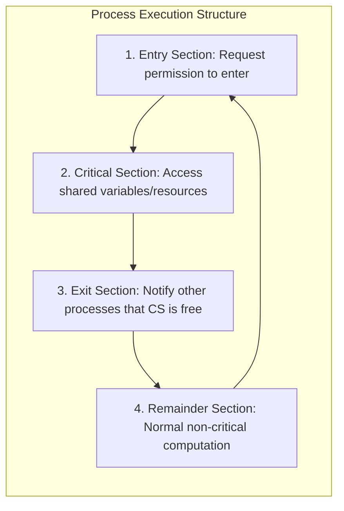
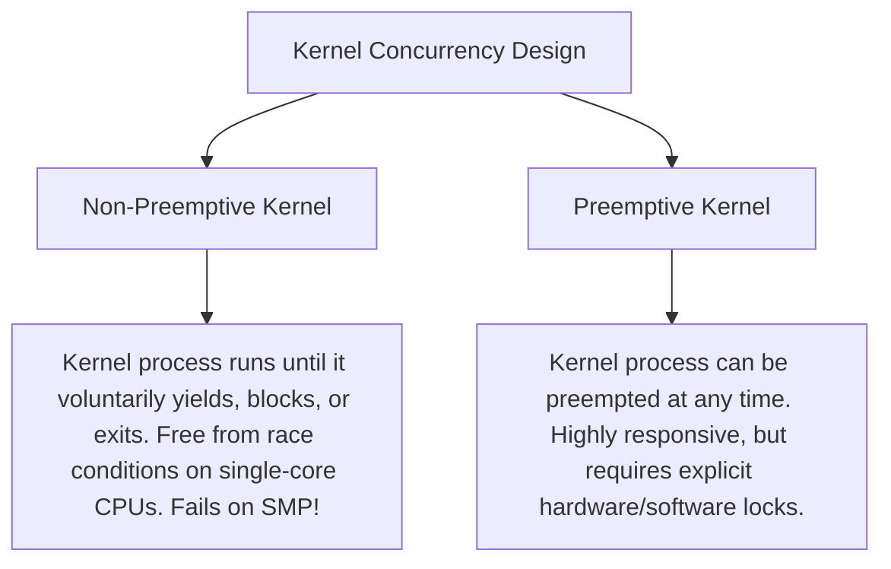

[OS Index](../README.md) / [Unit 2: Concurrency & Deadlocks](Introduction.md)

---

In the previous lectures, we saw how threads enable concurrent execution. But at the end of Lecture 4, we witnessed a catastrophic problem: when two threads executed `counter++` concurrently, our data was silently corrupted.

Now, we enter the conceptual core of concurrency theory.

How do we prevent multiple threads from corrupting shared data? What are the precise mathematical requirements an operating system must guarantee to ensure safety? And can we solve this problem using **pure software**—using nothing more than ordinary variable assignments and loops?

In this lecture, we formally define the **Race Condition**, formulate the **Critical-Section Problem**, examine its three mandatory criteria, and study the most famous software solution in computer science history: **Peterson's Algorithm**.

---

## The Race Condition Formalized

To see why concurrent updates fail, let's revisit the Producer-Consumer problem from Lecture 1.

Recall that our earlier circular buffer wasted one slot to distinguish between full and empty. What if we want to utilize all $N$ slots of the buffer? 

We can do so by introducing a shared integer counter:
```c
int counter = 0; // Tracks the exact number of full buffer slots
```

- When the **Producer** deposits an item, it increments: `counter++;`
- When the **Consumer** removes an item, it decrements: `counter--;`

### The Machine-Instruction Breakdown
In C, `counter++` and `counter--` look like single atomic operations. But at the machine architecture level, they compile into a sequence of three discrete CPU instructions:

| Producer (`counter++`) | Consumer (`counter--`) |
| :--- | :--- |
| `register1 = counter` | `register2 = counter` |
| `register1 = register1 + 1` | `register2 = register2 - 1` |
| `counter = register1` | `counter = register2` |

In a preemptive operating system, **the timer interrupt can strike between any two machine instructions!**

### Tracing the Disaster: A Six-Step Interleaving
Suppose `counter` currently holds the value **`5`**. Both the producer and consumer execute concurrently:



Look at the outcome: one item was produced and one item was consumed. The correct final value of `counter` should still be **`5`**.

Instead, `counter` ends up as **`4`**! (And if instructions 5 and 6 had executed in reverse order, `counter` would end up as **`6`**).

> **Definition of a Race Condition:**
> A situation where several processes access and manipulate the same data concurrently, and the outcome of the execution depends on the particular, unpredictable order in which access takes place.

To prevent race conditions, we must ensure that only **one process at a time** can manipulate the shared counter. This brings us to the Critical-Section Problem.

---

## The Critical-Section Problem

Consider a system consisting of $n$ processes $\{P_0, P_1, \dots, P_{n-1}\}$. Each process contains a segment of code called its **Critical Section**:



### The Four Code Sections:
1. **Entry Section:** The preamble code where a process requests permission to access the shared data. If another process is already inside, the requesting process must wait.
2. **Critical Section (CS):** The sensitive block of code where shared resources are manipulated (modifying shared memory, writing to a shared file, updating a database table).
3. **Exit Section:** The cleanup code executed immediately upon leaving the critical section, releasing locks and notifying waiting processes.
4. **Remainder Section:** The remaining execution code of the process that touches only private, local data.

---

## The Three Mandatory Criteria for Any Valid Solution

A valid solution to the Critical-Section Problem **must satisfy all three** of the following requirements:

### 1. Mutual Exclusion
If process $P_i$ is executing in its critical section, then **no other processes can be executing in their critical sections**.
- This is the fundamental safety requirement: at most one process can be inside the critical section at any given nanosecond.

### 2. Progress
If no process is executing in its critical section and some processes wish to enter, **only those processes that are NOT executing in their remainder sections can participate in deciding who enters next**, and this selection cannot be postponed indefinitely.
- *Clause A:* A process minding its own business in its remainder section cannot prevent other processes from entering the critical section!
- *Clause B:* Deadlock is strictly forbidden. If processes want to enter, one must be allowed in.

### 3. Bounded Waiting
There must exist a **bound (limit)** on the number of times that other processes are allowed to enter their critical sections after a process has made a request to enter and before that request is granted.
- This prevents **Starvation**: no process should be forced to wait indefinitely while other processes perpetually cut in front of it.

---

## Critical-Section Handling Inside the Kernel

Critical sections do not exist only in user programs. The operating system kernel is itself a massive concurrent program with internal data structures (process tables, page allocation bitmaps, interrupt queues) vulnerable to race conditions.

Operating systems handle kernel critical sections using one of two designs:



### Why Non-Preemptive Kernels Fail on Multicore (SMP) Machines:
In a single-processor computer, a non-preemptive kernel completely eliminates kernel race conditions: if process A enters kernel mode, it runs uninterrupted until it yields.

**However, on a Multi-Core Symmetric Multiprocessing (SMP) system, non-preemption is completely useless!**
Two different CPU cores can execute two independent processes in kernel mode at the exact same physical instant. Even if neither core preempts its thread, both cores can simultaneously write to the same kernel data structure in RAM. 

Modern operating systems (Linux, Windows, macOS) are all **preemptive kernels**, relying on explicit locks to protect shared state.

---

## Software Solutions: Peterson's Algorithm

Can we solve the Critical-Section Problem using **pure software**—without disabling interrupts and without special hardware instructions?

In 1981, G. L. Peterson published an elegant software solution for **two processes** ($P_0$ and $P_1$, or $P_i$ and $P_j$ where $j = 1 - i$).

### Shared Variables in Peterson's Solution:
```c
int turn;          // Indicates whose turn it is to enter the critical section
bool flag[2];      // flag[i] = true means Process Pi is ready to enter
```

Initially:
- `flag[0] = false;`
- `flag[1] = false;`
- `turn` can be initialized to either `0` or `1`.

### The Algorithm for Process $P_i$:
```c
do {
    flag[i] = true;             // Step 1: Declare "I want to enter"
    turn = j;                   // Step 2: Politely offer "You go first"
    
    // Step 3: Busy-wait while peer wants in AND it is peer's turn
    while (flag[j] && turn == j)
        ; // Spin wait!

    /* CRITICAL SECTION */

    flag[i] = false;            // Step 4: Declare "I am finished"

    /* REMAINDER SECTION */

} while (true);
```

---

## Why Both `flag` and `turn` are Absolutely Necessary

To understand Peterson's genius, look at what happens if you try to use either variable alone:

### Attempt 1: Using ONLY `turn`
```c
// Process Pi
while (turn != i) ; // Wait for my turn
/* CS */
turn = j;
```
- **Fails Progress!** This forces strict, rigid alternation: $P_0 \rightarrow P_1 \rightarrow P_0 \rightarrow P_1$.
- If $P_0$ exits its CS and then halts in its remainder section, $P_1$ can run once, set `turn = 0`, and exit. 
- Now $P_1$ wants to enter its CS again, but `turn` is `0`! Because $P_0$ is stuck in its remainder section, $P_1$ is blocked forever. A process in remainder has prevented an active process from progressing, violating the Progress requirement.

### Attempt 2: Using ONLY `flag`
```c
// Process Pi
flag[i] = true;
while (flag[j]) ; // Wait while peer wants in
/* CS */
flag[i] = false;
```
- **Fails Progress (Deadlock)!**
- If both $P_0$ and $P_1$ set `flag[0] = true` and `flag[1] = true` simultaneously, both arrive at their `while` loops at the same time.
- Both see that the other's flag is `true`, and **both spin in their loops forever**! Neither process ever enters.

### Peterson's Breakthrough:
Peterson combines both variables:
- `flag[i] = true` expresses **interest**.
- `turn = j` resolves **conflict**. By politely setting `turn` to the *other* process, whoever writes to `turn` **last** will be the one who yields!

---

## Rigorous Mathematical Proof of Peterson's Algorithm

To prove that Peterson's Algorithm is a valid solution, we must prove all three criteria:

### 1. Proof of Mutual Exclusion
Suppose both $P_0$ and $P_1$ are executing inside their critical sections at the same instant.

For $P_0$ to have entered its critical section, it must have exited its `while` loop. This means either:
$$\text{flag}[1] == \text{false} \quad \text{OR} \quad \text{turn} == 0$$

Similarly, for $P_1$ to have entered its critical section, it must have found:
$$\text{flag}[0] == \text{false} \quad \text{OR} \quad \text{turn} == 1$$

However:
- Both processes are in their critical sections, so both have already executed their entry statements: $\text{flag}[0] = \text{true}$ and $\text{flag}[1] = \text{true}$.
- Therefore, neither flag can be `false`.
- This implies that both conditions must hold: $\text{turn} == 0$ AND $\text{turn} == 1$.
- But `turn` is a scalar memory integer! It can hold only one value at a time. Whichever assignment to `turn` occurred last will overwrite the earlier write.
- If $P_0$ set `turn = 1` last, then `turn == 1`, forcing $P_0$ to spin. If $P_1$ set `turn = 0` last, then `turn == 0`, forcing $P_1$ to spin.

It is impossible for both processes to enter simultaneously. **Mutual exclusion is guaranteed.**

### 2. Proof of Progress
A process can only be blocked in the `while (flag[j] && turn == j)` loop.

- If $P_j$ is in its remainder section, $\text{flag}[j] == \text{false}$. $P_i$ evaluates the loop condition as false and enters the critical section immediately. A process in remainder never blocks another process.
- If both processes wish to enter simultaneously, both set their flags to `true`. Whichever process wrote to `turn` last overwrote the previous write, making `turn` equal to either `0` or `1`.
- The process whose index matches `turn` enters the critical section immediately. No deadlock or indefinite postponement can occur.

### 3. Proof of Bounded Waiting
Suppose $P_0$ is waiting in its `while` loop while $P_1$ is executing inside the critical section.

- When $P_1$ exits its critical section, it executes: `flag[1] = false;`
- This immediately falsifies $P_0$'s while condition, allowing $P_0$ to enter.
- Even if $P_1$ immediately attempts to re-enter, it must execute `turn = 0;`.
- Because $P_0$ already has `flag[0] == true`, setting `turn = 0` immediately grants $P_0$ priority!
- $P_1$ can overtake $P_0$ at most **zero times**. The waiting bound is exactly **1**.

---

## Why Peterson's Algorithm is Not Used in Modern Systems

Peterson's algorithm is mathematically flawless in theory. Yet, if you compile it on a modern Intel x86 or ARM CPU, **it can fail completely!**

Why? Because of three fatal real-world limitations:

1. **Restricted to Two Processes:** Generalizations to $n$ processes (e.g., Lamport's Bakery Algorithm) require complex $O(n)$ shared arrays and high computational overhead.
2. **Busy-Waiting (Spinlocks):** The waiting process spins continuously in a `while` loop, consuming 100% of a CPU core doing zero productive work.
3. **Memory Reordering by Compilers and Hardware:**
   Peterson's algorithm assumes a **Sequentially Consistent memory model** (instructions execute in the exact order they appear in source code).
   Modern out-of-order CPUs and optimizing compilers aggressively **reorder independent memory reads and writes** to maximize pipeline performance!
   A CPU core may buffer the store to `flag[i]` and execute the read of `flag[j]` first. If both cores do this, both read stale `false` values, and **both enter the critical section simultaneously!**

To make Peterson's algorithm work on modern hardware, programmers must insert hardware **Memory Barriers (Fences)** to stop the CPU from reordering memory instructions. But once we need hardware support, we can use much faster, native hardware atomic instructions.

---

## Key Takeaways

- A **Race Condition** occurs when multiple threads manipulate shared data concurrently and the outcome depends on execution timing.
- Preemptive schedulers can interrupt a thread between any two machine instructions; operations like `counter++` are non-atomic 3-instruction sequences (load, add, store).
- The **Critical-Section Problem** partitions process execution into four phases: Entry Section, Critical Section, Exit Section, and Remainder Section.
- Any valid solution must satisfy three mandatory criteria:
  1. **Mutual Exclusion:** At most one process in CS at any time.
  2. **Progress:** Only active non-remainder processes decide who enters next; no deadlock.
  3. **Bounded Waiting:** A finite limit on how many times others can enter before a waiting process is admitted; no starvation.
- **Non-preemptive kernels** eliminate kernel race conditions on uniprocessors, but fail completely on **multi-core SMP systems**.
- **Peterson's Algorithm** is an elegant two-process software solution using `flag[2]` (intent) and `turn` (polite tie-breaker).
- Peterson's algorithm is not used in modern production software because it is limited to two processes, busy-waits, and breaks under modern CPU **memory reordering**.

---

Because pure software approaches fail on modern out-of-order processors, operating systems turn to the CPU architecture for help.

What specialized atomic instructions do modern processors provide to guarantee mutual exclusion in hardware?

That brings us to hardware synchronization primitives in [**Lecture 7: Concurrency Principles and Synchronization Hardware**](L07%20-%20Concurrency%20Principles%20and%20Synchronization%20Hardware.md).
