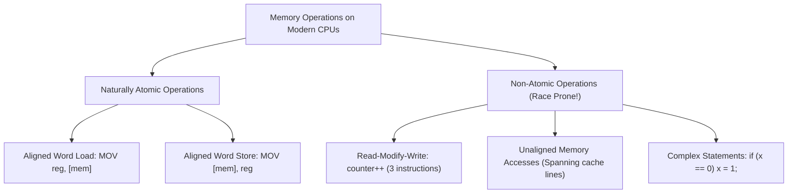
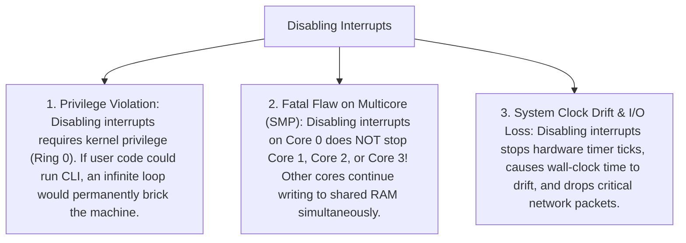
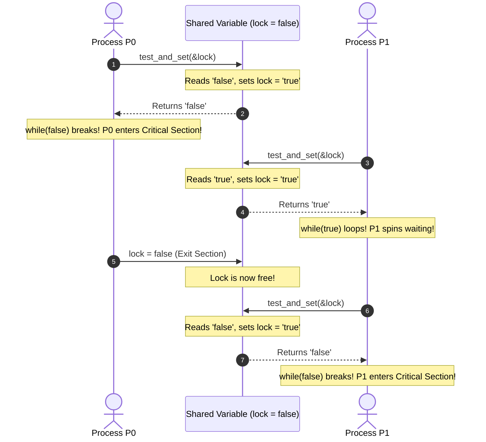
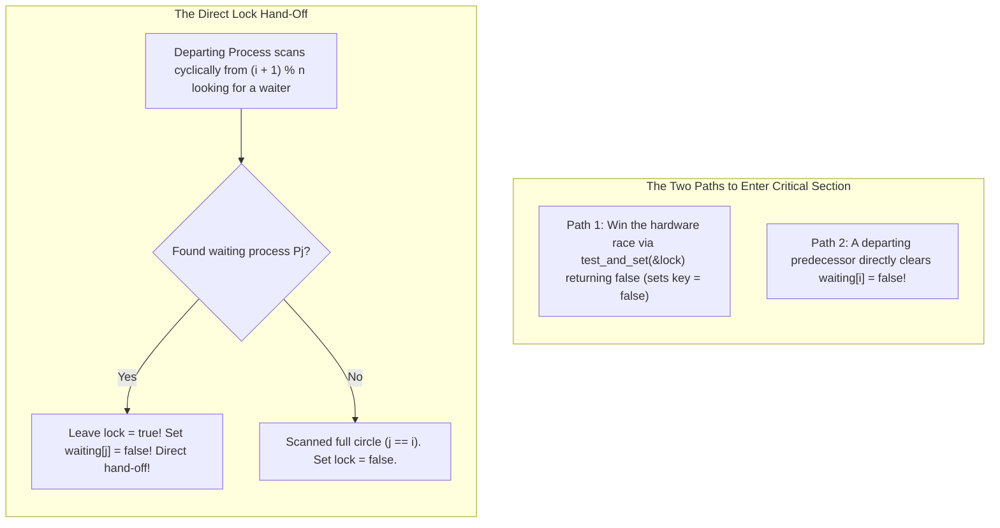

[OS Index](../README.md) / [Unit 2: Concurrency & Deadlocks](Introduction.md)

---

In Lecture 6, we studied Peterson's Algorithm—a brilliant pure-software solution to the Critical-Section Problem. 

However, we uncovered a fatal reality: on modern multi-core processors, **pure software algorithms break**. 

Modern CPUs and optimizing compilers aggressively reorder independent memory reads and writes to maximize instruction pipeline throughput. A processor may buffer a write to `flag[i]` and execute a read of `flag[j]` first, causing both processes to enter the critical section simultaneously.

If software alone cannot enforce execution ordering without fragile memory fences, where do we turn?

We turn to **Hardware Synchronization Primitives**.

In this lecture, we examine the fundamental principles of concurrency, evaluate the failure of disabling interrupts on multi-core systems, analyze specialized atomic hardware instructions—**`test_and_set`** and **`compare_and_swap`**—and construct algorithms that satisfy all three critical-section requirements, including **Bounded Waiting**.

---

## Principles of Concurrency

Operating systems and concurrent software must be designed under three foundational axioms:

1. **Unpredictable Execution Speeds:** The operating system cannot make any assumptions about the relative speeds of concurrent processes or CPU cores.
2. **Arbitrary Preemption:** In a preemptive operating system, the hardware timer can interrupt a thread between *any two machine instructions*.
3. **Determinism:** Program output must depend strictly on input data, never on the accidental timing or interleaving of thread execution.

---

## What is and is Not Atomic on Real Hardware?

Programmers often assume that simple operations in high-level languages are indivisible. In reality, modern hardware makes very specific guarantees:



- **Naturally Atomic:** On modern 32-bit and 64-bit architectures, reading or writing a single naturally aligned memory word is atomic at the bus level.
- **Non-Atomic:** Any operation that involves **reading a value, modifying it in a register, and writing it back** (Read-Modify-Write) is non-atomic. Between the read and the write, another CPU core can alter that exact memory location.

---

## Hardware Approach 1: Disabling Interrupts

The most primitive way to prevent preemption during a critical section is to disable hardware interrupts:

```c
// Entry Section
disable_interrupts(); // CLI instruction on x86

/* CRITICAL SECTION */

// Exit Section
enable_interrupts();  // STI instruction on x86
```

While interrupts are disabled, the hardware clock cannot fire a timer interrupt. The CPU core cannot switch contexts, guaranteeing that the currently running process executes its critical section without interruption.

### Why Disabling Interrupts Fails as a General Solution:



On modern multi-core computers, disabling interrupts is completely ineffective for protecting shared application data. Modern operating systems reserve interrupt disabling strictly for short, internal microkernel routines on a single core.

---

## Hardware Approach 2: Atomic Hardware Instructions

Rather than disabling interrupts, modern computer architectures provide **special hardware instructions** that perform Read-Modify-Write sequences **atomically**:

> **Definition of an Atomic Operation:**
> An operation that executes as a single, indivisible hardware unit. 
> 
> It provides two guarantees:
> 1. **All-or-Nothing:** It either runs to full completion or does not execute at all. No intermediate or partial state can ever be observed by another processor core.
> 2. **Indivisibility:** No other memory read or write can intervene between the read and write stages of the atomic instruction.

Modern CPUs enforce this at the silicon level by locking the cache line (using cache coherency protocols like MESI) during the execution of the instruction.

The two most famous atomic instructions are:
1. **`test_and_set`**
2. **`compare_and_swap` (CAS)**

---

## The `test_and_set` Instruction

The `test_and_set` instruction operates on a single boolean variable. 

Here is its logical behavior expressed in C:

```c
// EXECUTED ATOMICALLY IN HARDWARE
bool test_and_set(bool *target) {
    bool rv = *target;   // 1. Read the old value
    *target = true;      // 2. Set the value to true
    return rv;           // 3. Return the old value
}
```

Notice what happens:
- It **always sets the target variable to `true`**.
- It **returns the previous value** that was stored in `target`.
- Most importantly, the read, the write, and the return happen **atomically as a single machine instruction**.

---

## Building a Spinlock Using `test_and_set`

We can construct a mutual exclusion lock for an arbitrary number of processes using a single shared boolean:

```c
bool lock = false; // Shared lock: false = free, true = acquired

do {
    // Entry Section: Busy-wait until test_and_set returns false
    while (test_and_set(&lock))
        ; // Spin wait (do nothing!)

    /* CRITICAL SECTION */

    // Exit Section: Release the lock
    lock = false;

    /* REMAINDER SECTION */

} while (true);
```

### Tracing How the Lock Works:



### Evaluation Against the Three Criteria:
1. **Mutual Exclusion:** **Satisfied.** If the lock is held (`lock == true`), any other process calling `test_and_set` receives `true` and is trapped in the `while` loop. Only when the holder resets `lock = false` can another process receive `false` and enter.
2. **Progress:** **Satisfied.** When the lock is free, the next process that tests the lock acquires it immediately. A process in its remainder section has no effect on the lock.
3. **Bounded Waiting:** **FAILED!** 
   When multiple processes are spinning waiting for the lock, the selection of who grabs the lock next is determined purely by silicon-level memory bus contention. A process could spin indefinitely while newer arriving processes repeatedly win the race to set `lock = true`. **Starvation is possible.**

---

## The `compare_and_swap` (CAS) Instruction

Many modern CPU architectures (such as Intel x86 via the `CMPXCHG` instruction) utilize **Compare-And-Swap (CAS)** instead of `test_and_set`:

```c
// EXECUTED ATOMICALLY IN HARDWARE
int compare_and_swap(int *value, int expected, int new_value) {
    int temp = *value;            // 1. Read current value in memory
    if (*value == expected) {     // 2. If it matches what we expected:
        *value = new_value;       //    Update memory to new_value!
    }
    return temp;                  // 3. Always return original value
}
```

### How CAS Works:
- Takes three arguments: a memory pointer (`value`), an `expected` value, and a `new_value`.
- It updates `*value` to `new_value` **only if** `*value == expected`.
- It **always returns the original value** found in memory.
- If the return value equals `expected`, you know the swap succeeded!

### Building a Mutual Exclusion Lock with CAS:

```c
int lock = 0; // 0 = unlocked, 1 = locked

do {
    // Entry Section: Spin until CAS successfully changes 0 to 1
    while (compare_and_swap(&lock, 0, 1) != 0)
        ; // Busy-wait (spin)

    /* CRITICAL SECTION */

    // Exit Section
    lock = 0;

    /* REMAINDER SECTION */

} while (true);
```

### Why CAS is the Foundation of Modern Lock-Free Data Structures:
While `test_and_set` can only set a boolean to `true`, `compare_and_swap` can check whether a pointer or integer has been modified by another thread.

This enables **Lock-Free (Non-Blocking) Algorithms**:
```c
// Lock-free increment without ANY mutex locks!
void atomic_increment(int *val) {
    int current;
    do {
        current = *val;
    } while (compare_and_swap(val, current, current + 1) != current);
}
```
If another core updates `*val` while we were calculating `current + 1`, CAS detects that `*val != current`, rejects the update, and retries the loop! Modern language constructs like `std::atomic` in C++ and `AtomicInteger` in Java are built directly on top of hardware CAS.

---

## Satisfying Bounded Waiting with `test_and_set`

The simple `test_and_set` spinlock satisfied mutual exclusion and progress, but failed bounded waiting.

Can we design an algorithm using `test_and_set` that **guarantees Bounded Waiting for $n$ processes**?

Yes! We do so by introducing a shared array and implementing a **cyclic round-robin hand-off** in the exit section:

### Shared Data Structures:
```c
bool waiting[n]; // Initialized to false; waiting[i] == true means Pi wants to enter
bool lock;       // Initialized to false
```

### Algorithm for Process $P_i$:
```c
do {
    waiting[i] = true;
    bool key = true;

    // Entry Section: Spin while waiting AND key is true
    while (waiting[i] && key) {
        key = test_and_set(&lock);
    }
    waiting[i] = false;

    /* CRITICAL SECTION */

    // Exit Section: Find the next waiting process in cyclic order
    int j = (i + 1) % n;
    while ((j != i) && !waiting[j]) {
        j = (j + 1) % n; // Scan cyclically for the next waiting process
    }

    if (j == i) {
        // We scanned the entire circle and found NO ONE waiting!
        lock = false;        // Genuinely release the lock
    } else {
        // Found a waiting process Pj! Hand the lock DIRECTLY to Pj!
        waiting[j] = false;  // Unblocks Pj without touching 'lock'
    }

    /* REMAINDER SECTION */

} while (true);
```

---

## Dissecting the Bounded-Waiting Algorithm

This algorithm is an exam favorite because of its ingenious two-part design:



### How Bounded Waiting is Guaranteed:
1. **The Direct Hand-off:**
   When process $P_i$ exits, it does **not** simply set `lock = false` and let all $n$ processes fight a chaotic hardware race. 
   Instead, it scans the `waiting` array starting at index $i+1$, wrapping around cyclically.
2. If it finds a waiting process $P_j$, it **leaves `lock = true`** and directly sets `waiting[j] = false`!
   - This breaks $P_j$'s `while` loop, allowing $P_j$ to enter the critical section immediately.
   - Because `lock` remained `true` the entire time, no newly arriving process can sneak in and steal the lock!
3. **The Bound is $n - 1$:**
   Because the scan proceeds in strict cyclic order, every waiting process will be granted entry after at most **$n - 1$ turns**. Starvation is mathematically impossible.

---

## The Remaining Dilemma: Busy-Waiting (Spinlocks)

Look at every hardware solution we constructed in this lecture:
```c
while (test_and_set(&lock)) ; // SPINNING!
```

They all suffer from a massive practical defect: **Busy-Waiting (Spinlocks)**.

A spinning process sits in a tight CPU loop evaluating memory instructions millions of times a second. 
- On a single-core CPU, busy-waiting is disastrous: the spinning thread burns its entire time quantum holding the CPU, preventing the very thread that holds the lock from running and releasing it!
- On multi-core CPUs, spinlocks are acceptable only if the critical section is exceptionally short (a few CPU cycles).

Hardware instructions alone cannot eliminate busy-waiting. Why?
> **A user process spinning in a loop cannot put itself to sleep.**
> 
> Moving a process from the CPU into a waiting queue requires the intervention of the **operating system kernel**.

---

## Critical Section Solutions Summary

| Mechanism | Mutual Exclusion? | Progress? | Bounded Waiting? | Busy-Waits? |
| :--- | :---: | :--- :---: | :---: | :---: |
| **Disable Interrupts** | Yes (Uniprocessor only!) | Yes | Yes | **No** |
| **Peterson's Algorithm**| Yes (2 processes only) | Yes | Yes (Bound: 1) | **Yes** |
| **Simple `test_and_set`** | **Yes** ($n$ processes) | **Yes** | **No** (Starvation possible) | **Yes** |
| **Simple CAS Lock** | **Yes** ($n$ processes) | **Yes** | **No** (Starvation possible) | **Yes** |
| **Bounded `test_and_set`**| **Yes** ($n$ processes) | **Yes** | **Yes (Bound: $n-1$)** | **Yes** |

---

## Key Takeaways

- Software solutions fail on modern hardware due to **compiler and CPU instruction reordering** and out-of-order execution.
- Disabling interrupts is a privileged instruction that degrades system timing and **fails completely on Multi-Core (SMP) systems**.
- **Atomic operations** are indivisible hardware operations that execute without interruption or intermediate observation.
- **`test_and_set`** atomically reads a boolean and sets it to `true`. A simple lock built with it satisfies mutual exclusion and progress, but fails bounded waiting.
- **`compare_and_swap` (CAS)** atomically updates memory only if it matches an expected value. It serves as the foundation for modern **Lock-Free** concurrency.
- Bounded waiting with $n$ processes is achieved using `test_and_set` by maintaining a `waiting[n]` array and using a **cyclic hand-off** in the exit section, guaranteeing an upper bound of $n - 1$ waits.
- All hardware-only spinlocks suffer from **busy-waiting**. Eliminating busy-waiting requires operating system primitives that put waiting threads to sleep.

---

Now that we know how hardware enables atomic operations, how does the operating system build higher-level, sleep-based synchronization primitives that eliminate busy-waiting?

How do mutex locks and semaphores coordinate concurrent threads without wasting CPU cycles?

That brings us to operating system synchronization tools in [**Lecture 8: Mutex Locks and Semaphores**](L08%20-%20Mutex%20Locks%20and%20Semaphores.md).
