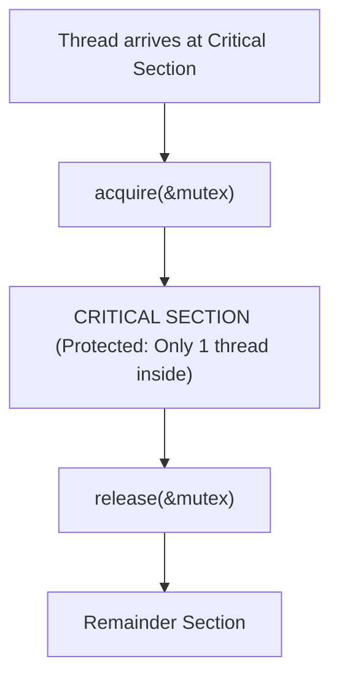
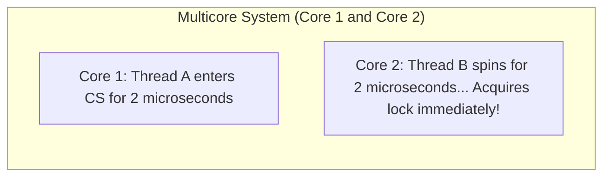
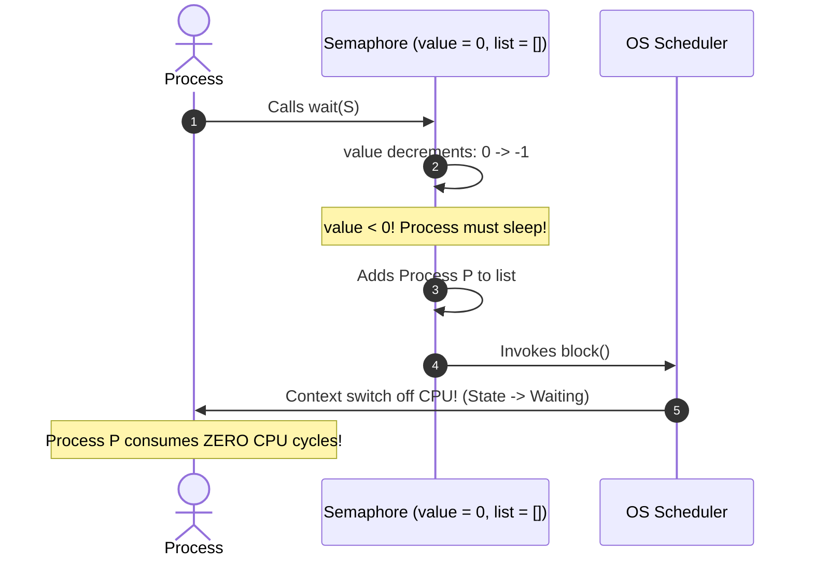
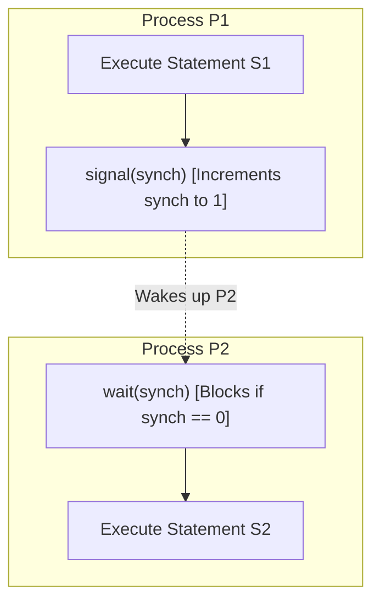
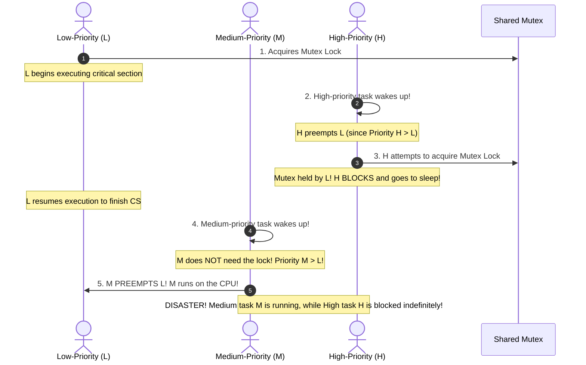

[OS Index](../README.md) / [Unit 2: Concurrency & Deadlocks](Introduction.md)

---

In the previous two lectures, we explored the theoretical and hardware mechanics of mutual exclusion. We saw Peterson's algorithm fail on modern out-of-order processors, and we used hardware atomic instructions like `test_and_set` and `compare_and_swap` to build locks.

However, all of those solutions had a glaring flaw: **Busy-Waiting (Spinlocks)**. 

A process trapped in a `while` loop burns CPU cycles doing zero productive work. Worse, building synchronization out of raw hardware instructions is difficult, error-prone, and inaccessible to everyday software engineers.

To solve this, the operating system kernel steps in to provide high-level synchronization abstractions:
1. **Mutex Locks:** A clean, atomic binary lock designed to protect critical sections.
2. **Semaphores:** A versatile integer-based primitive invented by Edsger Dijkstra that can count resources, enforce execution ordering, and—most importantly—**put waiting threads to sleep instead of burning CPU cycles**.

---

## Mutex Locks

The term **Mutex** is short for **Mutual Exclusion**.

A mutex lock is the simplest synchronization tool provided by operating systems. It is essentially an abstraction over a boolean lock variable, providing two atomic functions:
- **`acquire()`:** Requests the lock. If the lock is currently available, it is seized; if unavailable, the thread waits.
- **`release()`:** Releases the lock, making it available for other waiting threads.

```c
acquire() {
    while (!available)
        ; /* busy wait */
    available = false;
}

release() {
    available = true;
}
```



---

## Spinlocks: When is Busy-Waiting Actually Beneficial?

When a mutex lock is implemented using busy-waiting, it is called a **Spinlock**. 

Throughout earlier lectures, we treated busy-waiting as an unmitigated disaster. But on modern multi-core systems, **spinlocks have a very important, legitimate role**:



### The Cost of Sleeping vs. Spinning:
If a thread cannot acquire a lock, putting that thread to sleep requires:
1. A context switch out of the thread (saving registers, changing state to Waiting).
2. A context switch into another thread.
3. A subsequent context switch back into the thread when the lock is released.

Each context switch costs roughly **5 to 10 microseconds**. 

If the critical section is tiny (e.g., updating two integers in memory, lasting only **1 to 2 microseconds**):
- Putting the thread to sleep burns **15 microseconds** of context-switching overhead.
- Spinning for **2 microseconds** wastes only 2 microseconds of CPU time before acquiring the lock!

> **Rule of Thumb:**
> Spinlocks are advantageous **only on multi-core systems**, and **only when locks are held for durations shorter than the cost of two context switches**. 
> 
> On a single-core CPU, spinlocks are always terrible: the spinning thread prevents the lock-holder on that same core from running to release the lock!

---

## POSIX Mutex Locks in C

The POSIX standard provides mutexes through the `<pthread.h>` library:

```c
#include <pthread.h>

pthread_mutex_t lock;

// 1. Initialize the mutex
pthread_mutex_init(&lock, NULL);

// 2. Protect critical section
pthread_mutex_lock(&lock);
/* --- CRITICAL SECTION --- */
counter++;
/* ------------------------ */
pthread_mutex_unlock(&lock);

// 3. Destroy mutex when done
pthread_mutex_destroy(&lock);
```

By placing `pthread_mutex_lock()` and `pthread_mutex_unlock()` around `counter++`, the race condition we uncovered in Lecture 4 is completely eliminated. Only one thread can enter the critical section at a time.

---

## Semaphores

While a mutex lock is a binary tool (locked or unlocked), complex systems require more sophisticated coordination:
- How do we manage access to a pool of 5 identical database connections?
- How do we guarantee that Thread A completes step 1 *before* Thread B begins step 2?

To solve these problems, Dutch computer scientist **Edsger Dijkstra** introduced the **Semaphore** in 1965.

A **semaphore $S$** is an integer variable that, apart from initialization, is accessed only through two standard atomic operations:
1. **`wait()`** (originally named **$P$**, from Dutch *proberen*, "to test").
2. **`signal()`** (originally named **$V$**, from Dutch *verhogen*, "to increment").

### The Classical Definition (Spinning Semaphore):
```c
wait(S) {
    while (S <= 0)
        ; // busy wait
    S--;
}

signal(S) {
    S++;
}
```

---

## Types of Semaphores

1. **Binary Semaphore:**
   - The integer value of $S$ can range only between **`0` and `1`**.
   - Acts essentially as a mutex lock (initialized to `1` for mutual exclusion).
2. **Counting Semaphore:**
   - The integer value of $S$ can span across an unrestricted domain ($0$ to $N$).
   - Used to manage a **finite pool of identical resources**:
     - The semaphore is initialized to the number of available resources $N$.
     - Each process wishing to use a resource executes `wait(S)` (decrementing the count).
     - When a process releases a resource, it executes `signal(S)` (incrementing the count).
     - If all resources are checked out ($S == 0$), subsequent processes block until a resource is returned.

---

## Implementing Semaphores with NO Busy Waiting (Blocking / Sleeping)

The classical definition used busy-waiting. To build a production-grade semaphore, the operating system defines the semaphore as a C structure containing an integer value and a **waiting queue of process control blocks**:

```c
typedef struct {
    int value;
    struct process *list; // Linked list of waiting process PCBs
} semaphore;
```

When a process executes `wait()`, if the resource is unavailable, the kernel puts the process to **sleep**:

```c
void wait(semaphore *S) {
    S->value--;
    if (S->value < 0) {
        // Add this calling process PCB to S->list
        block(); // Kernel system call: Moves process to WAITING state!
    }
}

void signal(semaphore *S) {
    S->value++;
    if (S->value <= 0) {
        // Remove a process PCB 'P' from S->list
        wakeup(P); // Kernel system call: Moves process to READY queue!
    }
}
```



### Deep Dive: What Does a Negative Semaphore Value Mean?
Notice a profound property of this blocking implementation: **`S->value` can become negative!**

In classical spinning semaphores, $S$ never drops below zero. In the blocking implementation:
- If **`S->value > 0`**: The value represents the **number of resources currently available** for immediate acquisition.
- If **`S->value == 0`**: Exactly zero resources are free, but no processes are waiting.
- If **`S->value < 0`**: Exactly zero resources are free, and **the magnitude $|S\text{->value}|$ represents the exact number of processes currently sleeping in the waiting queue!**
  *(e.g., if `S->value == -3`, exactly 3 processes are blocked on that semaphore).*

---

## Using Semaphores to Enforce Execution Ordering

Semaphores are not just for mutual exclusion; they are powerful tools for **synchronizing execution order** between concurrent processes.

Suppose Process $P_1$ contains statement $S_1$, and Process $P_2$ contains statement $S_2$. 
We require that **$S_2$ must execute only AFTER $S_1$ has completed**.

We can guarantee this by sharing a semaphore initialized to **`0`**:

```c
semaphore synch = 0;

// --- Process P1 ---
S1;
signal(synch); // Wakes up P2 once S1 is done!

// --- Process P2 ---
wait(synch);   // Blocks immediately because synch == 0!
S2;
```



Look at how elegant this is:
- If $P_2$ reaches `wait(synch)` first, it sees `synch == 0`, decrements it to `-1`, and goes to sleep. When $P_1$ finishes $S_1$, it calls `signal()`, waking $P_2$ to run $S_2$.
- If $P_1$ finishes $S_1$ first, it calls `signal()`, setting `synch = 1`. When $P_2$ arrives, `wait()` decrements `synch` to `0` and proceeds immediately without sleeping.

In both cases, $S_2$ is mathematically guaranteed to execute after $S_1$. **A mutex cannot do this because mutexes have ownership constraints.**

---

## Mutex vs. Binary Semaphore: The Ownership Principle

Students often ask: *"If a binary semaphore only takes values 0 and 1, isn't it identical to a mutex?"*

No! They differ fundamentally on the concept of **Ownership**:

| Feature | Mutex Lock | Binary Semaphore |
| :--- | :--- | :--- |
| **Concept of Ownership**| **YES.** The thread that locks the mutex owns it. | **NO.** A semaphore has no owner. |
| **Release Permission** | **Only the thread that locked the mutex can unlock it!** | **Any thread** (or interrupt routine) can signal it! |
| **Primary Purpose** | Strict **Mutual Exclusion** (Protecting code) | **Signaling & Ordering** (Event notifications) |
| **Initial State** | Unlocked | Can be initialized to 0 (to enforce ordering) or 1 |

---

## Problems with Semaphores: Hazards and Failures

Because semaphores rely on programmers correctly placing `wait()` and `signal()` calls across distributed source files, honest mistakes cause catastrophic failures:

1. **Inversion of Calls (Accidental Parallelism):**
   ```c
   signal(mutex);
   /* CRITICAL SECTION */
   wait(mutex);
   ```
   Multiple processes can enter the critical section simultaneously, destroying mutual exclusion!
2. **Double Wait (Deadlock):**
   ```c
   wait(mutex);
   /* CRITICAL SECTION */
   wait(mutex); // Trapped in its own lock! Deadlock!
   ```
3. **Omission of Signal (Permanent Hang):**
   A programmer writes `wait(mutex)`, executes the critical section, and forgets `signal(mutex)` (or the process crashes inside the critical section). Every other process that ever touches this semaphore will block forever.

---

## Priority Inversion & The Priority Inheritance Protocol

A famous and subtle hazard in real-time preemptive systems is **Priority Inversion**.

Consider three processes with priorities: $\text{High } (H) > \text{Medium } (M) > \text{Low } (L)$:



Look at the breakdown:
- High-priority process $H$ is blocked waiting for Low-priority process $L$ to release the lock.
- But Medium-priority process $M$ (which has nothing to do with the lock) preempts $L$!
- As long as $M$ runs, $L$ cannot execute.
- As long as $L$ cannot execute, the lock is never freed.
- As long as the lock is never freed, the critical High-priority process $H$ is starved!

> **Real-World Incident:** This exact bug crippled NASA's **Mars Pathfinder spacecraft in 1997**. The high-priority information bus thread was starved by long-running medium-priority communications tasks because a low-priority meteorological task held a mutex, causing the spacecraft's watchdog timer to repeatedly reset the computer on Mars!

### The Solution: Priority Inheritance Protocol
To solve priority inversion, modern real-time operating systems implement the **Priority Inheritance Protocol**:
- When a low-priority process $L$ holds a lock that a high-priority process $H$ needs, **Process $L$ temporarily inherits the high priority of Process $H$**!
- Because $L$ is now operating with priority $H$, the medium-priority process $M$ **cannot preempt it**!
- Process $L$ quickly finishes its critical section, releases the lock, drops back down to its original low priority, and Process $H$ immediately preempts and runs.

---

## POSIX Semaphore APIs (`<semaphore.h>`)

In POSIX C programming, semaphores are provided through the POSIX realtime extension library:

```c
#include <semaphore.h>

sem_t sem;

// 1. Initialize semaphore: sem_init(sem_ptr, pshared, initial_value)
// pshared = 0 means shared between threads of the same process
sem_init(&sem, 0, 1);

// 2. Wait (P / Decrement)
sem_wait(&sem);

/* --- CRITICAL SECTION / RESOURCE USAGE --- */

// 3. Signal (V / Increment)
sem_post(&sem);

// 4. Destroy semaphore
sem_destroy(&sem);
```

---

## Key Takeaways

- **Mutex Locks** are boolean synchronization tools providing atomic `acquire()` and `release()` operations.
- **Spinlocks** use busy-waiting and are beneficial only on multi-core architectures for very short critical sections where sleeping would cost more in context-switch latency.
- **Semaphores** manage access via an integer $S$ modified only by atomic `wait()` (decrement) and `signal()` (increment).
- In the **blocking semaphore implementation**, waiting processes are put to sleep via `block()` and awakened via `wakeup()`, eliminating CPU-wasting busy-waiting.
- In a blocking semaphore, a **negative value indicates the exact number of processes currently sleeping in the wait queue**.
- Mutexes enforce **ownership** (only the locker can unlock); Semaphores have **no ownership** and can synchronize execution order between different processes.
- **Priority Inversion** occurs when a medium-priority task preempts a low-priority task holding a lock needed by a high-priority task. It is solved by the **Priority Inheritance Protocol**.

---

Now that we have master synchronization tools like Mutexes and Semaphores, how do we use them to solve classic multi-process coordination dilemmas?

How do we solve the Bounded-Buffer problem without busy-waiting, manage concurrent Readers and Writers without starvation, and keep five Dining Philosophers from starving each other?

That brings us to the canonical problems of concurrency in [**Lecture 9: Classical Problems of Synchronization**](L09%20-%20Classical%20Problems%20of%20Synchronization.md).
