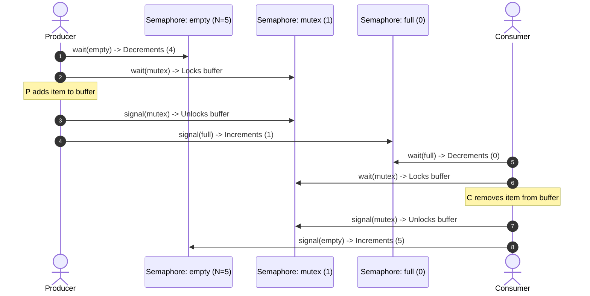
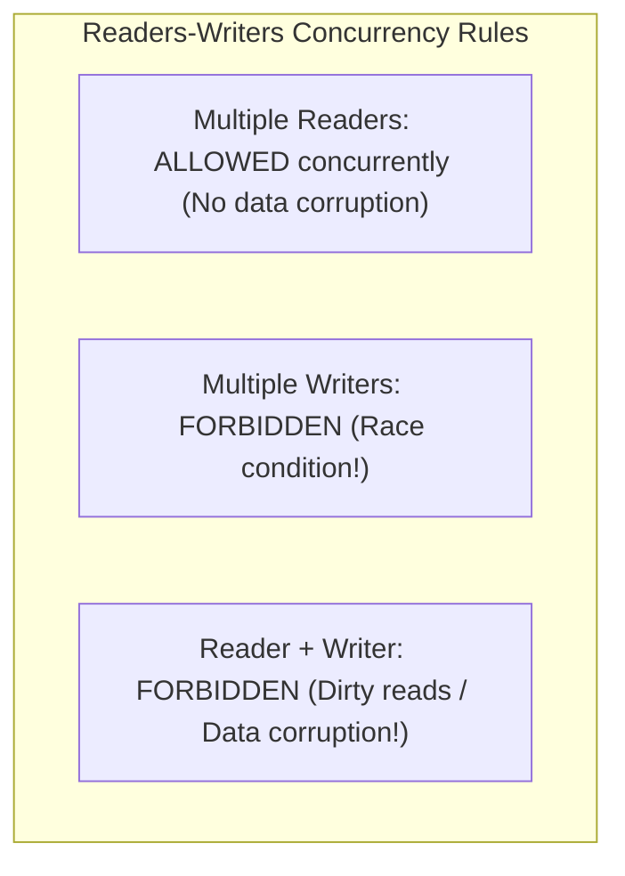
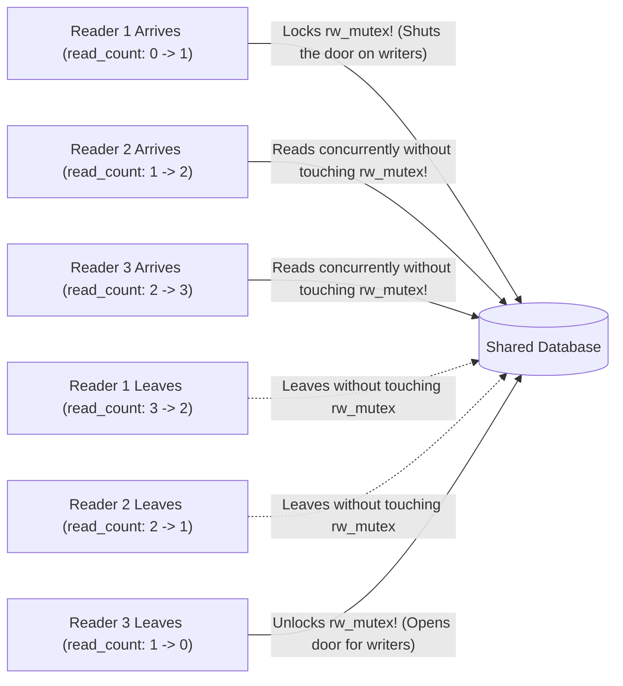
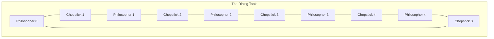
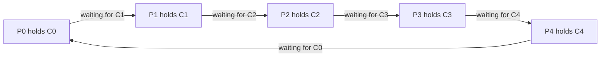
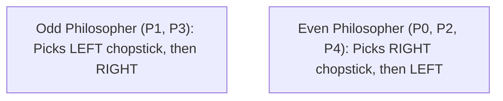

[OS Index](../README.md) / [Unit 2: Concurrency & Deadlocks](Introduction.md)

---

In the previous lecture, we examined the operating system's core synchronization primitives: Mutex Locks and Semaphores. We saw how counting semaphores track resource availability and how the kernel blocks waiting threads to eliminate CPU-wasting spinlocks.

Now, we put these tools to work against the canonical coordination challenges of computer science: the **Classical Problems of Synchronization**.

These problems are not mere academic brainteasers. They are the **fundamental archetypes of concurrent systems design**:
1. **The Bounded-Buffer Problem:** Coordinates producers and consumers exchanging data across a finite queue. *(Every thread pool, audio buffer, and network socket queue is an instance of this problem).*
2. **The Readers-Writers Problem:** Coordinates asymmetric data access where concurrent reads are harmless, but writes require absolute exclusivity. *(Every database engine and file caching system is an instance of this problem).*
3. **The Dining Philosophers Problem:** Allocates multiple mutually exclusive resources among competing processes, demonstrating how local, correct locks can still cause global system collapse. *(Every transaction engine acquiring locks on multiple database rows is an instance of this problem).*

---

## 1. The Bounded-Buffer (Producer-Consumer) Problem

Recall the Bounded-Buffer problem from Lecture 1 and Lecture 6. We have a shared circular buffer capable of holding $n$ items.

To coordinate producers and consumers without busy-waiting and without race conditions, we use **three semaphores**:

```c
#define N 10 // Buffer capacity

semaphore mutex = 1; // Binary semaphore: enforces mutual exclusion on the buffer
semaphore full  = 0; // Counting semaphore: counts the number of occupied (full) slots
semaphore empty = N; // Counting semaphore: counts the number of available (empty) slots
```

### The Invariant:
At any instant in time, the sum of empty and full slots satisfies:
$$\text{empty} + \text{full} = N$$

### The Producer Code:
```c
do {
    // 1. Produce an item in next_produced

    wait(empty);  // Decrement empty slot count; blocks if buffer is completely full!
    wait(mutex);  // Enter critical section to safely manipulate the buffer pointers

    // 2. Add next_produced to the buffer array

    signal(mutex); // Exit critical section
    signal(full);  // Increment full slot count; wakes up any sleeping consumer!

} while (true);
```

### The Consumer Code:
```c
do {
    wait(full);   // Decrement full slot count; blocks if buffer is completely empty!
    wait(mutex);  // Enter critical section to safely manipulate the buffer pointers

    // 1. Remove an item from the buffer into next_consumed

    signal(mutex); // Exit critical section
    signal(empty); // Increment empty slot count; wakes up any sleeping producer!

    // 2. Consume the item in next_consumed

} while (true);
```



---

## The Deadly Wait-Swap Trap in the Bounded Buffer

Look very closely at the order of the two `wait()` calls in the Producer:
```c
wait(empty); // 1. Resource check
wait(mutex); // 2. Mutex acquisition
```

What would happen if an innocent programmer reversed those two lines?

```c
// DANGEROUS ANTI-PATTERN: DO NOT DO THIS!
wait(mutex); // 1. Mutex acquisition
wait(empty); // 2. Resource check
```

Trace the catastrophe:
1. Suppose the buffer is completely full (`empty == 0`).
2. The producer arrives and executes `wait(mutex)`. The mutex is free, so the producer **acquires the mutex lock**.
3. Next, the producer executes `wait(empty)`. Because `empty == 0`, the producer **goes to sleep** waiting for an empty slot.
4. Now, the consumer arrives to consume an item. To do so, the consumer executes: `wait(full)` (succeeds) and then `wait(mutex)`.
5. **DEADLOCK!** 
   - The consumer blocks because the producer holds `mutex`.
   - The producer is asleep holding `mutex`, waiting for the consumer to run and execute `signal(empty)`.
   - Neither process can ever make progress! The system is permanently frozen.

> **The Golden Rule of Synchronization:**
> **Always acquire resource counting semaphores BEFORE acquiring the mutual exclusion lock.**

---

## 2. The Readers-Writers Problem

In many applications, access to shared data exhibits strong asymmetry:
- **Readers:** Processes that only *read* data (e.g., executing SQL `SELECT` queries).
- **Writers:** Processes that *update* or *modify* data (e.g., executing SQL `UPDATE`, `INSERT`, or `DELETE`).



### The Required Access Discipline:
1. Multiple readers can read the database simultaneously.
2. Only one writer can access the database at a time.
3. If a writer is writing, **no readers are allowed to enter**.

---

## The Readers-Writers Solution Structure

To implement this, we use two semaphores and a reader counter:

```c
semaphore rw_mutex = 1; // Mutual exclusion for writers; also blocks readers during writes
semaphore mutex    = 1; // Protects the integrity of the shared read_count variable
int read_count     = 0; // Number of readers currently reading
```

### The Writer Process:
The writer's logic is simple: it demands exclusive access to `rw_mutex`:
```c
do {
    wait(rw_mutex); // Lock out all other writers and all readers

    /* WRITING IS PERFORMED */

    signal(rw_mutex); // Release exclusive lock

} while (true);
```

### The Reader Process:
```c
do {
    // --- READER ENTRY SECTION ---
    wait(mutex);        // Ensure exclusive access to modify read_count
    read_count++;
    if (read_count == 1) {
        wait(rw_mutex); // The FIRST reader locks the resource against all writers!
    }
    signal(mutex);      // Release mutex so other readers can enter

    /* READING IS PERFORMED (Concurrent with other readers!) */

    // --- READER EXIT SECTION ---
    wait(mutex);        // Ensure exclusive access to modify read_count
    read_count--;
    if (read_count == 0) {
        signal(rw_mutex); // The LAST reader unlocks the resource for writers!
    }
    signal(mutex);

} while (true);
```

---

## The First-In / Last-Out Gatekeeper Principle

Look at the elegance of how the `read_count` checks work:



- **The First Reader In:** When `read_count` increments from `0` to `1`, the first reader calls `wait(rw_mutex)`. This locks out any writers.
- **Intermediate Readers:** Any subsequent readers increment `read_count` and proceed straight to reading. They do not touch `rw_mutex`.
- **The Last Reader Out:** When a reader decrements `read_count` to `0`, it realizes it is the final reader leaving the building. It calls `signal(rw_mutex)`, allowing waiting writers to proceed.

---

## Variations and the Starvation Trade-Off

Every solution to the Readers-Writers problem embeds an unavoidable policy trade-off:

1. **First Variation (Reader-Preference):**
   - No reader is kept waiting unless a writer has already obtained permission to use the shared object.
   - **The Defect: Writer Starvation!** If a new reader arrives before the previous reader finishes, `read_count` never drops to 0. A continuous stream of readers will cause writers to starve indefinitely.
2. **Second Variation (Writer-Preference):**
   - Once a writer is ready, that writer performs its write as soon as possible. If a writer is waiting, no *new* readers are allowed to start reading!
   - **The Defect: Reader Starvation!** If writers continuously queue up updates, readers will starve.

---

## 3. The Dining Philosophers Problem

The Dining Philosophers problem was formulated by Edsger Dijkstra in 1965 to illustrate the challenges of allocating multiple shared resources among competing processes:



### The Scenario:
- Five philosophers spend their lives alternating between two activities: **Thinking** and **Eating**.
- Five single chopsticks are laid out on a circular table, with one chopstick between each pair of adjacent philosophers.
- A philosopher needs **two chopsticks simultaneously** to eat a bowl of rice: the chopstick on their left and the chopstick on their right.
- When finished eating, a philosopher puts down both chopsticks and resumes thinking.

---

## The Naive Semaphore Solution and System Deadlock

Each chopstick is represented by a binary semaphore:
```c
semaphore chopstick[5] = {1, 1, 1, 1, 1};
```

Philosopher $i$ attempts to pick up their chopsticks sequentially:
```c
// Algorithm for Philosopher i
do {
    wait(chopstick[i]);                 // Pick up left chopstick
    wait(chopstick[(i + 1) % 5]);       // Pick up right chopstick

    /* EATING */

    signal(chopstick[i]);               // Put down left chopstick
    signal(chopstick[(i + 1) % 5]);     // Put down right chopstick

    /* THINKING */

} while (true);
```

### The Deadlock Disaster:
Look at what happens if all five philosophers become hungry at the exact same instant:
1. Philosopher 0 grabs Chopstick 0.
2. Philosopher 1 grabs Chopstick 1.
3. Philosopher 2 grabs Chopstick 2.
4. Philosopher 3 grabs Chopstick 3.
5. Philosopher 4 grabs Chopstick 4.

Every single chopstick is now held by a philosopher!

Now, each philosopher attempts to pick up their right chopstick:
- Philosopher 0 calls `wait(chopstick[1])` (Held by Philosopher 1). Blocks!
- Philosopher 1 calls `wait(chopstick[2])` (Held by Philosopher 2). Blocks!
- Philosopher 2 calls `wait(chopstick[3])` (Held by Philosopher 3). Blocks!
- Philosopher 3 calls `wait(chopstick[4])` (Held by Philosopher 4). Blocks!
- Philosopher 4 calls `wait(chopstick[0])` (Held by Philosopher 0). Blocks!



Notice the closed loop: **every process is waiting for an event that can only be caused by another waiting process.**

This is a classic **Circular Wait Deadlock**. All five philosophers starve to death holding one chopstick!

---

## Three Deadlock-Free Solutions to Dining Philosophers

Operating system theorists have developed three strategies to eliminate deadlock in Dining Philosophers:

### 1. Limit Table Capacity (Remove Resource Contention)
Allow at most **four philosophers** to sit at the table simultaneously, even though five seats and five chopsticks exist:
- By the Pigeonhole Principle, if 4 philosophers compete for 5 chopsticks, at least one philosopher is mathematically guaranteed to acquire both chopsticks.
- That philosopher eats, finishes, and releases both chopsticks, allowing the other philosophers to eat in turn.

### 2. Atomic Dual Acquisition (Acquire Both or None)
A philosopher is allowed to pick up chopsticks **only if both the left and right chopsticks are simultaneously available**:
- This can be implemented inside a critical section protected by a mutex, or using System V's `semop()` multi-semaphore atomic system call.
- Because a philosopher never holds one chopstick while waiting for another, the "Hold and Wait" condition for deadlock is eliminated.

### 3. Asymmetric Ordering (Break the Circular Wait)
Enforce an asymmetric rule based on philosopher ID:
- An **odd-numbered philosopher** picks up their **left chopstick first**, then their right chopstick.
- An **even-numbered philosopher** picks up their **right chopstick first**, then their left chopstick.



Look at the interaction between Philosopher 0 (even) and Philosopher 1 (odd):
- Philosopher 0 tries to grab Chopstick 1 first.
- Philosopher 1 also tries to grab Chopstick 1 first!
- They compete for the **exact same chopstick first**, meaning only one of them can pick up a chopstick at all. 
- The circular wait chain is completely broken, guaranteeing that deadlock cannot form!

---

## Classical Problems Summary Comparison

| Problem | Shared Data & Initial Semaphores | Core Synchronization Mechanism | Primary Failure Hazard |
| :--- | :--- | :--- | :--- |
| **Bounded-Buffer** | `mutex = 1`, `full = 0`, `empty = n` | Two complementary counting semaphores + 1 mutex | Deadlock if `wait(mutex)` is called before `wait(empty)` |
| **Readers-Writers**| `rw_mutex = 1`, `mutex = 1`, `read_count = 0` | First reader locks resource; last reader unlocks it | Writer starvation (reader-preference) or Reader starvation |
| **Dining Philosophers**| `chopstick[5] = {1,1,1,1,1}` | Philosophers compete for adjacent paired resources | Circular-wait deadlock when all grab left chopstick |

---

## Key Takeaways

- In the **Bounded-Buffer Problem**, `empty` starts at $n$ and `full` starts at $0$. Swapping the order of `wait(empty)` and `wait(mutex)` causes **Deadlock**.
- In the **Readers-Writers Problem**, multiple readers can read concurrently, but writers demand exclusive access.
- Readers-Writers uses a **Gatekeeper Pattern**: the first reader locks `rw_mutex` on behalf of the group, and the last reader releases it.
- Favoring readers causes **Writer Starvation**; favoring writers causes **Reader Starvation**.
- The naive solution to the **Dining Philosophers Problem** results in total deadlock when all philosophers pick up their left chopstick simultaneously.
- Deadlock in Dining Philosophers is prevented by:
  1. Limiting the table to 4 philosophers.
  2. Acquiring both chopsticks atomically.
  3. **Asymmetric ordering** (odd philosophers grab left first, even grab right first), breaking the circular wait.

---

The Dining Philosophers problem gave us our first direct look at the most dangerous pathology in concurrent systems: **Deadlock**.

What are the precise mathematical conditions that cause deadlocks? How can an operating system detect deadlocks using Resource-Allocation Graphs, and how can Dijkstra's famous Banker's Algorithm prevent deadlocks entirely?

That brings us to resource allocation and deadlock management in [**Lecture 10: Deadlocks**](L10%20-%20Deadlocks.md).
