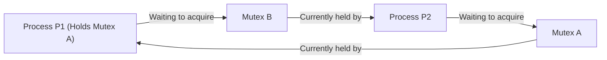
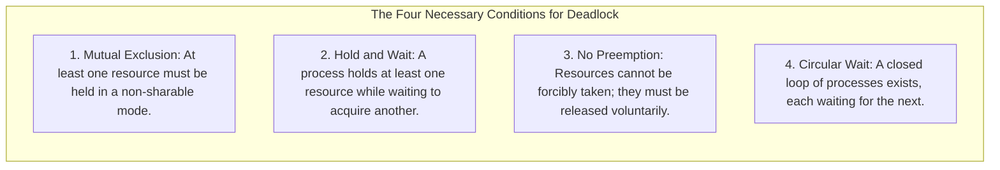
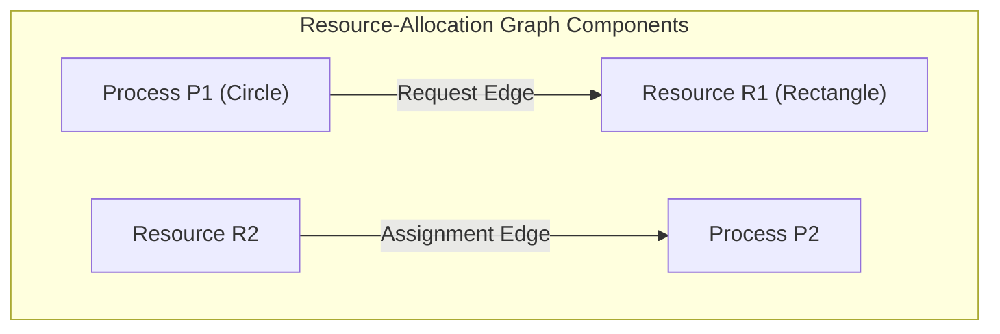
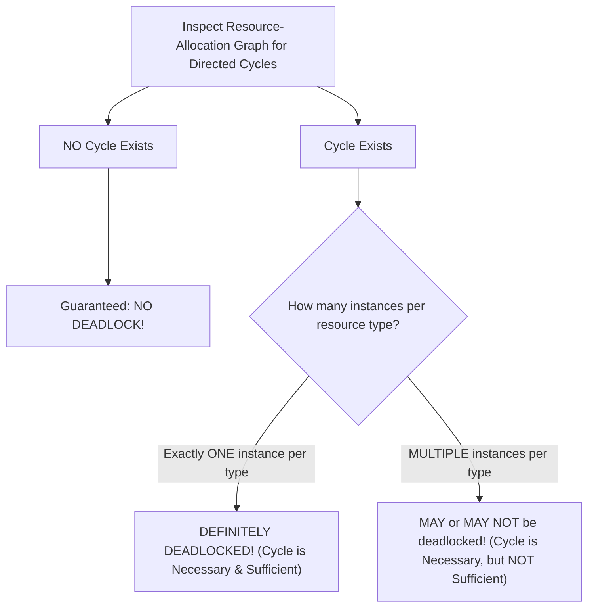
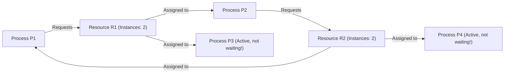
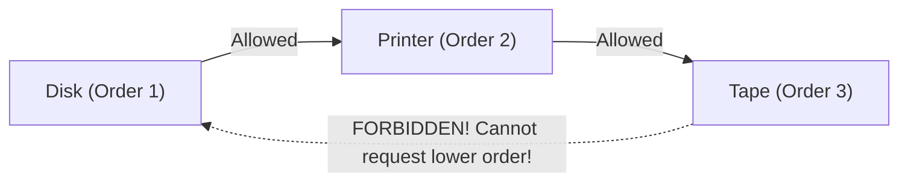
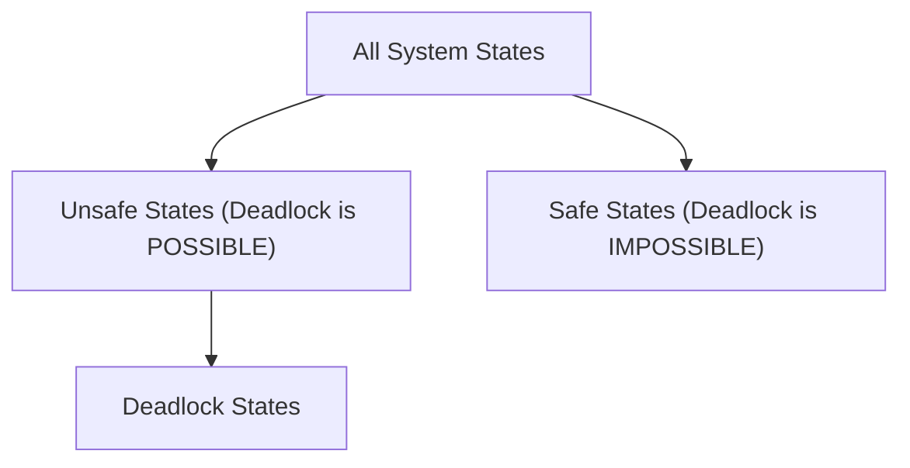
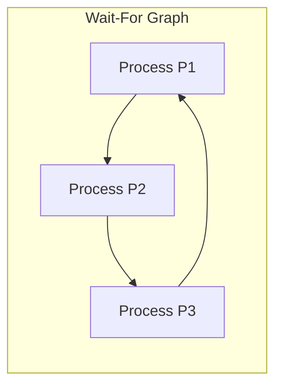

[OS Index](../README.md) / [Unit 2: Concurrency & Deadlocks](Introduction.md)

---

In the previous lecture, we studied the Classical Problems of Synchronization and witnessed the catastrophic failure of the naive Dining Philosophers algorithm: all five philosophers picked up their left chopstick, waited for their right chopstick, and froze the entire system forever.

That phenomenon is called **Deadlock**.

Deadlock is the ultimate pathology of concurrent computing. In this lecture, we treat deadlock systematically:
- We formulate the **four necessary conditions** that make deadlock possible.
- We model deadlocks visually and mathematically using **Resource-Allocation Graphs (RAG)**.
- We explore the four major strategies for dealing with deadlocks: **Prevention**, **Avoidance (The Banker's Algorithm)**, **Detection and Recovery**, and **The Ostrich Algorithm**.

---

## What is a Deadlock?

In a multiprogramming environment, concurrent processes share finite hardware and software resources: CPU cores, memory frames, database records, printers, and mutex locks.

A process requests resources; if the resources are unavailable, the process enters the Waiting state.

> **Formal Definition of Deadlock:**
> A situation where every process in a set is waiting for an event that can only be caused by another process in that same set.

Look at the circular dependency:
- $P_1$ holds Mutex A and is waiting for Mutex B.
- $P_2$ holds Mutex B and is waiting for Mutex A.
- Neither process can run, neither can release its lock, and neither can be preempted. They will remain frozen for eternity.

### The Real-World Bridge Analogy:
Imagine traffic on a narrow, single-lane bridge:
- A car traveling East enters the bridge from the West.
- A car traveling West enters the bridge from the East.
- They meet head-to-head in the exact center of the bridge.
- Neither car can move forward. Neither car can turn around. The only resolution is for one car to back up (preemption and rollback).

---

## The Four Necessary Coffman Conditions

In 1971, Edward G. Coffman Jr. proved that a deadlock can arise **if and only if all four** of the following conditions hold simultaneously:

### 1. Mutual Exclusion
At least one resource must be held in a **non-sharable mode**. Only one process at a time can use the resource. If another process requests that resource, it must wait.
*(Sharable resources, such as read-only files, can never be involved in a deadlock!)*

### 2. Hold and Wait
A process must currently be **holding at least one resource** and actively **waiting to acquire additional resources** that are held by other processes.

### 3. No Preemption
Resources **cannot be preempted** by the operating system. A resource can only be released voluntarily by the process holding it, after that process has finished its computation.

### 4. Circular Wait
A closed chain of processes $\{P_0, P_1, \dots, P_n\}$ exists such that:
- $P_0$ is waiting for a resource held by $P_1$,
- $P_1$ is waiting for a resource held by $P_2$,
- $\dots$
- $P_{n-1}$ is waiting for a resource held by $P_n$, and
- $P_n$ is waiting for a resource held by $P_0$.

> **Crucial Rule:** If you can mathematically eliminate **even one** of these four conditions, deadlock becomes physically impossible!

---

## Modeling Deadlocks: The Resource-Allocation Graph (RAG)

Deadlocks can be modeled precisely using a directed graph $G = (V, E)$ called a **Resource-Allocation Graph**:

### The Vertices ($V$):
- **Process Nodes ($P$):** Represented as **Circles** ($\bigcirc$).
- **Resource Nodes ($R$):** Represented as **Rectangles** ($\square$).
  - If a resource type has multiple identical instances, each instance is drawn as a **dot** ($\bullet$) inside the rectangle.

### The Directed Edges ($E$):
- **Request Edge ($P_i \rightarrow R_j$):** An arrow pointing from a process to a resource. Means Process $P_i$ has requested an instance of $R_j$ and is currently waiting.
- **Assignment Edge ($R_j \rightarrow P_i$):** An arrow pointing from a specific resource dot to a process. Means an instance of $R_j$ has been allocated to Process $P_i$.

---

## The Cycle Theorems: Does a Cycle Mean Deadlock?

Students frequently make mistakes regarding cycles in a Resource-Allocation Graph. Memorize these fundamental theorems:

### Case Study: A Cycle Without Deadlock!
Look at this classic counter-example with multiple resource instances:

Notice:
- There is a closed cycle: $P_1 \rightarrow R_1 \rightarrow P_2 \rightarrow R_2 \rightarrow P_1$.
- **Is the system deadlocked? NO!**
- Why? Process $P_3$ is holding an instance of $R_1$, but $P_3$ is not waiting for anything! $P_3$ will finish its work, release $R_1$, and that freed instance will satisfy $P_1$'s request, breaking the cycle.
- Therefore: with multiple instances, **a cycle is necessary for deadlock, but NOT sufficient**.

---

## The Four Methods for Handling Deadlocks

1. **Deadlock Prevention:** Design the system protocols so that at least one of Coffman's four conditions can never hold.
2. **Deadlock Avoidance:** The operating system dynamically evaluates every resource request at runtime and grants it only if the system remains in a **Safe State** (e.g., The Banker's Algorithm).
3. **Deadlock Detection and Recovery:** Allow deadlocks to occur, periodically run detection algorithms to locate cycles, and recover by killing processes or preempting resources.
4. **Deadlock Ignorance (The Ostrich Algorithm):** Pretend deadlocks never happen.

### Why Real Operating Systems Use The Ostrich Algorithm:
Why do Linux, Windows, and macOS ignore deadlocks in user space?
- In real-world software, deadlocks are relatively rare.
- Deadlock prevention reduces hardware resource utilization to unacceptable levels.
- Deadlock avoidance (Banker's Algorithm) requires every program to declare its maximum resource needs in advance—something no general-purpose application can do.
- It is cheaper to let a deadlock occur once a month and let the user terminate the frozen app (`kill -9`) than to slow down every single instruction with safety checks.

*(Note: Operating system kernels do strictly prevent deadlocks in their own internal code using lock ordering!).*

---

## Deadlock Prevention: Eliminating Coffman's Conditions

To prevent deadlocks statically, we must eliminate one of the four conditions:

### 1. Eliminating Mutual Exclusion
- Make all resources sharable.
- *Why it fails:* Hardware devices (printers) and software locks (mutexes) are inherently non-sharable. If two processes write to a file or memory word simultaneously, data is corrupted.

### 2. Eliminating Hold and Wait
- **Protocol A:** A process must request and receive **all** of its required resources at once before it begins executing. If even one resource is unavailable, it gets none.
- **Protocol B:** A process can request a resource only when it has **zero resources allocated**. It must release all current resources before requesting new ones.
- *Costs:* Horrible resource utilization (a tape drive needed for 1 second at the end of a 2-hour job sits locked for 2 hours) and high risk of **Starvation**.

### 3. Eliminating No Preemption
- If a process holding resources requests another resource that cannot be immediately allocated, **all of its currently held resources are forcibly preempted and released**!
- The process is put on a wait list and restarts only when it re-acquires both its old and new resources.
- *Costs:* Only works for state that can be easily saved and restored (CPU registers and memory pages). You cannot preempt a printer halfway through printing a page or a database transaction halfway through writing records.

### 4. Eliminating Circular Wait: Strict Resource Ordering
This is the **only truly practical prevention technique** used in real systems:
- Impose a strict, global **linear ordering function** $F: R \rightarrow \mathbb{N}$ on all resource types:
  $$F(\text{Disk}) = 1, \quad F(\text{Printer}) = 2, \quad F(\text{Tape Drive}) = 3$$
- **The Rule:** A process can request a resource $R_j$ **only if** $F(R_j)$ is strictly greater than the enumeration of all resources it currently holds!

### Mathematical Proof of Correctness:
Suppose a circular wait exists: $P_0 \rightarrow P_1 \rightarrow \dots \rightarrow P_n \rightarrow P_0$.
- $P_0$ holds $R_0$ and requests $R_1 \implies F(R_0) < F(R_1)$
- $P_1$ holds $R_1$ and requests $R_2 \implies F(R_1) < F(R_2)$
- $\dots$
- $P_n$ holds $R_n$ and requests $R_0 \implies F(R_n) < F(R_0)$

Chaining these inequalities:
$$F(R_0) < F(R_1) < F(R_2) < \dots < F(R_n) < F(R_0)$$

This implies $F(R_0) < F(R_0)$, which is a logical contradiction! Circular wait is mathematically impossible.

---

## Deadlock Avoidance and the Safe State

In **Deadlock Avoidance**, the operating system requires that each process declare its **Maximum resource claims** before execution begins.

At runtime, whenever a process requests a currently available resource, the kernel analyzes whether granting that request will leave the system in a **Safe State**.

### What is a Safe State?
A state is **safe** if there exists a **Safe Sequence** $\langle P_0, P_1, \dots, P_{n-1} \rangle$ of processes such that for each $P_i$, the maximum remaining resources that $P_i$ can still request can be satisfied by:
$$\text{Currently Available Resources} + \sum_{j < i} \text{Resources Held by all Preceding Processes } P_j$$

- If $P_i$'s needs cannot be immediately satisfied, it waits until all preceding processes $P_j$ finish, return their resources, and then $P_i$ runs to completion.
- **A Safe State guarantees no deadlock.**
- **An Unsafe State is NOT deadlocked**, but it *can lead* to deadlock if processes simultaneously demand their maximum declared needs.
- **Avoidance Rule:** Grant a resource request if and only if the resulting state is **Safe**!

---

## The Banker's Algorithm (Edsger Dijkstra)

For systems where resource types have **multiple instances**, the classic deadlock avoidance algorithm is Dijkstra's **Banker's Algorithm**.

It is named after a small-town banker who never allocates available cash in a way that leaves him unable to satisfy the credit limits of all his customers.

### Data Structures (for $n$ processes, $m$ resource types):
- **`Available[m]`:** Vector of length $m$. `Available[j] = k` means $k$ instances of resource $R_j$ are free.
- **`Max[n][m]`:** $n \times m$ matrix. `Max[i][j] = k` means process $P_i$ may request at most $k$ instances of $R_j$.
- **`Allocation[n][m]`:** $n \times m$ matrix. `Allocation[i][j] = k` means process $P_i$ currently holds $k$ instances of $R_j$.
- **`Need[n][m]`:** $n \times m$ matrix. Remaining resources $P_i$ may need to finish:
  $$\text{Need}[i][j] = \text{Max}[i][j] - \text{Allocation}[i][j]$$

---

## The Safety Algorithm

To determine whether a system state is safe:

1. Let **`Work = Available`** (vector of length $m$) and **`Finish[i] = false`** for all $i = 0, 1, \dots, n-1$.
2. Find an index $i$ such that:
   - `Finish[i] == false`
   - `Need[i] <= Work` (element-by-element)
   *If no such $i$ exists, go to Step 4.*
3. Process $P_i$ can finish! It releases its resources:
   - `Work = Work + Allocation[i]`
   - `Finish[i] = true`
   - *Return to Step 2.*
4. If **`Finish[i] == true` for all $i$**, then the system is in a **Safe State**!

---

## Fully Worked Exam Problem: The Banker's Algorithm

Consider five processes ($P_0$ through $P_4$) and three resource types ($A, B, C$) with total instances: $A = 10, B = 5, C = 7$.

At time $T_0$, the system state is:

| Process | Allocation ($A, B, C$) | Max ($A, B, C$) | Need ($A, B, C$) = Max - Alloc |
| :---: | :---: | :---: | :---: |
| $P_0$ | 0, 1, 0 | 7, 5, 3 | **7, 4, 3** |
| $P_1$ | 2, 0, 0 | 3, 2, 2 | **1, 2, 2** |
| $P_2$ | 3, 0, 2 | 9, 0, 2 | **6, 0, 0** |
| $P_3$ | 2, 1, 1 | 2, 2, 2 | **0, 1, 1** |
| $P_4$ | 0, 0, 2 | 4, 3, 3 | **4, 3, 1** |

Total allocated: $A = 2+3+2 = 7$, $B = 1+1 = 2$, $C = 2+1+2 = 5$.
$$\text{Available} = \text{Total} - \text{Allocated} = (10 - 7, 5 - 2, 7 - 5) = \mathbf{(3, 3, 2)}$$

### Step 1: Execute the Safety Algorithm
- Initialize: `Work = (3, 3, 2)`.
- **Check $P_0$:** Need $(7, 4, 3) \le (3, 3, 2)$? **No.** ($P_0$ must wait).
- **Check $P_1$:** Need $(1, 2, 2) \le (3, 3, 2)$? **Yes!**
  - $P_1$ finishes!
  - `Work = Work + Alloc[P1] = (3, 3, 2) + (2, 0, 0) = (5, 3, 2)`
  - `Finish[P1] = true`.
- **Check $P_3$:** Need $(0, 1, 1) \le (5, 3, 2)$? **Yes!**
  - $P_3$ finishes!
  - `Work = (5, 3, 2) + (2, 1, 1) = (7, 4, 3)`
  - `Finish[P3] = true`.
- **Check $P_4$:** Need $(4, 3, 1) \le (7, 4, 3)$? **Yes!**
  - $P_4$ finishes!
  - `Work = (7, 4, 3) + (0, 0, 2) = (7, 4, 5)`
  - `Finish[P4] = true`.
- **Check $P_0$:** Need $(7, 4, 3) \le (7, 4, 5)$? **Yes!**
  - $P_0$ finishes!
  - `Work = (7, 4, 5) + (0, 1, 0) = (7, 5, 5)`
  - `Finish[P0] = true`.
- **Check $P_2$:** Need $(6, 0, 0) \le (7, 5, 5)$? **Yes!**
  - $P_2$ finishes!
  - `Work = (7, 5, 5) + (3, 0, 2) = (10, 5, 7) = Total`
  - `Finish[P2] = true`.

All processes finished! The system is in a **Safe State**.
$$\text{Safe Sequence} = \mathbf{\langle P_1, P_3, P_4, P_0, P_2 \rangle}$$

---

## Deadlock Detection and Recovery

If an operating system does not prevent or avoid deadlocks, it must implement:
1. An algorithm to periodically inspect the state to detect cycles.
2. A recovery scheme to break the deadlock.

### 1. Single-Instance Detection: The Wait-For Graph
If all resources have only a single instance, we can convert the Resource-Allocation Graph into a **Wait-For Graph**:
- Remove all resource nodes!
- Draw a direct edge $P_i \rightarrow P_j$ if $P_i$ is waiting for a resource held by $P_j$.
- Run standard cycle detection (Depth-First Search) in $O(V^2)$ time. **A cycle in a Wait-For Graph equals deadlock!**

### 2. Recovery Strategies:
Once a deadlock is detected, the kernel must break it:
- **Process Termination:**
  - *Option A:* Abort all deadlocked processes. (Guaranteed to break deadlock, but discards hours of expensive computation).
  - *Option B:* Abort one process at a time until the deadlock cycle is eliminated. (Reruns detection algorithm after each termination).
- **Resource Preemption:**
  - **Select a Victim:** Choose the process that costs the least to terminate (considering priority, CPU time consumed, resources held).
  - **Rollback:** Roll the victim process back to a safe checkpoint state.
  - **Prevent Starvation:** Ensure the same victim is not perpetually selected, typically by including the number of past rollbacks in the cost function.

---

## Key Takeaways

- **Deadlock** occurs when every process in a set is waiting for an event that only another process in the set can cause.
- The four necessary Coffman conditions are **Mutual Exclusion**, **Hold and Wait**, **No Preemption**, and **Circular Wait**. All four must hold simultaneously.
- In a Resource-Allocation Graph, if there are **no cycles**, there is no deadlock. If a cycle exists with **single-instance resources**, the system is **definitely deadlocked**. With **multiple instances**, a cycle does not necessarily mean deadlock.
- **Deadlock Prevention** statically eliminates one of the four conditions (e.g., imposing strict **resource ordering** eliminates circular wait).
- **Deadlock Avoidance** dynamically grants requests only if the system remains in a **Safe State** where a **Safe Sequence** exists.
- The **Banker's Algorithm** implements avoidance for multi-instance resources using `Available`, `Max`, `Allocation`, and `Need` ($M - A$).
- Most general-purpose OSs use the **Ostrich Algorithm** (ignoring deadlocks) because avoidance and prevention overhead is too high.

---

We have now explored how processes synchronize, share resources, and avoid deadlocks. 

However, in real-world systems, asynchronous external events happen constantly: a user presses `Ctrl+C`, a math operation divides by zero, or a timer expires.

How does the kernel asynchronously notify a running process of an unexpected event?

That brings us to the final topic of Unit 2 in [**Lecture 11: Signals**](L11%20-%20Signals.md).
