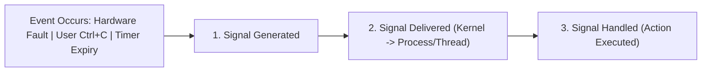
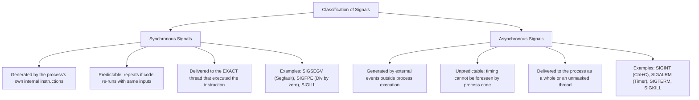
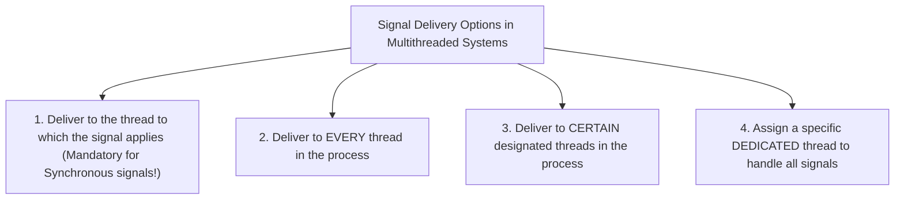
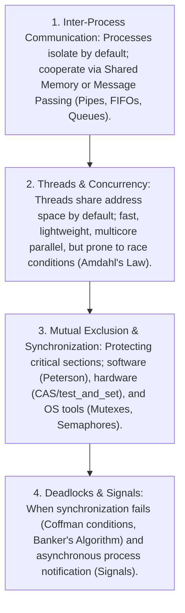

[OS Index](../README.md) / [Unit 2: Concurrency & Deadlocks](Introduction.md)

---

Throughout Unit 2, we examined how processes and threads voluntarily cooperate: a process decides to write to a pipe, a thread decides to acquire a mutex lock, or a philosopher decides to pick up a chopstick. In every case, execution was synchronous and planned.

**Signals are completely different.**

A signal arrives whether a process wants it or not. It strikes at an arbitrary, unpredictable instant, immediately interrupting whatever user code the processor was executing.

> **The Mental Model: A Software Interrupt**
> 
> Just as a hardware interrupt yanks the CPU core away from an executing program to run an Interrupt Service Routine (ISR) in the kernel, a **Signal yanks a user process away from its normal execution flow to run a Signal Handler**.

A signal is the oldest and most primitive form of Inter-Process Communication in Unix. It carries no arbitrary payload—it is simply a notification conveying that a specific event has occurred.

In this final lecture of Unit 2, we explore the signal lifecycle, synchronous vs. asynchronous signals, signal delivery in multithreaded systems, and how Windows emulates signals using Asynchronous Procedure Calls (APCs).

---

## The Three-Stage Signal Lifecycle

Every signal in an operating system moves through a strict three-stage lifecycle:



### 1. Signal Generation
A signal is generated when the triggering event occurs:
- The CPU encounters a division by zero or an invalid memory address.
- A user presses `Ctrl+C` in a terminal.
- A hardware timer set via `alarm()` expires.
- Another process explicitly executes the `kill()` system call.
At the moment of generation, the kernel marks the signal as **Pending** in the target process's internal Process Control Block.

### 2. Signal Delivery
The kernel delivers the pending signal to the target process. 
- Delivery is **not instantaneous**: if a process has placed that particular signal into its **Signal Block Mask** (blocked/masked), the signal remains pending indefinitely in the kernel until the process unblocks it.

### 3. Signal Handling
Once delivered, the process must act on the signal. Execution jumps to either the kernel's default handler or a custom user-defined function.

---

## Synchronous vs. Asynchronous Signals

Signals fall into two distinct categories based on their origin and timing:



### 1. Synchronous Signals (Internal Faults)
- Caused directly by the executing program performing an illegal or exceptional CPU operation.
- **Tightly coupled to execution:** If the exact same code runs with the exact same data, the signal will fire at the exact same instruction every single time.
- *Examples:*
  - `SIGSEGV` (Segmentation Fault): Dereferencing a `NULL` or wild memory pointer.
  - `SIGFPE` (Floating-Point Exception): Dividing an integer by zero.
  - `SIGILL` (Illegal Instruction): Attempting to execute a corrupted or privileged CPU instruction.

### 2. Asynchronous Signals (External Notifications)
- Generated by events completely external to the running instructions of the process.
- **Timing is independent of process state:** Can strike while the process is computing, doing I/O, or sleeping.
- *Examples:*
  - `SIGINT` (Terminal Interrupt): Generated by the tty driver when a user presses `Ctrl+C`.
  - `SIGALRM` (Alarm Clock): Generated by the kernel when a real-time timer expires.
  - `SIGKILL` / `SIGTERM`: Sent by administrators or parent processes to terminate the program.

---

## Signal Handlers: Default vs. User-Defined

Every signal type has a pre-configured **Default Signal Handler** defined by the operating system kernel.

When a signal arrives, the kernel takes one of five default actions:
1. **Terminate:** The process is abruptly killed (e.g., `SIGTERM`, `SIGINT`).
2. **Terminate with Core Dump:** The process is terminated, and a memory dump (`core`) is written to disk for post-mortem debugging (e.g., `SIGSEGV`, `SIGABRT`, `SIGFPE`).
3. **Ignore:** The signal is silently discarded with zero effect (e.g., `SIGCHLD` notifying a parent that a child stopped, `SIGURG`).
4. **Stop (Suspend):** The process is paused and placed in the Stopped state (e.g., `SIGSTOP`, `SIGTSTP` from `Ctrl+Z`).
5. **Continue (Resume):** Wakes up a stopped process and moves it back to the Ready Queue (e.g., `SIGCONT`).

### Custom User-Defined Signal Handlers
A programmer can override the default action for most signals by registering a custom callback function using `signal()` or the robust POSIX **`sigaction()`** system call:

```c
#include <stdio.h>
#include <stdlib.h>
#include <signal.h>
#include <unistd.h>

// Custom user-defined signal handler
void handle_sigint(int sig) {
    printf("\n[Caught SIGINT (%d)] Cleaning up temporary files and shutting down cleanly...\n", sig);
    exit(0);
}

int main() {
    // Register custom handler for SIGINT (Ctrl+C)
    signal(SIGINT, handle_sigint);

    printf("Daemon running. Press Ctrl+C to test signal handler...\n");
    while (1) {
        sleep(1);
    }
    return 0;
}
```

---

## The Two Uncatchable Signals: `SIGKILL` and `SIGSTOP`

Among all signals defined in Unix, **two signals can NEVER be caught, blocked, or ignored**:

1. **`SIGKILL` (Signal 9):** Unconditional, immediate process termination (`kill -9 <PID>`).
2. **`SIGSTOP` (Signal 19):** Unconditional process suspension.

### Why Must They Be Uncatchable?
> If an application could catch or ignore `SIGKILL`, a malicious or buggy program trapped in an infinite loop could refuse to terminate, permanently hijacking CPU cores and memory!
> 
> The operating system administrator must retain the **unconditional, absolute authority** to kill or pause any runaway process.

---

## Signal Handling in Multithreaded Programs

In a traditional single-threaded program, signal delivery is straightforward: the signal is delivered to the one and only thread.

In a **multithreaded process**, a complex architectural question arises:
> **When a signal is generated for a process, which thread should actually receive and execute the signal handler?**



### The Standard POSIX Multithreaded Delivery Rules:
1. **For Synchronous Signals (`SIGSEGV`, `SIGFPE`):**
   The signal is delivered strictly to the **specific thread that executed the offending instruction**. Delivering a division-by-zero signal to a harmless sister thread would make no sense.
2. **For Asynchronous Signals (`SIGINT`, `SIGTERM`):**
   The signal is delivered to the **first thread in the process that does NOT have that signal blocked**.
   - Each individual thread maintains its own private **Signal Mask** via `pthread_sigmask()`.
   - If Thread 1, Thread 2, and Thread 3 all block `SIGINT`, but Thread 4 does not, the kernel delivers `SIGINT` directly to Thread 4.
   - If all threads block the signal, it remains pending for the process until at least one thread unblocks it.

### Thread-Specific Signal System Calls:
- **`kill(pid_t pid, int sig)`:** Sends a signal to an **entire process** (the kernel picks which unmasked thread handles it).
- **`pthread_kill(pthread_t thread, int sig)`:** Sends a signal directly to a **specific individual thread**.

---

## Essential Linux Signals Reference Table

| Signal Number | Signal Name | Description | Default Action | Can Be Caught? |
| :---: | :--- | :--- | :---: | :---: |
| **1** | **`SIGHUP`** | Hangup detected on controlling terminal; reload config | Terminate | Yes |
| **2** | **`SIGINT`** | Terminal interrupt (`Ctrl+C`) | Terminate | Yes |
| **3** | **`SIGQUIT`**| Terminal quit (`Ctrl+\`) | Terminate + Core | Yes |
| **6** | **`SIGABRT`**| Process abort generated by `abort()` or `assert()` | Terminate + Core | Yes |
| **8** | **`SIGFPE`** | Erroneous arithmetic operation (Division by zero) | Terminate + Core | Yes |
| **9** | **`SIGKILL`**| Forcible termination (The silver bullet) | **Terminate** | **NO** |
| **11** | **`SIGSEGV`**| Segmentation fault (Invalid memory reference) | Terminate + Core | Yes |
| **13** | **`SIGPIPE`**| Broken pipe: write to a pipe with no readers | Terminate | Yes |
| **14** | **`SIGALRM`**| Real-time timer clock expired (`alarm()`) | Terminate | Yes |
| **15** | **`SIGTERM`**| Polite termination request (Default of `kill`) | Terminate | Yes |
| **17** | **`SIGCHLD`**| Child process terminated, stopped, or resumed | **Ignore** | Yes |
| **18** | **`SIGCONT`**| Continue executing if currently stopped | **Continue** | Yes |
| **19** | **`SIGSTOP`**| Forcible process suspension | **Stop** | **NO** |
| **20** | **`SIGTSTP`**| Terminal stop generated by `Ctrl+Z` | Stop | Yes |

---

## Signals in Microsoft Windows: Asynchronous Procedure Calls (APCs)

Microsoft Windows does not natively provide POSIX Unix-style signals.

Instead, Windows delivers asynchronous events to threads using **Asynchronous Procedure Calls (APCs)**:
- An APC allows a user-mode application or a kernel driver to queue a function to be executed **within the context of a specific target thread**.
- **The Execution Rule:** Unlike Unix signals (which can interrupt a thread at any arbitrary machine instruction), a Windows thread executes queued APCs **only when it enters an "Alertable Wait State"**!
- A thread enters an alertable state by explicitly calling wait functions with the alertable flag enabled:
  - `SleepEx(dwMilliseconds, TRUE)`
  - `WaitForSingleObjectEx(hHandle, dwMilliseconds, TRUE)`

### Why APCs are Cleaner than Unix Signals:
Unix signal handlers can execute at any random instruction, making it notoriously easy to cause deadlocks if a signal handler calls non-reentrant functions (like `malloc()` or `printf()`). 

Because Windows APCs only run when a thread explicitly declares itself alertable at safe synchronization boundaries, code state is guaranteed to be clean and consistent.

---

## The Complete Unit 2 Synthesis

With signals completed, we have unified the four grand themes of **Unit 2: Inter-Process Communication, Concurrency, Synchronization, and Deadlocks**:



1. **Isolation to Cooperation:** We moved from isolated processes to cooperating processes using **Shared Memory** and **Message Passing** (Pipes, FIFOs, System V IPC).
2. **Cooperation to Concurrency:** We realized process creation is heavy, introducing **Threads** to share memory by default across multiple cores, bounded by **Amdahl's Law**.
3. **Concurrency to Synchronization:** Sharing memory by default creates race conditions. We formulated the **Critical-Section Problem**, proved **Peterson's Algorithm**, analyzed hardware atomic instructions (**CAS**, **`test_and_set`**), mastered **Mutexes and Semaphores**, and conquered the **Classical Synchronization Problems**.
4. **Synchronization to Control:** We analyzed the catastrophic failure mode of synchronization—**Deadlocks**—and learned how to avoid them with Dijkstra's **Banker's Algorithm**, concluding with asynchronous process control via **Signals**.

---

## Key Takeaways

- A **Signal** is a software interrupt notifying a process that an event has occurred. It carries no data payload.
- The signal lifecycle consists of three distinct stages: **Generation**, **Delivery**, and **Handling**.
- **Synchronous signals** are triggered by internal program instructions (e.g., `SIGSEGV`, `SIGFPE`) and are delivered to the offending thread.
- **Asynchronous signals** are triggered by external events (e.g., `SIGINT`, `SIGALRM`, `SIGTERM`) and are delivered to an unmasked thread in the process.
- **`SIGKILL` (9)** and **`SIGSTOP` (19)** can **never be caught, blocked, or ignored**, preserving administrative control.
- In multithreaded programs, asynchronous signals are delivered to the first thread that does not have the signal blocked in its `pthread_sigmask()`.
- Windows emulates asynchronous events using **Asynchronous Procedure Calls (APCs)**, which execute only when a thread enters an alertable wait state.

---

This concludes **Unit 2: Inter-Process Communication, Threads, Concurrency, and Synchronization**.

Every concept from process creation and threads to semaphores and deadlocks has been comprehensively analyzed with rigorous step-by-step mathematical proofs, assembly-level traces, and production C implementations.

In **Unit 3**, we cross into physical and virtual memory:
- How does the hardware Memory Management Unit (MMU) translate virtual addresses to physical RAM?
- What are segmentation and paging?
- How does Demand Paging create the illusion of limitless memory, and how do Page Replacement Algorithms (FIFO, LRU, Optimal) prevent system thrashing?

That brings us to physical and virtual memory in [**Unit 3: Memory Management and Virtual Memory**](../Unit%203/Introduction.md).
