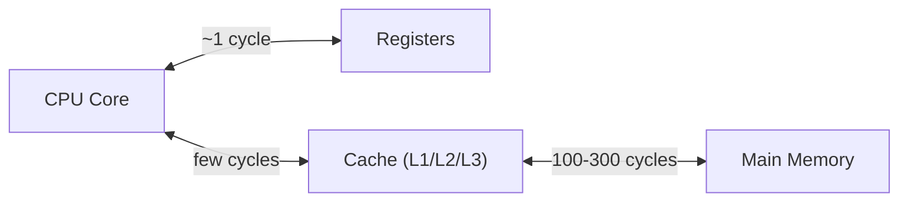
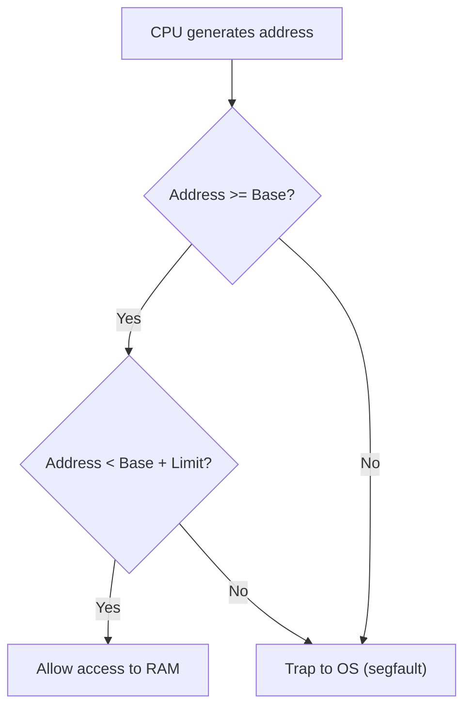
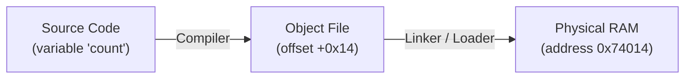
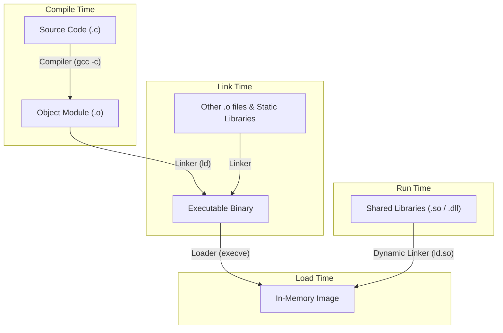
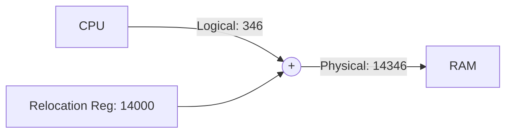
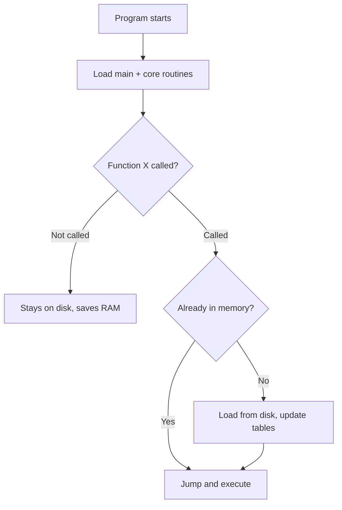
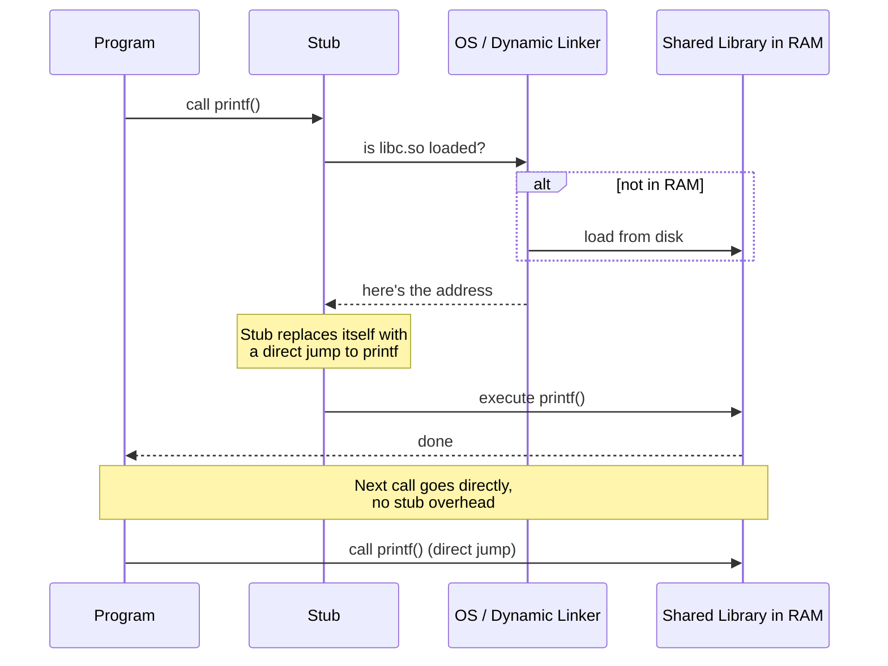
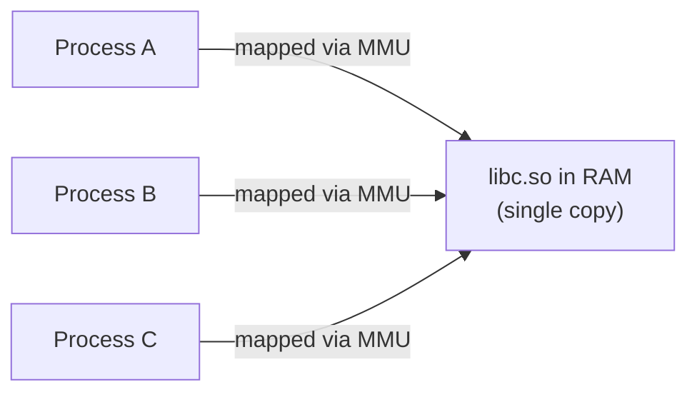

[OS Index](../README.md) / [Unit 3: Memory & Virtual Memory](Introduction.md)


---

Memory is just a large array of bytes, where each and every byte has its own unique number assigned to it. This is called a *memory address*. Main memory and the registers which are built directly on the CPU are the only general purpose memory that it can access *directly*. Memory unit(storage hardware) just oversees(does not control!) the input/output of memory addresses, so it only sees the stream of memory addresses. It has no idea how those addresses were generated or what they're for — whether it's an instruction, a variable, or kernel data. Memory is dumb, it just responds to whatever address shows up on the wire.

Because machine instructions can only take memory addresses(not disk addresses) as arguments to operate on, if the data that needs to be operated is not in main memory then the program needs to be brought in and placed in the ready queue(also present on main memory) before the operation is performed.

When we run a program, a typical instruction-execution cycle:
- The CPU fetches the instruction with the help of program counter(a special register which stores the memory address of the next address to be fetched for instructions that need to be executed) 
- Sends the memory access request to memory unit and takes the instruction, decodes it to get the required operation 
- Takes the operands from the memory and stores them in the registers of the CPU(for faster access, if not it accesses from main memory itself but the operation will be much more slower due to multiple memory accesses)
- Executes the operation with ALU or control unit on the fetched operands
- Once the operation is complete, the results are stored back in specific register (or some memory address) for future use.

Notice something here — a single instruction can need **2 to 3 trips** to memory (fetch instruction, fetch operands, store result). So if memory is slow, everything is slow.

---

## Basic Hardware

Registers are built inside the CPU chip itself so the data stored in them can be accessed in just one clock cycle.

But main memory sits on the motherboard across a bus, and accessing it takes **many clock cycles** — often 100 to 300 cycles on modern hardware. During this time the CPU just... waits. This is called a *memory stall*. 



To bridge this gap, fast memory called *cache* sits between CPU registers and main memory, usually right on the CPU chip. It stores recently accessed data so that repeated accesses don't need to go all the way to RAM.

*Important:* The cache is managed **entirely by hardware**. The OS has no say in what goes into the cache or what gets evicted — hardware handles it transparently.

---

Now, in *uniprogramming* (like old MS-DOS), only one program runs at a time. It gets the entire memory to itself. No protection needed, no translation needed — the program's addresses *are* the physical addresses, because there's nobody else to interfere with.

But we already know from earlier units that uniprogramming is wasteful — the CPU sits idle whenever the program waits for I/O. To keep the CPU busy we need *multiprogramming* — multiple processes loaded in memory at the same time.

The moment we do that, we have a problem: what stops Process A from accidentally (or intentionally) writing into Process B's memory, or worse, overwriting the OS kernel? And we just said memory hardware is dumb — it can't check permissions on its own.

So protection has to happen **before** the address reaches memory, in hardware sitting between the CPU and RAM.

---

## Hardware Address Protection: Base and Limit Registers

A simple hardware solution: give each process a pair of registers that define its legal memory boundaries.

- **Base register** — holds the smallest legal physical memory address for this process
- **Limit register** — holds the size of the process's address range

So if `Base = 300040` and `Limit = 120900`, this process can legally touch addresses `300040` through `420939` (that's `Base + Limit - 1`), nothing else.

For every memory address the CPU generates in user mode, hardware checks:



If either check fails, the hardware fires a trap to the OS. The OS treats this as a fatal error (like a segmentation fault) and kills the process.

Now obviously a user program should not be able to change its own base and limit — that would defeat the entire purpose. So loading these registers is a *privileged instruction*, meaning it can only be executed in **kernel mode**. When the OS does a context switch, it loads the new process's base and limit values into these registers.

---

Alright so we have hardware protecting memory boundaries. The OS decides "Process A lives at physical address 300040 to 420939."

But think about this from the programmer's side — when you write:
```c
int count = 10;
```

You have **no idea** what physical address `count` will end up at. You can't hardcode `300040` into your source code because tomorrow that spot might be taken by a different program.

So how does a human-readable variable name turn into an actual RAM address? That's *address binding*.

---

## Address Binding

Addresses go through multiple transformations during a program's lifecycle:

1. **Symbolic addresses** — in source code, things have names (`count`, `loop_start`)
2. **Relocatable addresses** — the compiler converts names into offsets within the module ("14 bytes from the start of this file")
3. **Absolute addresses** — the linker or loader maps those offsets to actual physical addresses (like `74014`)

Each transformation is a *binding* — a mapping from one address space to another.



The key question is: **when** does this binding to physical memory happen? There are three options, and the trade-off is always the same — later binding gives more flexibility but needs more hardware support.

### Compile-time binding
If you know at compile time exactly where the program will sit in memory, the compiler generates *absolute code* with hardcoded physical addresses. The catch: if that memory location is taken, the program can't run. If the address changes, you recompile everything. This is how MS-DOS `.COM` files worked.

### Load-time binding
The compiler generates *relocatable code* — all addresses are offsets. When the loader places the program in RAM, it adds the actual base address to every reference. The program can now load anywhere, but once loaded, it **cannot move**. Its addresses are burned in.

### Execution-time (run-time) binding
No addresses are fixed at all. The program uses logical addresses and hardware translates them on every single memory access. This means the process can be **moved while running** — the OS just updates the translation hardware. This is what makes swapping, compaction, and paging possible. But it needs an MMU.

| | When bound | Can move while running? | Needs hardware? |
|---|---|:---:|---|
| **Compile time** | At compilation | No | None |
| **Load time** | When loaded into RAM | No | None |
| **Execution time** | On every memory access | **Yes** | MMU |

---

So we know addresses transform through these stages. But how does software actually make this journey? A real program isn't one file — it's multiple source files, libraries, system routines. Let's trace the pipeline.

---

## The Processing Pipeline



- **Compiler** takes source files and produces *object modules* (`.o` files) — machine code with relocatable addresses and a symbol table of unresolved external references.
- **Linker** takes multiple `.o` files plus static libraries and combines them into one executable. It resolves cross-module references — if `main.o` calls a function defined in `utils.o`, the linker patches that call. If something is missing, you get `undefined reference to 'foo'`.
- **Loader** reads the executable from disk, allocates RAM, places the binary image in memory.
- **Dynamic Linker** resolves calls to shared libraries at run time, while the program is already executing.

---

Now here's the thing — if we did load-time or compile-time binding, the addresses in RAM are frozen. If the OS needs to swap this process out to disk and bring it back into a *different* physical location, all those hardcoded addresses are now wrong and the program crashes.

To make swapping and compaction work, we need the program to never know its real physical address. It should think it starts at address `0` and let hardware transparently figure out where it really lives.

This separation of what the program sees (logical address) from what memory hardware sees (physical address) is the core idea.

---

## Logical vs Physical Addresses and the MMU

- **Logical address** (also called *virtual address*) — address generated by the CPU, what the program works with
- **Physical address** — address that actually appears on the memory bus and reaches the RAM chips

With compile-time and load-time binding, these are the same thing. With execution-time binding, they're different.

The **Memory Management Unit (MMU)** is hardware that sits between the CPU and memory. Every address the CPU emits passes through it and gets translated before reaching RAM.

The simplest MMU scheme uses a *relocation register* (basically the base register from earlier):

$$\text{Physical Address} = \text{Logical Address} + \text{Relocation Register}$$



So if the relocation register is set to `14000`:
- Program accesses its address `0` → MMU sends `14000` to RAM
- Program accesses address `346` → MMU sends `14346` to RAM

The program never sees, knows, or cares about the real physical addresses. It writes code as if it owns memory from `0` to `max`. If the OS needs to move the process somewhere else in RAM, it just changes the relocation register. No instruction inside the program needs to change.

---

Up to this point there's a big assumption baked into our model: when a program starts, the loader copies the **entire** executable into RAM. Every function, every error handler, every rarely-used diagnostic routine — all of it sits in physical memory.

But think about real software. A big program might have 50,000 lines of code, but 40,000 of those are for handling rare errors that almost never trigger. If no error occurs during this run, 80% of the allocated RAM was wasted on code that never executed.

And there's another problem. Almost every C program uses `printf`, `scanf`, `malloc`. If 50 programs are running and each one has its own copy of the C standard library statically linked in, you now have 50 identical copies of `printf` sitting in RAM doing the exact same thing.

These two problems have different solutions.

---

## Dynamic Loading

Instead of loading the entire program at startup, with *dynamic loading* a routine is **not loaded until it is actually called**.

All routines stay on disk in relocatable format. The main program loads and runs. When it calls a function:
- It first checks an internal table — is that function already in memory?
- If yes, jump to it
- If not, a relocatable loader fetches it from disk, loads it into an available memory slot, updates the address table, and then calls it

This is great for programs with large chunks of rarely-used code — error handlers, diagnostics, seldom-used features. That code never eats RAM unless something actually goes wrong.



*Note:* Dynamic loading does **not** need special OS support. It's done entirely through program design — the developer uses library routines like `dlopen()` and `dlsym()` to load code on demand.

---

## Dynamic Linking and Shared Libraries

Dynamic loading solves the problem of wasted RAM *within* one program. But what about the 50 copies of `printf` across 50 processes?

That's what *dynamic linking* solves — it shares library code **across processes**.

With **static linking**, the linker copies library code directly into your executable. Every program on disk gets its own duplicate of `printf`, `scanf`, everything. Wastes disk space, wastes RAM, and if a bug is found in the library, every program must be recompiled.

With **dynamic linking**, instead of copying library code, the linker puts in a small placeholder called a *stub*. When the program calls `printf()`:



1. First call hits the stub
2. Stub asks the OS: "is this shared library already in RAM?" (maybe another process already loaded it)
3. If not, OS loads it. If yes, OS just returns the address.
4. The stub **overwrites itself** with a direct jump to the real function
5. Every subsequent call goes straight to the library at full speed



Multiple processes share a **single physical copy** of the library in RAM. The OS maps the same physical frames into each process's virtual address space (read-only, so no one can corrupt it). Each process has its own private data — only the code is shared.

And the best part: if a security vulnerability is patched in `libc.so`, you just replace the `.so` file. Every program automatically uses the new version next time it runs. No recompilation needed.

Unlike dynamic loading, dynamic linking **does** need OS support — the OS has to manage the shared memory mappings across process boundaries.

| | Dynamic Loading | Dynamic Linking |
|---|---|---|
| **Solves** | Wasted RAM within one program | Duplicate libraries across programs |
| **How** | Load routines only when called | Share single copy of library via stubs |
| **OS support needed?** | No | Yes |
| **Library updates** | Doesn't help | Automatic — just replace the `.so` |

---

## Key Takeaways

- Memory just sees addresses on a wire — it can't enforce protection. That has to happen in hardware between CPU and RAM.
- Registers: 1 cycle. RAM: 100-300 cycles. Cache bridges this gap, managed entirely by hardware.
- Base and limit registers define a process's legal range. Out-of-bounds → hardware trap → OS kills the process. Only kernel mode can change these registers.
- Address binding: compile-time (rigid), load-time (flexible at start, frozen after), execution-time (fully flexible, needs MMU).
- Logical address ≠ Physical address under execution-time binding. MMU translates: $\text{Physical} = \text{Logical} + \text{Relocation Register}$
- Dynamic loading = load routines only when called (no OS support needed).
- Dynamic linking = share library code across processes via stubs (needs OS support).

---

Now, there's a fundamental limitation with everything we've discussed so far — the base and limit scheme forces the **entire process into one contiguous chunk** of physical memory.

In a busy system where processes are constantly starting and stopping, memory gets fragmented into scattered little holes that are individually too small to fit anything. This is called *external fragmentation*, and dealing with it is the next major problem to solve — through [contiguous allocation strategies](L02%20-%20Swapping,%20Allocation,%20and%20Fragmentation.md), and eventually through the much more powerful idea of [*paging*](L04%20-%20Paging.md).