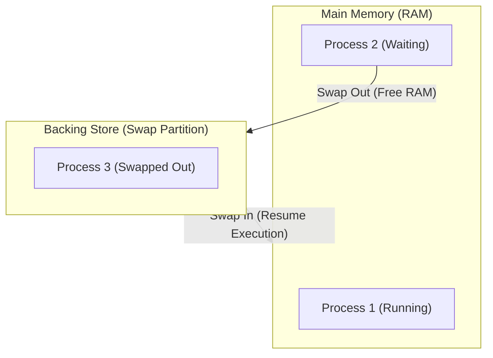
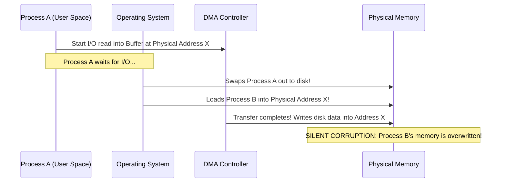
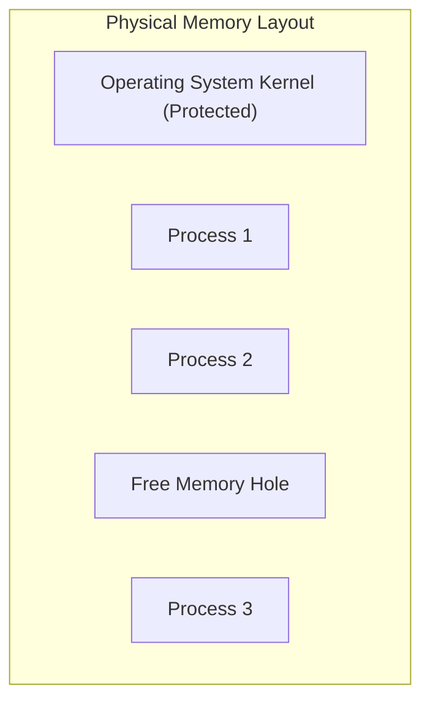
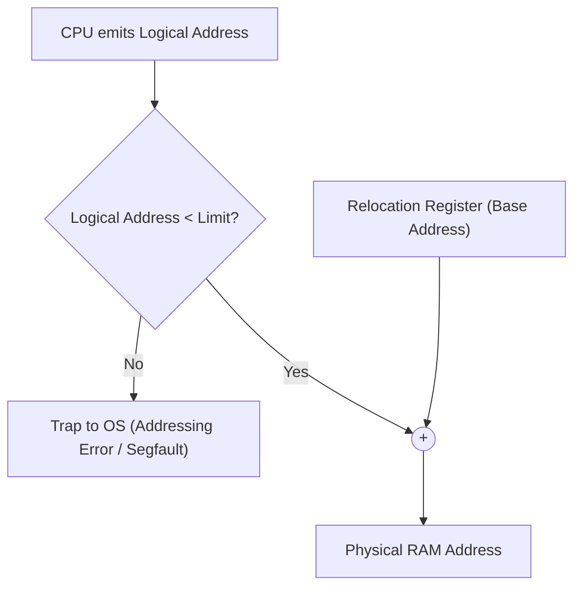
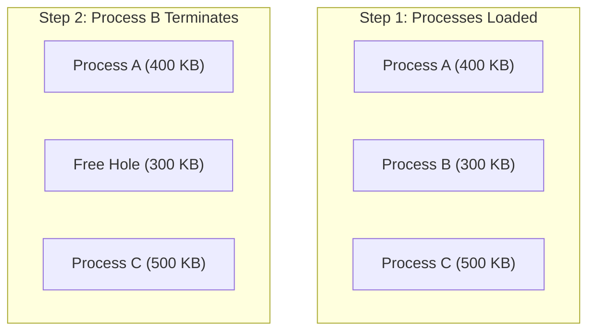
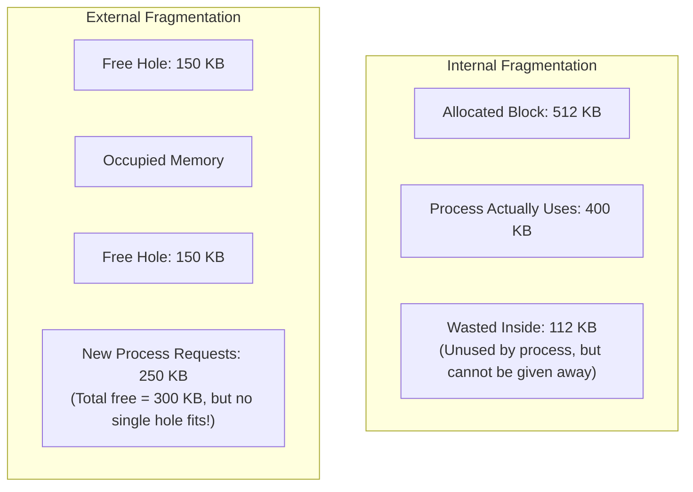
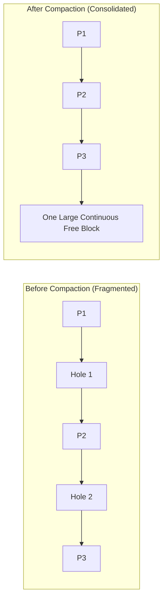

[OS Index](../README.md) / [Unit 3: Memory & Virtual Memory](Introduction.md)

---

In the previous lecture, we built the foundation: base and limit registers, the MMU, and dynamic relocation. But notice the big assumption hiding underneath everything we did:

We assumed that every process lives in **one single, unbroken, contiguous chunk of physical memory**.

Now, if a process must be contiguous, the operating system has to solve two practical problems:
1. What do you do when physical memory is completely full, but another process needs to run?
2. When processes of different sizes enter and leave memory, how do you decide *where* to place each one, and what happens to the gaps left behind?

This lecture explores how operating systems tried to make contiguous allocation work. And it is an argument that deliberately ends in failure — because every contiguous scheme eventually runs into a wall that forces us to rethink memory from scratch.

---

## Swapping

The most direct answer to "what if memory is full?" is simple: if there is no room in RAM, pick a process that is currently idle and kick it out to disk. When it is ready to run again, bring it back into RAM.

That mechanism is called *swapping*.

The disk area where swapped processes live is called the *backing store*. It is usually a dedicated, fast disk partition (like the swap partition in Linux) rather than a regular file, so the OS can bypass file system overhead and read or write raw disk blocks directly.

The big win here is huge: **the total memory required by all active processes can exceed physical RAM**. A machine with 8 GB of RAM can run 15 GB worth of processes, because only the ones actively computing need to sit in RAM right now.

There is also a priority-based variant called *roll out, roll in*. If a high-priority process suddenly arrives and needs memory, the scheduler rolls a low-priority process out to disk, runs the urgent process, and rolls the victim back in later.

### The Real Cost: Why Swapping Kills Performance
Swapping sounds great in theory. But look at where the time actually goes.

A context switch between two threads in RAM takes microseconds — maybe 10 to 20 microseconds. Now calculate what happens when a context switch requires swapping:

Suppose a process has an in-memory footprint of **100 MB**, and our storage drive has a transfer rate of **50 MB/s**.

$$\text{Transfer time out} = \frac{100\text{ MB}}{50\text{ MB/s}} = 2\text{ seconds}$$

$$\text{Transfer time in} = \frac{100\text{ MB}}{50\text{ MB/s}} = 2\text{ seconds}$$

$$\text{Total swap time} = 2\text{ s} + 2\text{ s} = 4\text{ seconds}$$

Think about that number for a moment. A normal context switch takes 10 microseconds. A context switch with swapping takes **4 seconds** — that is **400,000 times slower**!

And notice something critical: transfer time is *directly proportional* to the amount of memory being moved. Swapping 1 GB takes 10 times longer than swapping 100 MB. There is no economy of scale.

Because the cost is so massive, modern operating systems do not use standard swapping (moving entire process images to disk) during ordinary operation. Instead, standard swapping is usually disabled or kept strictly as an emergency fallback when memory is almost exhausted. What modern systems actually do is swap individual 4 KB *pages* on demand — which is the core idea of virtual memory later in this unit.

### The Ready Queue with Swapping
Swapping also changes what the ready queue means. 

If a process has been swapped out to disk, its process control block (PCB) is still in kernel memory, and it can still sit in the ready queue. But "ready" no longer means "ready to run this microsecond." Before the dispatcher can run it, it has to wait seconds for the disk transfer to complete.

### The I/O and DMA Hazard
There is a dangerous edge case with swapping that every OS designer must handle:

What happens if Process A issues a read request to the disk controller, and while waiting for the disk data to arrive, the OS decides to swap Process A out to disk?

Remember that Direct Memory Access (DMA) controllers write data straight to physical memory addresses without CPU intervention. If Process A is swapped out, and the OS loads Process B into that exact same physical memory space, the pending I/O transfer completes and writes disk data right over Process B's memory, silently corrupting it!

There are only two ways to prevent this:
1. **Never swap a process with pending I/O:** The process is *pinned* (or *latched*) in memory. The OS refuses to swap any frame marked as locked until its I/O finishes.
2. **Double buffering:** I/O transfers are never performed directly into user process memory. The DMA controller transfers data into OS kernel buffers first. Only after the transfer completes does the OS copy the data into user memory.

### Swapping on Mobile Systems
Mobile operating systems like Android and iOS almost never use traditional swapping to disk.

Mobile devices use flash storage (NAND flash). Flash memory can only withstand a limited number of write cycles before the storage cells physically degrade and fail. Swapping entire memory images would wear out a phone's flash storage within months. In addition, mobile storage buses are constrained, and constant disk writing drains the battery quickly.

Instead of swapping to disk:
- **iOS** asks apps to voluntarily free up memory (discard caches). If memory remains dangerously low, iOS terminates background apps outright.
- **Android** does not swap either. It writes the application state to flash and then terminates the process. When the user switches back, Android restarts the app and restores its state.

---

Alright, so full-process swapping is too slow to use constantly. That means multiple processes must share physical RAM at the same time.

Now, how does the OS carve up memory to hold them? That brings us to *contiguous memory allocation*.

---

## Contiguous Allocation and Memory Protection

In contiguous allocation, physical memory is typically divided into two main regions:
1. **Operating System region** — often placed in low memory (where the interrupt vector table lives) or high memory (where modern Linux and Windows place it).
2. **User process region** — the remainder of RAM, carved up among user programs.

Each user process is allocated in a single contiguous block of memory.

To protect these processes from each other and protect the OS from all of them, the CPU uses the **Limit Register** and the **Relocation Register** (Base Register) that we saw in Lecture 1.

Look at how the hardware comparator and adder work together:

Notice the specific job of each register:
- **Limit register** holds a *size* — the total length of the process's logical address space.
- **Relocation register** holds an *address* — the smallest physical address where this process starts in RAM.

The check is: $\text{Logical Address} < \text{Limit}$. If valid, $\text{Physical} = \text{Logical} + \text{Relocation Register}$.

Because this check happens on every single memory access, no user process can ever reach outside its assigned block.

### Transient Kernel Code: A Great Side Benefit
Dynamic relocation gives the OS a clever advantage: **the kernel itself can change size while user programs are running**.

An operating system contains device drivers for hundreds of devices — printers, audio chips, USB controllers, network cards. But any single computer only uses a few of them. Keeping every driver permanently in RAM wastes space.

With dynamic relocation, kernel code can be *transient*:
- When you plug in a USB drive, the OS loads the driver module into memory.
- When you unplug it, the OS removes the driver and returns that memory to the free pool.

This is exactly how Linux **Loadable Kernel Modules** (`insmod`, `rmmod`) work. And it only works because user processes use logical addresses: when the OS boundary shifts, the OS simply updates the relocation registers of user processes. Nothing in user space breaks.

---

Now, how should the OS divide the user memory region among multiple processes? Historically, there were two ways to do this.

---

## Multiple-Partition Allocation

### 1. Fixed-Partition Allocation (MFT)
In early systems (like IBM OS/360, where this was called MFT — *Multiprogramming with a Fixed number of Tasks*), memory was divided in advance into a fixed number of partitions of predetermined sizes.

For example, memory might be divided into four fixed partitions: 2 MB, 4 MB, 8 MB, and 16 MB.

When a process arrives:
- The OS finds a free partition that is big enough to hold it.
- The process is loaded, and that partition is marked occupied.
- When the process terminates, the partition becomes free again.

This is simple, but it has two severe problems:
1. **The degree of multiprogramming is capped:** If you have 4 partitions, you can run at most 4 processes at once, even if they are tiny and most of memory is empty.
2. **Internal Fragmentation:** If a process needs 5 MB, and the smallest available partition is 8 MB, the process gets the 8 MB partition. The remaining 3 MB inside that partition sits completely unused. It cannot be given to any other process because partitions cannot be shared.

Because of these flaws, fixed partitioning is obsolete.

### 2. Variable-Partition Allocation (MVT)
To eliminate internal waste, systems moved to *variable-size partitions* (called MVT in IBM OS/360 — *Multiprogramming with a Variable number of Tasks*).

Here, memory is not divided in advance. Instead, when a process arrives, the OS allocates **exactly as much memory as that process requests** — no more, no less.

The OS maintains a table tracking which parts of memory are currently occupied by processes and which parts are free. A contiguous block of free memory is called a **hole**.

Initially, all memory is one large hole. As processes arrive and receive memory, that large hole shrinks.

When a process terminates, it frees its block of memory. If the newly freed block is directly adjacent to another free hole, the OS merges them into one larger hole (called *coalescing*).

Over time, as processes of different sizes start and finish, memory becomes a patchwork: scattered blocks of running processes separated by free holes of various sizes.

And that leads directly to the core problem of variable partitioning:

When a new process arrives requesting $n$ bytes, and there are multiple holes scattered across RAM that are large enough to hold it, **which hole should you pick?**

---

## Dynamic Storage-Allocation Strategies

This is the *Dynamic Storage-Allocation Problem*. There are three standard strategies to choose from:

### 1. First-Fit
Scan the list of holes from the beginning, and allocate the **first hole that is big enough**.
- Search stops as soon as a big enough hole is found.
- Fast, because you usually don't have to scan the whole list.

### 2. Best-Fit
Search the **entire list** and allocate the **smallest hole that is big enough**.
- You must examine every hole unless the list is sorted by size.
- Produces the smallest leftover hole.

### 3. Worst-Fit
Search the **entire list** and allocate the **largest hole available**.
- The logic here was: if you pick the biggest hole, the leftover piece will still be large enough to be useful to another process later.
- In practice, it performs terribly.

### A Concrete Walkthrough: Which Strategy Wins?
Let's trace these strategies on an actual example.

Suppose we have five free memory holes currently available in RAM, in this order:
$$\text{Holes: } 100\text{ KB}, \quad 500\text{ KB}, \quad 200\text{ KB}, \quad 300\text{ KB}, \quad 600\text{ KB}$$

Now four processes arrive in sequence, requesting:
$$\text{Requests: } P_1 (212\text{ KB}), \quad P_2 (417\text{ KB}), \quad P_3 (112\text{ KB}), \quad P_4 (426\text{ KB})$$

Let's trace what each strategy does:

#### First-Fit:
1. $P_1$ (212 KB) arrives. Scans from start: 100 KB (too small), 500 KB (fits!). Placed in **500 KB hole**. Leftover = 288 KB.
2. $P_2$ (417 KB) arrives. Scans: 100 KB (no), 288 KB (no), 200 KB (no), 300 KB (no), 600 KB (fits!). Placed in **600 KB hole**. Leftover = 174 KB.
3. $P_3$ (112 KB) arrives. Scans: 100 KB (no), 288 KB (fits!). Placed in **288 KB hole**. Leftover = 176 KB.
4. $P_4$ (426 KB) arrives. Scans the remaining holes: 100 KB, 176 KB, 200 KB, 300 KB, 174 KB. None is $\ge 426$ KB. **$P_4$ must wait!**

#### Best-Fit:
1. $P_1$ (212 KB) arrives. Holes that fit: 500 KB, 300 KB, 600 KB. Smallest that fits is 300 KB. Placed in **300 KB hole**. Leftover = 88 KB.
2. $P_2$ (417 KB) arrives. Holes that fit: 500 KB, 600 KB. Smallest that fits is 500 KB. Placed in **500 KB hole**. Leftover = 83 KB.
3. $P_3$ (112 KB) arrives. Holes that fit: 200 KB, 600 KB. Smallest that fits is 200 KB. Placed in **200 KB hole**. Leftover = 88 KB.
4. $P_4$ (426 KB) arrives. Holes that fit: only the **600 KB hole** (leftover from before). Placed in 600 KB hole! Leftover = 174 KB.  
**All four processes are successfully allocated!**

#### Worst-Fit:
1. $P_1$ (212 KB) placed in largest hole: **600 KB**. Leftover = 388 KB.
2. $P_2$ (417 KB) placed in largest remaining hole: **500 KB**. Leftover = 83 KB.
3. $P_3$ (112 KB) placed in largest remaining hole: **388 KB**. Leftover = 276 KB.
4. $P_4$ (426 KB) arrives. Largest remaining hole is 300 KB. None is $\ge 426$ KB. **$P_4$ must wait!**

In this example, Best-Fit accommodated all four processes, while First-Fit and Worst-Fit left $P_4$ stuck waiting.

### Which Strategy is Best in Practice?
Computer simulations and mathematical analysis show clear results:
- **First-Fit and Best-Fit are far superior to Worst-Fit** in both speed and storage utilization.
- Between First-Fit and Best-Fit, **First-Fit is generally faster** because it doesn't need to scan the entire list of holes.
- Interestingly, Best-Fit often creates a large number of tiny, sliver-like leftover holes (like the 83 KB and 88 KB holes in our example) that are too small to be useful to any future process.

---

And that brings us to the inevitable failure of all contiguous allocation schemes: *fragmentation*.

---

## Fragmentation

Whichever allocation strategy you use, as memory churns over time, space gets wasted. This waste comes in two distinct forms, and you need to keep them crystal clear.

### Internal Fragmentation
Internal fragmentation occurs when memory is allocated in fixed-size blocks, and the process receives more memory than it actually asked for.

- The wasted memory is **internal** to the allocated partition.
- Because it belongs to that process's allocation, the OS cannot give that unused slice to anyone else.
- *Example:* A process requests 400 KB, but the system allocates a fixed 512 KB partition. The unused 112 KB inside the block is internal fragmentation.

### External Fragmentation
External fragmentation occurs when there is enough **total** free memory across the system to satisfy a process's request, but that free memory is broken up into multiple non-contiguous holes — **no single hole is large enough**.

- The wasted memory is **external** to all processes, sitting in the free space between them.
- *Example:* A system has two free holes of 150 KB each (total 300 KB free). A new process arrives requesting 250 KB. The request cannot be satisfied, even though total free memory (300 KB) is greater than requested memory (250 KB), because the process needs one contiguous 250 KB block!

### The 50-Percent Rule
How bad is external fragmentation in practice?

Statistical analysis by Donald Knuth revealed a surprising mathematical property known as the **50-Percent Rule**:

> For a system using First-Fit, if $N$ blocks of memory are currently allocated to processes, approximately **$0.5 N$ additional blocks will be lost to external fragmentation**.

Think about what that means: for every 2 allocated blocks, you lose roughly 1 block's worth of space to unusable holes. That means roughly **one-third of your entire physical memory becomes unusable waste!**

---

Can we fix external fragmentation? There are only two ways:

---

## Compaction: The Flawed Solution

If memory is fragmented into scattered holes, the obvious idea is: why not slide all the allocated processes toward one end of memory, so that all the little holes combine into one single, massive free block?

That process is called **Compaction** (or defragmentation).

Compaction works in theory. But in practice, it is almost never used in modern operating systems for three reasons:

### 1. It Requires Execution-Time Binding
Compaction moves running processes to completely different physical addresses. If a process was bound at compile time or load time, its machine instructions contain hardcoded physical addresses — moving it physically corrupts every pointer in the program!

Compaction is **only possible if address binding is done at execution time** via relocation registers. When a process is moved, the OS copies its bytes and updates its relocation register.

### 2. The I/O Hazard Returns
Just like with swapping, if a process has an active DMA transfer writing to physical memory, you cannot move that process's memory while the hardware controller is actively writing to it. The process must be pinned, or all I/O must go through kernel buffers.

### 3. The Fatal Flaw: The Cost of Physically Copying Memory
To compact memory, the CPU must physically read every byte of allocated memory and write it to its new location.

Suppose you have 8 GB of RAM to compact, and your memory bandwidth is 10 GB/s. Reading and rewriting that memory takes nearly **a full second**:

$$\text{Compaction time} \approx \frac{8\text{ GB}}{10\text{ GB/s}} \approx 0.8\text{ to } 1.0\text{ seconds}$$

During that entire second, **every single user process on the computer must be completely frozen**, because their data and code are literally shifting underneath them.

No user and no real-time system will tolerate the entire computer freezing for a second every few minutes just to tidy up memory. And the moment processes start and stop again, fragmentation immediately begins re-accumulating!

---

## Key Takeaways

- Swapping temporarily moves entire process images between RAM and a backing store. It lets total process space exceed physical RAM, but transfer time (seconds) is hundreds of thousands of times slower than a normal context switch (microseconds).
- Processes with pending I/O cannot be swapped freely due to the DMA hazard; they must be pinned in RAM or double-buffered through kernel space.
- Mobile devices (Android/iOS) avoid standard swapping to protect flash memory from write wear and save battery; they terminate background apps or restore saved states instead.
- Contiguous allocation places each process in one unbroken block. Dynamic relocation allows transient kernel code (loadable kernel modules) to come and go without affecting user processes.
- Fixed partitions (MFT) limit the degree of multiprogramming and cause internal fragmentation. Variable partitions (MVT) create holes and avoid internal waste, but cause external fragmentation.
- Dynamic storage-allocation strategies: First-Fit (fast, practical), Best-Fit (searches all, produces small slivers), Worst-Fit (searches all, performs poorly).
- Internal fragmentation = wasted space *inside* an allocated block. External fragmentation = enough total free space exists, but it is broken into non-contiguous holes.
- The 50-Percent Rule: for $N$ allocated blocks with first-fit, about $0.5 N$ blocks are lost to external fragmentation (roughly one-third of memory wasted).
- Compaction slides processes together to merge holes, but it requires execution-time binding, causes I/O hazards, and freezes the entire system for up to a second while copying memory.

---

And so we arrive at the inevitable conclusion of contiguous allocation:

Contiguous allocation causes external fragmentation. Compaction can fix it, but copying all of RAM is far too slow. 

Therefore, **we must abandon the requirement that a process must be contiguous in physical memory.**

If we allow a process to be chopped up and scattered across non-adjacent physical memory, external fragmentation vanishes completely — because any free piece of RAM, anywhere, can be used for any process. 

The question is: *how do you chop up a program?*

If you chop it up the way a programmer thinks about code — into logical chunks like functions, arrays, and stacks — you get [**Segmentation** (Lecture 3)](L03%20-%20Segmentation.md). And if you chop it up the way hardware likes it — into fixed-size, interchangeable blocks — you get the cornerstone of all modern memory management: [**Paging** (Lecture 4)](L04%20-%20Paging.md).
