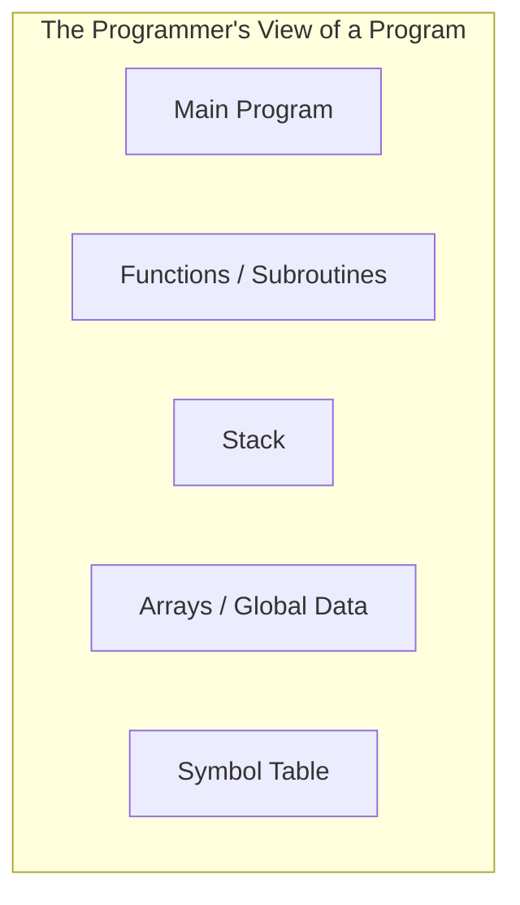
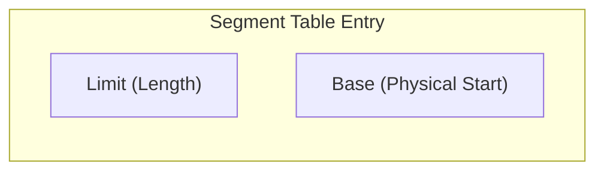
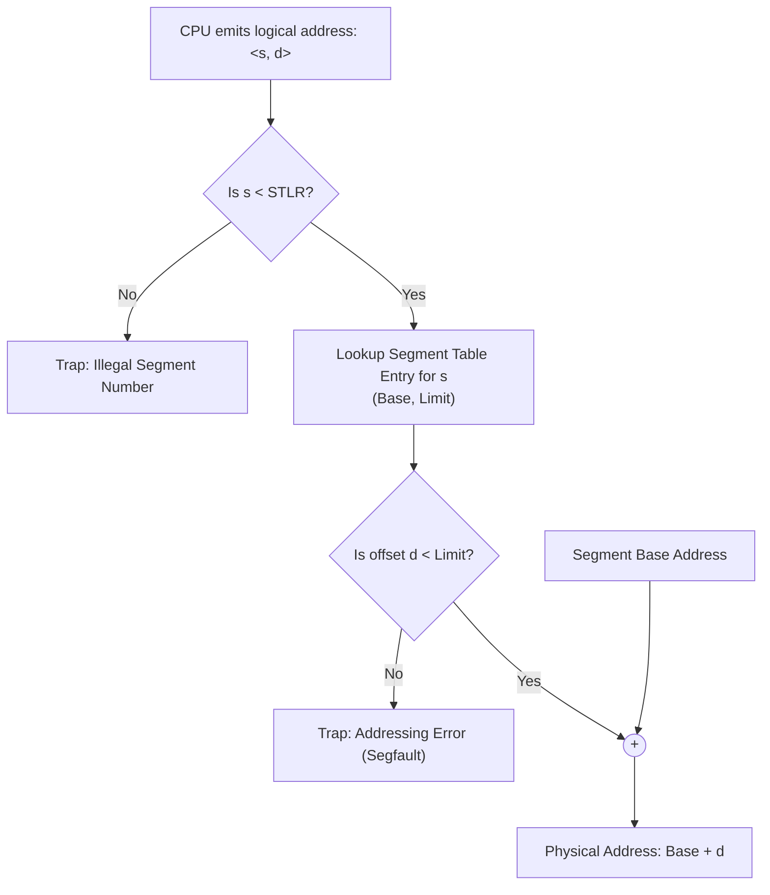
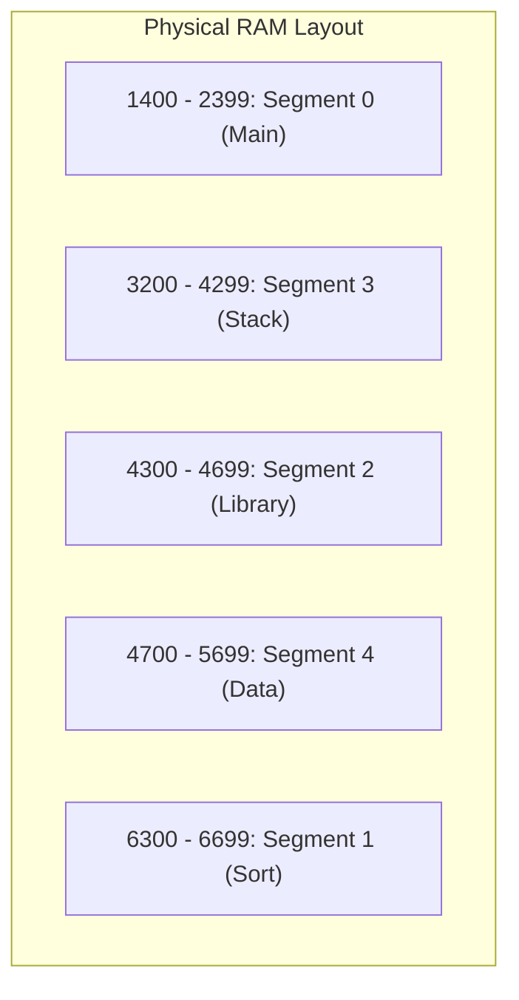
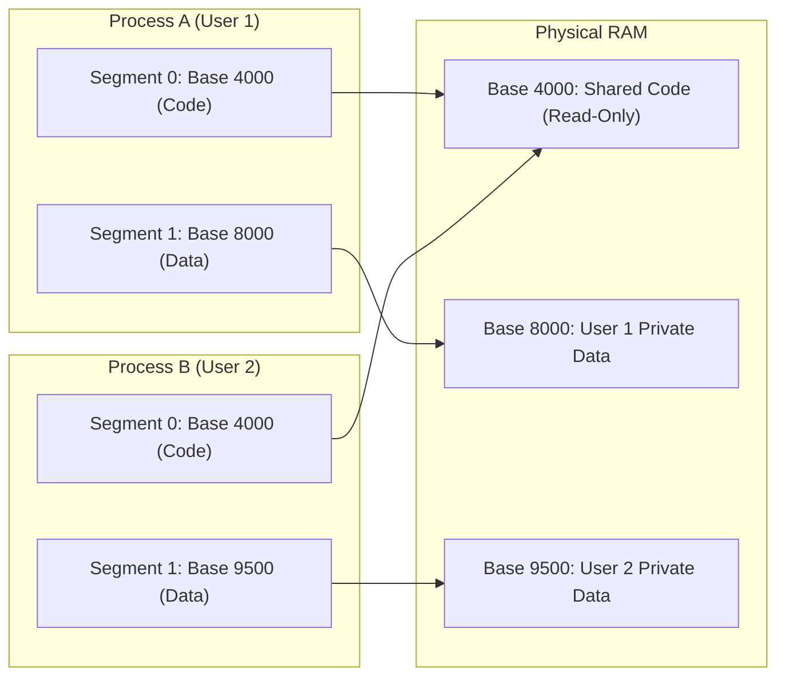

[OS Index](../README.md) / [Unit 3: Memory & Virtual Memory](Introduction.md)

---

Lecture 2 ended with a clear verdict: forcing an entire process into one contiguous physical block of memory is a dead end. It leads straight to external fragmentation, and compaction is far too slow to clean it up.

So we have to stop requiring contiguity. 

Segmentation is the first step away from contiguous allocation. And it is a partial step: instead of giving a process *one* contiguous block of RAM, we give it *several* contiguous blocks, one for each logical part of the program.

That single change fixes two huge problems:
- **Sparse address spaces:** In a flat model, the giant empty gap between the heap and the stack costs physical memory. In segmentation, the stack and heap are separate blocks, so the empty space between them costs nothing.
- **Sharing:** Two processes can easily share code (like a C library or text editor engine) simply by pointing their code segment entries to the same physical memory block.

And yet, segmentation has a fatal flaw of its own that makes modern systems rarely use it. But understanding it is essential, because every single idea in it — tables of base and limit pairs, per-entry protection bits, and hardware translation — forms the exact foundation of *paging*.

---

## The User's View of Memory

Think about how you actually write and reason about a program.

You do not think of your program as an anonymous, continuous stream of bytes from `0` to `65535`. You think in logical units:
- Here is the `main()` function
- Here is a sorting routine
- Here is a global array
- Here is the call stack
- Here is the symbol table

Every scheme we looked at earlier completely ignored this. The single base-and-limit scheme flattened your entire program into one anonymous slab of memory. The hardware had zero idea where your code ended and your stack began.

Segmentation is designed to **support the user's view of memory**. 

In segmentation, a program is not one big block — it is a collection of logical segments. Each segment has a name (or number) and a length, representing a distinct component: code, data, heap, or stack.

---

## Logical Addresses in Segmentation

Because a program is split into multiple independent segments, a single 1D memory address is no longer enough. If an instruction says "read byte 400", the hardware must ask: *byte 400 of which segment?* Byte 400 of the stack is completely different from byte 400 of the code segment.

Therefore, a logical address in segmentation is a two-tuple:

$$\langle s, \quad d \rangle$$

- **$s$ (Segment Number):** Specifies which segment we are accessing. It is used as an index into the segment table.
- **$d$ (Offset):** Specifies the exact byte within that segment. It must fall between `0` and the segment's length limit.

In high-level languages like C, you do not write segment numbers manually. The compiler does this automatically: it puts your functions into the code segment, your local variables into the stack segment, and your dynamically allocated memory into the heap segment.

---

## Segmentation Architecture and Hardware

To map these 2D logical addresses $\langle s, d \rangle$ to actual 1D physical RAM addresses, the CPU relies on a hardware table called the **Segment Table**.

Each running process has its own segment table. Each entry in the table contains two crucial pieces of information:
- **Base:** The starting physical memory address where that segment lives in RAM.
- **Limit:** The length of that segment.

### The Translation Hardware
Two dedicated hardware registers locate and bound the table during execution:
- **Segment-Table Base Register (STBR):** Holds the physical memory address where the current process's segment table begins in RAM.
- **Segment-Table Length Register (STLR):** Holds the total number of segments used by this process.

When the CPU executes an instruction that references address $\langle s, d \rangle$, the hardware performs a strict two-step verification before touching RAM:

Look at the hardware checks:
1. **Check the segment number:** The hardware first checks if $s < \text{STLR}$. If the program asks for segment 7, but the process only has 4 segments, the hardware immediately fires an illegal segment trap.
2. **Check the offset:** The hardware reads `limit` from `segment_table[s]` and checks if $d < \text{limit}$. If the segment is 400 bytes long, and the program tries to access offset 450, it is trying to access memory beyond its boundary. The hardware immediately traps to the OS with an addressing error (a *Segmentation Fault*).
3. **Compute physical address:** If both checks pass:
   $$\text{Physical Address} = \text{Base} + d$$

---

## A Concrete Worked Example

Let's walk through an actual example (the classic textbook scenario used in university exams).

Suppose we have a process with the following segment table:

| Segment ($s$) | Base | Limit | What it holds |
| :---: | :---: | :---: | :--- |
| **0** | 1400 | 1000 | Main program code |
| **1** | 6300 | 400 | Sorting function |
| **2** | 4300 | 400 | Shared library |
| **3** | 3200 | 1100 | Stack |
| **4** | 4700 | 1000 | Data / Array |

Here is how these segments physically sit in RAM:

Notice that the segments do not have to be in order in physical RAM! Segment 3 is placed before Segment 2, and Segment 1 is placed near the top. They are completely non-contiguous relative to each other.

Now let's trace three memory references:

### Reference 1: $\langle 2, \quad 53 \rangle$
- Segment $s = 2$, Offset $d = 53$.
- Look up Segment 2 in the table: $\text{Base} = 4300$, $\text{Limit} = 400$.
- Check offset: Is $53 < 400$? **Yes, valid!**
- Compute physical address:
  $$\text{Physical Address} = 4300 + 53 = 4353$$

### Reference 2: $\langle 3, \quad 852 \rangle$
- Segment $s = 3$, Offset $d = 852$.
- Look up Segment 3 in the table: $\text{Base} = 3200$, $\text{Limit} = 1100$.
- Check offset: Is $852 < 1100$? **Yes, valid!**
- Compute physical address:
  $$\text{Physical Address} = 3200 + 852 = 4052$$

### Reference 3: $\langle 0, \quad 1222 \rangle$
- Segment $s = 0$, Offset $d = 1222$.
- Look up Segment 0 in the table: $\text{Base} = 1400$, $\text{Limit} = 1000$.
- Check offset: Is $1222 < 1000$? **No! $1222 \ge 1000$.**
- The offset is larger than the entire segment. The hardware immediately blocks access and raises a **Trap to the OS**. In Unix/Linux, the OS delivers a `SIGSEGV` signal, and the program terminates with a *Segmentation Fault*.

---

## Why Segmentation Was a Huge Leap Forward

Even though pure segmentation is rarely used alone today, it introduced three revolutionary capabilities:

### 1. Per-Segment Protection
In an unsegmented flat memory model, the entire memory block has one blanket permission. But why should your code and your stack have the same permissions?

Because segmentation makes the hardware aware of logical regions, each segment table entry can carry dedicated **protection bits**:
- **Code segment:** Marked as `Read-Only` and `Executable`. Any attempt to write to it traps.
- **Data & Stack segments:** Marked as `Read-Write`, but `Non-Executable` (NX bit).

This simple distinction is what completely stops classic buffer-overflow exploits: even if an attacker manages to overflow a stack buffer and inject malicious shellcode onto the stack, the CPU refuses to execute it because the stack segment lacks execute permission!

### 2. Segment Sharing
Consider 50 students running the same C compiler on a university server. With contiguous allocation, you need 50 separate copies of the compiler's code in RAM.

With segmentation, sharing is trivial. The OS loads the compiler's machine code once into physical RAM. In the segment tables of all 50 student processes, their code segment entry points to the **exact same physical base address**, marked `Read-Only`. Meanwhile, each student gets their own private stack and data segments.

### 3. Independent Dynamic Growth
In a flat contiguous block, if your stack grows downward and your heap grows upward, and they meet in the middle, you have to move the entire process to a larger memory hole. 

Under segmentation, the stack is its own segment. As the stack grows, the OS can independently extend its limit register or relocate only the stack segment, leaving the code and data segments completely untouched.

---

## The Downside and Why Modern OSs Abandoned It

If segmentation is so intuitive and flexible, why don't modern systems rely on it?

Look closely at what a segment actually is: **it is a variable-sized contiguous block of memory**.

A code segment might be 42 KB, a stack segment 128 KB, an array segment 5 KB. When processes start and exit, segments of all different sizes are allocated and freed in physical RAM.

And the moment you have variable-sized blocks, **external fragmentation comes roaring right back!**

You are back to the exact same dynamic storage-allocation headache from Lecture 2: searching for free holes using First-Fit or Best-Fit, leaving tiny unusable slivers of free memory, and suffering from the 50-percent rule.

### The Linux Angle: The "Flat Memory Model"
Because x86 hardware historically included segmentation chips, operating systems like Linux had to deal with it.

Linux's solution was brilliant: it effectively **disabled segmentation**.

In the Linux **Flat Memory Model**:
- Linux sets the segment base of all segments (Code, Data, Stack) to `0`.
- It sets the segment limit of all segments to the maximum possible address space ($2^{32} - 1$ in 32-bit, or the maximum address in 64-bit).

Because base is `0` and limit is infinity:
$$\text{Physical Address} = \text{Base} + d = 0 + d = d$$

The logical address passes straight through the segmentation hardware completely unchanged!

Why did Linux do this?
1. **Portability:** Many major CPU architectures (like ARM, MIPS, and RISC-V) have zero hardware support for segmentation — they only support paging. A kernel reliant on segmentation could never run on smartphones or servers.
2. **Paging does everything better:** As we will see in the next lecture, paging gives you non-contiguous allocation, protection bits, and memory sharing, but **without external fragmentation**.

In 64-bit x86-64 processors, AMD and Intel recognized this reality and largely stripped out segmentation hardware: in 64-bit mode, the processor simply ignores base and limit registers for code, data, and stack segments.

---

## Key Takeaways

- Segmentation reflects the programmer's view of memory: a program is a collection of logical, variable-sized units (main, functions, stack, arrays).
- Logical addresses are two-tuples: $\langle s, d \rangle$, where $s$ is the segment number and $d$ is the offset.
- The Segment Table holds the `base` (starting physical address) and `limit` (length) for each segment.
- Hardware translation checks two conditions: $s < \text{STLR}$ (valid segment number) and $d < \text{limit}$ (offset in bounds). If either fails, the CPU raises a trap (segmentation fault). If valid, $\text{Physical Address} = \text{Base} + d$.
- Huge benefits: per-segment protection bits (NX bit stops stack buffer overflows), shared code segments across processes, and independent segment growth.
- The fatal flaw: segments are variable-sized, so **external fragmentation still exists**.
- Modern Linux bypasses segmentation using a "flat memory model" (base = 0, limit = max), delegating all real memory management to paging.

---

So segmentation proved that non-contiguous allocation is the right direction — but variable-sized units ruined it with external fragmentation.

What if, instead of chopping up a program into variable-sized logical pieces that match how humans think, we chop up memory into **fixed-size, interchangeable blocks** that hardware can manage with zero wasted gaps?

That is the single most important mechanism in modern operating systems: [**Paging** (Lecture 4)](L04%20-%20Paging.md).
