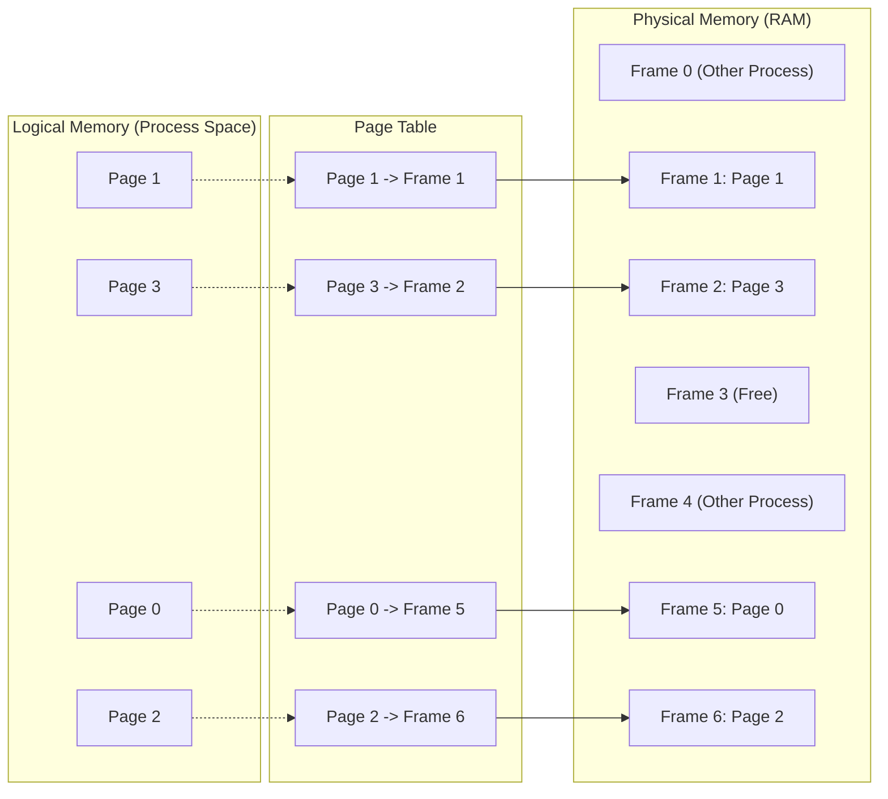
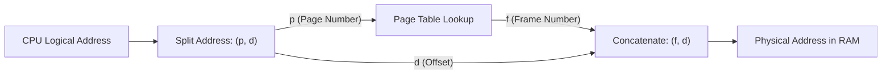
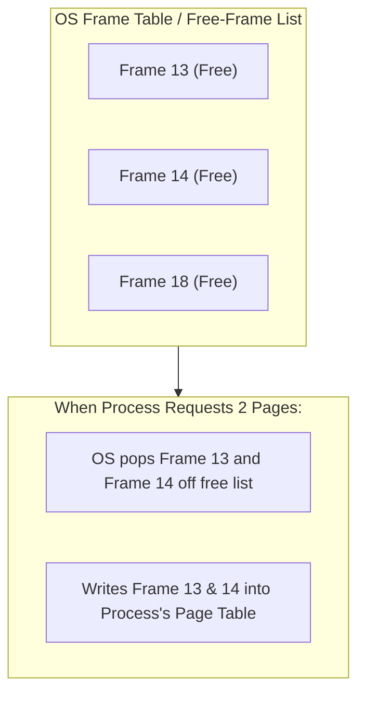

[OS Index](../README.md) / [Unit 3: Memory & Virtual Memory](Introduction.md)


---

In Lecture 2, we saw contiguous allocation fail because memory became peppered with unusable gaps (external fragmentation). In Lecture 3, we tried segmentation — breaking a program into variable-sized logical pieces — but because segments were still variable in size, external fragmentation came right back.

Both approaches failed for the exact same reason: they tried to fit variable-sized requests into variable-sized holes.

Paging makes one single, brilliant architectural change:

**Make every block the exact same size.**

The moment you do that, external fragmentation vanishes completely. There is no such thing as a free hole that is "the wrong shape" or "too small," because every single hole in RAM is identical in size to every single piece of every program. Any free block can hold any piece of any process.

Paging is the single most important memory management scheme in modern operating systems. Everything else in this unit rests directly on top of it.

---

## Pages and Frames: The Basic Concept

To understand paging, keep two terms strictly separated:

- **Frames:** Physical memory (RAM) is chopped up into fixed-size blocks called *frames*.
- **Pages:** Logical memory (the process's address space) is chopped up into blocks of the **exact same size** called *pages*.



Notice what just happened:
- To the program, memory looks completely contiguous: Page 0, Page 1, Page 2, Page 3.
- But in physical RAM, Page 0 is placed in Frame 5, Page 1 is in Frame 1, Page 2 is in Frame 6, and Page 3 is in Frame 2.
- The pages are scattered across completely non-contiguous physical frames!

The translation between the program's pages and the hardware's frames is tracked by a per-process data structure called the **Page Table**.

When a program needs $N$ pages of memory, the OS doesn't search for a contiguous hole of size $N$. It simply checks its list of free frames, pops any $N$ free frames off the list, loads the pages into them, and writes the frame numbers into the process's page table.

---

## Why Page Sizes Are Always Powers of Two

Page sizes are determined by hardware, not by the operating system. On almost all modern hardware, the standard page size is **4 KB** ($4096 \text{ bytes} = 2^{12}$). You can see your own system's page size in Linux by running:
```bash
getconf PAGESIZE
```

There is a profound engineering reason why page sizes are **always powers of two**:

If the page size is $2^n$ bytes, splitting a logical address into a page number and an offset requires **zero arithmetic**. It is done purely through bit-splitting.

Suppose a system has a 32-bit address space ($m = 32$), and the page size is 4 KB ($2^{12}$, so $n = 12$).

A 32-bit logical address is split into two bit fields:
- The **low-order $n$ bits** (bits 0 to 11) form the **offset ($d$)** within the page.
- The **remaining high-order $(m - n)$ bits** (bits 12 to 31) form the **page number ($p$)**.

$$\underbrace{p \quad (\text{high } 20 \text{ bits})}_{\text{Page Number}} \quad \Big| \quad \underbrace{d \quad (\text{low } 12 \text{ bits})}_{\text{Offset within Page (4 KB)}}$$

In math:
$$\text{Page Number } p = \lfloor \text{Address} / 2^n \rfloor = \text{Address} \gg n$$
$$\text{Offset } d = \text{Address} \pmod{2^n} = \text{Address} \ \& \ (2^n - 1)$$

Because the hardware uses binary, division and modulo by $2^{12}$ do not require an arithmetic divider circuit on the CPU. The wires carrying bits 0–11 simply route directly to the memory bus as the offset, while the wires carrying bits 12–31 route to the page table!

---

## Address Translation: Why Paging is Faster Than Segmentation

Look at how the MMU translates a logical address in paging:



Compare this to the hardware translation in segmentation from Lecture 3:
1. **In segmentation:** The hardware had to use an actual arithmetic adder to compute $\text{Physical} = \text{Base} + d$. In paging, **there is NO addition!** The frame number $f$ and the offset $d$ are simply glued together (concatenated). If frame number is `00000101` and offset is `001100001000`, the physical address is literally `00000101001100001000`.
2. **In segmentation:** The hardware had to check if offset $d < \text{Limit}$. In paging, **there is NO bounds check on the offset!** Because the page size is $2^n$, any $n$-bit binary number can only represent values from $0$ to $2^n - 1$. It is mathematically impossible for an $n$-bit offset to point outside a $2^n$-byte frame!

This makes paging hardware extraordinarily simple, elegant, and fast.

---

## A Concrete Worked Example

Let's trace how logical addresses translate into physical addresses.

Suppose:
- Logical address space = 8 pages ($2^3$, so page number $p$ is 3 bits)
- Page size = 1 KB ($1024 \text{ bytes} = 2^{10}$, so offset $d$ is 10 bits)
- Physical memory = 32 frames ($2^5 = 32 \text{ KB}$)

Here is the process's page table:

| Page ($p$) | Frame ($f$) |
| :---: | :---: |
| **0** | 5 |
| **1** | 6 |
| **2** | 1 |
| **3** | 2 |

Now let's translate the logical address **`2500`**:

1. **Find page number and offset:**
   $$p = \lfloor 2500 / 1024 \rfloor = 2$$
   $$d = 2500 \pmod{1024} = 452$$
   So logical address `2500` is byte 452 of Page 2.

2. **Look up the frame:**
   In the page table, entry for Page 2 points to **Frame 1**.

3. **Compute the physical address:**
   $$\text{Physical Address} = (f \times \text{Page Size}) + d$$
   $$\text{Physical Address} = (1 \times 1024) + 452 = 1476$$

The byte the program called `2500` physically lives at RAM byte `1476`.

---

## What Did We Pay? The Cost of Internal Fragmentation

Paging completely eliminates external fragmentation. But remember the universal rule of systems engineering: there is no free lunch.

What did we trade it for? **Internal fragmentation**.

A process can be any arbitrary size, but memory is allocated strictly in fixed-size pages. Unless a process's memory footprint happens to be an exact multiple of the page size, its very last page will not be completely full.

### A Concrete Calculation (Exam Classic)
Suppose the page size is **2048 bytes (2 KB)**.  
A process arrives with a size of **72,766 bytes**.

How much memory is allocated, and how much is wasted?

$$\text{Number of pages needed} = \lceil 72766 / 2048 \rceil = 36\text{ pages}$$

$$35 \text{ full pages} \times 2048 = 71680\text{ bytes}$$

$$\text{Bytes in the 36th page} = 72766 - 71680 = 1086\text{ bytes}$$

$$\text{Internal fragmentation (wasted space in last frame)} = 2048 - 1086 = 962\text{ bytes}$$

The process is allocated 36 frames ($36 \times 2048 = 73,728 \text{ bytes}$). The unused 962 bytes inside frame 36 sit empty, and because that frame is assigned to this process, the OS cannot give those 962 bytes to anyone else.

### How Bad is Internal Fragmentation?
- **Worst case:** A process needs $N$ pages plus 1 single byte. It gets $N + 1$ pages, wasting $(\text{Page Size} - 1)$ bytes in the last frame.
- **Best case:** A process is an exact multiple of page size, wasting 0 bytes.
- **Average case:** Across many processes, the expected waste is **half a page per process**:
  $$\text{Average Waste} = \frac{1}{2} \times \text{Page Size}$$

With 4 KB pages, that is an average of 2 KB wasted per process. Compared to contiguous allocation (where the 50-percent rule destroyed one-third of physical RAM), losing 2 KB per process is practically negligible!

### The Page Size Trade-off
Why not make pages tiny — say, 64 bytes — to eliminate internal fragmentation almost entirely?

Because of the **Page Table overhead**:
- If pages are tiny (64 bytes), a 4 GB address space needs **67 million pages**!
- That means your page table has 67 million entries. Storing the page table itself would eat hundreds of megabytes of RAM!
- In addition, disk I/O is much more efficient when transferring larger blocks.

So modern architectures settle on 4 KB as the sweet spot, while offering optional "Huge Pages" (2 MB and 1 GB on x86-64) for memory-intensive applications like databases to reduce page table sizes.

---

## The OS Free-Frame Table vs. The Page Table

Students often confuse the tables maintained by the system. Keep them strictly separated:

| Table | Page Table | Frame Table |
| :--- | :--- | :--- |
| **How many?** | **One per process** | **One for the entire system** |
| **Indexed by:** | Page number ($p$) | Frame number ($f$) |
| **What an entry stores:** | Which physical frame holds this page | Is this frame free or allocated? If allocated, which process owns it and which page is inside? |
| **Who uses it?** | The **MMU hardware**, on every single memory access | The **OS kernel**, when allocating or reclaiming memory |



When a process terminates, the OS reads its page table, looks up every allocated frame number, and returns those frames to the system-wide free-frame list.

---

## The Big Hidden Catch: The Speed Penalty of Paging

Everything about paging looks perfect: no external fragmentation, easy allocation, hardware bit-splitting.

But notice what we just introduced:

In simple contiguous allocation, accessing a variable took **one memory access** (the CPU added base to offset and touched RAM).

In paging, where does the page table live? **The page table itself lives in main memory!**

Think about what happens every single time the CPU executes an instruction that accesses memory:
1. **Memory Access #1:** The CPU must first read the page table in RAM to look up which frame holds page $p$.
2. **Memory Access #2:** The CPU takes the frame number, combines it with the offset, and accesses the actual data in RAM.

**Every single memory access is now twice as slow!**

If your CPU executes code at 4 GHz, but every memory access requires two sequential bus trips to RAM, overall system performance is cut in half.

How do computer architects solve this catastrophic speed penalty?

They invent a specialized, blazing-fast hardware cache dedicated exclusively to remembering recent address translations: the **Translation Lookaside Buffer (TLB)**. And that is where Lecture 5 begins.

---

## Key Takeaways

- Paging eliminates external fragmentation by making all memory blocks the exact same fixed size: physical memory is divided into **frames**, and logical memory is divided into **pages**.
- Page sizes are defined by hardware and are always powers of two (typically 4 KB).
- Because page size is $2^n$, address translation is pure bit-splitting: low $n$ bits are the offset $d$, and high bits are the page number $p$. No arithmetic adder or bounds check is required.
- Paging trades external fragmentation for **internal fragmentation** (waste only occurs in the last page of a process, averaging $\frac{1}{2} \times \text{Page Size}$).
- The **Page Table** belongs to a process and maps pages to frames. The **Frame Table** belongs to the OS and tracks which physical frames are free or allocated across the whole system.
- Paging makes allocation effortless: any $N$ free frames can satisfy a request for $N$ pages.
- The fundamental cost: the page table sits in RAM, which means every memory reference requires **two trips to RAM** (one to read the page table, one to read the actual data).

---

A 2x slowdown on every memory access is completely unacceptable for a modern processor. 

How can we keep all the fragmentation-free benefits of paging without suffering that second memory trip? And what happens when a 64-bit program has a page table so massive that the table itself doesn't fit in RAM?

That brings us to the structure of page tables, hierarchical paging, and the single most critical piece of performance hardware in modern memory systems: [**Structure of the Page Table** (Lecture 5)](L05%20-%20Structure%20of%20the%20Page%20Table.md).
