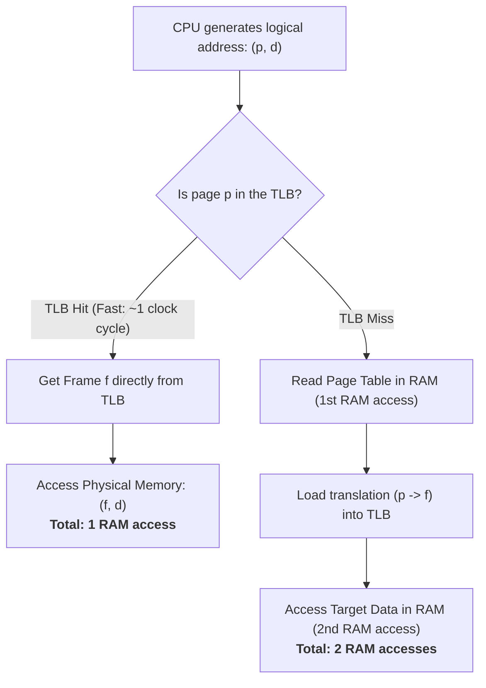
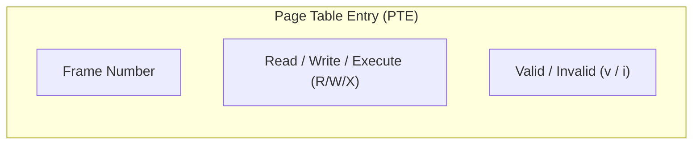
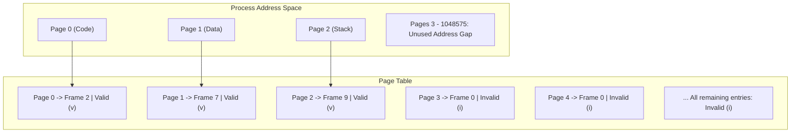
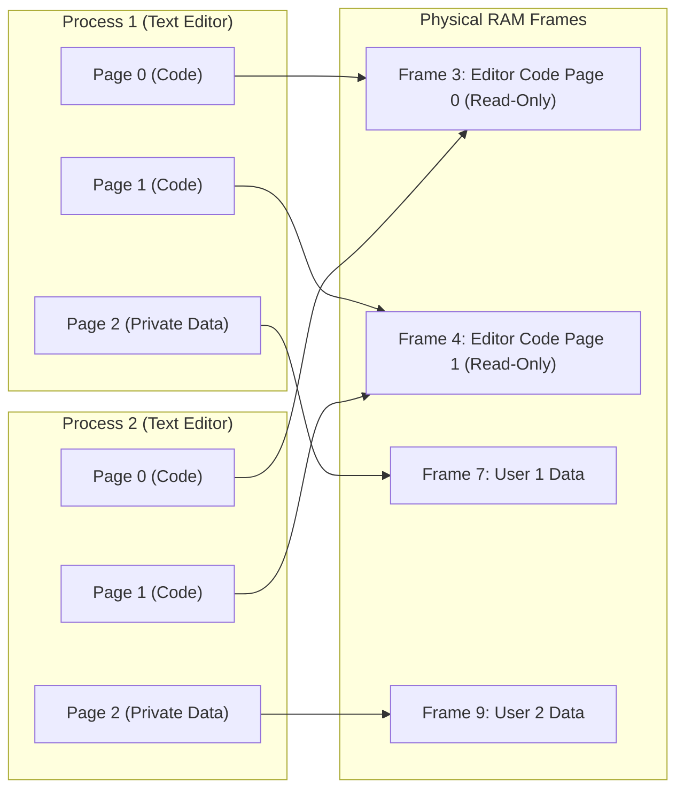
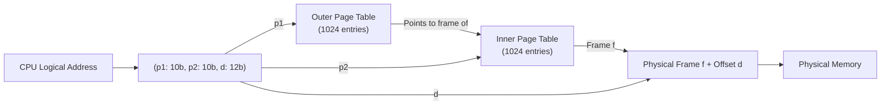
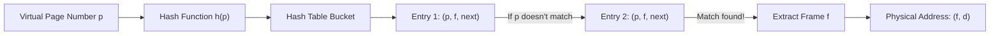
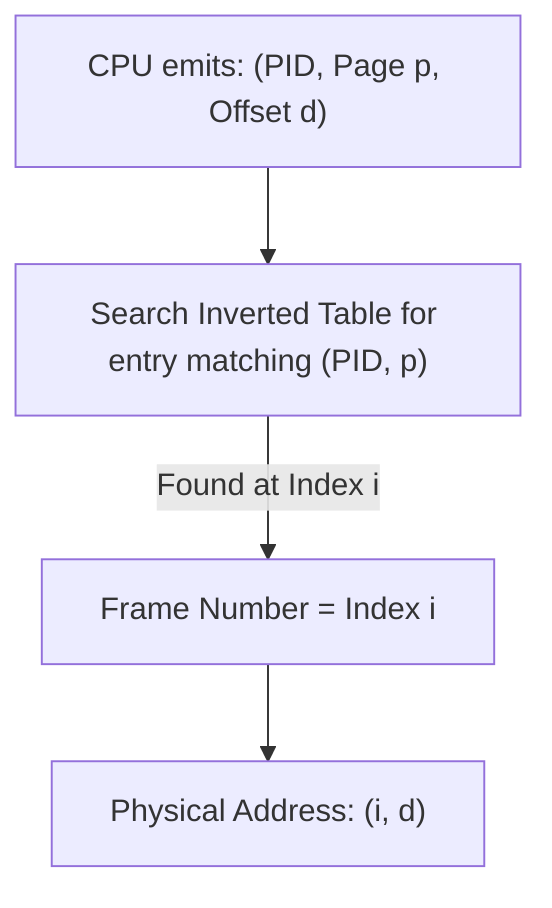

[OS Index](../README.md) / [Unit 3: Memory & Virtual Memory](Introduction.md)

---

In Lecture 4, paging looked like the ultimate solution: physical memory is split into frames, logical memory into pages, and external fragmentation is completely gone.

But the moment you try to build a real operating system with paging, you hit two massive engineering walls:

1. **Paging is dangerously slow:** The page table itself lives in main memory. That means every single time the CPU accesses an instruction or variable, it has to make **two trips to RAM** — one to read the page table, and one to fetch the actual data. System performance is cut in half.
2. **Page tables are impossibly huge:** In a 32-bit system with 4 KB pages, a single process has over a million pages. Its page table takes 4 MB of RAM. If you have 100 processes, that is 400 MB of RAM wasted just storing translation tables! And on 64-bit machines, a flat page table is millions of terabytes — physically impossible.

This lecture is about how computer architects and operating systems solve both problems. It is the practical engineering that turns the theory of paging into something fast, scalable, and real.

---

## The Speed Problem: Hardware Support and the TLB

Where should the page table physically live?

- **Idea 1: Put it in CPU registers.** If the entire page table is stored in CPU registers, translation is instantaneous — zero memory access penalty. The early DEC PDP-11 did this. But it only works if the page table has 8 or 16 entries. A modern system with a million entries cannot fit them in registers, and context switching would take forever saving and restoring them.
- **Idea 2: Put it all in RAM.** Keep the table in main memory. A hardware register called the **Page-Table Base Register (PTBR)** points to the start of the current process's page table in RAM, and the **Page-Table Length Register (PTLR)** bounds its size. Context switching is fast (just reload PTBR with the new process's table address). But every memory reference now takes **two physical RAM accesses**.

The solution to this dilemma is the **Translation Lookaside Buffer (TLB)**.

The TLB is a tiny, blazing-fast hardware cache built directly on the CPU chip. It doesn't cache program data — it exclusively caches **recent address translations** (page number $\to$ frame number).

### How the TLB Works
The TLB is made of *associative memory*. When the CPU emits page number $p$, the TLB searches **all of its entries in parallel simultaneously** in a fraction of a clock cycle.

- **TLB Hit:** Page $p$ is found in the TLB. The hardware gets frame number $f$ instantly and accesses RAM. Total memory access: **1 RAM access**.
- **TLB Miss:** Page $p$ is not in the TLB. The MMU must go to main memory to look up `page_table[p]` (first RAM access), load that translation into the TLB for next time, and then fetch the actual data (second RAM access). Total memory access: **2 RAM accesses**.

### Why the TLB Works So Well: Locality
A TLB is physically small — typically only **32 to 1024 entries**.

Why does such a tiny cache work for a process with millions of pages? Because of the principle of **locality of reference**:
At any given moment, a running program is not touching all of its code and data. It is executing a tight loop, reading an array, and pushing to the top of its stack. It spends 99% of its time touching the same handful of 5 or 10 pages.

Because those few active pages stay in the TLB, modern systems achieve TLB hit rates of **98% to 99%**!

---

## Effective Access Time (EAT)

To measure how much paging actually slows down the machine, we calculate the **Effective Access Time (EAT)**.

Let:
- $m$ = Main memory access time (typically 100 ns)
- $t_{\text{TLB}}$ = TLB search time (typically tiny, ~1 ns)
- $h$ = TLB hit ratio (the fraction of times page $p$ is found in the TLB)

$$\text{EAT} = h \times (t_{\text{TLB}} + m) + (1 - h) \times (t_{\text{TLB}} + 2m)$$

If we assume TLB search time is absorbed into the cycle or negligible ($t_{\text{TLB}} \approx 0$):

$$\text{EAT} = h \times m + (1 - h) \times 2m = (2 - h)m$$

### A Concrete Calculation (Exam Classic)
Suppose memory access time $m = 100\text{ ns}$.

#### Scenario A: 80% Hit Rate ($h = 0.80$)
$$\text{EAT} = 0.80 \times 100\text{ ns} + 0.20 \times 200\text{ ns} = 80 + 40 = 120\text{ ns}$$
A 20% slowdown compared to bare physical memory.

#### Scenario B: 99% Hit Rate ($h = 0.99$)
$$\text{EAT} = 0.99 \times 100\text{ ns} + 0.01 \times 200\text{ ns} = 99 + 2 = 101\text{ ns}$$
Only a **1% slowdown**! The TLB successfully restores system performance back to near-native hardware speed.

### The Context Switch Cost: Flushing and ASIDs
When the OS switches from Process A to Process B, the entries currently inside the TLB belong to Process A. If Process B asks for Page 3, and the TLB still holds Process A's Page 3, Process B would access Process A's memory!

Historically, the OS had to **flush the entire TLB** on every context switch, causing Process B to suffer a painful storm of TLB misses until its cache warmed up.

Modern CPUs solve this by adding an **Address-Space Identifier (ASID)** to every TLB entry. An ASID is like a process ID stored inside the hardware translation tag. When Process B runs, the TLB only matches entries where the ASID equals Process B's ID. Translations for multiple processes can safely coexist in the TLB, eliminating the need to flush on every switch.

---

## Memory Protection and Valid-Invalid Bits

In paging, protection bits live right inside each Page Table Entry (PTE):

- **Protection Bits:** Mark pages as Read-Only, Read-Write, or Execute-Disabled (NX bit). If code tries to write to a read-only page, the hardware traps.
- **The Valid-Invalid Bit:**
  - **Valid ($v$):** The page is in the process's legal logical address space.
  - **Invalid ($i$):** The page is **not** part of the process's address space.

Look at a process that only uses logical addresses `0` to `10485` (it only needs pages 0, 1, and 2 in a 4 KB page system).

If the program accidentally dereferences a null pointer or stray index pointing to Page 3, the MMU checks entry 3, sees the **$i$ (invalid)** bit, halts the CPU immediately, and fires a trap to the OS. The OS terminates the process with a segmentation fault.

---

## Shared Pages

Paging makes sharing code across processes extraordinarily clean.

If a code segment is written as **reentrant code** (pure code that never modifies itself), multiple processes can share the exact same physical frames:

Both processes have Page 0 and Page 1 mapped to physical Frames 3 and 4 with the Read-Only bit set. Only their data pages map to private physical frames. If 50 users open `vim` or `bash`, the system keeps only **one physical copy** of the executable code in RAM!

---

## The Size Problem: Why Flat Page Tables Break Down

Now let's face the second major crisis of paging: the sheer size of the page table.

Calculate the size of a flat page table on a standard 32-bit machine:
- 32-bit address space = $2^{32} = 4\text{ GB}$ of logical memory.
- Page size = 4 KB ($2^{12}$).
- Number of pages = $2^{32} / 2^{12} = 2^{20} = 1,048,576\text{ pages}$ (~1 million pages).
- Each Page Table Entry (PTE) takes 4 bytes.

$$\text{Page Table Size} = 1,048,576 \times 4\text{ bytes} = 4\text{ MB per process!}$$

Think about what this means:
1. Every single process running on the machine requires **4 MB of RAM** just to store its page table. If 100 processes are running, that is **400 MB of RAM** eaten before a single user program even does any real work.
2. Even worse: a flat page table is an array, which means **that 4 MB must be contiguous in physical memory**! We invented paging specifically to eliminate contiguous allocation, and now the page table itself requires 4 MB contiguous chunks!
3. On a 64-bit architecture, the math becomes absurd: $2^{64}$ bytes with 4 KB pages produces $2^{52}$ entries $\times 8\text{ bytes} = 36\text{ petabytes}$ per table!

To solve this, operating systems structure page tables in three main ways:
1. **Hierarchical Paging**
2. **Hashed Page Tables**
3. **Inverted Page Tables**

---

## 1. Hierarchical Paging (Multilevel Paging)

The simplest way to break up a massive page table is to use the core lesson of this entire unit:

**Page the page table itself!**

Instead of allocating one giant contiguous 4 MB table, chop the page table into 4 KB chunks, treat those chunks like ordinary pages, and create an *outer page table* to track them.

### Two-Level Paging (32-Bit System)
On a 32-bit system with 4 KB pages, the 32-bit logical address is split into three parts:

$$\underbrace{p_1 \quad (10 \text{ bits})}_{\text{Outer Page Table Index}} \quad \Big| \quad \underbrace{p_2 \quad (10 \text{ bits})}_{\text{Inner Page Table Index}} \quad \Big| \quad \underbrace{d \quad (12 \text{ bits})}_{\text{Offset within 4 KB Page}}$$

### Why Hierarchical Paging Saves Massive Amounts of RAM
Look at what this design achieves:
1. The **Outer Page Table** has $2^{10} = 1024$ entries $\times 4\text{ bytes} = 4\text{ KB}$. It fits completely inside **one single 4 KB frame**! No massive contiguous allocation required.
2. An **Inner Page Table** is only created when the process actually allocates memory in that region!
   - In most programs, 90% of the virtual address space (the vast void between the stack and the heap) is unused.
   - For all those unused regions, the outer table entry is marked **invalid** and points to nothing. The corresponding inner page tables **are never allocated in RAM!**
   - A typical small process that only uses a few pages of code, data, and stack only needs the outer table (4 KB) plus 2 or 3 inner tables (8–12 KB). Its total page table overhead drops from **4 MB down to ~16 KB**!

### The Cost: Multi-Trip Penalty on TLB Misses
The downside: if a translation misses the TLB, the MMU must now make **three trips to RAM** (read outer table, read inner table, then fetch data).  
On a 64-bit architecture, a full hierarchy needs **4 levels** (like x86-64's PML4) or 5 levels. A TLB miss on a 4-level table requires **5 trips to RAM** before getting a single byte of data! This makes a high TLB hit rate absolutely critical.

---

## 2. Hashed Page Tables

For address spaces larger than 32 bits, multi-level trees get too deep. A common alternative is a **Hashed Page Table**.

- The virtual page number $p$ is passed through a hash function.
- The hash table points to a linked list of entries that hashed to that bucket (handling collisions via chaining).
- Each entry contains three fields:
  1. Virtual page number ($p$)
  2. Mapped physical frame number ($f$)
  3. Pointer to the next entry in the linked list
- The MMU searches the chain for a matching $p$, extracts $f$, and forms the physical address.

**Advantage:** The size of the hash table scales with the amount of memory *actually used*, making it ideal for sparse 64-bit address spaces.

---

## 3. Inverted Page Tables

In all schemes so far, each process has its own page table tracking millions of virtual pages.

An **Inverted Page Table** flips the concept completely upside down:

Instead of tracking every *virtual page*, **track every physical frame in RAM**.

- There is **only ONE page table for the entire operating system**.
- The table has exactly one entry for each physical frame of RAM. If the machine has 8 GB of RAM and 4 KB frames, there are exactly $2,097,152$ entries, regardless of whether 1 process or 1,000 processes are running!
- Each entry stores:
  $$\langle \text{PID}, \quad \text{Page Number } p \rangle$$
  meaning: *"Physical frame $i$ is currently occupied by Page $p$ of Process PID."*

### The Strengths and Weaknesses of Inverted Page Tables

| Advantage | Fatal Flaw |
| :--- | :--- |
| **Fixed, Tiny Size:** Table size depends strictly on physical RAM size, completely immune to 64-bit virtual address explosions. | **Slow Search:** The table is sorted by *physical frame*, but the CPU searches by *virtual address*. To translate, the hardware must search the entire table! (Requires a hash anchor table to speed up searches). |
| **Single Table:** Only one structure for the whole OS to manage. | **Shared Memory is Broken:** A physical frame entry can only store ONE $\langle \text{PID}, p \rangle$ pair. It is structurally impossible to map two different processes to the same frame without causing artificial page faults! |

Because sharing code libraries (like `libc`) is so fundamental to modern operating systems, inverted page tables remained a niche design (used in IBM PowerPC and UltraSPARC), while **Hierarchical Multi-Level Paging** won out as the dominant design in almost all modern consumer and server processors (x86-64 and ARM).

---

## Key Takeaways

- Paging has two core engineering problems: **speed** (two memory accesses per reference) and **size** (page tables are enormous).
- The **TLB** is an associative hardware cache that stores recent translations. At a 99% hit rate, EAT drops from a 100% slowdown down to a negligible 1% overhead.
- $\text{EAT} = h \times (t_{\text{TLB}} + m) + (1 - h) \times (t_{\text{TLB}} + 2m)$.
- Page table entries hold **protection bits** (R/W/X) and a **Valid-Invalid bit ($v/i$)**. Accessing an invalid page traps to the OS with a segmentation fault.
- **Shared pages** allow identical read-only reentrant code (like system libraries) to share single physical frames across processes.
- **Hierarchical Paging** pages the page table itself. Unused inner tables are never allocated, slashing memory overhead from megabytes to kilobytes.
- **Hashed Page Tables** hash virtual page numbers into linked-list buckets, well-suited for sparse 64-bit address spaces.
- **Inverted Page Tables** maintain one entry per physical frame for the whole system, but make shared memory very difficult to implement.

---

Now look very closely at the **Valid-Invalid bit** we just studied.

Up to this point, if an entry had an **Invalid ($i$)** bit, we treated it as an error: the program tried to touch memory it doesn't own, so the OS kills it.

But what if an invalid bit meant something completely different?

What if the page is completely legal, but **it currently sits on disk because we haven't loaded it into RAM yet?**

What if a program with an 8 GB footprint could run on a computer with only 2 GB of physical RAM, loading pages on the fly only when the CPU actually touches them?

That single realization is the foundation of modern computing: [**Virtual Memory and Demand Paging** (Lecture 6)](L06%20-%20Virtual%20Memory%20and%20Demand%20Paging.md).
