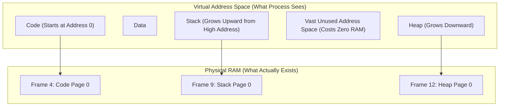
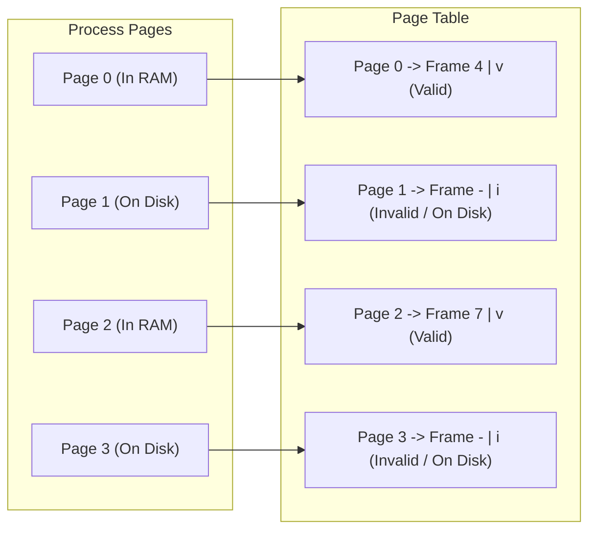
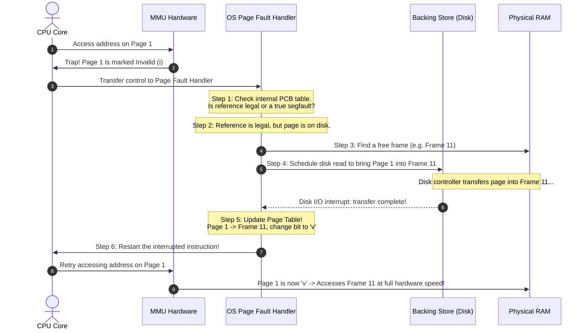
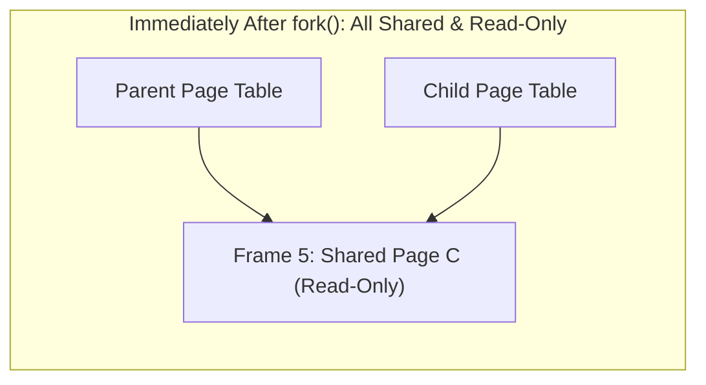
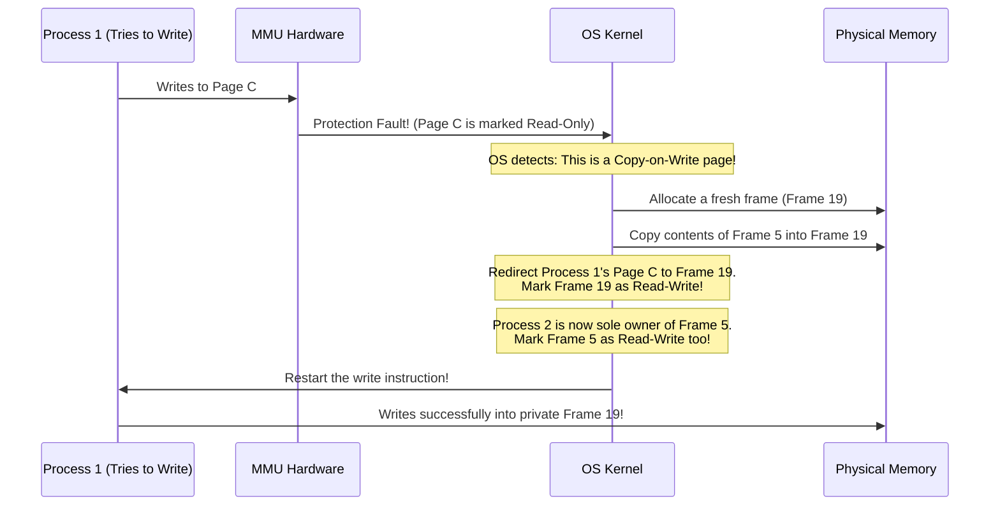
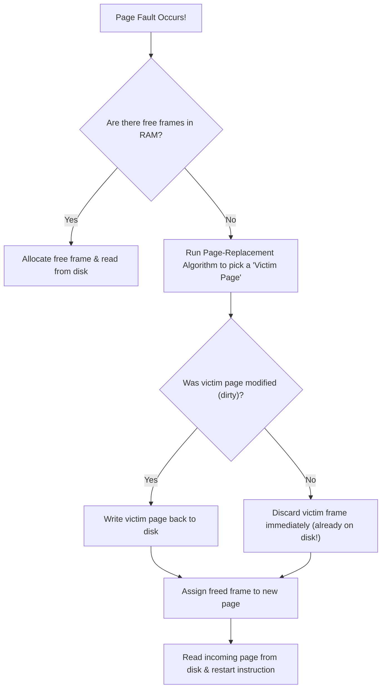

[OS Index](../README.md) / [Unit 3: Memory & Virtual Memory](Introduction.md)


---

Every scheme we have studied so far shared one fundamental assumption:

To run a program, **every single byte of that program must be loaded into physical RAM**.

Paging allowed those bytes to be scattered across non-contiguous frames, but every page of the process still had to reside in memory. 

Virtual memory takes the most radical step in operating systems:

**A page does not need to be in physical memory at all.**

A program can have 1,000 pages, but only 10 of them might be in RAM right now. The other 990 pages sit quietly on the disk, and the operating system fetches them into memory **only when the CPU actually tries to access them**.

The implications of this single idea changed computing forever:
- **Programs can be larger than physical RAM:** You can run a 16 GB video rendering job or database on a laptop with only 8 GB of RAM. The program does not know, and does not care.
- **Higher degree of multiprogramming:** If each process only holds its actively used pages in RAM, you can fit dozens more processes into physical memory at once. That means the CPU is never starved for work.
- **Instant startup:** When you launch an app, the OS doesn't make you wait while it copies 500 MB from disk to RAM. It loads the first page of code and starts executing immediately.
- **Unused code costs zero RAM:** Think about a giant program — 80% of its code is dedicated to error recovery, rare edge cases, and diagnostic features that never trigger during a normal run. In virtual memory, that code is never loaded into RAM.

And the most brilliant part? Computer architects did not have to invent any new hardware to make this work. They repurposed a bit we already studied: the **Valid-Invalid bit**.

---

## The Virtual Address Space

Virtual memory strictly decouples what the program sees from what physical hardware actually has:



- To the program, the **Virtual Address Space** is continuous, private, and vast. It starts neatly at address `0`, code sits at the bottom, heap grows down, stack grows up, and a giant ocean of unused addresses sits in the middle.
- But in **Physical RAM**, only the pages currently being read or written actually exist. The vast empty gap between the heap and the stack costs absolutely zero physical memory.

---

## Demand Paging: Bringing Pages on Demand

How does a system run a program when its pages are scattered between RAM and disk?

Through **Demand Paging** — pages are loaded only on demand, when an instruction actually references them ("lazy evaluation" applied to memory).

### The Valid-Invalid Bit Reimagined
In Lecture 5, we saw the Valid-Invalid bit ($v/i$) inside each Page Table Entry:
- In pure paging, an **invalid ($i$)** bit meant the program made an illegal memory access outside its boundary.
- In demand paging, the OS gives the invalid bit a second, profound meaning:

$$\mathbf{v} \implies \text{The page is valid AND currently resident in physical RAM.}$$

$$\mathbf{i} \implies \text{The page is either illegal OR it is a valid page currently sitting on disk!}$$



When the CPU accesses Page 0, the MMU sees the valid bit ($v$), extracts Frame 4, and fetches the data at normal hardware speed.

But when the CPU accesses Page 1, the MMU checks the entry and sees the **invalid bit ($i$)**. 

The MMU hardware cannot read disks on its own. So it does the only thing it knows how to do: **it halts the instruction and fires a hardware trap to the operating system.**

That trap is called a **Page Fault**.

---

## The Six Steps in Handling a Page Fault

A page fault is not an error — it is a routine mechanism used by the OS to fetch missing data. 

Here is the exact step-by-step sequence the OS executes to resolve a page fault:



### The Six Steps in Detail:
1. **Check internal tables:** The OS looks at internal process tables (stored in the PCB) to determine: *Was this reference completely illegal (like dereferencing a NULL pointer)? Or is it a valid page that just happens to be on disk?*
   - If illegal $\to$ kill the process with a segmentation fault.
   - If legal $\to$ proceed to fetch the page.
2. **Find a free frame:** The OS searches physical memory's free-frame list for an empty frame.
3. **Schedule disk I/O:** The OS issues a disk read request to fetch the missing page from the backing store (swap space or executable file) into the newly allocated physical frame.
4. **Wait for transfer (Context Switch):** Disk operations take milliseconds. While waiting, the CPU scheduler puts this process to sleep (waiting state) and switches the CPU to run another ready process.
5. **Update the Page Table:** When the disk controller fires an interrupt signaling that the read is complete, the OS updates the faulting process's page table: it writes the new frame number into the entry and changes the bit from **$i$** to **$v$**.
6. **Restart the instruction:** The OS places the process back in the ready queue. When it runs, the OS restores its exact registers and program counter to **re-execute the exact instruction that faulted**. This time, the translation finds the valid bit, and execution proceeds as if nothing ever happened!

---

## Major vs. Minor Page Faults

Not all page faults are created equal. In Linux and modern operating systems, page faults fall into two categories:

### Minor Page Fault (Fast — Microseconds)
A minor page fault occurs when a page is **already physically present in RAM**, but the MMU simply hasn't mapped it into this specific process's page table yet.
- *Examples:*
  - A shared library (like `libc`) was already loaded into RAM by another program, and your process is referencing it for the first time.
  - A page that was recently reclaimed is still sitting in the OS memory cache.
  - A **Copy-on-Write** page (discussed below).
- **Zero disk I/O is required!** The OS simply creates a page table mapping to the existing frame and sets the bit to valid. It takes microseconds.

### Major Page Fault (Slow — Milliseconds)
A major page fault occurs when the requested page is **not in RAM anywhere**, and the OS must physically read it from disk or SSD storage.
- Involves physical disk controllers, queueing delays, and disk latency.
- Takes **milliseconds** — thousands of times slower than a minor fault.

---

## The Challenge of Instruction Restart

Step 6 says: *"Restart the instruction that faulted."*

That sounds simple, but in computer architecture, restarting an instruction in the middle of execution is a nightmare.

Consider an instruction like:
```assembly
ADD R1, [3000]
```
If the memory reference to address `3000` causes a page fault, the CPU must cancel the addition, preserve register `R1`, fetch the page, and re-execute the instruction from the beginning.

Now look at a nasty edge case on architectures with **auto-increment addressing modes**:
```assembly
MOV (R2)+, [3000]
```
This instruction takes the value pointed to by `R2`, stores it in address `3000`, and **automatically increments register `R2`**.

What happens if the source read `(R2)+` succeeds (and `R2` is incremented by 4), but the destination write to `[3000]` page-faults?

If the OS simply restarts the instruction, `R2` will be incremented a second time — corrupting program data!

To make demand paging possible, CPU hardware must be explicitly designed to support **Instruction Restart**:
- The CPU maintains a temporary shadow copy of register state.
- If a page fault occurs midway through an instruction, the hardware rolls back all modified registers to their exact pre-instruction values before firing the page fault trap.

---

## Performance of Demand Paging: The Arithmetic of Page Faults

How does demand paging affect computer performance?

Let:
- $ma$ = Memory access time (typically 100 to 200 nanoseconds)
- $p$ = Page fault rate ($0 \le p \le 1$, the probability that a memory access causes a page fault)
- $\text{Page Fault Service Time} \approx 8\text{ milliseconds} = 8,000,000\text{ nanoseconds}$

$$\text{Effective Access Time (EAT)} = (1 - p) \times ma + p \times (\text{Page Fault Service Time})$$

### A Real-World Calculation (Exam Classic)
Suppose memory access time $ma = 200\text{ ns}$, and average page fault service time is $8\text{ ms} = 8,000,000\text{ ns}$.

$$\text{EAT} = (1 - p) \times 200 + p \times 8,000,000$$
$$\text{EAT} = 200 + 7,999,800 \times p\text{ ns}$$

Now, ask: **What is the maximum page fault rate we can tolerate if we want less than a 10% slowdown?**

A 10% slowdown means $\text{EAT} < 220\text{ ns}$:

$$200 + 7,999,800 \times p < 220$$
$$7,999,800 \times p < 20$$
$$p < \frac{20}{7,999,800} \approx 0.0000025$$

$$p < \frac{1}{400,000}$$

Think about that result:

To keep performance degradation under 10%, **fewer than 1 out of every 400,000 memory accesses can be a page fault!** If even 1 out of every 1,000 accesses caused a page fault, the computer would crawl at less than 2% of its native speed.

---

## Copy-on-Write (COW)

Virtual memory enables one of the most famous performance optimizations in all of operating systems: **Copy-on-Write (COW)**.

Recall from Unit 1 how process creation works in UNIX/Linux:
1. A process calls `fork()` to create a child process.
2. The child is an exact clone of the parent.
3. Almost immediately, the child calls `execve()` to replace itself with a completely new program binary.

In early systems, `fork()` physically copied every single page of the parent's memory into new frames for the child. If the parent was a 2 GB database, `fork()` spent half a second duplicating 2 GB of RAM — only for the child to call `execve()` one millisecond later and throw all those copied pages in the trash!

### How Copy-on-Write Fixes This
With Copy-on-Write, `fork()` **does not copy any memory pages at all!**

1. The OS creates a new page table for the child process.
2. The child's page table entries point to the **exact same physical frames** as the parent.
3. **The Crucial Step:** The OS marks every single shared page table entry as **Read-Only** in both the parent and the child!



Now, what happens when either process tries to modify a page?



1. Process 1 attempts to write data to Page C.
2. Because Page C was marked read-only, the MMU halts and fires a protection fault trap.
3. The OS inspects the fault and realizes: *"This is a legitimate write to a Copy-on-Write page."*
4. The OS allocates a brand-new physical frame (Frame 19), copies the contents of Page C into it, and updates Process 1's page table to point to Frame 19 with **Read-Write** permission.
5. The original Page C now has only one owner (Process 2), so the OS marks Process 2's entry as Read-Write as well.
6. The write instruction restarts, and Process 1 modifies its own private copy without affecting Process 2.

**The result:** Pages that are only read (like code, read-only data, or memory never modified before `execve`) are **never copied**. `fork()` becomes practically instantaneous.

### Zero-Fill-on-Demand (ZFOD)
When a process requests fresh memory (e.g. via `malloc()` extending the heap), the OS allocates a **Zero-Fill-on-Demand** page.

For security reasons, the OS cannot hand a process a raw physical frame that previously belonged to another process — otherwise, the new process could read leftover passwords or encryption keys! The OS pre-cleans frames with zeros before handing them over.

---

## What Happens When There Are No Free Frames Left?

Demand paging works smoothly as long as there is an empty frame to hand out on each page fault.

But physical memory is finite. As processes demand more and more pages, physical RAM eventually fills up completely. 

Now imagine: physical RAM is 100% full, an instruction executes, and it causes a page fault.

The OS needs to fetch the missing page from disk, but **there are zero free frames left in RAM**.

What can the operating system do?
1. It could kill the process. (Unacceptable and brutal).
2. It could swap out the entire process to disk. (Too coarse and slow).
3. **Page Replacement:** The OS picks an existing page in RAM that is "not actively in use," evicts it to disk, and gives its physical frame to the incoming page!



And that raises the single most important algorithmic question in virtual memory:

**Out of all the thousands of pages sitting in RAM, which page should you choose to evict?**

If you evict a page that the CPU is about to access in the next millisecond, you will cause another page fault immediately!

The science of picking the right victim page is the subject of [**Lecture 7: Page Replacement Algorithms**](L07%20-%20Page%20Replacement%20Algorithms.md).

---

## Key Takeaways

- Virtual memory decouples logical address space from physical RAM: a page does not need to be in physical memory to execute.
- **Demand Paging** loads pages on demand: when the CPU accesses a non-resident page, the MMU encounters an **Invalid ($i$)** bit and fires a **Page Fault** trap.
- Resolving a page fault involves 6 steps: verify legality $\to$ find free frame $\to$ schedule disk read $\to$ sleep process $\to$ update page table to valid $\to$ **restart the interrupted instruction**.
- **Minor page faults** map pages already in RAM (no disk I/O; microseconds). **Major page faults** read from disk (milliseconds).
- Demand paging performance is extremely sensitive to page faults: to keep performance degradation under 10%, fewer than **1 in 400,000 memory accesses** can cause a page fault.
- **Copy-on-Write (COW)** lets parent and child processes share pages read-only after `fork()`. Pages are physically duplicated only when a process attempts to write, making process creation nearly instantaneous.
- When physical RAM is full, the OS must perform **Page Replacement** to evict a victim page to disk to free a frame.

---

Page replacement is a high-stakes balancing act: picking the wrong victim page triggers a storm of disk I/O that destroys system throughput.

How does an operating system predict the future to know which page won't be needed anytime soon? 

That brings us to FIFO, Optimal, LRU, Second-Chance, and the counter-intuitive phenomenon known as Belady's Anomaly in [**Lecture 7: Page Replacement Algorithms**](L07%20-%20Page%20Replacement%20Algorithms.md).
