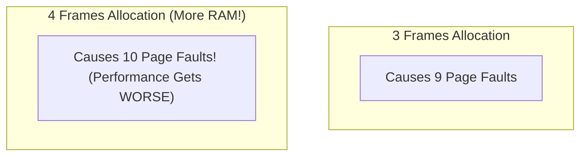
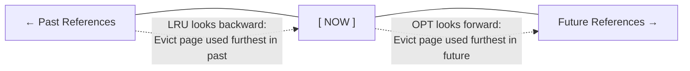
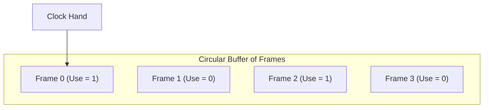
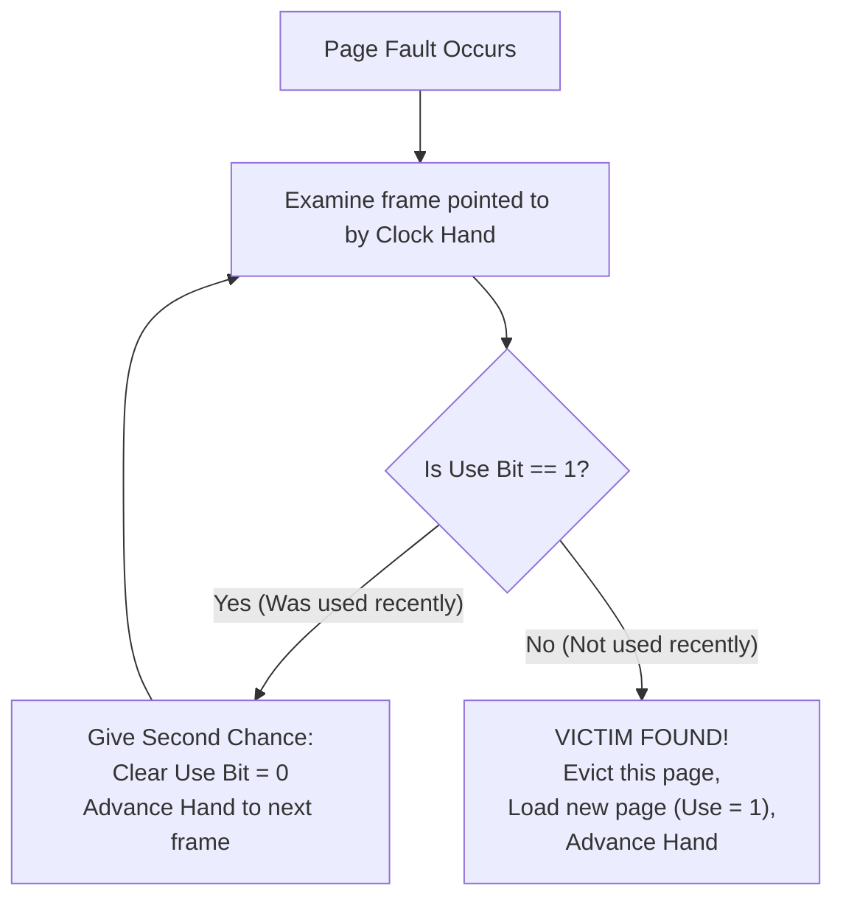

[OS Index](../README.md) / [Unit 3: Memory & Virtual Memory](Introduction.md)

---

In Lecture 6, we unlocked virtual memory: pages don't need to be in RAM until they are referenced.

Demand paging works smoothly until physical RAM fills up. When all frames are occupied and another page fault occurs, the operating system faces a critical dilemma:

To bring the new page into memory, **it must choose an existing page in RAM and kick it out to disk.**

The page chosen for eviction is called the **victim page**.

This sounds like a simple cache eviction problem. But remember the stakes:
- In a CPU cache, evicting the wrong cache line costs **100 nanoseconds**.
- In virtual memory, evicting the wrong page costs an **8-millisecond disk transfer** — that is **80,000 times slower**!

If the OS makes a foolish decision and evicts a page that the CPU is about to access in the very next instruction, the system immediately faults again, stalls the processor, and crawls to a dead halt.

Every page-replacement algorithm is judged by one number: **how many page faults does it produce?**

---

## The Four Standard Algorithms

To compare algorithms objectively, computer scientists evaluate them against a **Reference String** — the sequence of page numbers accessed by a running program over time.

We will trace the standard reference string used in university coursework (20 page references):
$$7, \quad 0, \quad 1, \quad 2, \quad 0, \quad 3, \quad 0, \quad 4, \quad 2, \quad 3, \quad 0, \quad 3, \quad 2, \quad 1, \quad 2, \quad 0, \quad 1, \quad 7, \quad 0, \quad 1$$
assuming a physical memory allocation of **3 frames**.

---

## 1. First-In, First-Out (FIFO)

The most intuitive policy: treat memory like a queue. When a frame is needed, **evict the page that has been in memory the longest** (the oldest arrival).

### Tracing FIFO on the Reference String (3 Frames)
1. `7` $\to$ Fault [7]
2. `0` $\to$ Fault [7, 0]
3. `1` $\to$ Fault [7, 0, 1] *(Memory full!)*
4. `2` $\to$ Fault. Oldest page is 7. Evict 7 $\to$ [2, 0, 1]
5. `0` $\to$ **Hit!** [2, 0, 1]
6. `3` $\to$ Fault. Oldest page is 0. Evict 0 $\to$ [2, 3, 1]
7. `0` $\to$ Fault. Oldest page is 1. Evict 1 $\to$ [2, 3, 0]
8. `4` $\to$ Fault. Oldest page is 2. Evict 2 $\to$ [4, 3, 0]
9. `2` $\to$ Fault. Oldest page is 3. Evict 3 $\to$ [4, 2, 0]
10. `3` $\to$ Fault. Oldest page is 0. Evict 0 $\to$ [4, 2, 3]
11. `0` $\to$ Fault. Oldest page is 4. Evict 4 $\to$ [0, 2, 3]
12. `3` $\to$ **Hit!** [0, 2, 3]
13. `2` $\to$ **Hit!** [0, 2, 3]
14. `1` $\to$ Fault. Oldest page is 2. Evict 2 $\to$ [0, 1, 3]
15. `2` $\to$ Fault. Oldest page is 3. Evict 3 $\to$ [0, 1, 2]
16. `0` $\to$ **Hit!** [0, 1, 2]
17. `1` $\to$ **Hit!** [0, 1, 2]
18. `7` $\to$ Fault. Oldest page is 0. Evict 0 $\to$ [7, 1, 2]
19. `0` $\to$ Fault. Oldest page is 1. Evict 1 $\to$ [7, 0, 2]
20. `1` $\to$ Fault. Oldest page is 2. Evict 2 $\to$ [7, 0, 1]

**Total Page Faults for FIFO = 15**

### The Fatal Flaw of FIFO
FIFO is simple to implement (just a queue pointer), but it has a disastrous blind spot: **Age is not a measure of usefulness.**

The page containing your core loop or `printf` was loaded when the program first started, making it the oldest page in memory. FIFO blindly evicts it simply because it has been around the longest, even though the CPU is using it every single millisecond!

---

## Belady's Anomaly

You would naturally assume that giving a computer more RAM (more frames) will always reduce — or at least equal — the number of page faults.

With FIFO, that common-sense assumption is completely broken.

In 1969, László Bélády proved that under FIFO, **giving a process MORE frames can actually INCREASE the number of page faults!** This counter-intuitive behavior is called **Belady's Anomaly**.

### Concrete Proof of Belady's Anomaly
Consider this specific reference string:
$$1, \quad 2, \quad 3, \quad 4, \quad 1, \quad 2, \quad 5, \quad 1, \quad 2, \quad 3, \quad 4, \quad 5$$

- Run with **3 Frames**: It produces **9 page faults**.
- Run with **4 Frames**: It produces **10 page faults**!

Why does this happen? Because FIFO is **not a stack algorithm**. In a stack algorithm, the set of pages in memory with $N$ frames is *always a subset* of the pages that would be in memory with $N+1$ frames. FIFO does not have this property.

---

## 2. The Optimal Algorithm (OPT / MIN)

What would the perfect algorithm look like?

Bélády proved that to achieve the absolute minimum possible number of page faults, you must:

**Evict the page that will NOT be used for the longest period of time in the future.**

Look ahead into the reference string and find which of the resident pages has its next reference furthest away (or never referenced again).

### Tracing OPT on the Reference String (3 Frames)
1. `7` $\to$ Fault [7]
2. `0` $\to$ Fault [7, 0]
3. `1` $\to$ Fault [7, 0, 1]
4. `2` $\to$ Fault. Next references: 0 is at ref 5, 1 is at ref 14, 7 is at ref 18. **7 is furthest! Evict 7** $\to$ [2, 0, 1]
5. `0` $\to$ **Hit!** [2, 0, 1]
6. `3` $\to$ Fault. Next references: 0 is at ref 7, 2 is at ref 9, 1 is at ref 14. **1 is furthest! Evict 1** $\to$ [2, 0, 3]
7. `0` $\to$ **Hit!** [2, 0, 3]
8. `4` $\to$ Fault. Next references: 2 is at ref 9, 3 is at ref 10, 0 is at ref 11. **2, 3, 0 all used soonest; 2 is at 9. Evict 2** $\to$ [4, 0, 3]
9. `2` $\to$ Fault. Next references: 3 is at ref 10, 0 is at ref 11, 4 never used again! **Evict 4** $\to$ [2, 0, 3]
10. `3` $\to$ **Hit!** [2, 0, 3]
11. `0` $\to$ **Hit!** [2, 0, 3]
12. `3` $\to$ **Hit!** [2, 0, 3]
13. `2` $\to$ **Hit!** [2, 0, 3]
14. `1` $\to$ Fault. 2 and 0 used soon; 3 never used again! **Evict 3** $\to$ [2, 0, 1]
15. `2` $\to$ **Hit!** [2, 0, 1]
16. `0` $\to$ **Hit!** [2, 0, 1]
17. `1` $\to$ **Hit!** [2, 0, 1]
18. `7` $\to$ Fault. 0 and 1 used at ref 19 & 20; 2 never used again! **Evict 2** $\to$ [7, 0, 1]
19. `0` $\to$ **Hit!** [7, 0, 1]
20. `1` $\to$ **Hit!** [7, 0, 1]

**Total Page Faults for OPT = 9** (Compared to 15 for FIFO!)

### Why Can't We Use OPT?
OPT requires you to predict the future. An operating system running interactive user applications cannot foresee what code path a user will click next.

OPT cannot be implemented in a real OS. It exists strictly as a **theoretical benchmark** — we run recorded execution traces through OPT to measure how close practical algorithms come to theoretical perfection.

---

## 3. Least Recently Used (LRU)

If we cannot see into the future, what can we do?

We use the core insight of memory systems: **The recent past is the best predictor of the near future.**

OPT looks forward in time to find the page used furthest in the future.  
**LRU reverses the time axis:** it looks backward in time and **evicts the page that has not been used for the longest period of time**.

### Tracing LRU on the Reference String (3 Frames)
Tracing LRU on the standard string yields **12 page faults**.
- It beats FIFO easily ($12 < 15$).
- It comes reasonably close to OPT ($12 \approx 9$).
- Because LRU is a **stack algorithm**, it is mathematically guaranteed to **never suffer from Belady's Anomaly**.

### Why Real Systems Do NOT Use True LRU
LRU sounds like the winner. So why don't modern operating systems use it directly?

Because implementing true LRU requires hardware tracking on **every single memory reference**:

- **Method 1: Timers / Counters.** Every time an instruction touches memory, hardware writes the current CPU clock into the page table entry. When a page fault occurs, the OS must search every single entry in the table to find the smallest timestamp. Searching a million entries during a page fault is terribly slow.
- **Method 2: Stack (Doubly-Linked List).** Keep a linked list of pages. Whenever a page is referenced, detach it from its current position and move it to the top of the stack. The bottom of the stack is always the least recently used victim.

Look at the cost of Method 2: moving a node in a doubly-linked list requires **6 pointer updates**.

If the CPU had to perform 6 memory writes for *every single instruction of program code*, the computer would spend 90% of its time updating linked list pointers! True LRU is far too expensive.

---

## 4. The Practical Winner: The Clock Algorithm (Second-Chance)

Operating systems need an algorithm that gives the high hit rate of LRU, but with **zero overhead on memory hits**.

That algorithm is the **Clock Algorithm** (also known as the *Second-Chance Algorithm*).

### The Hardware Trick: The Reference Bit
Instead of recording exact timestamps or maintaining pointer stacks, modern MMUs provide a single hardware bit in each Page Table Entry: the **Reference Bit** (or *Use Bit*).

- Whenever the CPU reads or writes a page, the MMU hardware automatically sets `Reference Bit = 1`. This costs zero software cycles.
- The operating system can clear `Reference Bit = 0`.

### The Clock Mechanism
The OS arranges all physical frames into a circular buffer, visualized like the face of a clock. A pointer (the **clock hand**) points to the next frame to consider for eviction.

When a page fault occurs and a victim frame is needed:
1. The OS inspects the page pointed to by the clock hand:
   - **If `Use Bit == 1`:** The page was accessed recently. Give it a **second chance**! Clear its `Use Bit = 0`, advance the clock hand to the next frame, and repeat.
   - **If `Use Bit == 0`:** The page was not accessed since the hand last cleared it. **This is our victim!** Evict this page, load the incoming page, set its `Use Bit = 1`, advance the hand, and return.

### Why the Clock Algorithm is Brilliant
- **On a memory hit:** The hardware sets `Use Bit = 1` for free. Zero software overhead!
- **On a page fault:** The hand sweeps through frames. If all pages have `Use Bit = 1`, the hand sweeps a full circle, resetting all bits to `0`, and then evicts the first page it originally saw (degenerating gracefully to FIFO in the worst case).
- In practice, the Clock Algorithm achieves almost the exact same hit rate as true LRU, while costing practically zero runtime overhead!

### The Enhanced Clock Algorithm (Using the Dirty Bit)
Real operating systems (like Linux) make one further refinement: they look at the **Dirty Bit (Modify Bit)**.

- If a page has **not been modified** (`Dirty == 0`), evicting it requires **zero disk writes** — the OS simply discards it, because an identical copy already exists on disk!
- If a page **has been modified** (`Dirty == 1`), evicting it requires a slow disk write to save changes.

The enhanced algorithm prefers evicting clean pages before dirty pages, prioritizing candidates in four classes:
1. `(Use = 0, Dirty = 0)` — Best victim: not recently used, clean (instant eviction).
2. `(Use = 0, Dirty = 1)` — Next best: not recently used, but requires a disk write.
3. `(Use = 1, Dirty = 0)` — Recently used, but clean.
4. `(Use = 1, Dirty = 1)` — Worst victim: recently used and dirty.

---

## Comparison of Algorithms

| Algorithm | Eviction Rule | Faults (Std String) | Cost on Memory Hit | Belady's Anomaly? | Used in Real OS? |
| :--- | :--- | :---: | :---: | :---: | :---: |
| **FIFO** | Oldest arrival | 15 | None | ⚠️ **Yes** | No (too dumb) |
| **Optimal (OPT)** | Furthest next use | 9 | — | ❌ No | No (impossible) |
| **LRU** | Oldest last use | 12 | Huge (6 pointer updates) | ❌ No | No (too expensive) |
| **Clock (Second-Chance)**| First page with `Use = 0` | ~12 | Zero (hardware bit) | ❌ No | ✅ **Yes (Standard)** |

---

## Key Takeaways

- Page replacement decides which resident page to evict when all physical frames are full.
- **FIFO** evicts the oldest page. It performs poorly because it evicts frequently used hot pages, and it is vulnerable to **Belady's Anomaly** (adding RAM can increase page faults).
- **Optimal (OPT)** evicts the page needed furthest in the future. It achieves the theoretical minimum number of faults, but is impossible in practice; it serves as a performance benchmark.
- **LRU** uses locality of reference to approximate OPT by evicting the page unused for the longest time. It is a stack algorithm (immune to Belady's anomaly), but true LRU is too expensive to maintain on every memory access.
- The **Clock Algorithm** uses a single hardware reference bit per page. It gives recently used pages a second chance, approximating LRU performance with zero overhead on hits.
- The **Enhanced Clock Algorithm** combines the reference bit with the dirty bit to prefer evicting clean pages over modified pages.

---

We now know which page to evict when physical frames run out.

But notice the assumption running through all four algorithms: we assumed the process had a **fixed allocation of 3 frames**.

In a real operating system running 100 processes simultaneously, physical memory must be partitioned among them:
- How many frames does each process deserve?
- What happens if a process is given too few frames to hold its working set?

The answer is catastrophic: the process enters a death spiral of non-stop page faulting, the disk queue overflows, and the entire computer completely freezes up. 

That nightmare is called **Thrashing**, and it is the subject of the final lecture in Unit 3: [**Allocation of Frames and Thrashing** (Lecture 8)](L08%20-%20Allocation%20of%20Frames%20and%20Thrashing.md).
