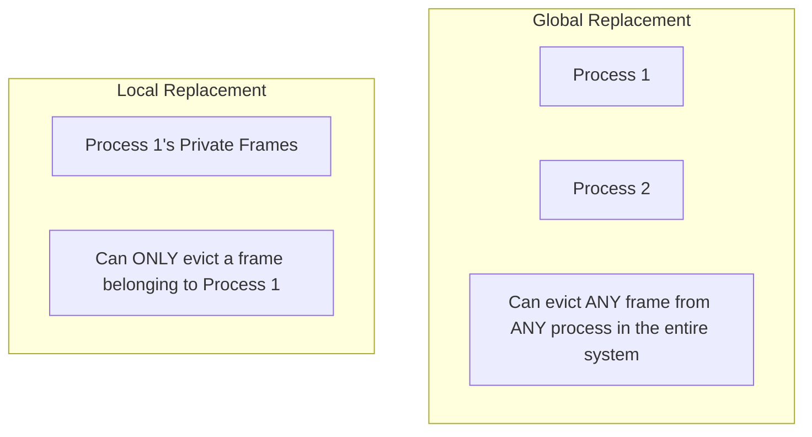
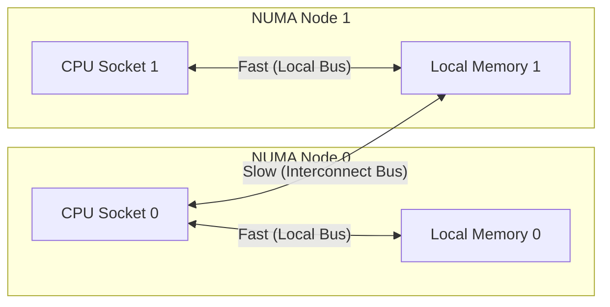
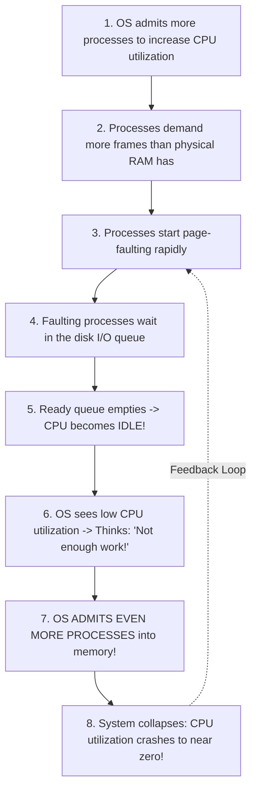

[OS Index](../README.md) / [Unit 3: Memory & Virtual Memory](Introduction.md)


---

In Lecture 7, we solved the replacement problem: when physical memory is completely full, we know *which* victim page to evict using the Clock algorithm.

Now we have to answer the other half of the memory allocation question:

In a real computer running 50 or 100 processes at once, **how many physical frames should each process get in the first place?**

This is the **Frame Allocation Problem**. 

And it turns out to matter far more than the replacement algorithm. If a process needs 40 pages in memory to execute its active loop, and you only give it 15 frames, no page-replacement algorithm on Earth can save it. The process will fault, wait on the disk, run for three instructions, fault again, and crawl.

When that happens across multiple processes at the same time, the entire operating system collapses into a catastrophic state where the CPU does zero useful work and spends 99% of its time waiting for disk transfers.

That nightmare is called **Thrashing**.

---

## The Minimum and Maximum Number of Frames

Before deciding how to split frames, there are hard architectural boundaries:

- **The Maximum:** The total amount of physical RAM installed in the machine minus the frames reserved for the operating system kernel.
- **The Minimum:** The absolute minimum number of frames a process must have to execute **one single instruction**.

Why is there a minimum? Look at how modern CPU instructions execute.

Consider an instruction that copies memory:
```assembly
MOV [Address_B], [Address_A]
```
To execute this single instruction:
1. The instruction code itself might span across **2 pages** (if it sits across a page boundary).
2. The source operand `Address_A` might span across **2 pages**.
3. The destination operand `Address_B` might span across **2 pages**.

That is **6 pages** that must be physically resident in RAM *simultaneously*!

What happens if the OS only gave this process 3 frames?
The CPU fetches the instruction (occupying 2 frames), attempts to read `Address_A` (occupying the 3rd frame), and then faults on `Address_B`. To fetch `Address_B`, it must evict one of its 3 frames — which means evicting part of the instruction it is currently executing!

The instruction can **never complete**. The CPU gets trapped in an infinite loop of page-faulting before finishing a single instruction.

Therefore, the **minimum number of frames is strictly defined by the computer architecture's Instruction Set Architecture (ISA)**. The OS has no choice — it must guarantee at least this minimum.

---

## Frame Allocation Strategies

Once the minimum is satisfied, how does the OS divide the remaining free frames among competing processes?

### 1. Equal Allocation
The simplest approach: divide the available user frames equally among all $n$ running processes.

If there are 93 free frames and 3 processes, each process gets:
$$\frac{93}{3} = 31\text{ frames}$$

This sounds fair, but in practice it is completely foolish:
- A tiny background terminal shell using 50 KB gets 31 frames (wasting 25 frames it will never touch).
- A giant database server using 4 GB gets 31 frames (starving completely and thrashing immediately).

### 2. Proportional Allocation
Instead of treating all processes identically, allocate frames based on the **virtual memory size of each process**.

Let:
- $m$ = Total number of available physical frames
- $s_i$ = Size of virtual memory for process $p_i$
- $S = \sum s_i$ = Sum of virtual memory sizes of all processes

The number of frames $a_i$ allocated to process $p_i$ is:

$$a_i = \left(\frac{s_i}{S}\right) \times m$$

#### A Concrete Calculation (Exam Classic)
Suppose available memory $m = 62\text{ frames}$.  
Two processes are running:
- Process $p_1$ has a size of $s_1 = 10\text{ pages}$.
- Process $p_2$ has a size of $s_2 = 127\text{ pages}$.

Total virtual memory $S = 10 + 127 = 137\text{ pages}$.

$$a_1 = \left(\frac{10}{137}\right) \times 62 \approx 4.52 \implies \mathbf{5\text{ frames}}$$
$$a_2 = \left(\frac{127}{137}\right) \times 62 \approx 57.47 \implies \mathbf{57\text{ frames}}$$

Small processes receive small frame budgets; large processes receive large frame budgets. And as processes start and terminate, $S$ changes dynamically, and the OS adjusts allocations on the fly.

---

## Global vs. Local Replacement

When a process page-faults and needs a frame, from which pool does it select the victim?



### Global Replacement
A process can select a victim frame from the **entire pool of physical frames**, even if that frame currently belongs to another process.
- **Advantage:** High system throughput. Memory dynamically flows to whichever process needs it most right now.
- **Disadvantage:** A process's execution time is completely unpredictable. If Process B suddenly starts churning through memory, it will steal frames from Process A, slowing Process A down through no fault of its own.
- **Risk:** Allows thrashing to spread like wildfire across the entire system.

### Local Replacement
Each process has a fixed quota of frames. When it page-faults, it can **only evict a victim from its own allocated frames**.
- **Advantage:** Predictable performance. A memory-hogging process only hurts itself; it cannot steal frames from its neighbors.
- **Disadvantage:** Inefficient memory utilization. If Process A has idle frames, Process B cannot touch them.

Modern systems use **global replacement** as their default because it provides far superior overall throughput, but they implement thrashing safeguards to keep it from spiraling out of control.

---

## Non-Uniform Memory Access (NUMA)

On modern multi-socket server hardware, physical memory is not one uniform pool:



A CPU can access its own **local memory** in nanoseconds. But accessing memory physically wired to another CPU socket across the interconnect bus takes significantly longer.

In a NUMA system, frame allocation is **topology-aware**:
When a process running on CPU Socket 0 page-faults, the OS scheduler and memory allocator deliberately allocate a physical frame from **Local Memory 0**. Allocating from a remote node is kept strictly as a last resort.

---

## Thrashing: The Memory Death Spiral

Now we come to the most spectacular failure mode in all of operating systems: **Thrashing**.

A system is thrashing when:
$$\textbf{A process spends more time paging (swapping pages in and out) than executing instructions.}$$

### The Chain Reaction That Causes Thrashing
Look at how an operating system accidentally destroys itself:



1. In Unit 1, we learned that the OS monitors CPU utilization. If the CPU is not 100% busy, the long-term scheduler increases the **degree of multiprogramming** by loading more processes.
2. Eventually, the sum of all pages actively needed by running processes exceeds total physical RAM:
   $$\sum \text{Active Pages Needed} > \text{Total Physical Memory}$$
3. Processes begin page-faulting constantly.
4. When a process page-faults, it sleeps while waiting for the disk controller. As more processes fault, they all pile into the disk queue.
5. The ready queue empties out. **The CPU sits completely idle waiting for disk I/O!**
6. The OS CPU scheduler looks at the CPU meter, sees 15% utilization, and draws the disastrously wrong conclusion:
   *"The CPU is bored! We don't have enough work loaded. Let's admit another process from disk!"*
7. The new process arrives, demands its own frames, and steals memory from the already-starved processes.
8. Everyone faults harder. The disk queue explodes. CPU utilization plunges to near zero.

```mermaid
flowchart LR
    subgraph PHASE1["Phase 1: Underutilization"]
        direction TB
        U1["Low Multiprogramming<br/>CPU: 15% (Processes idle waiting on I/O)"]
    end
    subgraph PHASE2["Phase 2: Optimal Peak"]
        direction TB
        U2["Optimal Multiprogramming<br/>CPU: 92% (High concurrency, few page faults)"]
    end
    subgraph PHASE3["Phase 3: Thrashing Collapse"]
        direction TB
        U3["Over-allocation: Thrashing Starts<br/>CPU drops to 40% (Processes queue for paging)"] --> U4["Severe Thrashing<br/>CPU drops to 5% (100% Disk Paging, 0% Work)"]
    end
    PHASE1 -->|Add processes| PHASE2 -->|Add more processes| PHASE3```

The system becomes completely unresponsive. The disk light stays solid on, the mouse cursor freezes, and typing in a terminal does nothing. That is thrashing.

---

## How to Prevent Thrashing: The Working-Set Model

Why does thrashing happen mathematically?

Because of **locality**. A program does not access memory uniformly; it executes within a **locality** — a small group of pages (code loop, local variables, active data structures) that are accessed together.

As long as the OS gives a process enough frames to hold its entire current locality, the process executes at full hardware speed with virtually zero page faults. But the moment you give it even one frame less than its locality, it faults continuously.

Peter Denning formalized this in the **Working-Set Model**:

- Define **$\Delta$ (Working-Set Window):** A fixed number of most recent page references (for example, the last 10,000 memory accesses).
- The **Working Set ($\text{WS}_i$)** of process $p_i$ is the set of distinct pages referenced during the last $\Delta$ memory accesses.
- The **Working-Set Size ($\text{WSS}_i$)** is the count of pages in that set.

$$\text{Total Demand for Frames } (D) = \sum \text{WSS}_i$$

```mermaid
flowchart TD
    CALC["Calculate Total Memory Demand: D = sum(WSS)"] --> CHK{"Is D &gt; Total Available Frames m?"}
    CHK -- "No (D &le; m)" --> SAFE["Safe! All processes have their working sets in RAM.<br>Zero thrashing."]
    CHK -- "Yes (D &gt; m)" --> DANGER["DANGER: Thrashing Imminent!<br>OS must SUSPEND a process & free its frames!"]
```

If $D > m$, total memory demand exceeds physical RAM. **Thrashing is guaranteed.**

The OS solution is simple and decisive: **suspend (swap out) one entire process**. Its frames are redistributed to the remaining processes, bringing $D$ back below $m$. The remaining processes run smoothly, finish their work, and the suspended process is resumed later.

---

## Page-Fault Frequency (PFF): The Direct Approach

Calculating working sets by inspecting thousands of memory accesses in software is computationally heavy.

A more direct, hardware-friendly strategy is **Page-Fault Frequency (PFF)**:

Instead of guessing locality sizes, **directly measure how often each process is page-faulting!**


- If a process's page-fault rate rises **above the Upper Threshold**:  
  $\implies$ The process is starved! It does not have enough frames to hold its active working set. **Allocate more frames to it.**
- If a process's page-fault rate drops **below the Lower Threshold**:  
  $\implies$ The process has more frames than it actually needs. It is hoarding memory. **Reclaim a frame from it** and give it to the free pool.

If an over-budget process page-faults and there are no free frames anywhere in the system, the OS suspends that process.

---

## The Modern Angle: OOM Killer and Memory Compression

Modern operating systems (Linux, Android, macOS) have refined these mechanisms into powerful real-world tools:

### 1. The Linux Out-of-Memory (OOM) Killer
When physical RAM and swap space are completely 100% exhausted, the Linux kernel refuses to let the computer freeze indefinitely in thrashing.

It invokes the **OOM Killer**:
- An algorithm inspects all running processes and assigns each an `oom_score` based on how much RAM it is consuming and how important it is.
- The kernel picks the worst offender (usually a rogue process with a massive memory leak) and terminates it with `SIGKILL` (`kill -9`).
- Reclaiming that process's memory instantly restores the entire system to life.

### 2. Memory Compression (zRAM / macOS Compressed Memory)
Instead of writing idle pages across a slow bus to disk, modern operating systems compress inactive pages in RAM:
- Compressing a 4 KB page down to 1 KB using fast LZO or LZ4 algorithms takes **a few microseconds**.
- Writing that page to SSD or HDD takes **milliseconds** (thousands of times slower!).
- Memory compression gives a system the illusion of having 30% to 50% more physical RAM without ever touching physical storage drives!

---

## The Grand Synthesis of Unit 3

Take a step back and look at the entire journey across Unit 3. It is a single, beautiful intellectual argument driven by two relentless forces: **fragmentation** and **capacity**.

1. **Hardware & Base/Limit (L01):** We gave each process one contiguous block. Fast, but rigid.
2. **Swapping & Fragmentation (L02):** Contiguous allocation collapsed under external fragmentation. Compaction proved too slow. Contiguity had to die.
3. **Segmentation (L03):** We broke memory into logical units. It solved sparse address spaces and sharing, but variable sizes brought external fragmentation right back.
4. **Paging (L04):** We made all units fixed-size. External fragmentation vanished forever; allocation became trivial.
5. **TLB & Page Tables (L05):** We fixed paging's flaws. The TLB cured the 2x speed penalty, and multi-level tables cured the memory explosion.
6. **Virtual Memory & Demand Paging (L06):** We realized pages don't need to be in RAM. Programs can be larger than physical memory. Copy-on-Write made process creation instant.
7. **Page Replacement (L07):** When RAM fills up, we pick victim pages using the Clock algorithm.
8. **Frame Allocation & Thrashing (L08):** We sized frame allocations to match program localities, stopping thrashing through working sets, PFF, and memory compression.

Every single mechanism in this unit was made possible by one foundational principle: **a transparent layer of hardware indirection between the address a program uses and the physical memory chips.**

---

## Key Takeaways

- Minimum frames per process is dictated by the CPU architecture (an instruction must be able to hold all pages referenced simultaneously to complete). Maximum is physical RAM.
- **Equal Allocation** divides frames evenly ($m/n$), ignoring process size. **Proportional Allocation** divides frames according to virtual memory footprint ($a_i = (s_i / S) \times m$).
- **Global replacement** lets processes steal frames from anywhere (high throughput, risk of thrashing). **Local replacement** restricts eviction to private frames (predictable, isolates faults).
- **NUMA systems** require memory allocation to be localized to the CPU socket running the process to avoid slow interconnect bus latency.
- **Thrashing** occurs when $\sum \text{Locality Sizes} > \text{Physical RAM}$. The system spends all its time servicing page faults; CPU utilization collapses.
- The **Working-Set Model** tracks active pages over a window $\Delta$. If total working set demand $D > m$, the OS suspends a process to prevent thrashing.
- **Page-Fault Frequency (PFF)** directly monitors fault rates, adding frames if above the upper threshold and reclaiming frames if below the lower threshold.
- Modern OSs use **Memory Compression** (compressing inactive pages in RAM) and the **OOM Killer** (terminating rogue processes when memory is exhausted).

---

Throughout all of Unit 3, we treated the storage drive as a convenient, passive "backing store" where pages are safely written and retrieved.

Now, think about what is actually happening on that disk:
- How does the operating system organize billions of raw bytes into files and directories?
- When multiple processes read and write to disk, how does the OS schedule disk head movements so throughput doesn't collapse?
- How do file systems survive sudden power outages without corrupting your data?
- And how do we protect sensitive files from unauthorized users?

That brings us to the storage half of the semester: [**Unit 4: Storage Management and File Systems**](../Unit%204/Introduction.md).
