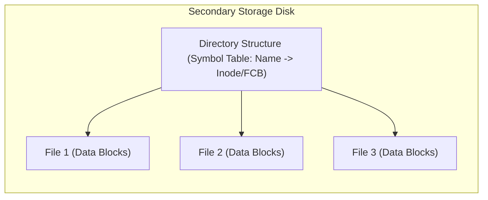
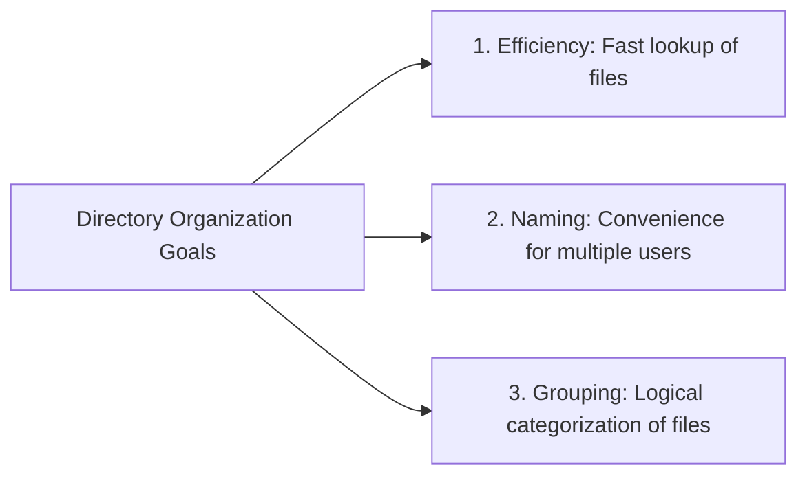
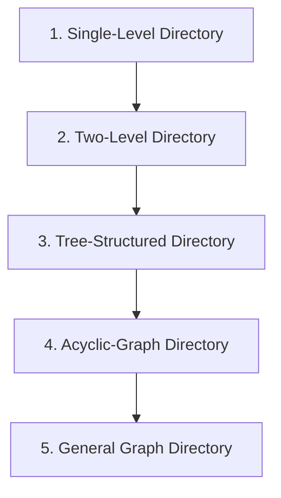
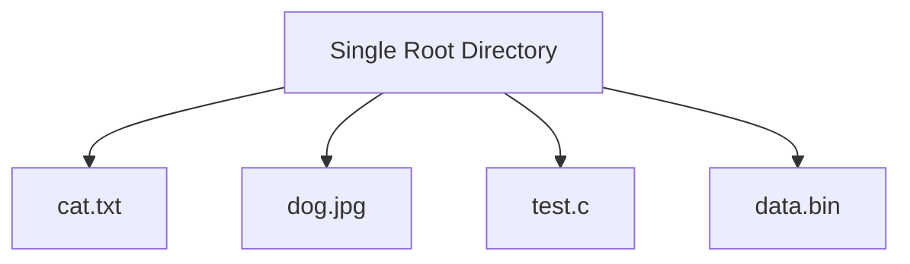
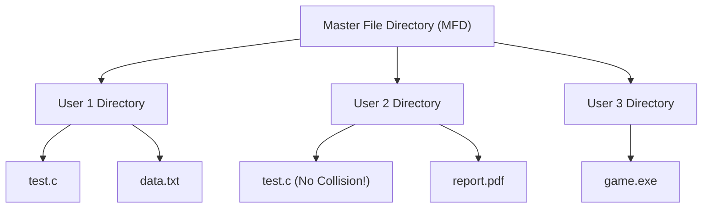
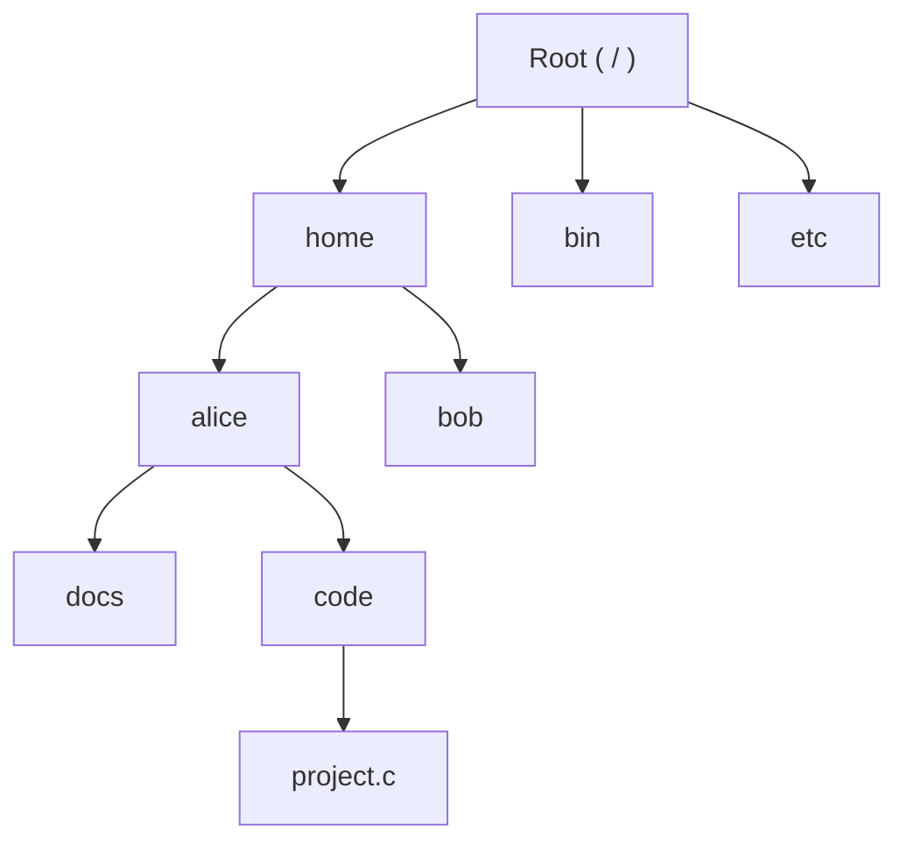
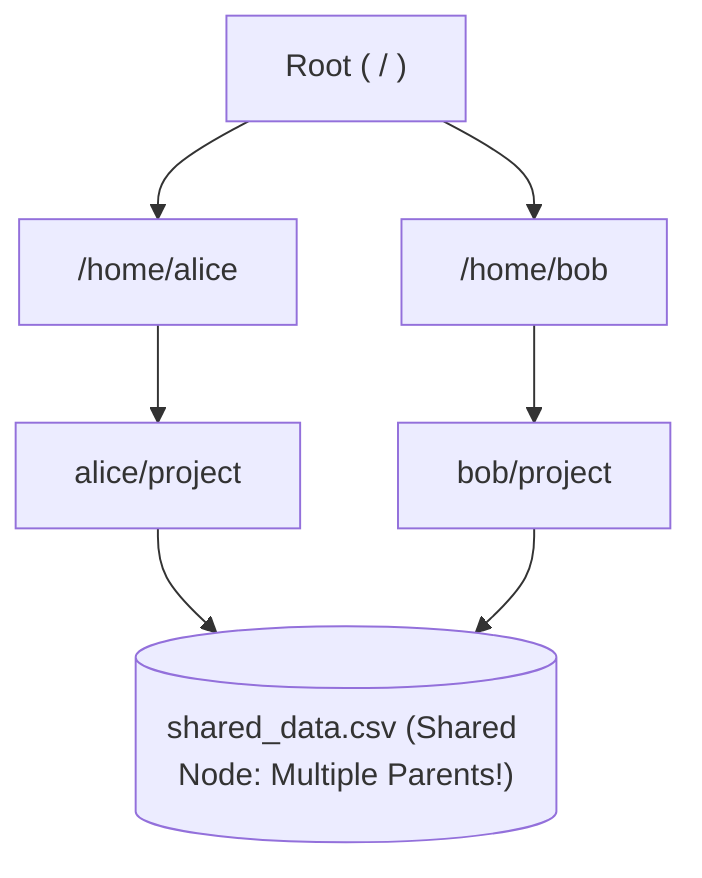
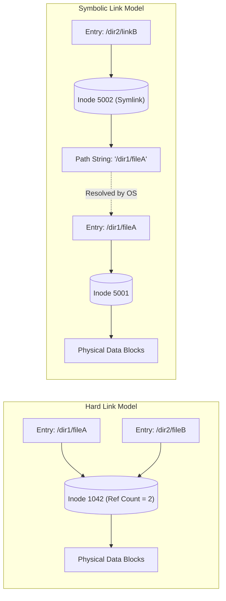
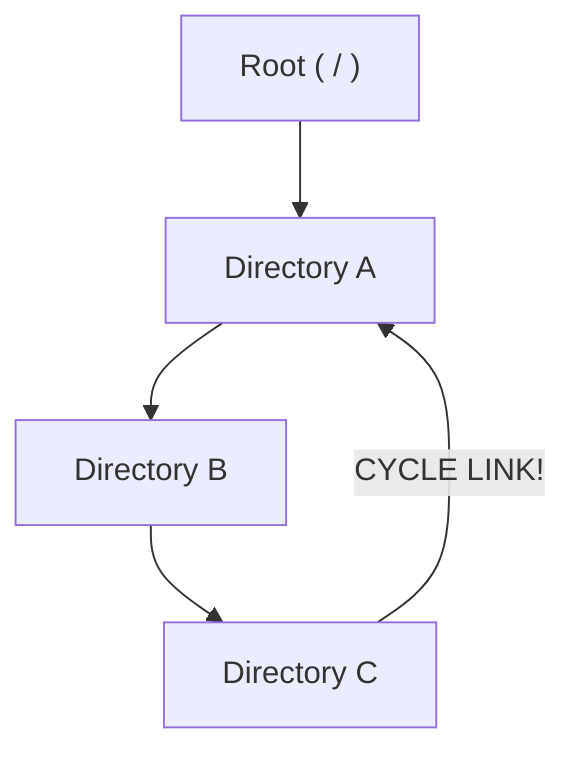

[OS Index](../README.md) / [Unit 4: Storage & Protection](Introduction.md)

---

In the first three units of this course, our focus was on the volatile components of a computer system: CPU execution, concurrent threads, and virtual memory. But volatile memory has one fatal property: the moment you turn off the power, every register, cache line, and RAM frame is wiped clean.

Secondary storage (magnetic hard disks and solid-state flash drives) provides **non-volatile persistence**.

However, raw secondary storage is physically intimidating. A hard drive is just billions of 512-byte magnetic sectors arranged along circular tracks; an SSD is an array of semiconductor flash blocks. None of these physical media understand the concept of a file, a folder, a document, or an executable.

The operating system bridges this gap through the **File System**.

The file system provides two foundational abstractions:
1. **The File:** A contiguous, named logical address space created by the OS to store data.
2. **The Directory Structure:** An organization mechanism that maps human-readable names to file metadata and physical disk locations.

In this lecture, we examine the directory abstraction, the three goals of directory design, and the historical progression of the **five directory structures**: from flat single-level directories to modern acyclic graphs.

---

## What is a Directory Structure?

A **directory** is a specialized symbol table managed by the operating system that translates human-readable strings (file names) into internal file control information (such as disk block addresses or inode numbers):

### The Physical Reality:
Notice a fundamental principle of storage architecture:
> **Both the directory structure and the files reside permanently on the disk.**

Because directories are stored on disk, resolving a path like `/home/user/documents/report.pdf` requires reading the directory entries for `/`, then `home`, then `user`, and then `documents`—potentially four physical disk I/O operations before touching a single byte of the actual file!

To keep systems fast, operating systems cache recently accessed directory entries in RAM using high-speed in-memory data structures (such as Linux's **dentry cache**).

---

## Operations Performed on a Directory

To manage files effectively, an operating system must provide system calls to perform six basic directory operations:

1. **Search for a File:** Locate a specific file entry within the directory structure when a user references it by name.
2. **Create a File:** Allocate a new directory entry, record the file name, and link it to an allocated File Control Block (FCB).
3. **Delete a File:** Remove the entry from the directory, decrement its link count, and release its data blocks if no references remain.
4. **List a Directory:** Traverse the directory and display file names along with metadata (size, owner, permissions, last modified timestamp).
5. **Rename a File:** Update the name string in the directory entry without moving or copying the underlying file data blocks on disk.
6. **Traverse the File System:** Recursively visit every directory and file in the storage volume (essential for system backups, disk defragmentation, virus scanners, and file search indexing).

---

## The Three Goals of Directory Organization

When designing a directory structure, operating systems balance three competing goals:

1. **Efficiency:** A user or program should be able to locate a file quickly. Linear scans are acceptable for 10 files, but intolerable for 100,000 files.
2. **Naming Convenience:** Users should not have to worry about choosing globally unique names. Two different users should both be allowed to name their project files `main.c` without collision. Furthermore, a file should be allowed to have multiple names (aliasing).
3. **Logical Grouping:** Users should be able to group related files together by task or property (e.g., all source code files in one place, all game assets in another).

---

## The Evolution of Directory Structures

Operating systems have evolved through five distinct directory architectures:

---

## 1. Single-Level Directory

The simplest possible directory organization: a single, flat list containing all files in the storage system:

### The Fatal Defects:
- **Naming Collision:** Every single file on the disk must have a **globally unique name**! If User A creates a file called `test.c`, User B is forbidden from creating a file called `test.c`. In a multi-user environment, users quickly run out of names.
- **No Grouping:** It is impossible to categorize files. A system with 5,000 files dumps them all into one massive list, making file management chaotic.
- Used only in early microcomputers (such as the original CP/M and early MS-DOS 1.0).

---

## 2. Two-Level Directory

To eliminate naming collisions between different users, systems introduced a two-tier hierarchy:

### How It Works:
- The top level is the **Master File Directory (MFD)**, which contains an entry for each user account pointing to that user's private directory.
- The second level consists of individual **User File Directories (UFDs)**.
- When User 1 logs in, system lookups are restricted to User 1's UFD.

### Strengths and Limitations:
- **Resolves Naming Collisions:** User 1 and User 2 can both have a file called `test.c` because their paths are distinct: `/user1/test.c` vs. `/user2/test.c`.
- **Search Efficiency:** Searches are confined to the logged-in user's UFD.
- **The Remaining Flaw: No Internal Grouping!** A user cannot create subdirectories to organize their own files. If User 1 has 500 files across 10 different projects, they all sit together in one flat UFD. Furthermore, sharing files between users is awkward and isolated.

---

## 3. Tree-Structured Directories

The breakthrough that defines modern computing: **arbitrary directory nesting**.

In a tree-structured directory, a directory is simply a special type of file that can contain both regular files and **subdirectories**:

### Key Architectural Concepts:
1. **Absolute vs. Relative Pathnames:**
   - **Absolute Pathname:** Specifies the path from the root directory `/` down to the target (e.g., `/home/alice/code/project.c`). It is unique and invariant regardless of where the process is currently located.
   - **Relative Pathname:** Specifies the path starting from the process's **Current Working Directory (CWD)** (e.g., if the CWD is `/home/alice`, the relative path is `code/project.c`).
2. **Current Working Directory (`CWD`):**
   - Maintained in the process's PCB. System calls resolve relative paths against the CWD, saving programmers from typing long paths repeatedly.
3. **Directory Deletion Semantics:**
   - What happens when a user attempts to delete a directory that contains files?
     - *Conservative Approach:* Delete fails unless the directory is completely empty (e.g., Unix `rmdir`).
     - *Aggressive Approach:* Recursively delete the directory and every file and subdirectory within it (e.g., Unix `rm -rf`).

### The Remaining Limitation of Trees:
In a pure mathematical tree, **every node has exactly one parent**. 
This means a file can exist in only one place. What if two users working on a team project need to share the exact same file in their respective project folders? In a tree, you would have to make two independent copies, meaning edits by User 1 would not be seen by User 2!

---

## 4. Acyclic-Graph Directories

To allow files and subdirectories to be **shared between multiple users**, operating systems evolved to the **Acyclic-Graph Directory**:

An acyclic graph allows a directory or file to have **multiple parent directories**. It enables **file aliasing**: the same physical file appears under multiple distinct pathnames.

---

## Implementing Sharing: Hard Links vs. Symbolic Links

Unix systems implement acyclic graphs using two distinct linking mechanisms:

### 1. Hard Links (`ln target link_name`)
- A directory entry points directly to the file's internal metadata block (its **inode**).
- Both names point to the **exact same inode number**.
- Neither name is "more real" than the other: they are two equal names for the same file.
- The inode maintains a **Reference Count (Link Count)** recording how many directory entries point to it.
- **Constraints:** Cannot cross filesystem boundaries (because inodes are local to a single disk partition); cannot point to directories.

### 2. Symbolic Links / Soft Links (`ln -s target link_name`)
- A symlink is a completely separate, independent small file created on disk.
- Its data content is simply a **text string containing the pathname of the target file**.
- When an application opens the symlink, the operating system transparently intercepts the read, reads the pathname string, and follows the path to the real file.
- **Properties:** Can span across different filesystems; can point to directories.
- **Dangling Link Hazard:** If the original target file is deleted or renamed, the symlink remains on disk pointing to a non-existent path (a **dangling pointer**).

---

## The Deletion Problem in Acyclic Graphs

When a shared file is deleted by one of its owners, what should the operating system do?

Consider the scenario: Alice and Bob share `data.csv`. Alice decides she is done with it and executes `rm data.csv`.
- If the operating system immediately erases the file data blocks from disk, Bob's directory entry now points to deallocated disk sectors! If another process allocates those blocks, Bob's reads will return garbage or another user's private data.

### The Solution: Reference Counting (Entry-Hold-Count)
To solve this cleanly, Unix uses **Reference Counting**:
1. When a file is created, its inode's link count is set to **`1`**.
2. Every time a new hard link is created (`ln`), the inode's link count is incremented:
   $$\text{link\_count} = \text{link\_count} + 1$$
3. When a user deletes a file (`rm`), the system removes that user's directory entry and **decrements the link count by 1**:
   $$\text{link\_count} = \text{link\_count} - 1$$
4. **The physical file data blocks are freed IF AND ONLY IF the link count drops to `0`** (and no running process has the file open).

As long as Bob retains his hard link, the link count is $\ge 1$. Alice's deletion removes only her own entry, leaving Bob's access completely intact.

---

## 5. General Graph Directory: The Cycle Danger

What happens if an operating system accidentally allows a directory link that creates a **directed cycle**?

A directory structure with cycles is called a **General Graph Directory**, and it introduces two severe problems:

### 1. The Infinite Traversal Loop
Any recursive file-system utility (`find / -name "*.txt"`, disk space recalculators `du`, or backup tools) will follow the cycle from $A \rightarrow B \rightarrow C \rightarrow A \rightarrow B \rightarrow \dots$, spinning in an infinite loop until memory is exhausted or the system crashes.

### 2. The Cyclic Garbage Leak
Look at what happens to reference counting when a cycle exists:
- Suppose Directory $A$ links to $B$, and $B$ links back to $A$.
- Both $A$ and $B$ have a reference count of **`1`** (held by each other).
- If the user deletes the parent reference from Root to $A$:
  - $A$ and $B$ are now completely unreachable by any human user or path!
  - However, because they point to each other, **their link counts never drop to zero!**
  - Reference counting fails completely on cyclic garbage. The disk space is permanently leaked unless the OS runs a slow, multi-hour **Garbage Collection (Mark-and-Sweep)** scan across the entire storage drive.

---

## How Unix Guarantees No Cycles

Rather than suffering the immense overhead of running garbage collection algorithms over multi-terabyte disks, Unix operating systems use an elegant structural rule:

> **Allow hard links ONLY to files, NEVER to directories!**

Think about the graph theory:
- A cycle can only form if a node can have outgoing edges that loop back.
- Files are strictly **leaf nodes** (they cannot contain other directory entries).
- If only leaf nodes (files) can have multiple parents, the **directory backbone remains a strict acyclic tree**!

By prohibiting `ln` on directories, Unix ensures that cycles cannot form in the hard-link graph. Reference counting remains $100\%$ reliable, and disk garbage collection is never needed.

*(Note: While symbolic links can form loops, the kernel handles them simply by aborting path resolution with error `ELOOP` if it encounters more than 40 consecutive symlinks).*

---

## Summary of Directory Organizations

| Organization | Description | Solves | Remaining Defect |
| :--- | :--- | :--- | :--- |
| **Single-Level** | Flat list of all files in one directory | Maximum simplicity | Severe naming collisions; no grouping |
| **Two-Level** | Master directory pointing to User directories | Naming collisions between users | No grouping within user projects |
| **Tree-Structured** | Arbitrary nesting of subdirectories | Logical grouping, relative paths | Cannot share files (no aliasing) |
| **Acyclic-Graph** | Allows shared nodes with multiple parents | True file sharing via hard/soft links | Complex deletion (requires reference counts) |
| **General Graph** | Unrestricted graph (cycles permitted) | Theoretical flexibility | Infinite loops; requires garbage collection |

---

## Key Takeaways

- A **Directory** is a symbol table stored on disk that maps file names to File Control Blocks (inodes).
- The three goals of directory organization are **Efficiency** (fast search), **Naming** (user convenience), and **Grouping** (logical categorization).
- **Single-level directories** suffer from naming collisions; **Two-level directories** isolate users but lack sub-grouping.
- **Tree-structured directories** provide natural nested hierarchies with absolute and relative paths.
- **Acyclic-graph directories** enable file sharing using **Hard Links** (multiple directory entries pointing to the same inode with reference counting) and **Symbolic Links** (pointer files containing a pathname string).
- **Hard links cannot point to directories in Unix**, preventing directed cycles and guaranteeing that reference counting never leaks cyclic garbage.

---

Now that we understand how directories organize and name files across a storage volume, what is a file itself?

What attributes define a file, how do programs read and write its data, and what is the difference between sequential access and direct random access?

That brings us to file attributes and access methods in [**Lecture 2: Storage Management & File Concept**](L02%20-%20Storage%20Management%20-%20File%20Concept.md).
