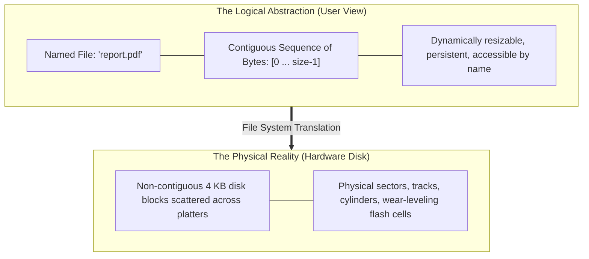
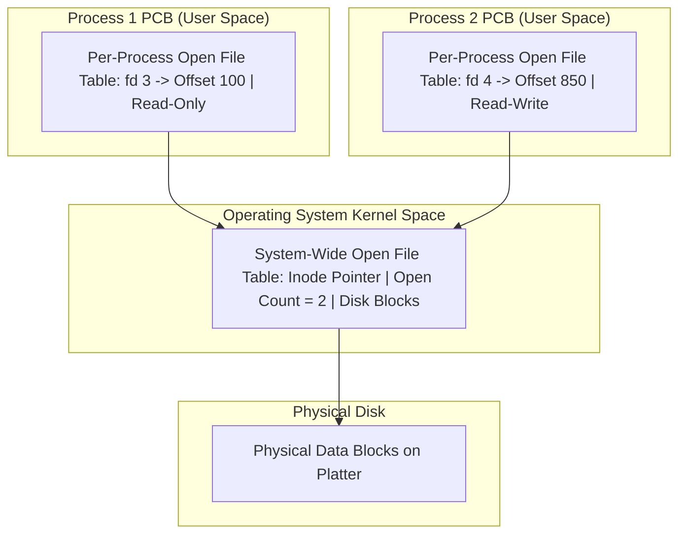
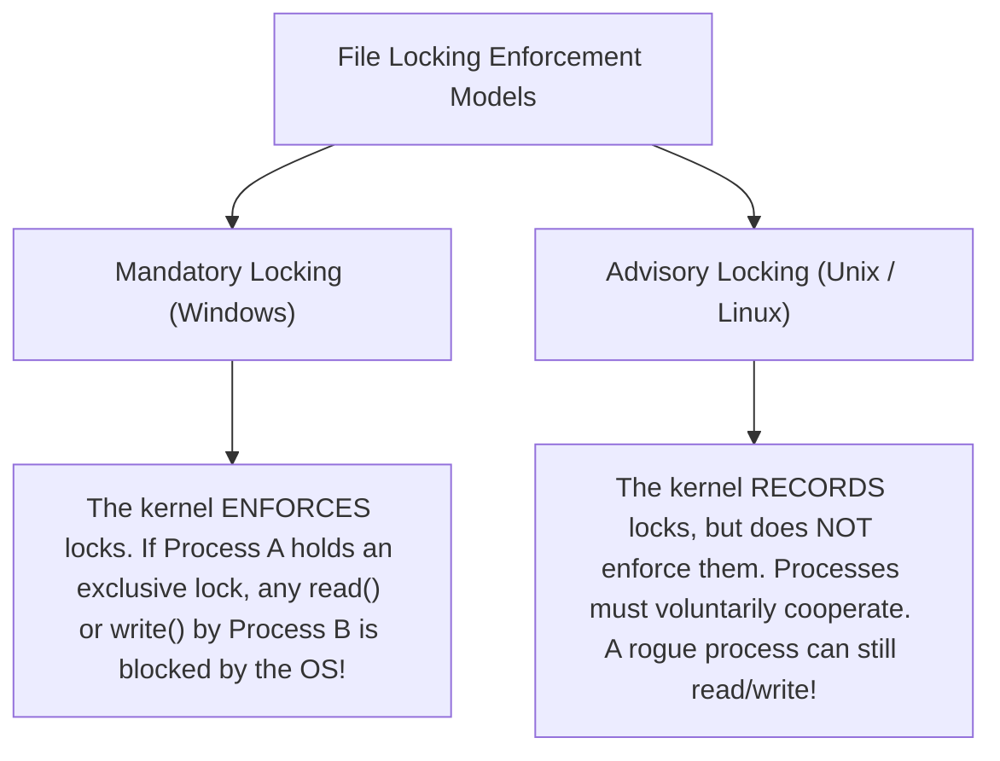
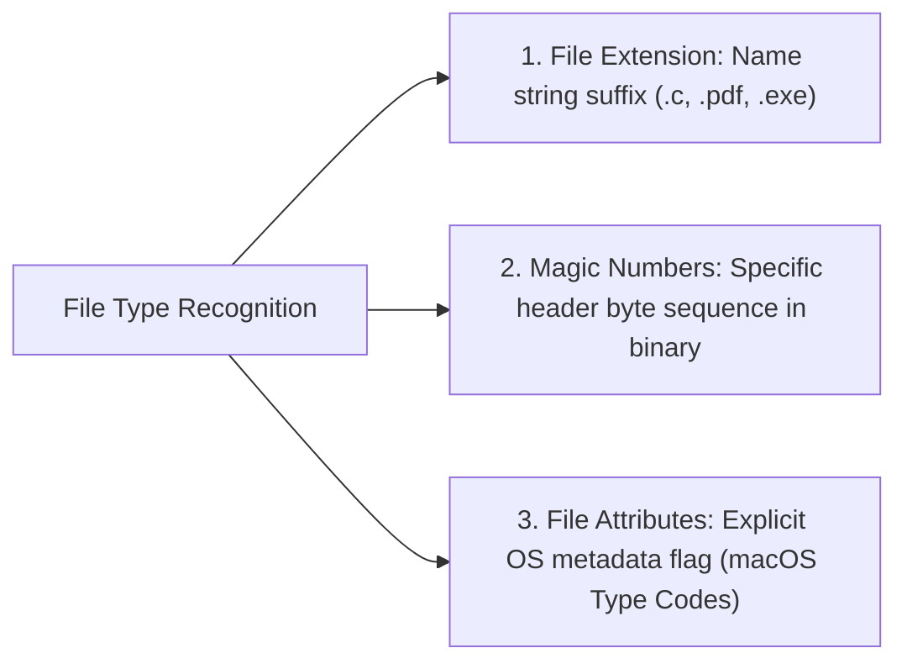
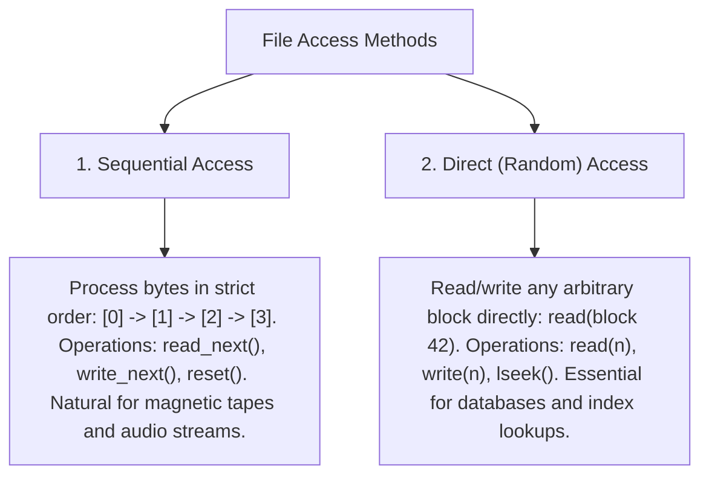

[OS Index](../README.md) / [Unit 4: Storage & Protection](Introduction.md)

---

In the previous lecture, we looked at the directory structure—the global map that organizes and locates files across secondary storage.

Now, we zoom in on the fundamental unit of storage itself: **The File**.

Just as virtual memory creates the convenient illusion that a process owns a vast, private, contiguous address space (hiding the reality of fragmented physical RAM frames), the file system creates the illusion that data lives in clean, contiguous, named files (hiding the reality of scattered physical disk sectors).

In this lecture, we examine the file abstraction: its attributes, the lifecycle of file operations, the two-level open-file tables, file locking semantics, and the two fundamental access methods: **Sequential Access** and **Direct (Random) Access**.

---

## What is a File?

Computers store information on various physical secondary storage media: spinning magnetic platters, solid-state NAND flash cells, and magnetic tapes. 

Each physical medium has its own controller-specific quirks. A hard disk addresses data by 512-byte sectors along concentric cylinders; a flash SSD addresses data by 4 KB pages grouped into 2 MB erase blocks.

The operating system abstracts all these hardware differences away by defining a uniform logical storage unit: the **File**.



### The Unix Byte-Stream Philosophy
How does the operating system view the contents of a file?

Historically, mainframe operating systems (like IBM OS/360 or DEC VMS) forced files to conform to rigid internal record structures (fixed-length card images, indexed-sequential records). If the operating system did not know the record format, you could not store the file.

Unix introduced a revolutionary design philosophy that has become the universal standard:
> **To the operating system, a file is an uninterpreted sequence of bytes.**

The operating system does not know or care whether a file contains a compiled C program, an MP3 audio track, a JPEG image, or random noise. The OS simply stores bytes on disk and returns those exact same bytes upon request. The interpretation of the data is pushed entirely into **user application space**.

---

## File Attributes (Metadata)

A file is more than just its raw data payload. The operating system associates rich metadata with every file, known as its **File Attributes**:

1. **Name:** The human-readable string used to reference the file (e.g., `main.c`). This is the only attribute that humans interact with directly.
2. **Identifier:** A unique non-human-readable numeric tag assigned by the system (the **inode number** in Unix). It uniquely identifies the file within its filesystem partition.
3. **Type:** Identifies the file format (e.g., text, executable, archive, directory) on systems that support different types.
4. **Location:** A pointer to the physical device and the specific disk block addresses where the file's data blocks are physically stored.
5. **Size:** The current length of the file, measured in bytes, words, or disk blocks, as well as the maximum permitted size.
6. **Protection:** Access-control permissions specifying who can read, write, or execute the file.
7. **Time, Date, and User ID:** Timestamps recording when the file was created, last modified, and last accessed, along with the user ID of the file's owner.

All file attributes are stored in the directory structure or dedicated metadata blocks (**File Control Blocks / inodes**) on disk, completely separate from the file's data bytes.

---

## The Core File Operations

The operating system provides system calls allowing programs to perform six primitive operations on files:

1. **Create:** Allocates disk space in the directory structure, creates an empty File Control Block, and records the file's initial attributes.
2. **Write:** Takes a buffer of data and writes it to the file at the location indicated by the current write pointer. The pointer is automatically updated.
3. **Read:** Reads a stream of bytes from the file into memory starting at the current read pointer, advancing the pointer as bytes are consumed.
4. **Reposition Within File (`lseek`):** Repositions the file offset pointer to a given location (e.g., skipping ahead 500 bytes, or seeking directly to the end). No disk I/O occurs; only an integer pointer is modified!
5. **Delete:** Searches the directory for the named file, releases its directory entry, and reclaims all allocated disk blocks for the free space pool.
6. **Truncate:** Wipes clean the contents of a file, resetting its size to `0` and releasing its data blocks, but **leaves the file's attributes and directory entry intact**.

---

## Why Do `open()` and `close()` Exist?

Notice that you could theoretically perform any file operation simply by passing a full pathname:
```c
read("/home/user/docs/data.csv", buffer, 100);
```

Why don't operating systems do this? Why do we have explicit `open()` and `close()` system calls?

Because **path lookup is exceptionally expensive!**

Resolving `/home/user/docs/data.csv` requires reading the directory for `/`, searching for `home`, reading `home`'s disk blocks to find `user`, reading `user`'s blocks to find `docs`, and finally searching for `data.csv`. Furthermore, the kernel must verify file permissions at every step.

If a program reads a file in 100-byte chunks, doing directory traversals and permission checks on every single `read()` call would cripple system performance.

### The Role of `open()`:
- `open()` performs directory traversal and permission validation **once**.
- It loads the file's File Control Block (inode) into high-speed kernel RAM.
- It returns an integer handle: the **File Descriptor** (Unix) or **File Handle** (Windows).
- Subsequent `read()` and `write()` calls use this integer index directly, bypassing directory lookups entirely!

### The Role of `close()`:
- Flushes any unwritten in-memory data buffers to disk.
- Releases locks and decrements system-wide open counts.
- Frees the file descriptor slot in the process's internal table.

---

## The Two-Level Open-File Tables

When multiple processes open files concurrently, the operating system tracks open file states using two interconnected tables:



### 1. Per-Process Open-File Table
Maintained inside each process's private Process Control Block (PCB). It records:
- The **Current File Pointer (Offset):** Tracks the byte position where *this specific process* is currently reading or writing. (If two processes open the same file, each has its own independent offset!).
- **Access Rights:** The mode in which this process opened the file (`O_RDONLY`, `O_WRONLY`, `O_RDWR`).

### 2. System-Wide Open-File Table
A single, global table maintained in kernel memory. It records:
- **Disk Location:** In-memory copy of the file's inode / File Control Block.
- **File-Open Count:** A reference counter tracking how many processes across the entire machine currently have this file open.
- When a process calls `close()`, the kernel decrements the file-open count. When the count drops to **`0`**, the kernel flushes dirty blocks and deletes the entry from the system-wide table.

---

## File Locking: Shared vs. Exclusive Locks

When multiple processes read and write to the same file concurrently, race conditions occur just as they do in shared memory. To coordinate access, operating systems provide **File Locking**.

File locks come in two varieties:
1. **Shared Lock (Read Lock):** Analogous to a reader lock in the Readers-Writers problem. Multiple processes can acquire shared locks on the same file concurrently. While held, no process can acquire an exclusive lock.
2. **Exclusive Lock (Write Lock):** Analogous to a writer lock. Only **one process at a time** can hold an exclusive lock. While held, no other process can acquire either a shared or exclusive lock.



### Mandatory vs. Advisory Locking
- **Mandatory Locking (Windows standard):** The operating system kernel enforces lock policies at the system call level. If a process holds an exclusive lock on a file, any attempt by another process to call `read()` or `write()` on that file is rejected or suspended by the OS.
- **Advisory Locking (Unix/Linux default):** The kernel tracks locks via `fcntl()` or `flock()`, but **does not prevent unauthorized reads or writes**. If Process A acquires a lock and Process B simply ignores the locking API and calls `write()`, the kernel allows the write to proceed! Advisory locking relies on cooperating processes behaving properly.

---

## File Types and Extensions

How does an operating system recognize what kind of data lives inside a file?

Operating systems use three approaches:



1. **File Extension:** The filename string ends with a period followed by an identifier (e.g., `resume.docx`, `script.py`). Used heavily by Windows to associate files with default GUI applications. *(Weakness: Easily spoofed by renaming `virus.exe` to `photo.jpg`).*
2. **Magic Numbers (Unix Standard):** The kernel or utility (like the Unix `file` command) inspects the **first few bytes of the file**:
   - Linux ELF Executable: Begins with bytes `0x7F 'E' 'L' 'F'`
   - PDF Document: Begins with `%PDF`
   - Java Bytecode: Begins with `0xCA 0xFE 0xBA 0xBE` (`CAFEBABE`)
   - GIF Image: Begins with `GIF89a`

---

## File Access Methods

Once a file is stored on disk, how does a program read and write its data?

Operating systems support two primary access methods:



### 1. Sequential Access
- The simplest and most common access method.
- Information is processed in sequential order, one record or byte after another.
- Modeled on physical media like magnetic tapes:
  - `read_next()`: Reads the next chunk of the file and automatically advances the internal pointer.
  - `write_next()`: Appends to the end of the file and advances the pointer.
  - `reset()`: Rewinds the pointer back to the beginning (`offset = 0`).
- Ideal for compilers parsing source code, audio/video playback, and log generation.

### 2. Direct Access (Random Access)
- A file is viewed as a numbered sequence of logical blocks or records ($0, 1, 2, \dots, N$).
- Programs can read or write blocks in **completely arbitrary order** without scanning preceding bytes:
  - `read(n)`: Reads logical block $n$.
  - `write(n)`: Writes logical block $n$.
  - `position_to(n)` (`lseek`): Jumps directly to block $n$.
- Essential for **Database Management Systems (DBMS)**. When a database queries record number 50,000 using a B-Tree index, it seeks directly to block 50,000 in a single disk access rather than scanning the first 49,999 records!

---

## Direct Access Simulates Sequential Access

Notice that **Direct Access is strictly more powerful than Sequential Access**. 

Any system that provides direct access can trivially simulate sequential access using a single integer variable tracking the current position (`cp`):

| Sequential Operation | Equivalent Direct Access Implementation |
| :--- | :--- |
| **`reset()`** | `cp = 0;` |
| **`read_next()`** | `read(cp); cp = cp + 1;` |
| **`write_next()`** | `write(cp); cp = cp + 1;` |

The converse is not true! A sequential-only medium (like magnetic tape) cannot simulate direct access without rewinding and physically scanning through thousands of records—turning an $O(1)$ direct read into a slow $O(n)$ physical scan.

Because modern secondary storage media (hard disks and SSDs) allow random block addressing, all modern operating systems provide direct access natively via system calls like `lseek()`.

---

## Key Takeaways

- A **File** is a logical contiguous address space defined by the OS, mapped over non-contiguous physical storage blocks.
- Under the Unix philosophy, a file is an **uninterpreted sequence of bytes**; structure and formatting are handled by applications.
- File attributes (metadata: name, identifier, size, location, permissions, timestamps) are stored in directory entries or File Control Blocks (inodes), separate from file data.
- **`open()`** performs directory lookups and permission checks once, returning a file descriptor to eliminate path resolution overhead on subsequent reads and writes.
- The **Per-Process Open-File Table** tracks the process's private file pointer offset; the **System-Wide Open-File Table** tracks open counts and physical block mappings.
- **Mandatory locking** is enforced strictly by the kernel (Windows); **Advisory locking** requires processes to cooperatively check locks (Unix/Linux default).
- **Sequential access** reads bytes in order (`read_next`); **Direct access** jumps to any arbitrary block (`read(n)`). Direct access can simulate sequential access trivially, but not vice versa.

---

Now that we understand what a file is, how it is opened, and how it is accessed, how does an operating system integrate separate physical disk partitions into a single directory tree?

How do multiple users share files safely across local volumes and network file systems, and how do permission bits protect data?

That brings us to volume management and access control in [**Lecture 3: Mounting, File Sharing, and Protection**](L03%20-%20Mounting,%20File%20Sharing,%20and%20Protection.md).
