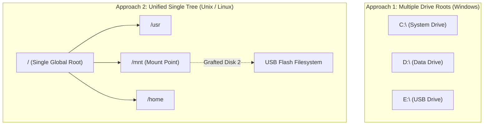
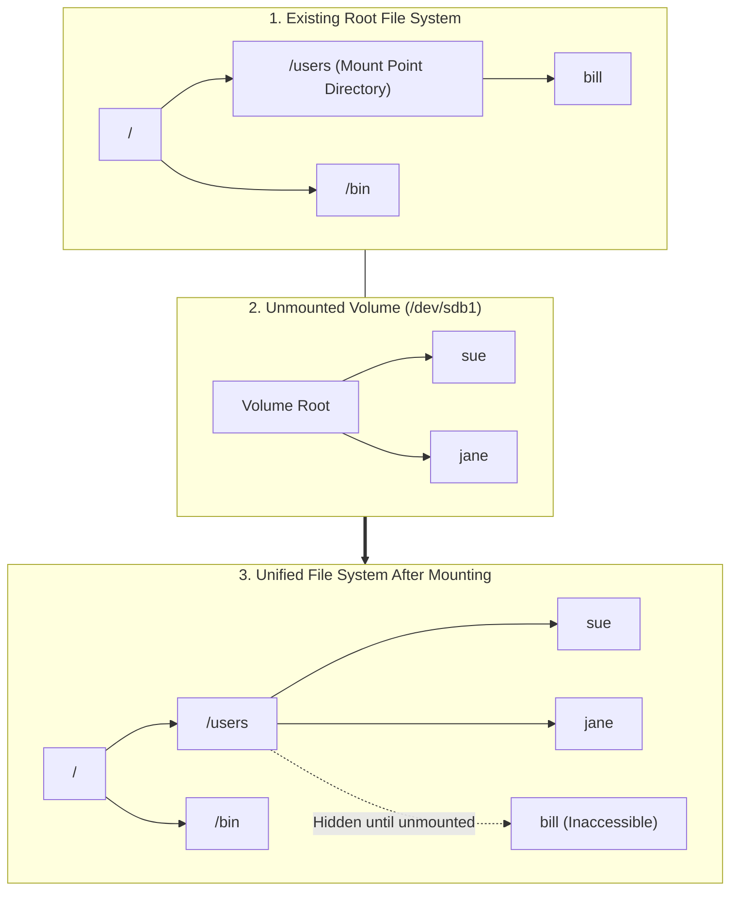
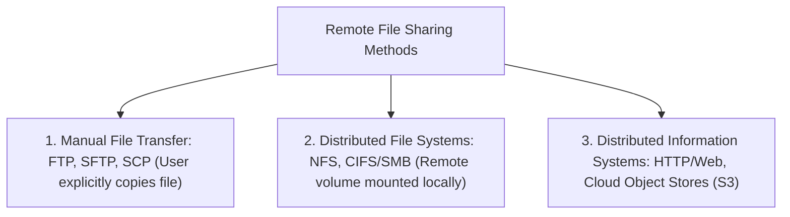
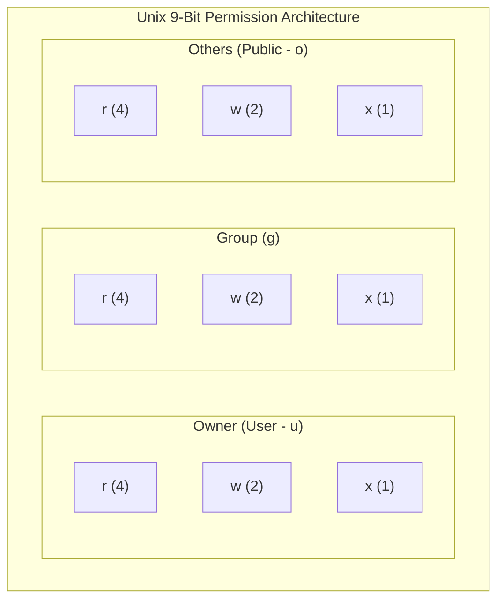
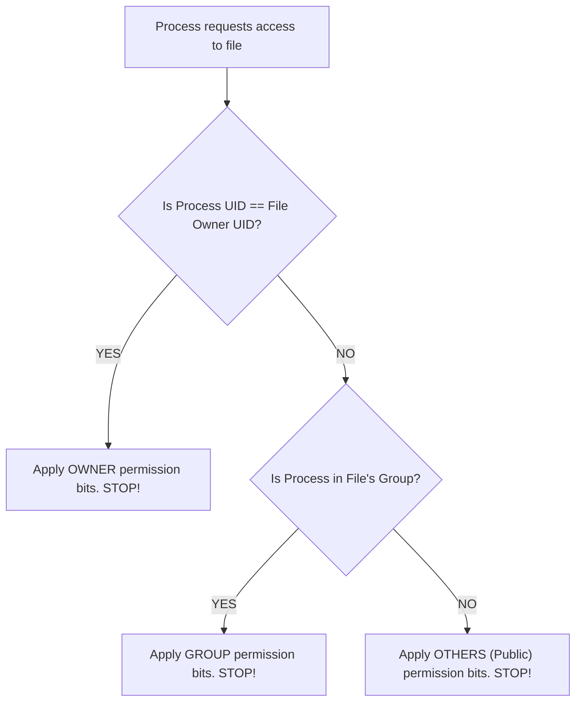

[OS Index](../README.md) / [Unit 4: Storage & Protection](Introduction.md)

---

In the previous two lectures, we explored the directory hierarchy and the file abstraction from the perspective of an individual user.

However, real computer systems do not consist of a single user working on a single storage drive.
- A modern machine often has multiple storage drives: an NVMe SSD for the operating system, a mechanical hard drive for backups, and external USB flash drives.
- A server has hundreds of concurrent users collaborating on shared projects.
- Enterprise networks share storage drives across dozens of physical machines over local area networks.

How does the operating system bring multiple physical disks into a single coherent directory tree? How do multiple users share files without stepping on each other, and how do permission bits guarantee data protection?

In this lecture, we examine **File System Mounting**, the mechanics of **Local and Remote File Sharing (NFS/CIFS)**, and the industry-standard **Unix 9-Bit Permission Model**.

---

## File System Mounting

Every physical disk partition or storage volume contains its own self-contained file system with its own private root directory and metadata structures.

If you attach three physical disks to a computer, you have three independent file system trees. How should the operating system present them to the user?



- **Windows Approach:** Assigns a separate drive letter to each volume (`C:\`, `D:\`, `E:\`), maintaining disjoint namespaces.
- **Unix Approach (Mounting):** Unifies all storage volumes into a **single, global hierarchical directory tree** rooted at `/`.

---

## How Mounting Works Mechanistically

In Unix-like systems, a file system cannot be accessed until it is **Mounted**:



1. **The Mount Point:** An existing empty directory in the main file system (e.g., `/mnt/usb` or `/home/users`) is designated as the **Mount Point**.
2. **The Mount Operation:** The system administrator executes the `mount` system call:
   ```bash
   mount /dev/sdb1 /users
   ```
3. **The Grafting:** The kernel reads the superblock of the unmounted volume, validates its filesystem integrity, and grafts the root of the new volume directly onto the mount point directory.
4. **Transparent Path Traversal:** When an application traverses a path like `/users/jane/project.c`, the kernel's path-resolution logic reaches `/users`, consults its in-memory **Mount Table**, and transparently crosses over onto `/dev/sdb1`! The boundary between physical drives is completely invisible to software.

### What Happens to Files Already at the Mount Point?
If `/users` contained files (such as `bill`) before the mount command was issued, **those files are hidden, not deleted!**
- While the secondary volume is mounted, any attempts to access `/users/bill` fail because all lookups are diverted to the root of the newly mounted volume.
- When the volume is unmounted (`umount /users`), the mount table entry is removed, and the original `bill` directory immediately reappears completely intact.

---

## File Sharing: Local and Remote

File sharing allows multiple users or machines to access the same files.

### 1. Multi-User Local Sharing
On a single physical machine with multiple user accounts, file sharing is governed by user credentials:
- Every user is assigned a unique numeric **User ID (UID)**.
- Users are grouped into teams identified by a **Group ID (GID)**.
- Every file stores the UID of its creator (**Owner**) and the GID of its associated **Group**.

### 2. Remote File Systems (Distributed File Systems)
In distributed computing, files reside on a remote server across a network. Remote sharing operates across three levels of abstraction:



### The Distributed File System (DFS) Standard:
Using **NFS (Network File System)** in Unix or **CIFS/SMB** in Windows:
- A remote file server exports a directory over the network.
- The client machine **mounts the remote directory over the network** onto a local mount point.
- Client applications access remote files using standard C system calls (`open()`, `read()`, `write()`). The operating system translates these calls into network RPC packets (Remote Procedure Calls) transparently!

### The Fundamental Challenge: Client Authentication
When sharing files over a network, security becomes complex:
- On a local machine, the kernel knows that a process belongs to UID `1001` because the kernel logged the user in.
- But if a remote client connects over an Ethernet cable and claims: *"I am UID 1001, give me this file"*, how can the server trust that the client hasn't modified its own local kernel?
- To enforce security, distributed systems use centralized network authentication directories: **LDAP**, **Kerberos**, or **Active Directory**.

---

## File Protection and Access Rights

When files are shared among multiple users, the system must provide **Protection**: ensuring that data can only be accessed by authorized users.

Protection is governed by two questions:
1. **What operations are being requested?**
2. **Who is allowed to perform them?**

### The Six Types of Access Operations:
Operating systems control six fundamental operations on files and directories:

1. **Read (`r`):** Reading the data bytes from a file.
2. **Write (`w`):** Modifying, overwriting, or clearing the contents of an existing file.
3. **Execute (`x`):** Loading an executable program or script into RAM and running it.
4. **Append:** Writing new data *strictly to the end* of a file without being permitted to overwrite existing data. (Crucial for system audit logs: a process can record events, but cannot erase its past tracks!).
5. **Delete:** Removing a file entry from its directory.
6. **List:** Reading the directory structure to see what file names exist.

> **Crucial Distinction:** Deleting a file requires write permission on the **parent directory**, not necessarily write permission on the file itself! If you own a directory, you can delete files inside it even if you do not own those files.

---

## The Unix 9-Bit Permission Model

To provide fast, fine-grained access control without bloating metadata, Unix operating systems implement an elegant **9-bit protection scheme**.



### The Three User Classes:
1. **Owner (`u`):** The specific user account that created and owns the file.
2. **Group (`g`):** A collection of user accounts that belong to the file's assigned group.
3. **Others (`o`):** Every other user account on the computer system (the general public).

### The Three Permission Modes:
Each class is allocated **3 bits** representing three independent permissions:
- **`r` (Read):** Value = **`4`** (Binary `100`)
- **`w` (Write):** Value = **`2`** (Binary `010`)
- **`x` (Execute):** Value = **`1`** (Binary `001`)

Combining these 3 bits yields an octal digit between `0` and `7` for each user class:

| Octal Digit | Binary Bits | Permission String | Meaning |
| :---: | :---: | :---: | :--- |
| **7** | `111` | **`rwx`** | Full access: Read, Write, and Execute |
| **6** | `110` | **`rw-`** | Read and Write (Standard data file) |
| **5** | `101` | **`r-x`** | Read and Execute (Standard program/script) |
| **4** | `100` | **`r--`** | Read-Only |
| **1** | `001` | **`--x`** | Execute-Only |
| **0** | `000` | **`---`** | Zero access: Completely blocked |

---

## Decoding Permission Modes: A Worked Example

Suppose a file has permissions set to octal **`761`**:

```
Owner (7)       Group (6)       Others (1)
 1 1 1           1 1 0           0 0 1
 r w x           r w -           - - x
```

- **Owner Access (`7`):** The owner can read, write, and execute the file (`rwx`).
- **Group Access (`6`):** Members of the file's group can read and write, but cannot execute (`rw-`).
- **Public / Others Access (`1`):** Anyone else on the system can only execute the file, but cannot read its source or modify it (`--x`).

When you inspect this file using `ls -l`, the system displays:
```bash
-rwxrw---x  1 alice  developers  4096 Oct 20 16:00 game
```

### Managing Permissions and Groups:
- **`chmod 761 game`:** Changes the file's mode bits to `761`.
- **`chgrp developers game`:** Changes the group ownership of the file to `developers`.

---

## The First-Match Rule (Permissions Are NOT Cumulative!)

Students frequently assume that Unix permissions are cumulative (i.e., that a user receives the union of all permissions).

**This is completely incorrect!**

The operating system evaluates permissions using a strict **First-Match Rule**:



### The "Owner Locked Out" Anomaly:
Look at what happens if a file has permissions set to mode **`007`** (`--- --- rwx`):
- Mode `007` grants **`rwx`** to Others (Public).
- But what happens when the **Owner** attempts to read the file?
  1. The kernel checks: *Is the requester the owner?* **YES.**
  2. The kernel applies the owner's permission bits: **`---` (Zero Access)**.
  3. **The kernel immediately blocks the owner with "Permission Denied"!**

Even though any random user on the system can read and write the file, the owner cannot touch it! Permissions are never merged across classes; the first matching tier determines access.

---

## Key Takeaways

- **Mounting** grafts an independent secondary file system onto an existing directory node (the **Mount Point**), unifying multiple physical volumes into a single seamless namespace.
- Files residing in a directory before it becomes a mount point are **hidden, not deleted**, and reappear when the volume is unmounted.
- **Distributed File Systems (DFS)** like **NFS** and **CIFS** allow remote directories to be mounted across a local area network, enabling transparent remote access via standard system calls.
- File operations require distinct protection controls: Read, Write, Execute, Append, Delete, and List.
- Deleting a file requires write permission on the **parent directory**, not on the file itself.
- Unix enforces security using a compact **9-bit permission model** (3 classes: Owner, Group, Others $\times$ 3 modes: `r`, `w`, `x`).
- Permission evaluation follows the **First-Match Rule** (Owner $\rightarrow$ Group $\rightarrow$ Others); permissions are strictly **not cumulative**.

---

Up to this point, we have explored the file system entirely from the user's interface: how files are named, mounted, opened, and protected.

Now, we cross the boundary into physical implementation:
- How does the operating system actually lay out files on physical disk sectors?
- What internal on-disk and in-memory data structures make up a file system?
- What are inodes, File Control Blocks, and Virtual File Systems (VFS)?

That brings us to low-level implementation in [**Lecture 4: Implementing File Systems**](L04%20-%20Implementing%20File%20Systems.md).
