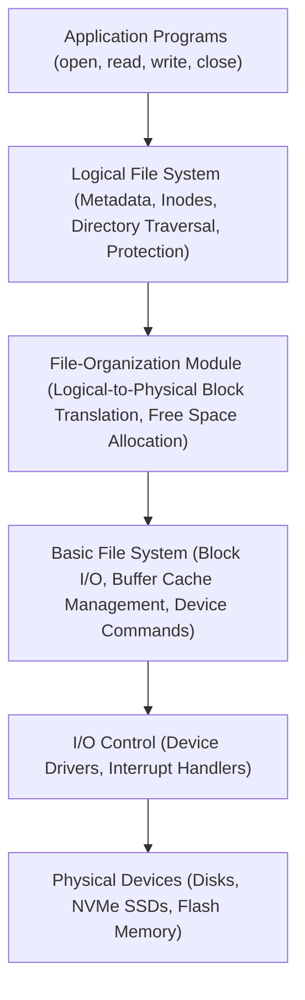
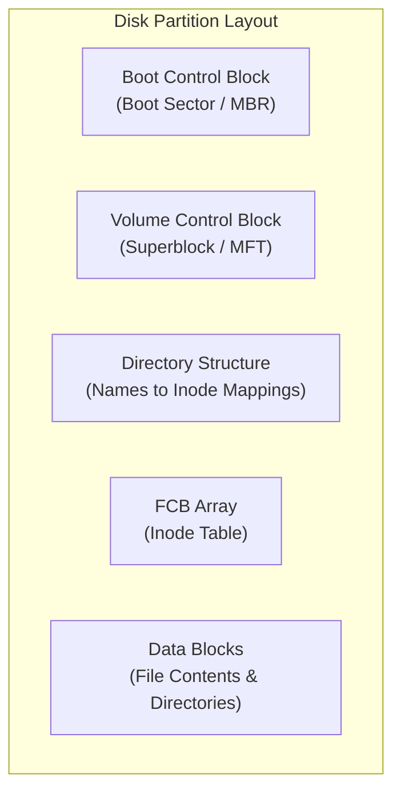
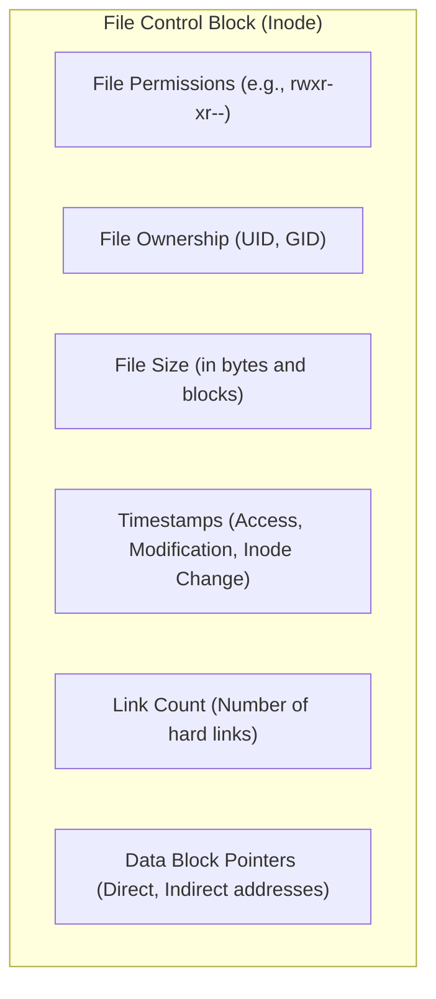
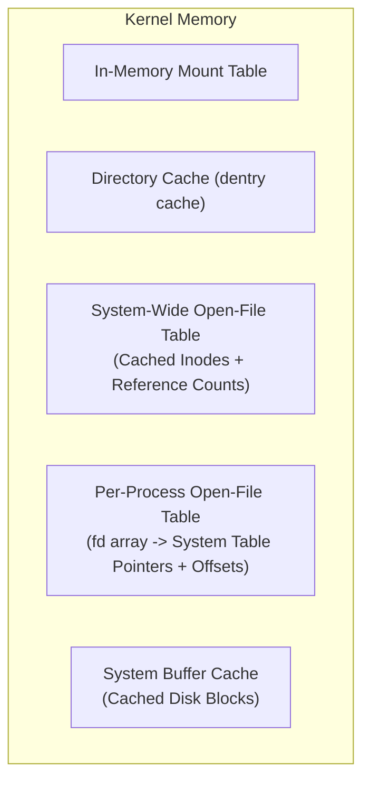
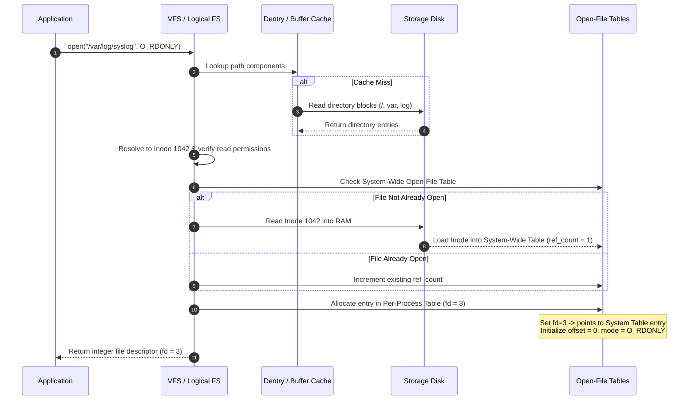
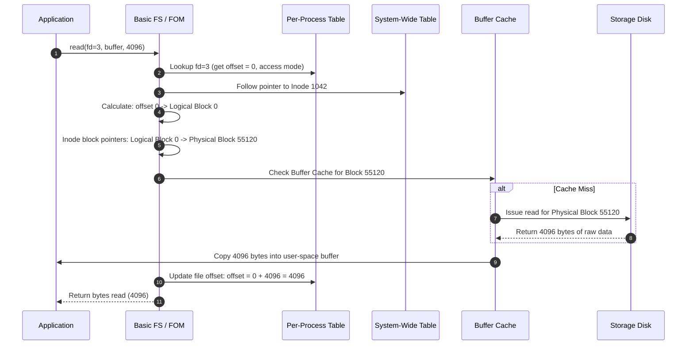
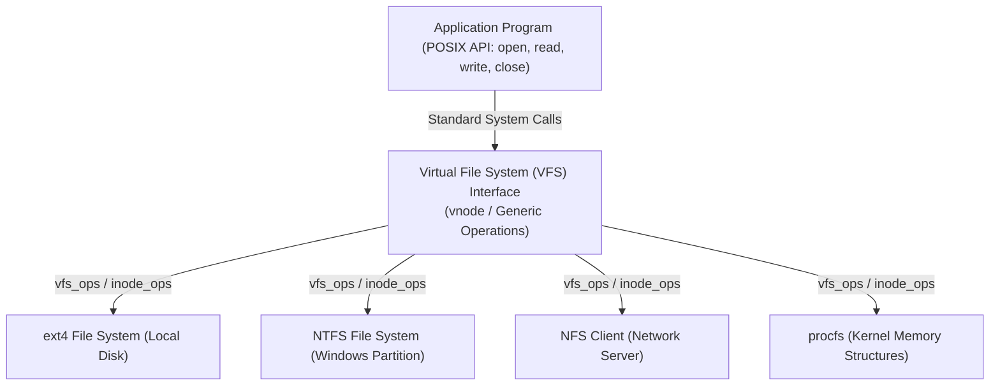

[OS Index](../README.md) / [Unit 4: Storage & Protection](Introduction.md)

---

In the previous lectures, we viewed the file system from the perspective of an application and an end user: files as linear streams of bytes, directories as hierarchical paths, and permissions as read, write, and execute bits.

Now we cross the boundary into the kernel. 

At the hardware layer, secondary storage knows nothing about filenames, nested folders, or stream offsets. A storage drive is simply a massive, flat array of fixed-sized physical sectors. How does an operating system take raw, unformatted sectors and construct the entire illusion of files, hierarchical trees, fast opens, and multi-filesystem compatibility?

In this lecture, we examine the internal machinery of file system implementation: the **Layered File System Architecture**, the **On-Disk Layout**, the **In-Memory Control Structures** that power `open()` and `read()`, and the **Virtual File System (VFS)** abstraction.

---

## The Layered File System Architecture

Building a file system as a single monolithic block of code would make it unmaintainable. If a new storage protocol appears (such as NVMe replacing SATA), or if you want to support a new on-disk format (such as Btrfs alongside ext4), rewriting the entire storage stack would be disastrous.

Instead, operating systems structure file systems into distinct, modular layers. Each layer performs a specific level of abstraction, transforming a high-level logical request into progressively lower-level physical operations:

Let us look closely at what each layer receives, what it does, and what it produces:

### 1. Logical File System
- **Receives:** A human-readable path string (e.g., `/home/alice/notes.txt`) and operation requests.
- **Responsibilities:** 
  - Manages all metadata structures (ownership, timestamps, permissions, access controls).
  - Navigates and manages directory structures to translate file pathnames into unique file identifiers (in Unix, the **inode number**).
  - Enforces access control and security permissions.
  - Manages the **File Control Block (FCB)**.
- **Produces:** An internal file identifier (e.g., inode 4096) and verification that the operation is permitted.

### 2. File-Organization Module
- **Receives:** A file identifier and a logical file position (e.g., inode 4096, byte offset 12,500).
- **Responsibilities:**
  - Understands the allocation method used by the file system (contiguous, linked, or indexed).
  - Converts the file-relative **logical block number** into a volume-relative **physical block address**. For instance, if block size is 4 KB, byte 12,500 falls inside logical block 3; the file-organization module inspects the file's index table to find that logical block 3 maps to physical block 81,920.
  - Manages free-space tracking and allocates new blocks to the file when it grows.
- **Produces:** A physical block address on the storage volume (e.g., "Physical Block 81920").

### 3. Basic File System
- **Receives:** Generic read/write commands for physical block addresses (e.g., "Read Physical Block 81920").
- **Responsibilities:**
  - Manages the operating system's in-memory **buffer cache**. Before sending any command to hardware, it checks whether block 81,920 already resides in RAM. If it does, the I/O is satisfied instantly.
  - Holds buffers for pending disk writes and schedules flushes.
  - Issues generic, device-independent read/write commands to the appropriate device driver.
- **Produces:** Generic device commands aimed at a specific controller.

### 4. I/O Control (Device Drivers and Interrupt Handlers)
- **Receives:** Generic device commands.
- **Responsibilities:**
  - Translates high-level read/write commands into controller-specific register writes, memory-mapped I/O operations, or DMA channel transfers.
  - Handles the physical transmission of electrical/optical signals to and from the disk.
  - Catches hardware interrupts when data transfers complete and wakes up sleeping processes.
- **Produces:** Direct hardware interaction with physical sectors.

### Why Layering Matters
Notice the isolation between layers:
- If you upgrade your drive from SATA to NVMe, only the **I/O Control** layer changes.
- If you switch the filesystem from ext4 to XFS, only the **Logical File System** and **File-Organization Module** change.
- If you optimize your caching strategy (e.g., LRU vs. ARC), only the **Basic File System** changes.

---

## On-Disk File System Structures

Secondary storage retains data permanently across reboots. Therefore, the file system must maintain several core data structures directly on the physical disk partition:

Let us examine what each on-disk structure stores:

### 1. Boot Control Block
- Usually occupies the very first block or track of a partition.
- Contains the bootstrap code needed to load and boot the operating system kernel if the partition is bootable.
- In Unix/Linux, this is known as the **boot block**; in Windows/DOS systems, it is called the **partition boot sector**. If the volume contains no operating system, this block is left empty or filled with a stub error message.

### 2. Volume Control Block (Superblock)
- Contains critical master metadata describing the entire partition/volume:
  - Total number of blocks in the volume.
  - Physical block size (e.g., 4096 bytes).
  - Free-block count and pointers to free blocks (or bitmap locations).
  - Total number of free FCBs/inodes and their allocation status.
  - Volume label, UUID, and mount status flags (e.g., dirty bit indicating an ungraceful shutdown).
- In Unix/Linux file systems (UFS, ext2/3/4), this structure is called the **Superblock**. In Windows NTFS, this information is stored within the **Master File Table (MFT)**.
- If the volume control block is corrupted, the operating system cannot read the filesystem at all; for this reason, file systems like ext4 keep redundant backup copies of the superblock scattered across block groups.

### 3. Directory Structure
- Stores the mapping between human-readable file names and their internal metadata pointers.
- In modern Unix systems, a directory block contains a list of records, where each entry is simply:
  $$\text{Directory Entry} = \langle \text{File Name}, \text{Inode Number} \rangle$$

### 4. File Control Block (FCB / Inode)
- Stores all metadata associated with an individual file. Every single file has exactly one FCB.
- In Unix-like systems, the FCB is called an **inode** (index node).

### The Architectural Separation of Name and Metadata
Notice something crucial: **The file name is NOT stored in the File Control Block / Inode.**

The file name lives exclusively inside the directory entry. The inode only contains the file's attributes, permissions, and data block pointers.

Why did operating system architects separate the name from the metadata?
1. **Hard Links:** Multiple directory entries in different folders can reference the exact same inode number. The file exists once on disk, but has multiple names in the directory tree.
2. **Cheap Renames:** Renaming a 50 GB video file does not touch the inode or the data blocks at all. The operating system merely updates the string in the directory block.
3. **Consistency:** If metadata lived with the filename, moving a file or creating an alias would require duplicating or synchronizing timestamps, permissions, and block pointers across multiple locations.

---

## In-Memory File System Structures

On-disk structures are persistent, but accessing the disk for every filename lookup, permission check, or block seek would make the operating system intolerably slow.

To achieve acceptable performance, the kernel maintains specialized **in-memory data structures** that cache and manage active file operations:

Let us break down each in-memory structure:

### 1. In-Memory Mount Table
- Maintains an entry for each mounted file system volume.
- Contains a pointer to the volume control block (superblock) and links the mount-point directory in the host tree to the root directory of the mounted volume.

### 2. In-Memory Directory-Structure Cache (dentry cache)
- Holds recently translated directory entries (`/home`, `/home/alice`, `/home/alice/notes.txt`).
- When a process accesses a path, the kernel first consults this cache. If resolved, it avoids reading directory blocks from disk entirely.

### 3. System-Wide Open-File Table
- Contains exactly **one entry for every currently open file** across the entire operating system.
- Stores:
  - An in-memory copy of the file's FCB/inode.
  - An **open count** (reference count) tracking how many processes currently have this file open.
  - File locking status.
- When the open count drops to zero (the last process closes the file), any modified metadata is written back to disk and the entry is evicted from memory.

### 4. Per-Process Open-File Table
- Every process maintains its own private table (in Unix, the file descriptor table indexed by integers `0, 1, 2, ...`).
- Each entry in this table stores:
  - A pointer to the corresponding entry in the **System-Wide Open-File Table**.
  - The process's current **file offset pointer** (the read/write byte cursor).
  - The access mode under which this specific process opened the file (e.g., `O_RDONLY`, `O_WRONLY`, `O_APPEND`).

Notice why the file offset pointer belongs in the *per-process* table rather than the *system-wide* table: if two independent processes open `report.pdf` at the same time, each process must be able to read through the document at its own independent reading pace without overwriting the other's cursor.

---

## The Execution Trace: `open()` and `read()`

To understand how on-disk and in-memory structures collaborate, let us trace what happens when an application calls `open()` followed by `read()`.

### Tracing `open("/var/log/syslog", O_RDONLY)`

Opening a file is heavy work because it involves path parsing, disk lookups, and permission verification:

1. **Path Resolution:** The kernel parses the path starting from root (`/`). It looks up `var`, then `log`, and finally `syslog`, checking the dentry cache first. If entries are missing from RAM, it reads the corresponding directory data blocks from disk.
2. **Permission Check:** The kernel extracts the inode number for `syslog` (e.g., inode 1042) and checks whether the calling process has permission to read it. If denied, `open()` returns `-1` (`EACCES`).
3. **System-Wide Table Update:** The kernel checks the system-wide open-file table. If another process already has `syslog` open, the kernel simply increments its open reference count. If not, it reads inode 1042 from disk into a newly allocated system-wide table entry and sets `open_count = 1`.
4. **Per-Process Table Allocation:** The kernel finds the smallest unused integer in the process's file descriptor table (e.g., `fd = 3`). It configures entry 3 to point to the system-wide table entry, initializes the file offset cursor to `0`, and records `O_RDONLY`.
5. **Descriptor Return:** The system call returns `3` to the application.

### Tracing `read(3, buffer, 4096)`

Now notice what happens when the application calls `read()`:

Notice the enormous difference between `open()` and `read()`:
- `open()` had to parse text strings, traverse directory hierarchies, check permissions, and populate kernel tables. It is computationally expensive.
- `read()` uses the integer `3` as a direct array index into the per-process table. It does **zero directory traversals** and **zero string comparisons**. It simply inspects the cached inode pointers, fetches physical block 55120 from the buffer cache (or disk), copies the bytes to user space, and increments the offset cursor.

This is why file systems separate `open()` from `read()`: you pay the naming and resolution overhead once, and subsequent I/O operations execute in near-constant time.

---

## Virtual File Systems (VFS)

On a modern operating system, storage is heterogeneous. A user might have:
- An internal SSD running Linux **ext4**
- A secondary partition formatted with Windows **NTFS**
- A USB flash drive running **FAT32**
- A networked company share mounted over **NFS**
- Virtual filesystems synthesized by the kernel, such as `/proc` (process status) and `/sys` (device status)

How can a single user program call `read(fd, buf, count)` and have it work seamlessly across every single one of these wildly different storage mechanisms?

The solution is the **Virtual File System (VFS)**.

### The VFS Abstraction
VFS introduces an object-oriented abstraction layer directly inside the kernel:
- It defines a standard, uniform set of file operations that every file system must support.
- User-space applications invoke system calls against the **VFS interface**, never against a specific file system implementation.
- VFS dispatches each call to the concrete file system driver through a table of function pointers.

When you call `read(fd, buf, n)`, the kernel does not execute ext4 code directly. It invokes:
$$\text{file}\to\text{f\_op}\to\text{read}(\text{file}, \text{buf}, n, \text{\&offset})$$

If the file lives on ext4, `f_op->read` points to `ext4_file_read_iter()`. If the file lives on an NFS share, `f_op->read` points to `nfs_file_read()`. The caller is completely oblivious to the underlying mechanics.

### The Four Primary VFS Object Types
In standard Linux/Unix implementations, the VFS defines four core data object types:

1. **Superblock Object (`struct super_block`):**
   - Represents an entire mounted file system.
   - Stores volume-level metadata and holds function pointers to filesystem-wide operations (`super_operations`, such as allocating an inode or unmounting the filesystem).

2. **Inode Object (`struct inode`):**
   - Represents an individual file or directory uniquely within the file system.
   - Holds file metadata (size, permissions, timestamps) and function pointers to inode operations (`inode_operations`, such as `create`, `link`, `mkdir`, `lookup`).
   - In BSD and SunOS terminology, this generalized across network filesystems is called a **vnode** (virtual inode).

3. **Dentry Object (`struct dentry`):**
   - Represents a directory entry, linking a filename string to an inode object.
   - Dentries are cached in memory to accelerate path lookups.
   - Includes pointers to directory operations (`dentry_operations`, such as `d_compare`, `d_delete`).

4. **File Object (`struct file`):**
   - Represents a file that has been opened by an active process.
   - Exists exclusively in memory while the file is open.
   - Tracks the process's file offset cursor, access flags (`O_RDWR`), and points to file operations (`file_operations`, such as `read`, `write`, `mmap`, `fsync`).

### The Design Principle
Notice the recurring systems theme:
$$\text{Define an interface} \longrightarrow \text{Allow multiple implementations} \longrightarrow \text{Dispatch at runtime}$$

We saw this exact design in Unit 1 with the system call boundary, in Unit 2 with POSIX threads, and in Unit 3 with page tables. The VFS brings this same polymorphism to storage, decoupling application code from physical storage formats.

---

## Key Takeaways

- File system implementations use a four-layer architecture: **Logical File System** (metadata, paths, inodes, protection), **File-Organization Module** (logical-to-physical block translations, free space), **Basic File System** (block cache buffers, generic I/O), and **I/O Control** (drivers, interrupts).
- On disk, a partition stores a **Boot Control Block** (bootloader), a **Volume Control Block / Superblock** (volume size, block size, free counts, allocation maps), a **Directory Structure** (name-to-inode mappings), and an array of **File Control Blocks / Inodes** (metadata, timestamps, block pointers).
- File names are stored exclusively inside directories, not in the inode. This design allows cheap renames, robust hard links, and clean separation between naming and file properties.
- In memory, the kernel maintains a **Mount Table**, a **Dentry Cache**, a **System-Wide Open-File Table** (cached inodes with open counts), and a **Per-Process Open-File Table** (file descriptors, current seek offsets, open modes).
- `open()` incurs the expensive overhead of path parsing, directory disk reads, and table allocation once, returning a small integer descriptor. Subsequent `read()` calls use the descriptor as an array index, executing block lookups in near-constant time.
- The **Virtual File System (VFS)** acts as a polymorphic abstraction layer in the kernel, enabling applications to interact with ext4, NTFS, NFS, and virtual filesystems through a single, uniform POSIX API.

---

Now that we understand how the file system structure is organized on disk and managed in memory, a fundamental algorithmic question emerges: once the file-organization module needs to store a file's data, how does it allocate physical disk blocks to that file? In the next lecture, we analyze the three foundational allocation strategies in [**L05 - Disk Space Allocation Methods**](L05%20-%20Disk%20Space%20Allocation%20Methods.md): **Contiguous Allocation**, **Linked Allocation (including File Allocation Tables)**, and **Indexed Allocation (including Unix multi-level inodes)**.
