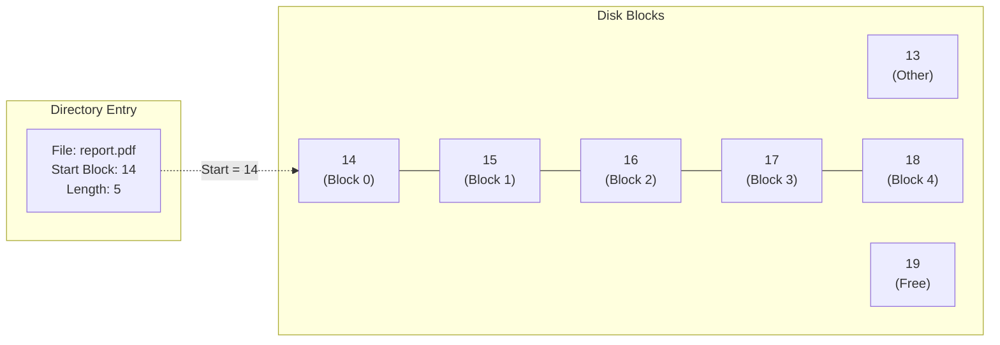
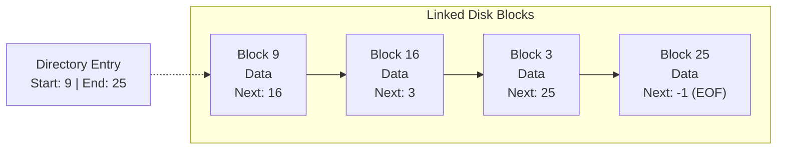
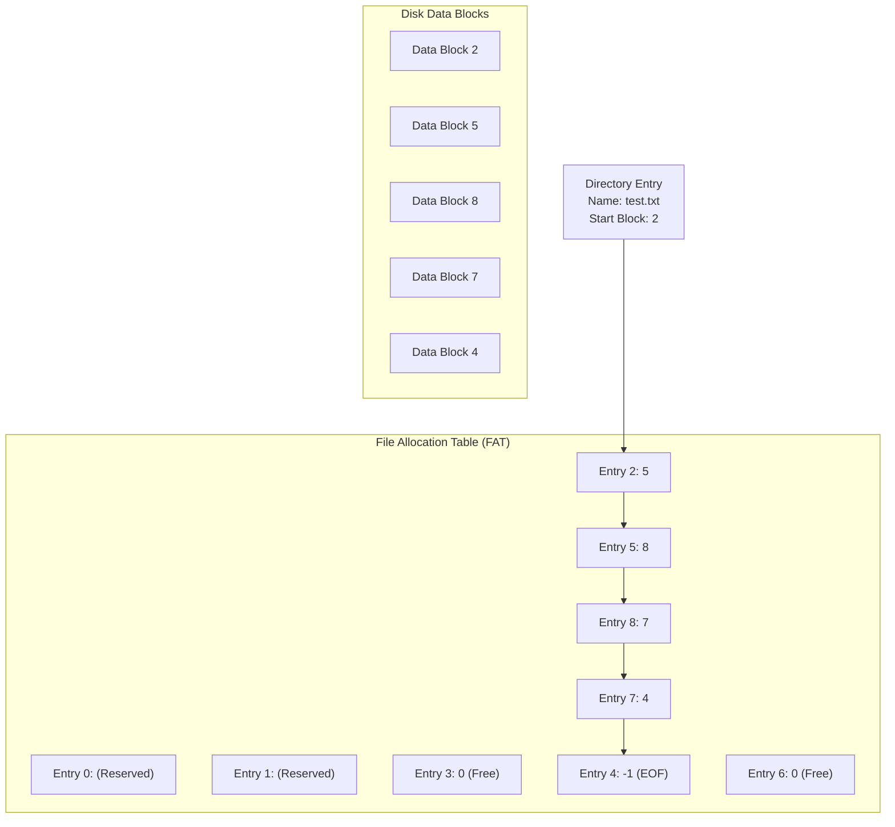
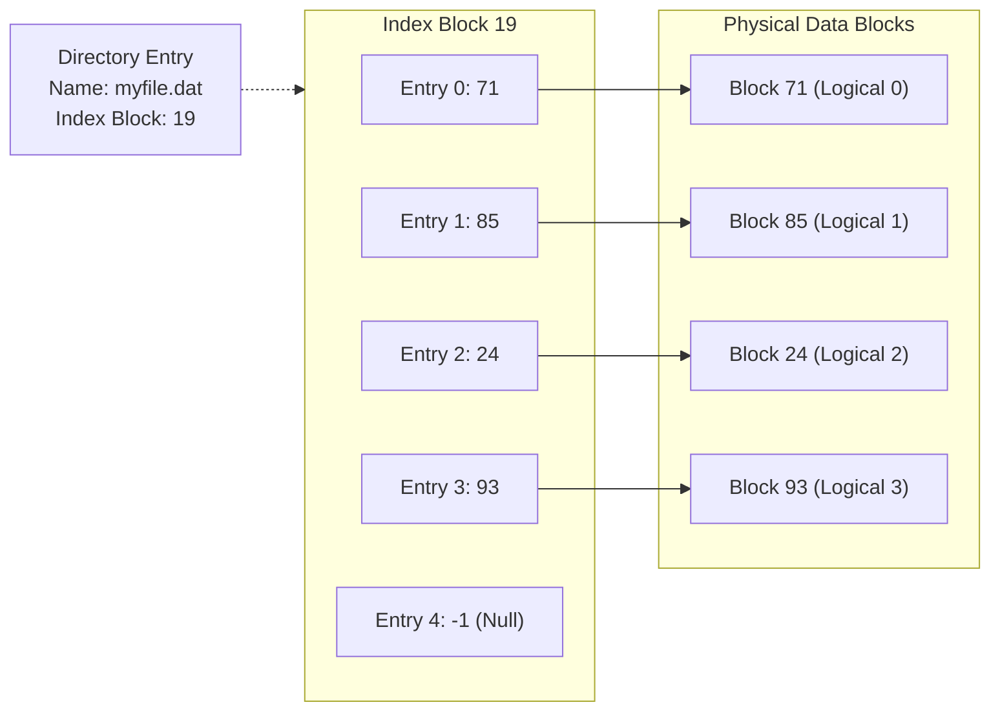
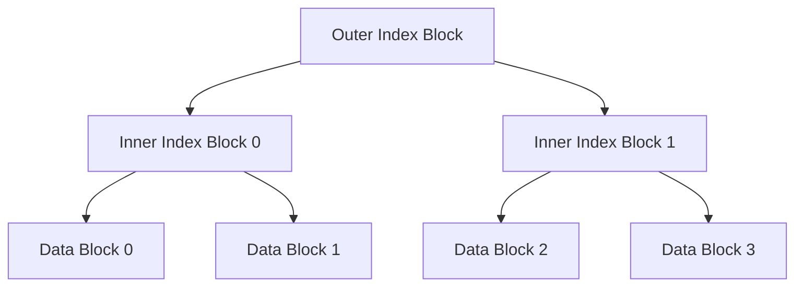
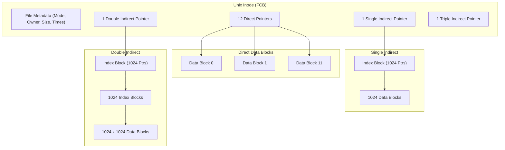

[OS Index](../README.md) / [Unit 4: Storage & Protection](Introduction.md)

---

In the previous lecture, we established that the **File-Organization Module** sits between the logical file system and the basic file system. Its primary responsibility is translation: whenever a program reads byte offset 35,000 from a file, the file-organization module must determine which physical disk block contains that data.

At first glance, this sounds like an arbitrary storage decision. But secondary storage has a physical reality that main memory does not:
- On mechanical hard disks, moving the read/write head (a seek) is thousands of times slower than reading sequential blocks.
- On solid-state drives, random writes trigger write amplification and wear-leveling overheads.
- Files dynamically grow, shrink, and get deleted over months and years, leaving holes in storage.

How should the operating system allocate disk blocks to files so that access is fast, storage is not wasted, and files can expand freely?

Notice the deep parallel with Unit 3: in memory management, we asked how to map a process's logical address space to physical RAM, moving from contiguous allocation to paging and multi-level page tables. In this lecture, we study the exact same architectural trade-offs applied to disk blocks through the three classical allocation strategies: **Contiguous Allocation**, **Linked Allocation (and FAT)**, and **Indexed Allocation (and the Unix Combined Scheme)**.

---

## Contiguous Allocation

The most straightforward allocation strategy is to require that each file occupy a set of **contiguously adjacent blocks** on the disk.

If a file starts at block $b$ and is $n$ blocks long, it occupies physical blocks:
$$b, \; b+1, \; b+2, \; \dots, \; b+n-1$$

### Directory Representation and Address Translation
Under contiguous allocation, the directory entry for a file is remarkably compact. It needs only two numbers:
$$\text{Directory Entry} = \langle \text{Start Block } b, \; \text{Length } n \rangle$$

Mapping a logical block number $L$ ($0 \le L < n$) to a physical block address $P$ requires a single addition:
$$P = b + L$$

Direct (random) access is virtually free: zero table lookups, zero pointer chasing, and zero indirection.

### Advantages
1. **Unrivaled I/O Performance:** On spinning disks, reading a contiguous file requires at most one initial seek and rotational delay. After that, entire tracks can be read sequentially at full bus bandwidth without moving the disk arm.
2. **Simple Direct Access:** Finding block $L$ requires no intermediate disk reads.
3. **Minimal Metadata Overhead:** Only two integers per file in the directory.

### The Fatal Flaws
Despite its speed, contiguous allocation suffers from severe practical limitations:
- **External Fragmentation:** As files are created, updated, and deleted, the disk becomes fragmented into scattered chunks of free space. A request to allocate a 50-block file might fail even if 200 free blocks exist on disk, simply because no single contiguous hole of size 50 is available.
- **Compaction Overhead:** Eliminating external fragmentation requires moving massive quantities of file data across the disk (disk defragmentation), tying up I/O channels for hours.
- **Pre-allocating File Size:** The user or application must declare the maximum file size upfront so the operating system can find a large enough hole. If the estimate is too low, the file cannot grow and the program terminates with a disk full error; if the estimate is too high, precious disk space is wasted internally.

### The Modern Adaptation: Extent-Based Allocation
Modern high-performance file systems (such as Linux **ext4** and Veritas) do not abandon contiguous allocation entirely. Instead, they use **extents**. 

An extent is a contiguous run of disk blocks represented as $\langle \text{start block, count} \rangle$. A file begins as a single contiguous extent. If the file outgrows its original extent, the operating system allocates a *second* contiguous extent elsewhere and links them together. This preserves high sequential throughput while eliminating strict contiguous file limits.

---

## Linked Allocation

To eliminate external fragmentation entirely and allow files to grow dynamically without upfront declarations, **Linked Allocation** treats physical disk blocks like nodes in a linked list.

Each file is an arbitrary collection of scattered disk blocks. The directory entry stores only two addresses:
$$\text{Directory Entry} = \langle \text{First Block Address}, \; \text{Last Block Address} \rangle$$

Every individual disk block contains file data plus a physical pointer pointing to the disk block address of the next block in the chain. The last block contains a null/EOF pointer (e.g., `-1`).

### Advantages
1. **Zero External Fragmentation:** Any free block from anywhere on the disk can be immediately added to any file. No space is ever wasted due to scattered holes.
2. **Effortless File Growth:** Files grow one block at a time. The operating system simply pulls any free block from the free list and updates the tail pointer.
3. **No Prior Size Declarations:** A process never needs to declare how large a file will become.

### Disadvantages and Pitfalls
While linked allocation solves storage layout, it introduces severe operational costs:

1. **Terrible Direct (Random) Access:**
   To read logical block $i$ of a file, the operating system cannot compute its address mathematically. It must start at block 0, read it from disk to find the pointer to block 1, read block 1 to find block 2, and repeat this chain until it reaches block $i$.
   $$\text{Disk Accesses to reach block } i = i + 1$$
   On a spinning disk, reading byte 500,000 might require hundreds of individual disk head seeks across different platters, rendering random access impossibly slow.

2. **Pointer Storage Overhead:**
   If a disk sector is 512 bytes and a disk address pointer takes 4 bytes, each block only holds 508 bytes of actual file data.
   - Files are no longer multiples of 512 bytes, breaking hardware alignment and complicating buffer cache translations.
   - Roughly $0.78\%$ of total storage is consumed solely by pointer overhead.

3. **Poor Reliability:**
   Because pointers are physically embedded inside each block across the drive, a single bad sector or hardware write glitch destroys the pointer, severing the entire remainder of the file and dropping it into lost-cluster limbo.

> [!NOTE]
> File systems often mitigate the pointer overhead by allocating **clusters** (e.g., groups of 4 or 8 consecutive blocks) rather than individual blocks. This reduces pointer overhead proportionally, but increases internal fragmentation when files do not fill an entire multi-block cluster.

---

## File Allocation Table (FAT)

Linked allocation is conceptually elegant, but chasing pointers across physical disk sectors kills performance. Can we retain the linked-list structure while making pointer traversal fast?

The answer, introduced by Microsoft in MS-DOS and early Windows, is the **File Allocation Table (FAT)**.

Instead of scattering pointers inside data blocks, FAT carves out a small, dedicated section at the very beginning of the disk partition to store a **centralized table of pointers**.

### How the FAT Operates
- The table has one entry for every physical data block on the disk partition.
- If physical block $k$ belongs to a file, `FAT[k]` holds the block number of the *next* block in the file.
- Special sentinel values indicate terminal states:
  - `FAT[k] == 0`: Block $k$ is unused and free.
  - `FAT[k] == -1` (or `0xFFFF` / `0x0FFFFFFF`): Block $k$ is the end-of-file (EOF).
  - Any other value $m$: Block $k$ is followed by block $m$.

### Why FAT Solves Direct Access
Because the FAT is centralized, **the operating system caches the entire table in RAM**.

Now, when a program wants to read block 50 of a file:
- Instead of performing 50 disk seeks, the kernel traverses 50 integer indices inside RAM in microseconds.
- Once it identifies the target physical block number, it issues exactly **one single disk read** directly to the target data block.
- Blocks on disk now store 100% pure data with no pointer bytes carved out, restoring power-of-two alignment.

### The Downside of FAT
The limitation of FAT is scalability:
- The FAT must grow proportionally with partition capacity.
- On a 500 GB drive with 4 KB blocks, there are $125 \times 10^6$ blocks. At 4 bytes per entry (FAT32), the FAT itself consumes 500 MB of RAM just to keep the mapping table in memory.
- Furthermore, as files grow, their data blocks still end up scattered across the disk, causing mechanical seek thrashing during sequential reads.

---

## Indexed Allocation

Both contiguous and linked allocation struggle when balancing random access and dynamic growth. **Indexed Allocation** solves this by borrowing the exact architectural concept of paging from virtual memory: the **Index Block**.

Instead of linking blocks together, the file system allocates an **Index Block** for every file. The index block is a flat array of disk block addresses:
$$\text{Index Block}[i] = \text{Physical Address of Logical Block } i$$

The directory entry stores only the address of the file's index block:
$$\text{Directory Entry} = \langle \text{File Name}, \; \text{Index Block Address} \rangle$$

### Address Translation Mechanics
Let us trace reading logical block $i$:
1. The kernel reads the file's index block into memory (if not already cached).
2. It indexes directly into entry $i$:
   $$\text{Physical Block Address} = \text{Index Block}[i]$$
3. It reads the physical block.

Direct access requires exactly **one pointer lookup**, regardless of whether you are reading logical block 0 or logical block 400. There is zero sequential traversal.

### The Trade-off: Index Overhead
The Achilles' heel of indexed allocation is memory overhead for small files:
- Even if a file is only 10 bytes long, it requires **two disk blocks**: one for the data, and one entire block dedicated to the index array.
- If block size is 4 KB and pointers are 4 bytes, an index block holds 1024 pointers. For a 1-block file, 1023 pointer slots sit completely empty, wasting $50\%$ of the allocated storage.

### Handling Large Files
A single index block has a hard mathematical ceiling. If a block is 4 KB ($4096$ bytes) and pointers are 4 bytes, an index block can hold at most:
$$\frac{4096}{4} = 1024 \text{ pointers}$$
$$1024 \times 4\text{ KB} = 4\text{ MB maximum file size!}$$

How can a file grow beyond 4 MB? Systems use three mechanisms:

#### 1. Linked Index Scheme
The file system chains multiple index blocks together like a linked list. The last entry of index block 1 points to index block 2. While simple, accessing blocks near the end of a multi-gigabyte file reintroduces sequential traversal overhead across index blocks.

#### 2. Multilevel Index Scheme
Just as virtual memory uses two-level and three-level page tables, indexed allocation can use hierarchical index blocks:
- An **Outer Index Block** contains pointers to second-level index blocks.
- The **Second-Level Index Blocks** contain pointers to actual data blocks.

With 1024 pointers per block:
$$\text{Max Size} = 1024 \times 1024 \times 4\text{ KB} = 4\text{ GB}$$
Adding a third level expands the ceiling to $4\text{ TB}$. Every direct access requires $L+1$ disk reads (where $L$ is the number of levels), guaranteed to be constant time.

---

## The Unix Combined Scheme (Inode Structure)

Multilevel indexing scales beautifully for massive files, but wasting multiple index blocks on tiny 1 KB files remains unacceptable.

Unix solved this dilemma with a design pattern that balances both extremes: **The Unix Inode Combined Scheme**.

In a traditional Unix inode, there are typically **15 block pointers**:

### 1. Twelve Direct Pointers
- The inode itself directly stores the physical block numbers of the first 12 data blocks (blocks 0 through 11).
- For files smaller than $12 \times 4\text{ KB} = 48\text{ KB}$, **zero intermediate index blocks are allocated**.
- Because the inode is already in RAM when the file is open, reading any data block in a small file requires **zero indirection overhead**—exactly 1 physical disk read!

### 2. One Single Indirect Pointer
- Points to a single external index block on disk containing pointers to data blocks.
- With 4 KB blocks and 4-byte pointers, this holds 1024 pointers, covering files up to:
  $$48\text{ KB} + (1024 \times 4\text{ KB}) = 48\text{ KB} + 4\text{ MB}$$

### 3. One Double Indirect Pointer
- Points to an index block containing pointers to 1024 single-indirect index blocks.
- Covers:
  $$1024 \times 1024 \times 4\text{ KB} = 1,048,576 \text{ blocks} = 4\text{ GB}$$

### 4. One Triple Indirect Pointer
- Points to an index block containing pointers to 1024 double-indirect index blocks.
- Covers:
  $$1024 \times 1024 \times 1024 \times 4\text{ KB} = 4\text{ TB}$$

### Why the Combined Scheme is Brilliant
Notice the core systems engineering principle at work:
$$\text{Make the common case fast, and make the rare case possible.}$$

Empirical studies show that over $80\%$ of files on typical computer systems are under 50 KB. For all those common small files, the Unix inode incurs zero index block overhead. Only when a file genuinely expands into gigabytes or terabytes does the kernel dynamically allocate single, double, or triple indirect blocks.

---

## Comparative Analysis of Allocation Methods

Let us summarize the three foundational allocation strategies across all critical performance metrics:

| Property | Contiguous Allocation | Linked Allocation | FAT (File Allocation Table) | Indexed Allocation (Unix Inode) |
| :--- | :--- | :--- | :--- | :--- |
| **Directory Stores** | Start block + length | First block + last block | Starting block number | Inode number (Index Block address) |
| **Pointer Storage** | None (pure mathematical offset) | Embedded inside every data block | Extracted into centralized table | Array inside index blocks / inode |
| **External Fragmentation** | Severe (requires defragmentation) | Zero | Zero | Zero |
| **Internal Fragmentation** | None (except last block) | Small (worse if clusters are large) | Small (cluster-dependent) | Index block overhead for tiny files |
| **Sequential Access Speed** | Optimal (near-zero seek delay) | Moderate (head seeks across chained blocks) | Moderate (chained blocks scatter) | Good (caches direct pointers) |
| **Direct (Random) Access** | $O(1)$ — single addition | $O(N)$ — requires traversing $N$ blocks | $O(1)$ memory walk + 1 disk read | $O(1)$ — constant number of indirections |
| **Dynamic File Growth** | Difficult (pre-allocation or relocation) | Simple (append any free block) | Simple (update table entry) | Simple (allocate block and update index) |
| **Fault Tolerance** | Single lost block affects only that block | Single bad pointer breaks entire tail of file | Table corruption corrupts entire volume | Bad index block loses entire file |
| **Modern Usage** | Extents in ext4, XFS, optical media | Rarely used in raw form | USB flash drives, EFI partitions, SD cards | Linux (ext2/3/4), Unix (UFS), macOS (HFS+) |

---

## Key Takeaways

- **Contiguous Allocation** places file blocks in unbroken sequential order. It delivers the fastest sequential throughput and trivial $O(1)$ direct access, but suffers from severe external fragmentation and difficult dynamic expansion.
- Modern file systems salvage contiguous allocation using **Extents** (contiguous runs of blocks linked together when files expand).
- **Linked Allocation** stores pointers inside each data block. It eliminates external fragmentation and allows effortless file growth, but completely cripples random access ($O(N)$ traversal overhead) and wastes byte alignment.
- **File Allocation Table (FAT)** fixes linked allocation by consolidating all block pointers into a single centralized table at the start of the disk. Caching the FAT in memory makes random access fast while preserving cluster chaining.
- **Indexed Allocation** gives each file an index block acting as a private page table. Direct access requires a single table lookup, solving both fragmentation and random access at the cost of index block overhead.
- The **Unix Inode Combined Scheme** provides 12 direct pointers, 1 single indirect, 1 double indirect, and 1 triple indirect pointer. This ensures zero indirection overhead for small files (under 48 KB) while effortlessly scaling up to terabytes.

---

We now know how the operating system maps file data to physical disk blocks. But this introduces the complementary problem: before the file-organization module can allocate a block to a growing file, how does it locate and track free blocks across millions of disk sectors? In the next lecture, we explore [**L06 - Free Space Management and Efficiency**](L06%20-%20Free%20Space%20Management%20and%20Efficiency.md), examining bit vectors, linked free lists, grouping, counting, and the optimization techniques that keep file systems running at peak efficiency.
