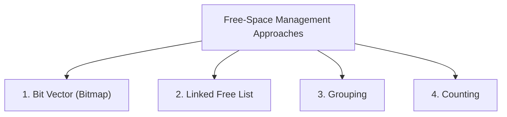
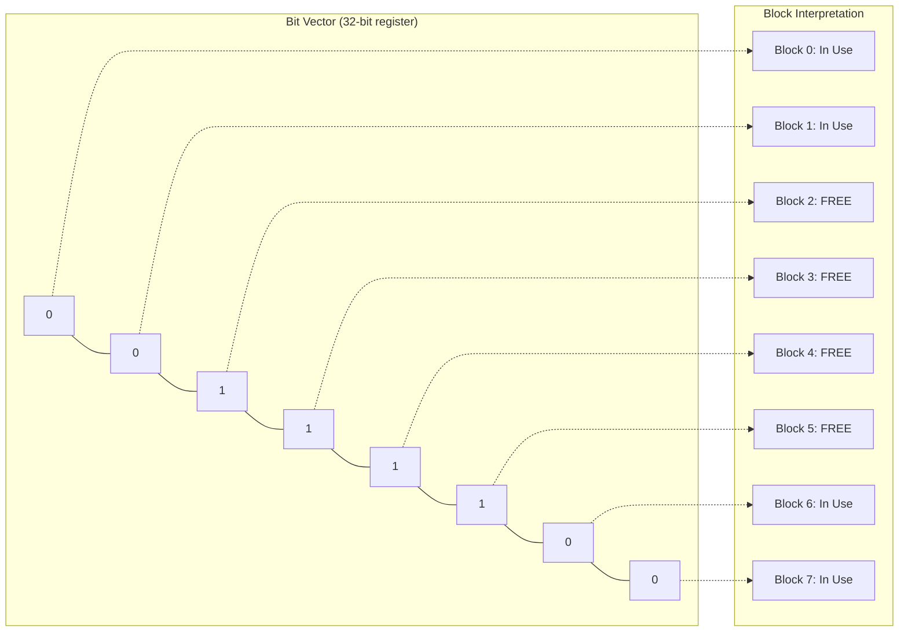
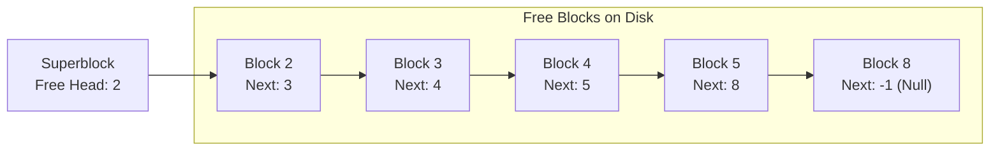
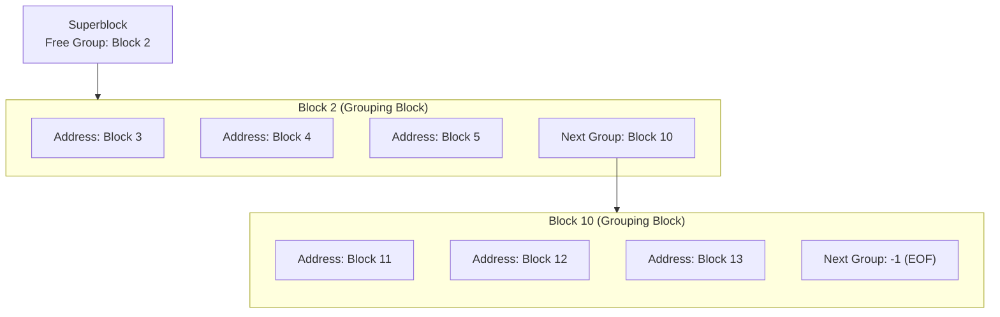
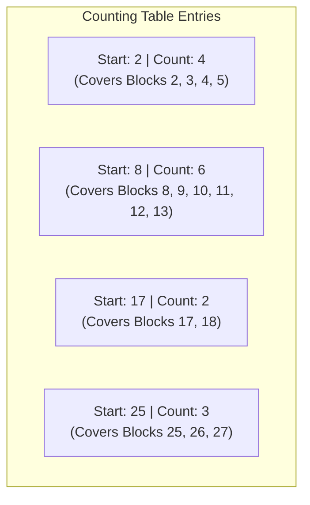
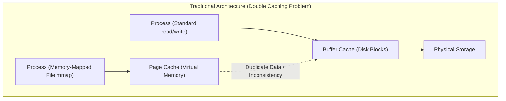
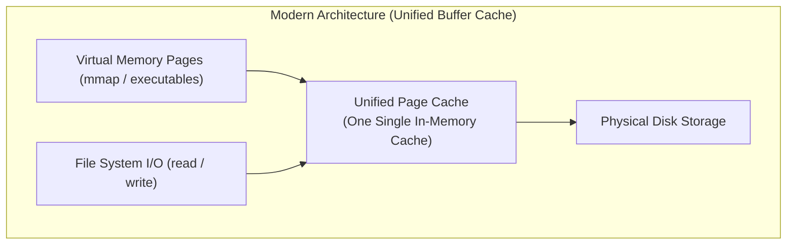
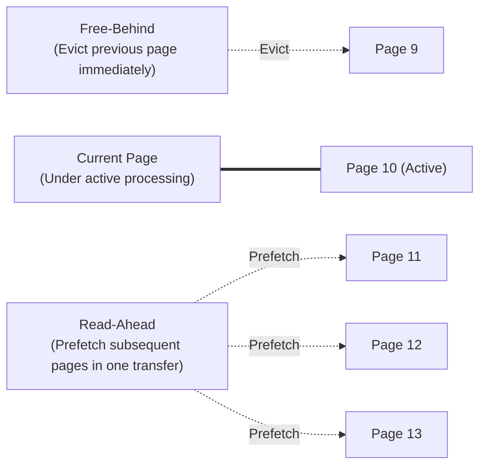

[OS Index](../README.md) / [Unit 4: Storage & Protection](Introduction.md)

---

In the previous lecture, we examined how the file-organization module maps files to physical storage blocks using contiguous, linked, and indexed allocation. But every allocation decision requires an answer to a preceding question:

Where does the operating system find free disk blocks in the first place?

When files are repeatedly created, expanded, truncated, and deleted over months of system usage, millions of storage blocks churn between active data and vacant space. If the kernel does not track these available blocks with extreme efficiency, storage becomes fragmented, allocations crawl to a halt, and physical disk capacity is permanently leaked.

Furthermore, physical disk access is orders of magnitude slower than CPU execution or main memory access. How does the operating system organize its caches and replacement algorithms so that file I/O does not bottleneck the entire computer?

In this lecture, we examine **Free-Space Management Techniques** (bit vectors, linked lists, grouping, and counting), the trade-offs of **Synchronous vs. Asynchronous Disk Operations**, the evolution of the **Unified Buffer Cache**, and sequential optimizations like **Read-Ahead and Free-Behind**.

---

## The Free-Space Management Problem

To track and reuse vacant blocks from deleted files, the operating system maintains a **Free-Space List**.

Notice that while it is conventionally called a "list," it does not necessarily have to be a linked list. It is an abstract data structure that must support two fundamental operations:
1. **Allocate:** Rapidly locate and return one or more free blocks when a file is created or expands. Ideally, the allocator should return blocks that are *physically contiguous* or geographically close to the file's existing blocks on disk to minimize future head movement.
2. **Free (Deallocate):** Rapidly return blocks to the free pool when a file is truncated or deleted, coalescing adjacent blocks whenever possible.

To balance speed, memory footprint, and contiguous allocation ability, operating systems employ four classical representations:

---

## 1. Bit Vector (Bitmap)

The most widely used free-space representation in modern file systems (such as Linux ext4) is the **Bit Vector** (or **Bitmap**).

The free space is represented as a contiguous array of $N$ bits, where each bit corresponds to one physical block on the disk partition:
$$\text{bit}[i] = \begin{cases} 1 & \text{if block } i \text{ is free} \\ 0 & \text{if block } i \text{ is allocated} \end{cases}$$

*(Note: Some systems invert the convention, using 0 for free and 1 for allocated. The algorithmic principles remain identical.)*

### Finding Free Blocks Using Hardware Acceleration
Why are bitmaps so popular? Because modern CPU architectures feature dedicated hardware instructions to scan machine words for non-zero bits.

Instead of scanning bit-by-bit in software, the kernel loads a 64-bit integer into a CPU register:
- If `word == 0`, all 64 blocks in that chunk are fully allocated; the kernel skips to the next word in a single instruction.
- As soon as `word != 0`, the kernel uses CPU primitives like `ctz` (Count Trailing Zeros) or `ffs` (Find First Set) to locate the exact free block index in **one machine cycle**:

$$\text{Block Number} = (\text{Word Index} \times \text{Bits per Word}) + \text{Offset of First 1-Bit}$$

### Space Overhead Calculation
Bitmaps are extremely compact. Let us calculate the memory required to track a modern 1 TB disk with 4 KB blocks:
$$\text{Total Blocks} = \frac{1\text{ TB}}{4\text{ KB}} = \frac{2^{40}\text{ bytes}}{2^{12}\text{ bytes}} = 2^{28} \text{ blocks} = 268,435,456 \text{ blocks}$$
$$\text{Bitmap Size} = \frac{2^{28} \text{ bits}}{8 \text{ bits/byte}} = 2^{25} \text{ bytes} = 32\text{ MB}$$

Tracking an entire 1-terabyte partition requires only **32 MB of RAM**. That is small enough to be kept permanently in memory, enabling instantaneous free-block queries with zero disk latency.

### Primary Advantage: Finding Contiguous Runs
Beyond speed, the defining advantage of a bitmap is its ability to identify **contiguous runs of free blocks**. 

By applying bitwise masks (e.g., searching for consecutive sequences of `1111...`), the allocator can easily locate 16 consecutive free blocks to allocate to a large file, guaranteeing low seek overhead on spinning media.

---

## 2. Linked Free List

In a **Linked Free List**, the file system links all vacant blocks together using pointers.

The superblock holds a single pointer to the first free block on disk. That free block holds a pointer to the next free block, which points to the next, forming an unbroken chain across the drive:

### The Architectural Advantage: Zero Memory Waste
The linked free list has an appealing mathematical property: **it consumes zero additional disk space**.

Because the blocks on the free list are unused by files, the operating system embeds the pointer directly inside the body of the free block itself! A 4 KB empty block has thousands of free bytes, so writing an 8-byte pointer into its first few bytes costs nothing.

### The Fatal Flaw: Devastating Disk I/O
Despite requiring zero storage overhead, the raw linked list is almost never used in modern production file systems:
- To allocate 100 blocks to a new file, the kernel must read Block 2 from disk to discover the pointer to Block 3, read Block 3 to find Block 4, and so on. Allocating space would require **100 physical disk reads**.
- Even worse, there is no spatial locality. Free blocks become chained in random order over time. A file allocated from this list ends up scattered randomly across platters, devastating sequential read performance.
- Finding a contiguous run of $K$ blocks is completely impossible without traversing the entire list across the disk.

---

## 3. Grouping

**Grouping** is a modification of the linked free list designed to eliminate the one-block-at-a-time disk read bottleneck.

Instead of storing a single pointer per free block, the first free block stores the **disk addresses of $n$ free blocks**:
- The first $n-1$ entries are addresses of actual free data blocks ready for immediate allocation.
- The $n$-th entry is an address pointing to *another* grouping block that contains the next batch of $n$ free block addresses.

### Why Grouping is Superior to Linked Lists
Under grouping, when the operating system needs to allocate space:
- It reads **one single block** (Block 2) into memory.
- It immediately possesses $n-1$ free block addresses (e.g., 500 blocks if block size is 2 KB and addresses are 4 bytes).
- It can satisfy hundreds of block allocation requests in pure RAM before having to perform another disk read to fetch Block 10.

However, grouping still does not guarantee that the returned blocks are physically contiguous on disk; it merely delivers batches of free addresses faster.

---

## 4. Counting

The **Counting** approach exploits a fundamental truth about real-world file system churn:

Files are often allocated and deleted in contiguous chunks. When an application writes a multi-megabyte file or deletes a directory, it frequently frees a continuous run of adjacent blocks.

Rather than maintaining individual block numbers, the counting method tracks runs of contiguous free space as pairs:
$$\text{Entry} = \langle \text{Starting Block Address}, \; \text{Contiguous Block Count} \rangle$$

### Operational Advantages
1. **Dramatically Shorter Tables:** If a 10,000-block file is deleted, a linked list or grouping table requires 10,000 entries. Counting records the entire deallocation in **one single 8-byte entry**: $\langle \text{Block } 45000, \; \text{Count } 10000 \rangle$.
2. **First-Class Extent Support:** File systems that use extent-based allocation (such as ext4, XFS, and ZFS) naturally pair with counting. When an application requests an extent of 32 contiguous blocks, the allocator searches its counting table (often stored in a balanced B-Tree) and finds a run that satisfies the request with zero search friction.

---

## File System Efficiency and Performance

A file system may have elegant data structures, but if its disk access patterns are naive, system performance will degrade catastrophically.

Let us evaluate the architectural factors that dictate file system efficiency and speed:

### 1. Metadata Placement
Where metadata resides on disk directly dictates mechanical head travel:
- In early Unix file systems, all inodes were grouped together at the very beginning of the disk partition, while data blocks lived at the end.
- Every time a process read a file, the disk arm had to make a long seek to the front of the platter to read the inode, then make another long seek to the middle of the platter to read data, thrashing back and forth continuously.
- Modern file systems divide the partition into **Block Groups** (e.g., ext4 block groups). Each block group contains its own slice of inodes, its own data blocks, and its own free bitmaps. By allocating a file's inode and data blocks within the same localized cylinder group, disk arm movement is reduced by over $90\%$.

### 2. Synchronous vs. Asynchronous Disk Writes
Notice a fundamental asymmetry in operating system I/O:
- **Disk Reads are Synchronous:** When an application calls `read()`, it usually cannot continue executing until the requested data arrives. The thread blocks and goes to sleep.
- **Disk Writes are Asynchronous:** When an application calls `write()`, the operating system does not immediately write the bytes to physical storage. Instead, it copies the data into an in-memory kernel buffer and immediately returns control to the process with a success status!

A background kernel daemon (such as `flush` or `pdflush` in Linux) batches modified "dirty" buffers, sorts them to minimize disk head travel, and writes them to physical storage periodically (e.g., every 5 to 30 seconds).

This makes writes appear orders of magnitude faster than reads to the user. The trade-off is crash vulnerability: if power fails before dirty buffers are flushed, unwritten data is lost. Critical applications bypass asynchronous buffering using the `fsync()` system call or opening files with `O_SYNC`.

---

## The Unified Buffer Cache

Historically, operating systems maintained two completely separate caching layers in RAM:

1. **The Page Cache:** Managed by the virtual memory subsystem. Cached virtual memory pages for executing code and memory-mapped files (`mmap()`).
2. **The Buffer Cache:** Managed by the file system. Cached raw physical disk blocks to accelerate standard `read()` and `write()` system calls.

### The Double Caching and Incoherency Flaw
Look at what happened when a file was accessed through both mechanisms:
- Standard `read()` fetched disk blocks into the Buffer Cache.
- Memory-mapped `mmap()` loaded the file into the Page Cache.
- The exact same data existed **twice in RAM**, wasting valuable physical memory.
- Even worse, if a process modified the file via `write()`, the changes updated the Buffer Cache but were invisible to a process reading through `mmap()`, causing disastrous cache incoherency.

### The Solution: Unified Buffer Cache
Modern operating systems (including Linux, macOS, and modern Windows) resolve this by integrating both subsystems into a single **Unified Buffer Cache**:

Under a unified cache:
- All file caching is performed at the **page level**.
- Standard `read()` and `write()` operations operate directly on the page cache buffers.
- Double caching is completely eliminated.
- Memory mapping and standard I/O remain perfectly coherent at all times because both point to the exact same physical pages in RAM.

---

## Sequential Access Optimizations: Free-Behind and Read-Ahead

Standard page replacement algorithms (such as LRU) assume **temporal locality**: if a page was accessed recently, it is highly likely to be accessed again soon.

For sequential file processing (e.g., streaming a 4 GB video or scanning a large log file), **temporal locality is completely false**:
- Once an application reads page 10 and moves to page 11, it will almost certainly never touch page 10 again.
- Yet standard LRU marks page 10 as "most recently used," keeping it in RAM and evicting other genuinely useful application pages!

To optimize sequential I/O, operating systems override LRU with two specialized policies:

### 1. Free-Behind
- As soon as the application finishes reading a block and requests the next block in sequence, the kernel immediately evicts or unpins the preceding block from memory.
- This prevents sequential streaming scans from polluting the buffer cache and flushing out hot application working sets.

### 2. Read-Ahead
- When the kernel detects that a file is being accessed sequentially, it automatically issues disk requests for several subsequent blocks *before* the application requests them.
- Instead of issuing separate, high-latency disk seeks for pages 11, 12, 13, and 14 on demand:
  $$\text{Demand Cost} = 4 \times (\text{Seek} + \text{Latency} + \text{Transfer}) \approx 4 \times 6\text{ ms} = 24\text{ ms}$$
  $$\text{Read-Ahead Cost} = 1 \times \text{Seek} + 4 \times \text{Transfer} \approx 6\text{ ms} + 0.8\text{ ms} = 6.8\text{ ms}$$
- The operating system pays the seek latency once and streams multiple consecutive sectors into RAM in a single transfer.
- When the application finishes processing page 10 and calls `read()` for page 11, the data is already waiting in memory. The read call hits the cache instantly with zero I/O wait.

---

## Key Takeaways

- To allocate space dynamically and reuse storage from deleted files, the operating system maintains a **Free-Space List**.
- **Bit Vectors (Bitmaps)** track availability using 1 bit per disk block. They are compact (32 MB tracks 1 TB), benefit from single-cycle CPU bit-scan instructions, and easily locate contiguous runs of free blocks.
- **Linked Free Lists** chain vacant blocks together by embedding pointers inside the empty blocks themselves, incurring zero extra space overhead. However, allocating blocks requires heavy disk seek traversal and cannot identify contiguous runs.
- **Grouping** stores hundreds of free-block pointers inside a single vacant block, amortizing disk reads over batch allocations.
- **Counting** stores runs of free space as $\langle \text{start block, count} \rangle$ pairs, drastically compressing metadata for extent-based file systems.
- Writes are typically asynchronous (buffered in RAM and flushed later), making them appear faster than synchronous reads, but creating a window of crash vulnerability.
- A **Unified Buffer Cache** merges the page cache and buffer cache, preventing double-caching and guaranteeing coherency between `read()`/`write()` and `mmap()`.
- For sequential streaming, the kernel replaces LRU with **Free-Behind** (discarding already-read pages immediately) and **Read-Ahead** (prefetching consecutive upcoming blocks in a single seek).

---

Now that we have explored the file system's logical abstractions, directory trees, block allocation strategies, and caching optimizations, we must descend directly into the underlying physical hardware: the mechanical and electrical storage media that house our data. In the next lecture, we analyze [**L07 - Mass-Storage Structure**](L07%20-%20Mass-Storage%20Structure.md), breaking down the physical geometry of hard disk drives, platters, tracks, and sectors, calculating disk transfer timing, and examining the modern architecture of Solid-State Drives (SSDs).
