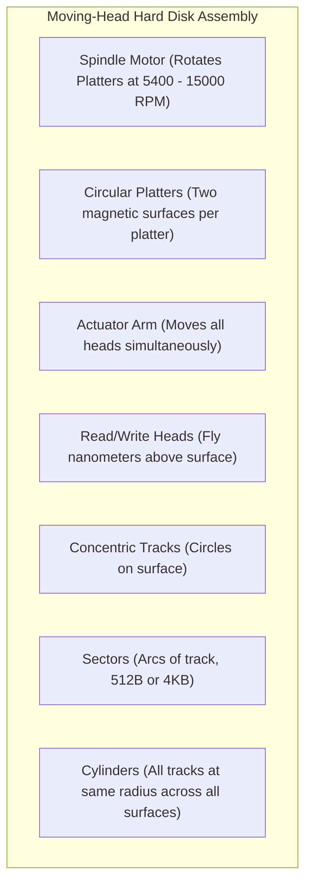
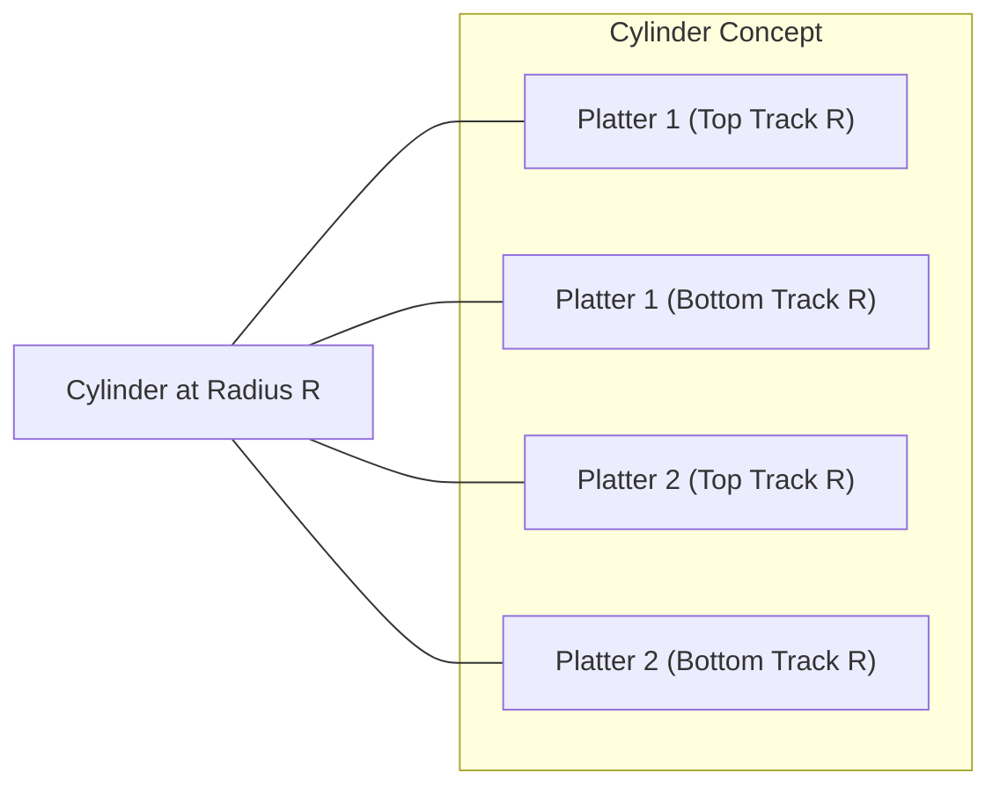
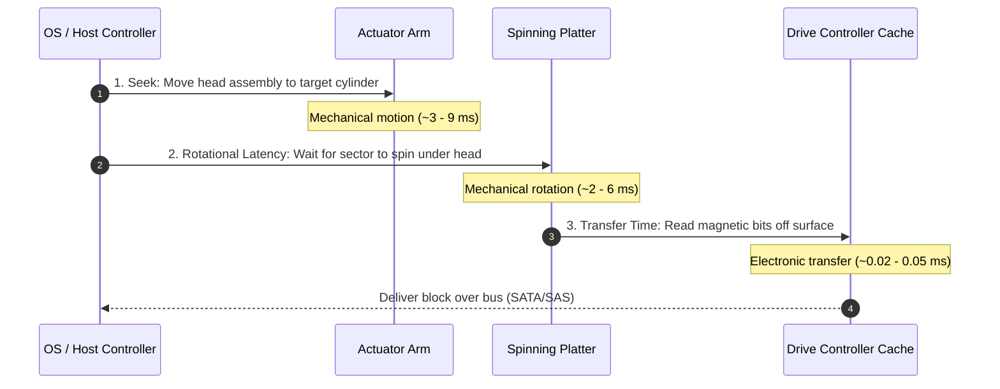
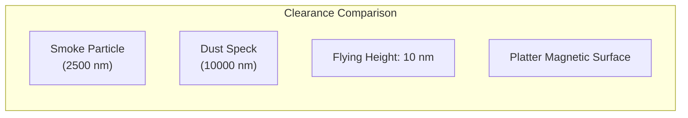
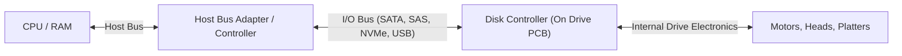
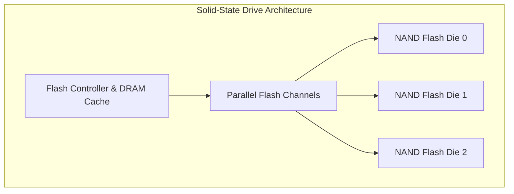

[OS Index](../README.md) / [Unit 4: Storage & Protection](Introduction.md)

---

Throughout our study of memory management and file systems, a single number has repeatedly dictated system behavior: roughly **5 to 10 milliseconds**.

In Unit 3, an 8 ms page fault latency forced virtual memory systems to employ complex page-replacement heuristics. In the earlier lectures of Unit 4, the cost of moving between disk blocks forced file systems into extent allocation, buffer caching, read-ahead, and block grouping.

Where does this multi-millisecond delay actually come from? 

It does not originate from software bugs or operating system overhead. It is a physical constraint of the physical universe: secondary storage media rely on mechanical motors, spinning platters, magnetic actuators, and electronic semiconductor gates.

In this lecture, we examine **Mass-Storage Structure**: the physical geometry of mechanical Hard Disk Drives (HDDs), the mathematical breakdown of **Disk Access Time**, physical failure modes like **Head Crashes**, device attachment buses, and modern non-volatile alternatives including **Solid-State Drives (SSDs)** and **Magnetic Tape**.

---

## Mechanical Hard Disk Drive (HDD) Geometry

A mechanical Hard Disk Drive stores binary data magnetically on circular spinning platters.

To understand how the operating system interacts with an HDD, we must establish its precise physical geometry:

Let us define the core geometric components:

### 1. Platters and Surfaces
- A hard drive contains one or more rigid aluminum, glass, or ceramic disks called **platters**, typically 2.5 or 3.5 inches in diameter.
- Both the top and bottom surfaces of each platter are coated with a microscopically thin magnetic recording layer. A drive with 4 platters possesses 8 magnetic recording surfaces.

### 2. Tracks and Sectors
- Each platter surface is logically organized into thousands of concentric rings called **Tracks**.
- Each track is subdivided into smaller geometric arcs called **Sectors**. A sector is the smallest physically addressable unit of read and write transfer on the disk (historically 512 bytes, now standard at 4 KB Advanced Format).

### 3. Read/Write Heads and the Actuator Assembly
- Data is read and written by tiny electromagnetic induction coils or magnetoresistive sensors called **Read/Write Heads**.
- Crucially, **all read/write heads are mounted on a single, rigid actuator arm assembly**.
- When the voice-coil actuator motor moves the arm, **every single head moves inward or outward simultaneously to the exact same radius**. You cannot move the head on platter 1 to the outer rim while keeping the head on platter 2 near the center.

### 4. Cylinders: The Fundamental Architectural Unit
Because all heads are mechanically linked to the same arm, the set of all tracks that reside at the exact same radial position across all platter surfaces is called a **Cylinder**.

Look at why the cylinder is the central organizing concept for operating systems:
- Moving the physical actuator arm to a new radial position requires moving mechanical mass. This takes **milliseconds**.
- Switching the active recording head from platter 1's surface to platter 2's surface is purely electronic: the disk controller simply toggles an internal transistor switch. This takes **microseconds**.

Therefore, once the drive head is positioned at a given cylinder, the drive can read every track across all platters in that cylinder **without moving the arm at all**. This explains why the Unix Fast File System (FFS) and modern Linux ext4 organize disk space into **Cylinder Groups**: keeping related files and metadata within the same cylinder eliminates mechanical arm travel.

---

## Disk Access Time Mechanics

Whenever an operating system requests a block of data from an HDD, the total elapsed time to fulfill the request is governed by three sequential physical phases:

$$\text{Total Access Time} = \text{Seek Time} + \text{Rotational Latency} + \text{Transfer Time}$$

Let us analyze each component quantitatively:

### 1. Seek Time
- **Definition:** The time required for the mechanical actuator motor to accelerate, travel, and settle the read/write head assembly directly over the target cylinder.
- **Typical Duration:** Ranges from 3 ms (track-to-track adjacent seeks) to 15 ms (full-stroke seeks from innermost to outermost cylinder). Average seek time on modern enterprise drives is roughly **4 to 9 milliseconds**.
- This is the single slowest component of the entire storage pipeline.

### 2. Rotational Latency
- **Definition:** Once the head is positioned over the correct cylinder track, the drive must wait for the platter to spin until the requested sector rotates directly underneath the flying head.
- **Average Rotational Latency Calculation:** On average, the requested sector is halfway around the circle from the head when the seek finishes. Therefore, the average rotational latency is exactly **the time required for half a revolution**:

$$\text{Rotational Speed} = \text{RPM} \text{ (Revolutions Per Minute)}$$
$$\text{Time for One Revolution} = \frac{60}{\text{RPM}} \text{ seconds}$$
$$\text{Average Rotational Latency} = \frac{1}{2} \times \left(\frac{60}{\text{RPM}}\right) = \frac{30}{\text{RPM}} \text{ seconds}$$

Let us compute this across common drive speeds:
- **5,400 RPM (Laptops / Bulk Storage):**
  $$\text{Latency} = \frac{30}{5400} = 0.00556 \text{ s} \approx 5.56\text{ ms}$$
- **7,200 RPM (Desktop / Standard Enterprise):**
  $$\text{Latency} = \frac{30}{7200} = 0.00417 \text{ s} \approx 4.17\text{ ms}$$
- **10,000 RPM (High-Performance Server):**
  $$\text{Latency} = \frac{30}{10000} = 0.003 \text{ s} = 3.00\text{ ms}$$
- **15,000 RPM (Ultra Enterprise SCSI):**
  $$\text{Latency} = \frac{30}{15000} = 0.002 \text{ s} = 2.00\text{ ms}$$

### 3. Transfer Time
- **Definition:** The time required to physically stream the magnetic bits off the spinning platter and transmit them across the controller bus to host RAM.
- **Calculation:**
  $$\text{Transfer Time} = \frac{\text{Data Size to Transfer}}{\text{Internal Drive Transfer Rate}}$$
- If a drive sustains a sequential media transfer rate of $100\text{ MB/s}$, reading a standard $4\text{ KB}$ block takes:
  $$\text{Transfer Time} = \frac{4096 \text{ bytes}}{100 \times 10^6 \text{ bytes/sec}} \approx 0.000041 \text{ seconds} \approx 0.041\text{ ms}$$

### The Stark Reality: 99% Mechanical Waste
Look at the sum for a 7,200 RPM drive performing a random read:
$$\text{Total Access Time} = 5.0\text{ ms (Seek)} + 4.17\text{ ms (Rotation)} + 0.041\text{ ms (Transfer)} \approx 9.21\text{ ms}$$

Notice that **over 99.5% of the total time is spent waiting on mechanical movement**, while less than 0.5% is spent actually reading data!

This explains why disk scheduling, buffer caching, contiguous allocation, and read-ahead are so critical in operating system design: every technique is an attempt to eliminate seek and rotational overhead.

---

## Physical Vulnerabilities: The Head Crash

A spinning hard disk is a marvel of microscopic precision.

The read/write head does not actually touch the platter. Instead, the rapid rotation of the platters (spinning at up to 100 km/h at the rim) drags a thin cushion of air along its surface. The head is shaped like an airfoil, generating aerodynamic lift that causes it to "fly" a mere **5 to 10 nanometers** above the magnetic surface.

To put 10 nanometers into perspective:
- A human hair is roughly $80,000\text{ nm}$ thick.
- A speck of dust is $10,000\text{ nm}$.
- A smoke particle is $2,500\text{ nm}$.
- A fingerprint smudge is $4,000\text{ nm}$.

If a particle of dust enters the sealed chamber, or if the drive experiences an external physical shock while spinning, the head crashes through the air cushion and collides directly with the spinning platter.

This catastrophic event is called a **Head Crash**:
- The flying head gouges deep circular grooves into the magnetic substrate at thousands of RPM.
- The magnetic film is scraped off into microscopic metallic dust, permanently destroying data and the read head itself.
- Head crashes are unrecoverable; the data on those sectors is destroyed forever.

---

## Host Attachment and Logical Block Addressing (LBA)

How does the CPU communicate with a mass-storage drive?

### The Controller Hierarchy
- **Host Controller (Host Bus Adapter - HBA):** Sits on the motherboard or PCIe bus (e.g., AHCI SATA controller, NVMe controller). Converts OS commands into bus signals.
- **Disk Controller:** A specialized embedded microcontroller built directly into the circuit board on the bottom of the hard drive. It manages the voice-coil motor, maintains head alignment, performs error-correction code (ECC) calculations, and manages an internal drive cache (typically 64 MB to 512 MB of onboard DRAM).

### Logical Block Addressing (LBA)
In ancient operating systems, the kernel had to know the drive's exact physical geometry: Cylinder number, Head number, and Sector number (CHS addressing).

Modern mass storage completely abstracts this via **Logical Block Addressing (LBA)**:
- The disk controller presents the drive to the operating system as a flat, simple, one-dimensional array of logical blocks:
  $$\text{Blocks } 0, 1, 2, 3, \dots, N-1$$
- The internal drive controller maps each logical block $k$ to a physical $\langle \text{cylinder, head, sector} \rangle$.
- This abstraction allows the drive controller to perform transparent internal optimizations:
  - **Defect Sector Remapping:** If physical sector 450 develops a magnetic defect, the controller automatically remaps that LBA to a spare sector set aside on a reserved track.
  - **Zone-Bit Recording (ZBR):** Outer tracks have larger circumferences than inner tracks. Modern drives pack more sectors onto outer tracks than inner tracks. LBA completely hides this varying sector density from the OS.

---

## Solid-State Disks (SSDs)

Over the past decade, semiconductor non-volatile memory has challenged mechanical HDDs: the **Solid-State Disk (SSD)**.

An SSD contains zero moving mechanical parts. It is constructed from a high-speed embedded flash controller and arrays of **NAND Flash Memory** chips.

### Flash Memory Mechanics: Pages vs. Blocks
Flash memory does not operate like RAM or spinning magnetic sectors. It has unique semiconductor physics:
- **Flash Pages:** Data is read and written in units called **Pages** (typically 4 KB to 16 KB).
- **Flash Blocks:** Flash pages are grouped into large **Erase Blocks** (typically 128 to 512 pages, spanning 2 MB to 8 MB).
- **The Erase-Before-Write Rule:** Once a flash cell has been written, it cannot be overwritten in place. To write new data to an existing page, **the entire surrounding multi-megabyte block must be erased first**!

### The Flash Translation Layer (FTL) and Wear Leveling
Because erasing blocks is slow and NAND flash cells degrade after a finite number of write/erase cycles (typically 1,000 to 10,000 cycles for TLC/QLC flash), the SSD controller runs a sophisticated embedded operating system called the **Flash Translation Layer (FTL)**:
- **Out-of-Place Writes:** When the OS overwrites an existing LBA, the FTL writes the new data to a completely different, pre-erased page and marks the old page as "invalid/stale."
- **Garbage Collection:** In the background, the FTL sweeps through blocks, copies valid pages to new blocks, and erases the old blocks to replenish the free block pool.
- **Wear Leveling:** The FTL dynamically distributes writes evenly across every physical block on the drive, preventing any single block from prematurely burning out.

### Performance Profile: No Moving Parts
Because there is no arm to move and no platter to spin:
- $\text{Seek Time} = 0$
- $\text{Rotational Latency} = 0$
- Typical random read latency is **10 to 100 microseconds** ($0.01 - 0.1\text{ ms}$), compared to $9\text{ ms}$ on an HDD—roughly **100 times faster**!
- To harness this semiconductor speed without the bottlenecks of legacy SATA controllers, modern SSDs interface directly with the CPU via PCIe using the **NVMe (Non-Volatile Memory Express)** protocol.

---

## Magnetic Tape

The oldest surviving mass-storage medium is **Magnetic Tape**.

A tape drive winds a long, thin plastic ribbon coated with magnetic material across a stationary read/write head, much like a traditional audio cassette.

### Why Tape Still Dominates Cold Archival Storage
To a modern software developer, magnetic tape sounds obsolete. Random access on a tape is abysmal: seeking a record halfway through a 1,000-meter tape cartridge requires physically spooling the tape for 30 to 120 seconds. Random access is roughly **1,000 to 10,000 times slower** than a hard disk!

Yet every major hyperscale cloud provider (Google, AWS, Microsoft) stores exabytes of data on magnetic tape. Why?

1. **Ultra-Low Cost per Terabyte:** Tape cartridges (such as LTO-9) provide 18 TB of uncompressed storage (up to 45 TB compressed) at a tiny fraction of the cost per terabyte of hard drives or SSDs.
2. **Massive Density:** Robotic tape libraries house tens of thousands of cartridges in standard server racks, storing petabytes per square foot.
3. **Exceptional Shelf Longevity:** An HDD sitting on a shelf unpowered may suffer bearing seizure or magnetic flux leakage after 5 to 7 years. Magnetic tape stored in a climate-controlled room is rated for **30+ years of archival stability**.
4. **Zero Idle Power Consumption:** When a tape cartridge sits in a library slot or on a shelf, it consumes zero watts of electricity. A million idle hard drives consume megawatts of power continuously.
5. **Air-Gapped Ransomware Immunity:** An unmounted tape sitting on a physical shelf cannot be reached, encrypted, or wiped over an IP network by malware or ransomware.

---

## The Mass Storage Trade-Off Matrix

No single storage technology wins across every dimension. Each technology trades latency against cost and capacity:

| Storage Medium | Typical Random Latency | Sustained Throughput | Cost per TB | Typical Application |
| :--- | :--- | :--- | :--- | :--- |
| **NVMe SSD** | $10 - 100 \ \mu\text{s}$ | $3,000 - 7,000\text{ MB/s}$ | High | OS root, active databases, low-latency caches |
| **SATA HDD** | $5 - 15\text{ ms}$ | $150 - 250\text{ MB/s}$ | Low | Bulk secondary storage, NAS, video streaming |
| **Magnetic Tape (LTO)** | $10 - 120\text{ s}$ | $300 - 400\text{ MB/s}$ | Ultra-Low | Long-term archival, disaster recovery, cold backup |

---

## Key Takeaways

- Mechanical hard drives consist of spinning **platters** divided into concentric **tracks** and subdivided into **sectors** (typically 4 KB).
- All read/write heads are fixed to a single actuator arm assembly. A **cylinder** represents all tracks at the same radial position across all platter surfaces. Switching tracks within a cylinder is microsecond electronic switching; moving between cylinders is millisecond mechanical motion.
- **Disk Access Time** is the sum of three terms:
  $$\text{Access Time} = \text{Seek Time} + \text{Rotational Latency} + \text{Transfer Time}$$
- Average rotational latency is the time for half a platter revolution:
  $$\text{Average Rotational Latency} = \frac{30}{\text{RPM}} \text{ seconds}$$
  (e.g., $4.17\text{ ms}$ at 7,200 RPM).
- Over $99\%$ of mechanical disk access time is spent waiting on seek and rotational motion; the electronic transfer time is negligible.
- A **Head Crash** occurs when the flying head collides with the magnetic platter surface at nanometer tolerances, permanently destroying data.
- **Logical Block Addressing (LBA)** abstracts the underlying geometry into a flat 1D array of numbered blocks, allowing drive controllers to remap bad sectors and implement zone-bit recording transparently.
- **Solid-State Drives (SSDs)** eliminate mechanical seeks and rotational latency entirely ($10 - 100\ \mu\text{s}$ access), but require block erasures before page writes and depend on the Flash Translation Layer (FTL) for wear leveling.
- **Magnetic Tape** offers terrible random access (tens of seconds), but remains unbeatable for long-term cold archives due to low cost, 30-year shelf life, zero idle power, and physical air-gap protection.

---

Now that we know the mechanical reality of hard disks—specifically that seek time is the dominant performance bottleneck—a critical operating system scheduling problem emerges: when multiple processes issue I/O requests for blocks scattered across different cylinders, in what order should the disk controller service them? In the next lecture, we analyze [**L08 - Disk Scheduling**](L08%20-%20Disk%20Scheduling.md), tracing **FCFS**, **SSTF**, **SCAN**, **C-SCAN**, **LOOK**, and **C-LOOK** with step-by-step head movement calculations.
