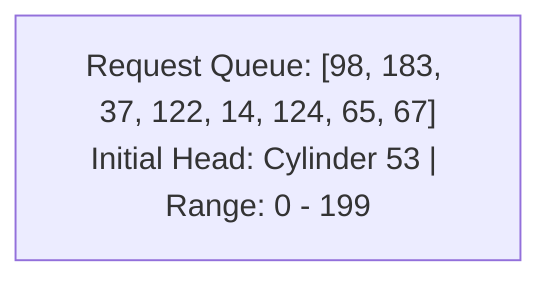
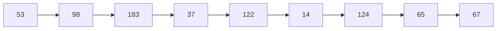
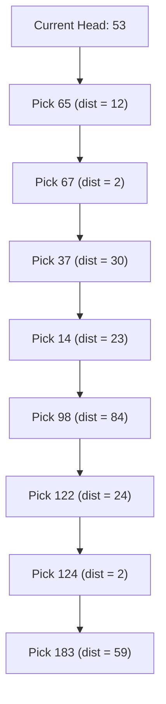
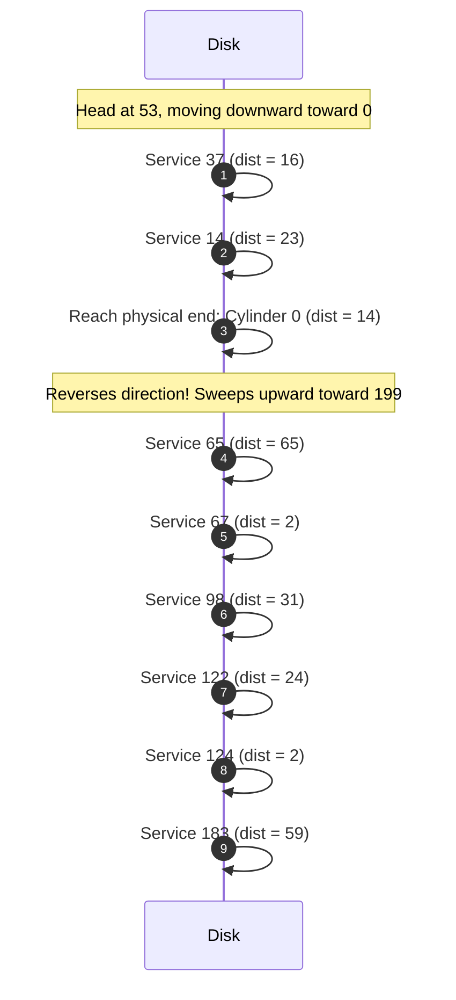
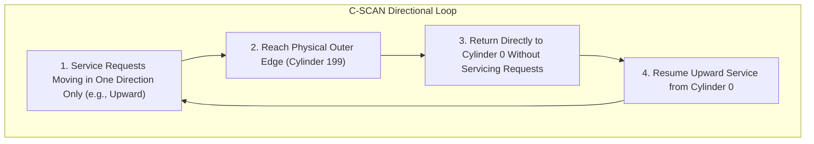
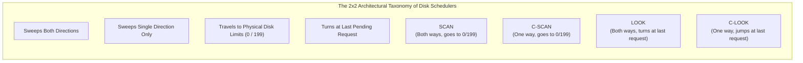

[OS Index](../README.md) / [Unit 4: Storage & Protection](Introduction.md)

---

In the previous lecture, we established the physical access formula that governs mechanical storage:

$$\text{Total Access Time} = \text{Seek Time} + \text{Rotational Latency} + \text{Transfer Time}$$

Notice something fundamental about these three components:
- **Rotational Latency** is determined entirely by the physical spindle motor (e.g., 7,200 RPM). The operating system cannot command the platter to spin faster.
- **Transfer Time** is fixed by the magnetic recording density and interface bus bandwidth.
- **Seek Time**, however, depends entirely on the distance the actuator arm travels across cylinders. 

This gives the operating system its single degree of freedom: when multiple processes generate competing read and write requests for blocks scattered across different cylinders, **the order in which the operating system services those requests dictates the total seek time**.

If we serve requests naively, the disk head will thrash back and forth across platters, wasting dozens of milliseconds per operation. If we schedule requests intelligently, we can dramatically increase **Disk Bandwidth**:

$$\text{Disk Bandwidth} = \frac{\text{Total Number of Bytes Transferred}}{\text{Total Elapsed Time between First Request and Last Transfer Completion}}$$

In this lecture, we analyze the classical **Disk Scheduling Algorithms**: **FCFS**, **SSTF**, **SCAN (Elevator)**, **C-SCAN**, and **LOOK / C-LOOK**. We trace every algorithm using the canonical benchmark queue, calculate exact head movement step-by-step, and examine why each algorithm was invented to fix the flaws of its predecessor.

---

## The Canonical Benchmark Problem

To evaluate and compare disk scheduling algorithms fairly, operating system textbooks and university examinations evaluate them on the standard benchmark scenario:

- **Disk Cylinders:** Numbered from $0$ to $199$ (total of 200 cylinders).
- **Initial Head Position:** Currently resting at cylinder **53**.
- **Pending Request Queue:**
  $$\{98, \; 183, \; 37, \; 122, \; 14, \; 124, \; 65, \; 67\}$$

We will track the exact sequence of head visits and compute the **Total Head Movement** (measured in total cylinders traversed) for every algorithm.

---

## 1. First-Come, First-Served (FCFS) Scheduling

The simplest scheduling strategy is **First-Come, First-Served (FCFS)**. The disk controller maintains a standard FIFO queue and services requests strictly in the order they arrive:

$$\text{Order of Service: } 53 \longrightarrow 98 \longrightarrow 183 \longrightarrow 37 \longrightarrow 122 \longrightarrow 14 \longrightarrow 124 \longrightarrow 65 \longrightarrow 67$$

### Step-by-Step Calculation of Head Movement
Let us calculate the absolute distance traveled for each individual seek:

| Movement Step | Cylinders Traversed | Arithmetic |
| :--- | :--- | :--- |
| $53 \to 98$ | $|98 - 53|$ | $45$ |
| $98 \to 183$ | $|183 - 98|$ | $85$ |
| $183 \to 37$ | $|37 - 183|$ | $146$ |
| $37 \to 122$ | $|122 - 37|$ | $85$ |
| $122 \to 14$ | $|14 - 122|$ | $108$ |
| $14 \to 124$ | $|124 - 14|$ | $110$ |
| $124 \to 65$ | $|65 - 124|$ | $59$ |
| $65 \to 67$ | $|67 - 65|$ | $2$ |
| **Total Movement** | | **640 Cylinders** |

### Critical Analysis of FCFS
- **Advantage:** Intrinsically fair. Every request is guaranteed to be serviced in arrival order; zero possibility of starvation.
- **The Fatal Flaw:** Total head movement is a catastrophic **640 cylinders**. Look at the thrashing: the arm moves out to 183, sweeps all the way back to 37, swings out to 122, sweeps back to 14, and swings out to 124. The arm spends almost all its time traveling across the entire width of the disk, delivering abysmal throughput.

---

## 2. Shortest Seek Time First (SSTF) Scheduling

To eliminate the wild thrashing of FCFS, **Shortest Seek Time First (SSTF)** adopts a greedy strategy:

From the current head position, the disk controller always selects the pending request that requires the **minimum seek distance**, regardless of arrival time.

Notice the parallel with CPU scheduling: SSTF is the exact mass-storage equivalent of **Shortest Job First (SJF)**.

### Trace and Arithmetic
Let us trace each greedy decision:
1. At **53**, pending are $\{14, 37, 65, 67, 98, 122, 124, 183\}$. Closest is **65** ($|65-53| = 12$).
2. At **65**, closest is **67** ($|67-65| = 2$).
3. At **67**, pending are $\{14, 37, 98, 122, 124, 183\}$. Distance to $37$ is $30$; distance to $98$ is $31$. Closest is **37** ($|37-67| = 30$).
4. At **37**, closest is **14** ($|14-37| = 23$).
5. At **14**, only $\{98, 122, 124, 183\}$ remain. Closest is **98** ($|98-14| = 84$).
6. At **98**, closest is **122** ($|122-98| = 24$).
7. At **122**, closest is **124** ($|124-122| = 2$).
8. At **124**, only **183** remains ($|183-124| = 59$).

$$\text{Order of Service: } 53 \to 65 \to 67 \to 37 \to 14 \to 98 \to 122 \to 124 \to 183$$

$$\text{Total Movement} = 12 + 2 + 30 + 23 + 84 + 24 + 2 + 59 = \mathbf{236 \text{ Cylinders}}$$

### Critical Analysis of SSTF
- **Performance:** Head movement drops from 640 down to **236 cylinders**—a dramatic $63\%$ reduction in mechanical travel!
- **The Fatal Flaw: Starvation.** Just as SJF starves long CPU bursts, SSTF starves requests at distant cylinders. If processes continuously submit I/O requests for cylinders near 50 to 70, the head will stay in that cluster forever, and requests waiting at cylinder 183 will **starve indefinitely**.
- Because spatial locality is common in workloads, SSTF is rarely used in raw form in general-purpose operating systems.

---

## 3. SCAN (The Elevator Algorithm)

To eliminate starvation while preserving high mechanical efficiency, Harold Lorin developed the **SCAN** algorithm, commonly called the **Elevator Algorithm**.

Think about how a skyscraper elevator works:
- It does not chase the nearest passenger back and forth between floors 2 and 4.
- It moves continuously in one direction (e.g., upward), servicing all floor calls in its path until it reaches the top floor.
- Then it reverses direction and sweeps downward, servicing all calls on the way down.

### Operating Mechanics
Under SCAN:
1. The disk head starts at its current position and moves in a chosen direction (say, toward cylinder 0).
2. It services all requests encountered along the way.
3. **When it reaches the physical edge of the disk (cylinder 0)**, it reverses direction.
4. It sweeps all the way back across the disk toward cylinder 199, servicing requests encountered on the return stroke.

### Trace and Arithmetic (Assuming Head Moves Toward 0 First)
$$\text{Service Order: } 53 \longrightarrow 37 \longrightarrow 14 \longrightarrow \mathbf{0} \longrightarrow 65 \longrightarrow 67 \longrightarrow 98 \longrightarrow 122 \longrightarrow 124 \longrightarrow 183$$

Let us compute the total head movement:
$$\text{Downward Stroke (53 to 0): } (53 - 37) + (37 - 14) + (14 - 0) = 53 - 0 = 53$$
$$\text{Upward Stroke (0 to 183): } (65 - 0) + (67 - 65) + \dots + (183 - 124) = 183 - 0 = 183$$
$$\text{Total Movement} = 53 + 183 = \mathbf{236 \text{ Cylinders}}$$

*(Note: If the problem states the head initially moves toward 199, the arm sweeps to 199 first, then reverses down to 14, giving $(199 - 53) + (199 - 14) = 146 + 185 = 331$ cylinders. Always specify the initial direction!)*

### Analysis of SCAN
- **Starvation-Free:** No request can be bypassed indefinitely. The maximum waiting time for any request is bounded by exactly one full round-trip sweep of the disk.
- **The Subtle Inequity of SCAN:** Notice that SCAN does not provide uniform waiting times:
  - When the arm reaches cylinder 0 and reverses upward, the cylinders just ahead of it (e.g., 10, 20) have very few pending requests because they were just serviced moments ago.
  - The cylinders at the far end of the disk (e.g., 180, 190) have been waiting the longest.
  - Furthermore, cylinders in the middle of the platter are visited **twice per round trip** (once going down, once going up), while edge cylinders (near 0 and 199) are visited only **once per round trip**. This systematically favors middle cylinders over edges.

---

## 4. Circular SCAN (C-SCAN) Scheduling

To provide completely **uniform waiting times** across all cylinders, **Circular SCAN (C-SCAN)** treats the disk as if the cylinders were wrapped into a continuous circle:

### Operating Mechanics
1. The head moves in **one single direction only** (conventionally upward, toward cylinder 199), servicing all requests in its path.
2. When it reaches the end of the disk (cylinder 199), it **immediately returns to cylinder 0 without servicing any requests along the return trip**.
3. Once back at cylinder 0, it resumes its upward servicing sweep.

### Trace and Arithmetic (Assuming Initial Direction Toward 199)
Pending requests: $\{14, 37, 65, 67, 98, 122, 124, 183\}$. Head starts at 53.
1. Moving upward: services $65 \to 67 \to 98 \to 122 \to 124 \to 183$.
2. Sweeps to the physical edge: reaches cylinder **199**.
3. **The Return Jump:** Flies directly from **199 back to 0** (no requests serviced).
4. Moving upward from 0: services $14 \to 37$.

$$\text{Service Order: } 53 \to 65 \to 67 \to 98 \to 122 \to 124 \to 183 \to \mathbf{199} \to \mathbf{0} \to 14 \to 37$$

$$\text{Upward Stroke to Edge: } 199 - 53 = 146$$
$$\text{Return Jump: } 199 - 0 = 199$$
$$\text{Upward Stroke from Zero: } 37 - 0 = 37$$
$$\text{Total Head Movement} = 146 + 199 + 37 = \mathbf{382 \text{ Cylinders}}$$

### Why C-SCAN Deliberately "Wastes" Head Movement
At first glance, 382 cylinders looks worse than SCAN's 236 cylinders. Why would an operating system choose C-SCAN?
- **Uniformity of Waiting Time:** Under C-SCAN, every single cylinder in the disk experiences the exact same periodic servicing interval.
- **Physics of the Long Seek:** Notice that 199 cylinders of that total ($52\%$) are traversed in a single unbroken return stroke. Because the disk controller is not stopping to settle and read data on the return trip, the actuator motor accelerates to maximum velocity. A single 199-cylinder stroke takes far less time in milliseconds than ten short stop-and-go seeks across the same distance!

---

## 5. LOOK and C-LOOK Scheduling

Both SCAN and C-SCAN share an obvious practical inefficiency:
**Why force the arm to travel all the way to the physical boundary (cylinder 0 or 199) if there are no pending requests waiting at the edge?**

In our example, the lowest pending request is at cylinder 14, and the highest is at cylinder 183. Forcing SCAN to travel from 14 to 0, or forcing C-SCAN to travel from 183 to 199 and then jump to 0, wastes time traveling over empty tracks!

**LOOK** and **C-LOOK** fix this by simply looking ahead:
- The head travels only as far as the **final pending request** in the current direction.
- As soon as there are no more requests ahead, it immediately reverses (LOOK) or jumps back (C-LOOK).

### LOOK Algorithm Trace (Assuming Initial Direction Toward 0)
1. Head starts at 53 and moves downward: services $37$, then $14$.
2. It looks ahead: no requests exist below 14! It does **not** travel to 0. It immediately reverses direction at 14.
3. It sweeps upward: services $65 \to 67 \to 98 \to 122 \to 124 \to 183$.
4. At 183, no higher requests exist. It stops.

$$\text{Order of Service: } 53 \longrightarrow 37 \longrightarrow 14 \longrightarrow 65 \longrightarrow 67 \longrightarrow 98 \longrightarrow 122 \longrightarrow 124 \longrightarrow 183$$

$$\text{Downward Travel: } 53 - 14 = 39$$
$$\text{Upward Travel: } 183 - 14 = 169$$
$$\text{Total Head Movement} = 39 + 169 = \mathbf{208 \text{ Cylinders}}$$

Notice that **208 cylinders is the theoretical minimum possible movement** for this entire queue—even better than greedy SSTF (236), and completely starvation-free!

### C-LOOK Algorithm Trace (Assuming Initial Direction Toward 199)
1. Head starts at 53 and sweeps upward: services $65 \to 67 \to 98 \to 122 \to 124 \to 183$.
2. At 183, no higher requests exist. It does **not** travel to 199.
3. It jumps back directly to the **lowest pending request: cylinder 14** (it does **not** jump to 0).
4. It sweeps upward from 14: services $14 \to 37$.

$$\text{Order of Service: } 53 \to 65 \to 67 \to 98 \to 122 \to 124 \to 183 \longrightarrow 14 \to 37$$

$$\text{Upward Stroke to Highest Request: } 183 - 53 = 130$$
$$\text{Return Jump to Lowest Request: } 183 - 14 = 169$$
$$\text{Upward Stroke to Remaining Requests: } 37 - 14 = 23$$
$$\text{Total Head Movement} = 130 + 169 + 23 = \mathbf{322 \text{ Cylinders}}$$

---

## Master Comparison of Disk Scheduling Algorithms

Let us summarize all five algorithms evaluated on the canonical benchmark queue ($53 \to [98, 183, 37, 122, 14, 124, 65, 67]$):

| Algorithm | Decision Rule | Total Head Movement | Starvation? | Waiting Time Distribution | Real-World Application |
| :--- | :--- | :--- | :--- | :--- | :--- |
| **FCFS** | Strict arrival order | **640** | No | Fair, predictable, poor throughput | Baseline, light workloads |
| **SSTF** | Greedy: nearest cylinder | **236** | **Yes** | Low average, unbounded worst-case | Rarely used raw (starvation risk) |
| **SCAN** | Sweeps both ways to 0 and 199 | **236** ($\downarrow$ first) / 331 ($\uparrow$) | No | Bounded, but favors middle cylinders | Traditional elevator schedulers |
| **C-SCAN** | Sweeps upward to 199, jumps to 0 | **382** ($\uparrow$ first) | No | Highly uniform across all cylinders | Heavy concurrent multi-user servers |
| **LOOK** | Sweeps both ways, turns at last request | **208** ($\downarrow$ first) / 299 ($\uparrow$) | No | Bounded, optimal for single sweeps | High-performance disk schedulers |
| **C-LOOK** | Sweeps upward, jumps to lowest request | **322** ($\uparrow$ first) | No | Highly uniform, eliminates edge waste | Production Linux I/O schedulers |

### Disk Scheduling in the Modern Era: SSDs vs. HDDs
Do these algorithms matter on Solid-State Drives?
- On an SSD, $\text{Seek Time} = 0$. Whether the SSD reads LBA 14 or LBA 183, the semiconductor access latency is identical ($10 - 50\ \mu\text{s}$).
- Therefore, mechanical elevator algorithms like SCAN and LOOK provide **zero seek reduction on flash memory**.
- Modern Linux kernels use schedulers like **None** or **Kyber** for NVMe SSDs, prioritizing parallelism across hardware queues and enforcing low read latency deadlines rather than cylinder sorting.

---

## Key Takeaways

- Seek time is the only mechanical delay that operating system software can optimize by reordering I/O requests.
- **FCFS** is intrinsically fair and avoids starvation, but produces severe arm thrashing (640 cylinders on benchmark).
- **SSTF** is a greedy strategy that dramatically reduces head movement (236 cylinders), but causes indefinite starvation for distant requests under heavy loads.
- **SCAN** sweeps back and forth like an elevator to the physical disk limits (0 and 199), bounding wait time and preventing starvation, but visits middle cylinders twice as often as edges.
- **C-SCAN** sweeps in one direction to cylinder 199 and jumps back to 0 without servicing requests, delivering uniform waiting times across all cylinders.
- **LOOK** and **C-LOOK** optimize SCAN and C-SCAN by reversing or jumping at the **outermost pending requests** rather than traveling to empty physical disk boundaries (LOOK achieves the theoretical minimum of 208 cylinders on our benchmark).
- Modern mechanical disk schedulers are based on C-LOOK with request deadlines, while SSDs dispense with cylinder sorting entirely.

---

We have now conquered both the logical design of file systems and the mechanical scheduling of single physical disks. But this reveals a catastrophic vulnerability: what happens when a mechanical drive suffers a head crash, or an SSD controller burns out? Everything on that single drive is obliterated. How can an operating system combine multiple physical disks into an array that not only survives hardware failure, but delivers multiplied throughput? In the next lecture, we analyze [**L09 - RAID**](L09%20-%20RAID.md), examining mirroring, data striping, and bit-level parity across RAID levels 0 through 6.
