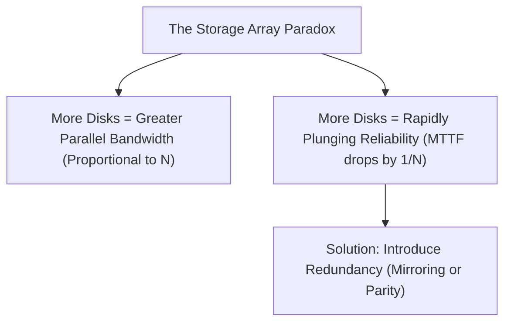
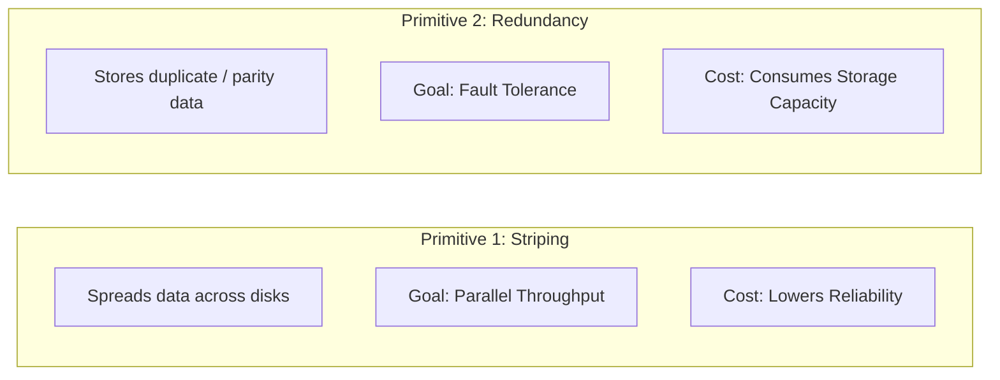
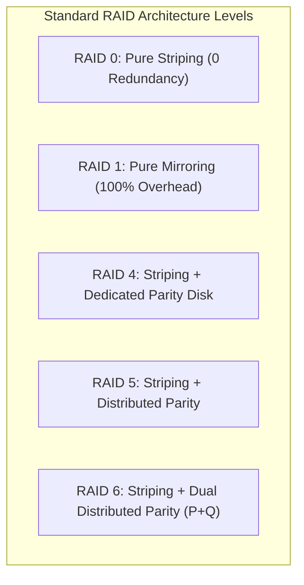
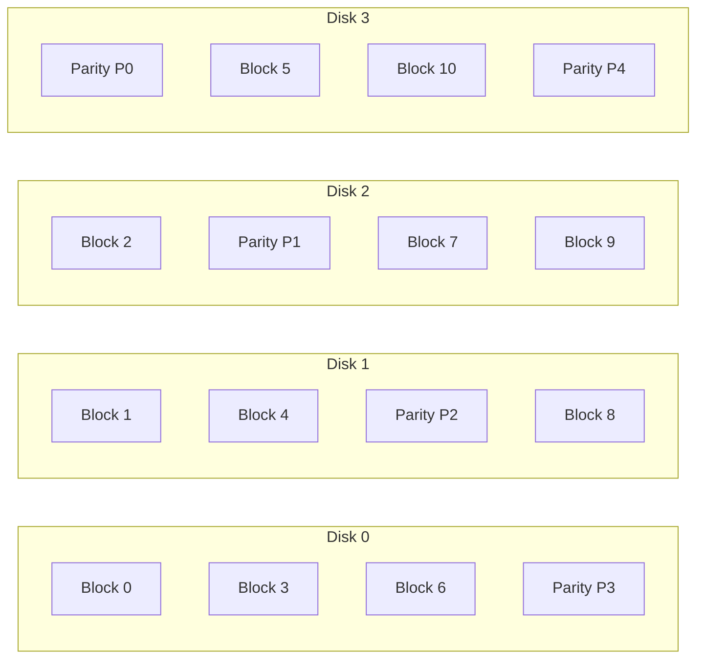
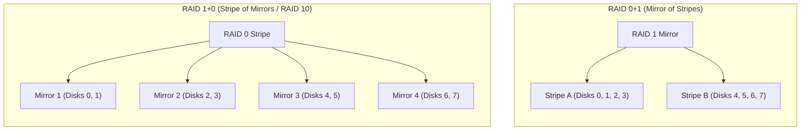

[OS Index](../README.md) / [Unit 4: Storage & Protection](Introduction.md)

---

In the previous lectures, we optimized the file system, disk geometry, and request scheduling to squeeze maximum performance out of storage hardware. But all of those optimizations quietly rested on a terrifying assumption:

We assumed the physical storage drive never breaks.

As we saw when analyzing mechanical hard drives, a read/write head flying nanometers above a platter spinning at 7,200 RPM is vulnerable to microscopic dust, vibration, mechanical fatigue, and thermal expansion. When an HDD suffers a head crash or an SSD flash controller burns out, the drive does not fail gracefully—it fails completely and permanently.

If an enterprise server relies on a single storage drive, that drive is an unacceptable single point of failure.

Can we combine multiple inexpensive, fallible physical disks into an organized array such that the entire array is **vastly more reliable than any individual drive**, while simultaneously multiplying read and write throughput?

The answer, introduced in a landmark 1988 UC Berkeley paper by David Patterson, Garth Gibson, and Randy Katz, is **RAID** (**Redundant Array of Independent Disks**, originally *Inexpensive Disks*). In this lecture, we examine the mathematical foundations of RAID reliability, the two foundational primitives (**Striping** and **Redundancy**), the classical **RAID Levels 0, 1, 4, 5, and 6**, and the architectural superiority of **RAID 10 over RAID 0+1**.

---

## The Reliability vs. Performance Paradox

To understand why RAID is necessary, let us look at the mathematics of combining multiple disks without redundancy.

Suppose an enterprise database requires 100 terabytes of storage. Rather than buying a single gigantic custom drive, the administrator connects 100 standard 1 TB drives together.

Suppose each individual disk has a **Mean Time To Failure (MTTF)** of $100,000\text{ hours}$ (roughly 11.4 years of continuous spinning):
- For a single disk, an 11-year lifespan sounds reliable.
- But in an array of $N = 100$ independent disks with no redundancy, the array fails whenever **any one single drive fails**!

Assuming independent exponential failure rates, the failure rate of the array is the sum of the individual failure rates:
$$\lambda_{\text{array}} = \sum_{i=1}^{N} \lambda_{\text{disk}} = N \times \lambda_{\text{disk}}$$
$$\text{MTTF}_{\text{array}} = \frac{\text{MTTF}_{\text{disk}}}{N} = \frac{100,000 \text{ hours}}{100} = 1,000 \text{ hours} \approx \mathbf{41.66 \text{ days}}$$

A 100-disk array without redundancy will suffer complete catastrophic data loss **every 6 weeks**!

To resolve this paradox, RAID introduces **Redundancy**. If a single drive dies, the missing data is either read from an exact duplicate mirror or reconstructed algorithmically from mathematical parity bits.

When redundant data exists, data loss occurs only if a *second* disk dies before the failed first disk can be replaced and reconstructed. If the **Mean Time To Repair (MTTR)**—the time to swap the dead drive and rebuild its contents—is 10 hours, the **Mean Time To Data Loss (MTTDL)** of a mirrored pair becomes:

$$\text{MTTDL} = \frac{\text{MTTF}_{\text{disk}}^2}{2 \times \text{MTTR}} = \frac{(100,000)^2}{2 \times 10} = \frac{10^{10}}{20} = 500,000,000 \text{ hours} \approx \mathbf{57,000 \text{ years!}}$$

By pairing striping with redundancy, we turn an array of cheap, fragile disks into a fault-tolerant storage system that outlives its physical components.

---

## The Two Foundational Primitives of RAID

Every RAID level in existence is simply an engineering recipe combining two fundamental primitives:

### 1. Data Striping (The Speed Multiplier)
Instead of filling disk 0 completely before touching disk 1, the controller partitions the logical address space into fixed-size chunks called **stripe units** (typically 64 KB to 512 KB) and interleaves them round-robin across all $n$ drives.

In **Block-Level Striping**:
$$\text{Logical Block } b \text{ is mapped to: } \text{Disk } (b \bmod n) \text{ at Block Offset } \lfloor b / n \rfloor$$

If you have 4 disks:
- Disk 0 stores blocks $0, 4, 8, 12, \dots$
- Disk 1 stores blocks $1, 5, 9, 13, \dots$
- Disk 2 stores blocks $2, 6, 10, 14, \dots$
- Disk 3 stores blocks $3, 7, 11, 15, \dots$

**Why Striping Multiplies Performance:**
- **Transfer Throughput:** A large 256 KB read is divided into four 64 KB reads issued simultaneously across 4 independent disk buses. Total transfer time drops by a factor of 4.
- **Concurrent Seeks:** Multiple independent processes accessing different files can be serviced simultaneously by different physical drive heads.

### 2. Redundancy: Mirroring vs. Parity
To protect against failure, RAID uses two redundancy mechanisms:
1. **Mirroring (Shadowing):** Maintaining two identical physical copies of every block on separate drives.
   - *Advantage:* Simple, zero CPU compute overhead, blazing read speeds (can read from either copy).
   - *Cost:* Exactly $50\%$ usable capacity; doubling drive hardware costs.
2. **Parity (XOR Coding):** Calculating the bitwise exclusive-OR ($\oplus$) of corresponding data blocks across $n-1$ disks and writing the result to a parity block.
   - *Advantage:* Highly space-efficient; only 1 drive's worth of capacity is dedicated to redundancy regardless of array size.
   - *Cost:* Requires CPU/controller parity calculation and incurs a write performance penalty.

### The XOR Parity Reconstruction Engine
Recall the truth table and algebraic properties of XOR:
$$0 \oplus 0 = 0, \quad 0 \oplus 1 = 1, \quad 1 \oplus 0 = 1, \quad 1 \oplus 1 = 0$$
$$\text{Property: } A \oplus A = 0, \quad A \oplus 0 = A$$

Suppose we have 3 data disks ($D_1, D_2, D_3$) and 1 parity disk ($P$):
$$P = D_1 \oplus D_2 \oplus D_3$$

Now suppose Disk 2 physically crashes and its data is lost. How does RAID recover $D_2$?
The controller reads the surviving data disks ($D_1, D_3$) and the parity disk ($P$), and simply XORs them together:
$$D_2 = P \oplus D_1 \oplus D_3$$

Let us verify with binary bits:
- Let $D_1 = 1$, $D_2 = 0$, $D_3 = 1$.
- Parity bit: $P = 1 \oplus 0 \oplus 1 = 0$.
- Disk 2 is obliterated. To rebuild $D_2$:
  $$D_2 = P \oplus D_1 \oplus D_3 = 0 \oplus 1 \oplus 1 = 0$$
The lost bit is recovered with mathematical certainty!

---

## Detailed Analysis of Standard RAID Levels

### RAID 0: Non-Redundant Striping
- **Structure:** Blocks are striped round-robin across $n$ disks. Zero parity, zero mirroring.
- **Usable Capacity:** $n \times C$ ($100\%$ capacity utilization).
- **Fault Tolerance:** **0 disk failures.** A single disk failure destroys the entire array and all data.
- **Use Case:** High-performance temporary scratch disks, video rendering caches, scientific HPC temp files where speed is everything and data loss is tolerable.

### RAID 1: Mirrored Disks
- **Structure:** Every disk has an exact duplicate mirror clone. For an array of $n$ disks, there are $n/2$ mirrored pairs.
- **Usable Capacity:** $\frac{n}{2} \times C$ ($50\%$ capacity utilization).
- **Fault Tolerance:** Survives at least 1 disk failure per mirrored pair. In an 8-disk system, it can survive up to 4 simultaneous failures if every failure occurs in a different pair.
- **Performance:** Read requests can load-balance across both mirrors (doubling read IOPS). Write requests must write to both physical drives, but both writes execute in parallel.
- **Use Case:** Operating system boot partitions, high-value transaction log volumes.

### RAID 4: Block-Level Striping with Dedicated Parity Disk
- **Structure:** Blocks are striped across $n-1$ data disks, while disk $n$ is dedicated exclusively to storing parity blocks.
- **Usable Capacity:** $(n - 1) \times C$.
- **Fault Tolerance:** Survives exactly 1 disk failure.
- **The Parity Disk Bottleneck:** RAID 4 is almost never used in modern general-purpose storage due to a fatal performance flaw:
  - Every single write to *any* data disk requires updating the parity block.
  - Because all parity blocks reside on a single physical disk, **that dedicated parity disk must participate in every single write across the entire array**!
  - The parity disk's actuator arm thrashes incessantly, bottlenecking the write performance of the entire system to that of a single drive.

### RAID 5: Block-Level Striping with Distributed Parity
RAID 5 solves RAID 4's bottleneck with an ingenious insight: **distribute the parity blocks evenly across all disks in the array**.

- **Structure:** Parity rotates round-robin across all disks. For row 0, Disk 3 holds parity; for row 1, Disk 2 holds parity; for row 2, Disk 1 holds parity; for row 3, Disk 0 holds parity.
- **Usable Capacity:** $(n - 1) \times C$.
- **Fault Tolerance:** Survives 1 disk failure.
- **Elimination of Bottleneck:** Because parity is evenly distributed, concurrent writes to different blocks touch different parity drives in parallel.

#### The RAID 5 "Small Write" Penalty (Read-Modify-Write)
When an application modifies a single 4 KB block ($D_{\text{new}}$), how does RAID 5 update the corresponding parity block without having to read all the other $n-2$ data blocks?

It uses the **Read-Modify-Write** equation:
$$P_{\text{new}} = P_{\text{old}} \oplus D_{\text{old}} \oplus D_{\text{new}}$$

Notice what physical I/O operations must occur to update one single block:
1. **Read** the existing data block from disk ($D_{\text{old}}$).
2. **Read** the existing parity block from disk ($P_{\text{old}}$).
3. Compute $P_{\text{new}} = P_{\text{old}} \oplus D_{\text{old}} \oplus D_{\text{new}}$ in RAM.
4. **Write** the updated data block to disk ($D_{\text{new}}$).
5. **Write** the updated parity block to disk ($P_{\text{new}}$).

$$\text{Every single small write in RAID 5 requires } \mathbf{4 \text{ Physical I/O Operations}} \text{ (2 Reads + 2 Writes)!}$$

This $4\times$ write amplification makes RAID 5 suboptimal for write-intensive transactional databases unless backed by battery-backed NVRAM write caches.

### RAID 6: Dual Distributed Parity ($P + Q$ Redundancy)
In the 1990s, when hard drives were 9 GB, rebuilding a failed disk under RAID 5 took 30 minutes. Today, enterprise hard drives are 18 TB to 22 TB. Rebuilding an 18 TB drive over a busy storage bus takes **24 to 48 hours**.

During that 48-hour rebuild window:
- All surviving drives are under continuous, maximum read load.
- If a single sector develops an Unrecoverable Read Error (URE), or if a second drive dies from thermal stress, **the entire RAID 5 array is lost**.

**RAID 6** was designed specifically to survive this window:
- **Structure:** Stores **two independent mathematical parity syndromes** ($P$ and $Q$) distributed across all drives. $P$ is standard XOR parity; $Q$ is an independent Reed-Solomon polynomial or Galois Field code.
- **Usable Capacity:** $(n - 2) \times C$.
- **Fault Tolerance:** Survives **two simultaneous physical disk failures**!
- **Small Write Cost:** Requires updating two parity blocks ($P$ and $Q$), resulting in **6 physical I/Os per write** (3 reads + 3 writes).
- **Modern Status:** Mandatory standard for enterprise bulk storage arrays using large hard drives.

---

## Nested RAID: RAID 0+1 vs. RAID 1+0 (RAID 10)

High-performance enterprise applications often combine the pure speed of striping (RAID 0) with the low write overhead of mirroring (RAID 1). 

However, the **order of composition** creates a massive difference in reliability:

Let us analyze an 8-disk system under both configurations:

### RAID 0+1 (Mirror of Stripes)
- Disks are grouped into two large striped sets: Stripe A (disks 0–3) and Stripe B (disks 4–7). The two stripes are mirrored.
- **Suppose Disk 0 dies:**
  - Stripe A is now broken and completely unavailable.
  - The entire storage array is now relying exclusively on Stripe B.
  - If a second failure occurs on **any single disk in Stripe B (disks 4, 5, 6, or 7)**, the entire array is destroyed!
  - Out of the 7 surviving disks, 4 will cause total data loss:
    $$\text{Second Failure Vulnerability} = \frac{4}{7} \approx \mathbf{57.1\%}$$

### RAID 1+0 (Stripe of Mirrors / RAID 10)
- Disks are paired into 4 individual mirrored sets: $\{0, 1\}, \{2, 3\}, \{4, 5\}, \{6, 7\}$. The 4 pairs are then striped together.
- **Suppose Disk 0 dies:**
  - Only Mirror Pair 1 is degraded.
  - Mirrors 2, 3, and 4 are operating with $100\%$ full redundancy.
  - A second failure will destroy the array **only if it happens to be Disk 1** (the exact mirror clone of Disk 0).
  - Any failure in disks 2, 3, 4, 5, 6, or 7 will be tolerated with zero data loss!
  - Out of the 7 surviving disks, only 1 will cause total data loss:
    $$\text{Second Failure Vulnerability} = \frac{1}{7} \approx \mathbf{14.3\%}$$

### Rebuild Speed Advantage
Furthermore, when Disk 0 dies in RAID 10, replacing it only requires copying data directly from its partner Disk 1. In RAID 0+1, the entire 4-disk stripe must be re-read and reconstructed.

Because RAID 1+0 is vastly more resilient and rebuilds faster with identical capacity ($n/2$) and identical performance, **RAID 1+0 is universally used, while RAID 0+1 is obsolete**.

---

## Comprehensive RAID Comparison Matrix

| RAID Level | Structural Principle | Usable Capacity ($n$ disks of size $C$) | Failures Tolerated | Small Write I/O Overhead | Rebuild Process | Best Use Case |
| :--- | :--- | :--- | :--- | :--- | :--- | :--- |
| **RAID 0** | Block striping, no parity | $n \times C$ ($100\%$) | **0** | 1 I/O | Impossible (Data lost) | Temp files, video caches |
| **RAID 1** | Mirroring | $\frac{n}{2} \times C$ ($50\%$) | 1 per pair | 2 I/Os | Fast direct clone copy | OS boot drives, transaction logs |
| **RAID 4** | Striping + dedicated parity | $(n - 1) \times C$ | 1 | 4 I/Os (Parity bottleneck) | XOR all surviving disks | Obsolete (replaced by RAID 5) |
| **RAID 5** | Striping + distributed parity | $(n - 1) \times C$ | 1 | 4 I/Os | XOR all surviving disks | General-purpose file storage |
| **RAID 6** | Striping + dual parity ($P+Q$) | $(n - 2) \times C$ | **2** | 6 I/Os | Algebraic syndrome solve | Large capacity arrays ($>4\text{ TB}$ disks) |
| **RAID 10** | Stripe of mirrored pairs | $\frac{n}{2} \times C$ ($50\%$) | 1 per pair (up to $n/2$) | 2 I/Os | Fast direct clone copy | High-performance random I/O databases |

---

## The Golden Rule of Storage: RAID is NOT a Backup

A universal trap among systems students and junior engineers is assuming that a RAID array eliminates the need for backups.

**RAID protects against exactly one thing: physical drive hardware failure.**

RAID provides **zero protection** against:
1. **Accidental Deletion:** If a user runs `rm -rf /` or drops a database table, RAID instantly and flawlessly mirrors that deletion across all drives in parallel!
2. **File System Corruption:** Software bugs or sudden power cuts that corrupt the superblock or inode tables corrupt the entire array simultaneously.
3. **Ransomware and Malware:** Malicious encryption encrypts the array just as smoothly as a single drive.
4. **Site Disasters:** Fires, floods, electrical surges, or physical theft destroy all drives in the enclosure at once.

A true backup must be **independent, versioned, and physically or logically separated (offsite / air-gapped)** from the primary system.

---

## Key Takeaways

- Combining multiple drives increases bandwidth via parallel transfers, but drastically reduces array reliability ($\text{MTTF}_{\text{array}} = \text{MTTF}_{\text{disk}} / n$).
- RAID resolves this through **Striping** (spreading data across drives for parallel speed) and **Redundancy** (storing duplicate copies or mathematical parity for survival).
- **Parity** uses bitwise XOR ($P = D_1 \oplus D_2 \oplus \dots \oplus D_{n-1}$). If any single drive is destroyed, it is reconstructed by XORing the surviving disks with the parity disk.
- **RAID 0** stripes with zero redundancy ($100\%$ capacity, 0 fault tolerance).
- **RAID 1** mirrors disks ($50\%$ capacity, survives 1 failure per pair, fast direct rebuild).
- **RAID 4** uses a dedicated parity disk that becomes an unlivable write bottleneck.
- **RAID 5** rotates parity across all drives, solving the bottleneck, but incurs a **4 I/O penalty per small write** ($P_{\text{new}} = P_{\text{old}} \oplus D_{\text{old}} \oplus D_{\text{new}}$).
- **RAID 6** uses dual distributed parity ($P+Q$) to survive **two simultaneous disk failures**, making it essential for multi-terabyte drives with lengthy rebuild windows.
- **RAID 10 (1+0)** strictly outperforms RAID 0+1 because a second disk failure has only a $1/7$ chance of crashing an 8-disk array, compared to $4/7$ in RAID 0+1.
- RAID guarantees hardware availability; it is never a substitute for an offsite backup.

---

We have now made our storage system fast, organized, and physically fault-tolerant against hardware failure. But physical durability introduces an equally critical challenge: once data is safely preserved on disk, how does the operating system control which users, programs, and processes are permitted to read or modify it? In the next lecture, we enter the security foundation of the operating system: [**L10 - Protection**](L10%20-%20Protection.md), analyzing the principle of least privilege, protection domains, and CPU protection rings.
