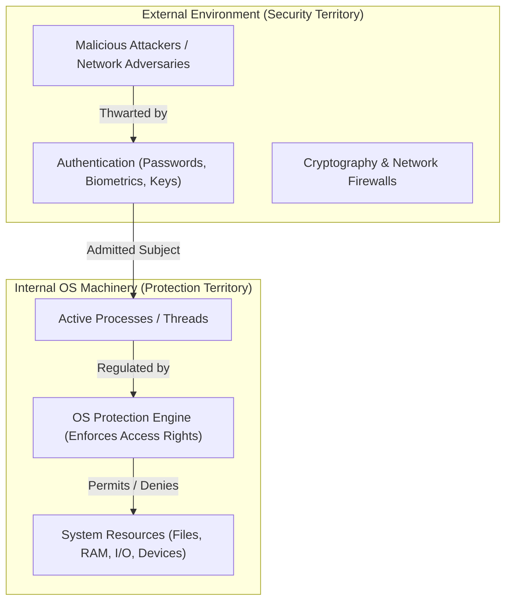
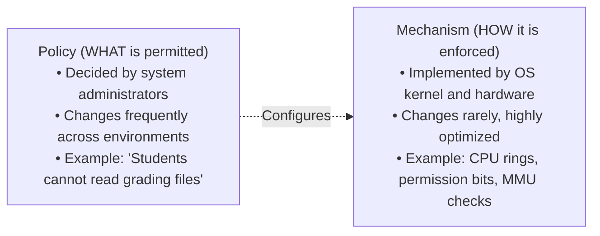
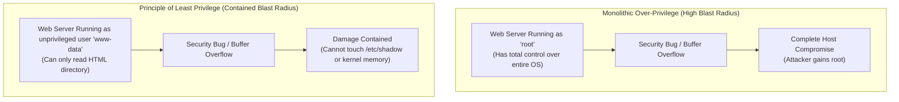
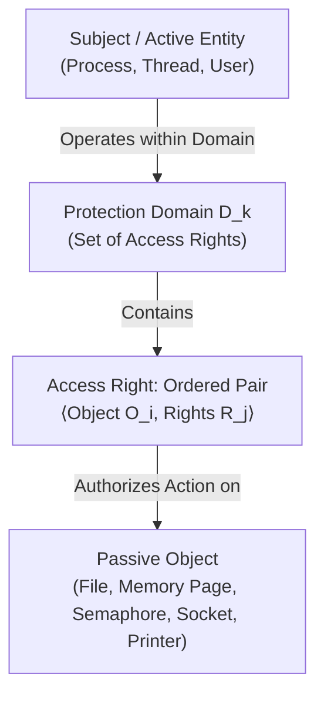
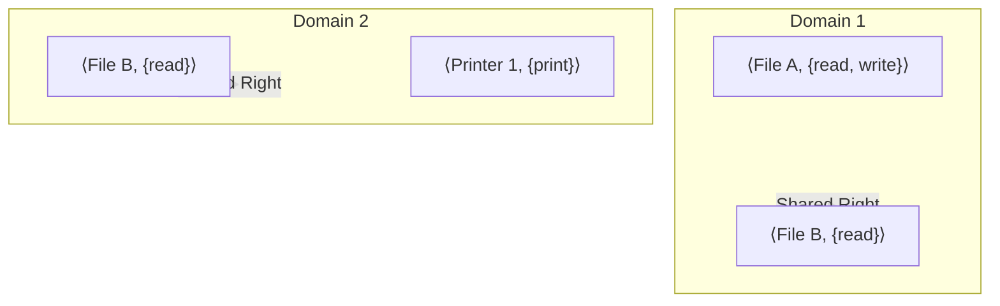
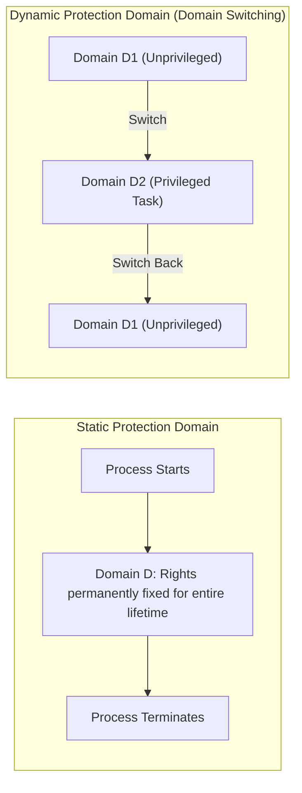
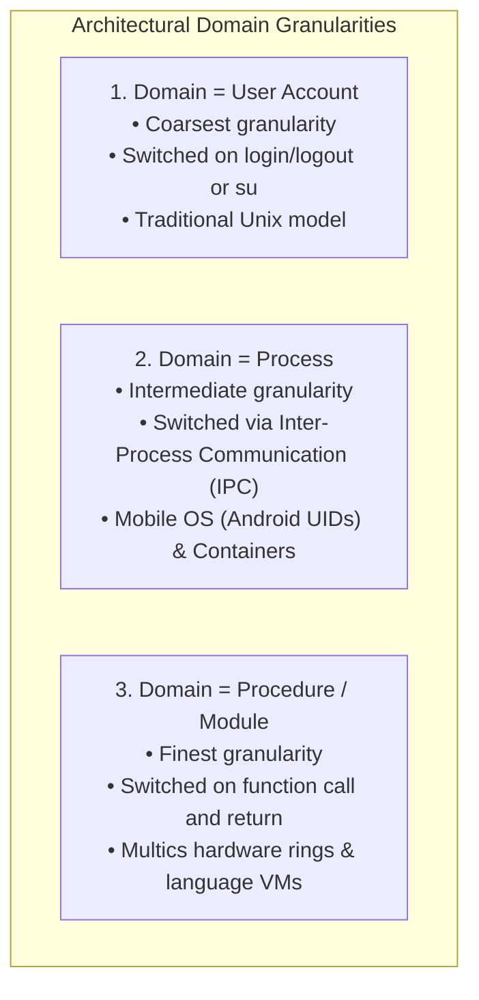
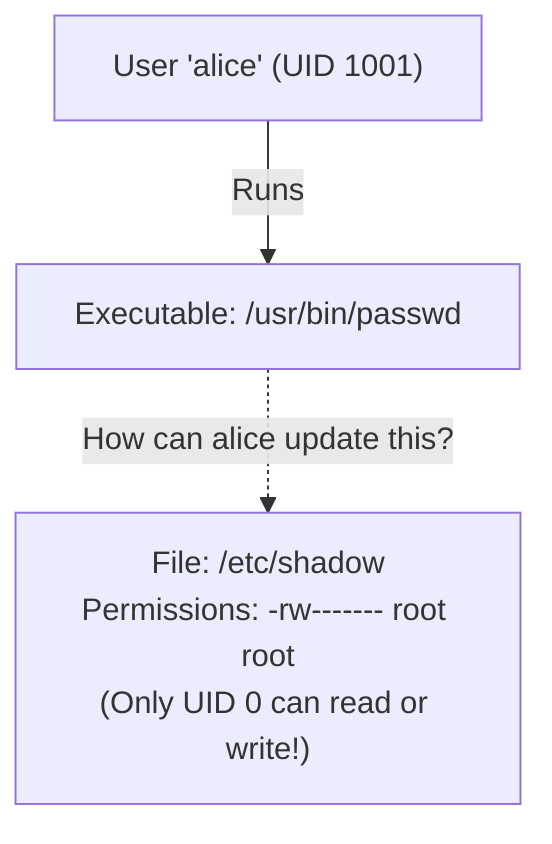
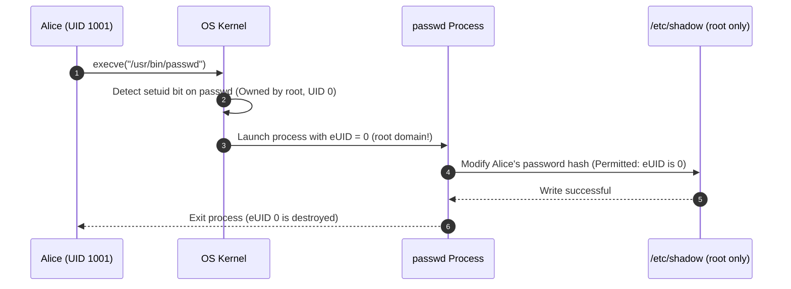

[OS Index](../README.md) / [Unit 4: Storage & Protection](Introduction.md)

---

Up to this point in Unit 4, our study of storage and file systems rested on a quiet, cooperative assumption: we assumed that every process asks only for data it is entitled to touch, that programs are free of catastrophic bugs, and that users never attempt to snoop into each other's private files.

That cooperative assumption must now be completely discarded.

In a modern multi-user, multi-programmed operating system:
- Hundreds of untrusted user processes execute concurrently on the same hardware.
- Software contains flaws, logic bugs, buffer overflows, and untrusted third-party dependencies.
- Administrative boundaries must prevent ordinary users from modifying system-critical configuration files or spying on other users' private directories.

How does the operating system construct an internal fortress that confines processes to strictly bounded boundaries?

In this lecture, we explore the conceptual foundations of **Operating System Protection**: the vital distinction between **Protection and Security**, the architectural **Separation of Policy and Mechanism**, the **Principle of Least Privilege**, the mathematical formulation of **Protection Domains**, and the mechanics of **Domain Switching** in Unix via `setuid`.

---

## Protection vs. Security: The Essential Boundary

In everyday conversation, the words "protection" and "security" are used interchangeably. In operating system design, they denote two completely different layers of defense:

| Dimension | Protection | Security |
| :--- | :--- | :--- |
| **Domain** | **Internal** to the operating system. | **External** boundary between the system and the world. |
| **Primary Goal** | Controls access of programs, processes, and users to internal system resources. | Defends the system against external adversaries, intrusion, eavesdropping, and tampering. |
| **Target Adversary** | Internal software bugs, misbehaving programs, errant pointers, and unauthorized internal access. | External network attackers, eavesdroppers, physical thieves, and impostors. |
| **Core Assumption** | Assumes subjects (users/processes) have already been authenticated; regulates what they may touch. | Validates whether users and machines are genuinely who they claim to be. |

Protection is the internal prison guard checking cell permissions; Security is the perimeter fence and passport control at the border. Without internal protection, a single bug in a user program can corrupt kernel memory or wipe out another user's files.

---

## Separation of Mechanism and Policy

One of the most profound design principles in computer systems is the strict architectural separation between **Mechanism** and **Policy**:

### Why Separate Them?
If policy and mechanism are fused into a monolithic codebase:
- Every time an administrator wants to change access rules (e.g., granting read access to a new department auditor), the operating system kernel would have to be modified and recompiled!
- By decoupling them, the kernel provides a small, rigid, highly verified **enforcement mechanism** that runs at maximum speed. 
- The **policy** remains external and flexible, defined through configuration files, access control lists, and administrative roles.

$$\text{Mechanisms dictate } \mathbf{HOW} \text{ something can be done; Policies determine } \mathbf{WHAT} \text{ will be done.}$$

---

## The Principle of Least Privilege

The bedrock principle of all computer security and fault tolerance is the **Principle of Least Privilege**:

> Programs, users, and systems should be granted the minimum set of privileges necessary to perform their legitimate tasks, and those privileges should be active for only the minimum duration of time required.

### The Two Dimensions of Least Privilege
Notice that least privilege is not just about *what* you can touch, but *when*:
1. **Extent (Scope):** A process should only possess rights to resources currently required for its task. A text editor does not need permission to modify network routing tables.
2. **Duration (Time):** A process should hold elevated privilege only while executing the specific operation that requires it, and drop it immediately afterward. 

### Damage Limitation, Not Prevention
Least privilege does not necessarily prevent bugs from existing; **it limits the blast radius of a failure**. 

If a web server running as `root` is compromised by an attacker, the attacker gains total control over the physical machine. But if the web server drops root privileges at startup and runs as an unprivileged service account (`www-data`), a compromise confines the attacker inside an isolated directory, preventing them from touching kernel structures or reading password hashes.

### The Need-to-Know Principle
A closely related variant is the **Need-to-Know Principle**: at any point in its execution, a process should only be able to access those objects currently necessary to finish its immediate subtask.

---

## Protection Domains

To model protection mathematically, the operating system formalizes the relationship between the active components of a computer and the passive resources they consume:

### Formal Definitions
1. **Object:** A passive entity within the computer system that holds or receives information, or provides an operational service.
   - *Hardware Objects:* CPU registers, physical memory frames, disk blocks, network interfaces, printers.
   - *Software Objects:* Files, directories, message queues, semaphores, shared memory segments, processes.
2. **Access Right:** The ability to execute a specific operation on a specific object. Formally represented as an ordered pair:
   $$\text{Access Right} = \langle \text{Object } O, \; \text{Set of Operations } R \rangle$$
   *Example:* $\langle \text{file.txt}, \; \{\text{read, write}\} \rangle$
3. **Protection Domain:** A collection of access rights. A domain specifies what resources a process executing within that domain can access, and what operations it may perform:
   $$D = \{ \langle O_1, R_1 \rangle, \; \langle O_2, R_2 \rangle, \; \dots, \; \langle O_m, R_m \rangle \}$$

### Domains Can Overlap
Notice that protection domains are not disjoint sets. Two different domains can contain access rights to the exact same object:

In the diagram above, Domain 1 and Domain 2 both have read access to `File B`, but Domain 1 can write to `File A`, while Domain 2 can access `Printer 1`.

---

## Static vs. Dynamic Protection Domains

How do the rights inside a protection domain behave over time as a process runs?

### Static Domains
- The set of access rights belonging to a process is determined at process creation and **remains frozen for its entire execution**.
- **The Structural Flaw:** Static domains fundamentally violate the Principle of Least Privilege! 
  - Consider a compiler: in Phase 1, it needs to read the source file; in Phase 2, it parses the AST; in Phase 3, it writes temporary symbol tables; in Phase 4, it writes the executable binary.
  - If its domain is static, the compiler must be granted read and write permissions to *all* of those files throughout its entire run. If a bug in Phase 1 triggers an errant pointer write, it can corrupt the output binary before compilation even begins.

### Dynamic Domains and Domain Switching
- In a dynamic system, the set of rights changes as the process transitions through different phases of work.
- The standard mechanism to accomplish this is **Domain Switching**:
  - The process executes inside Domain $D_1$.
  - When it needs to perform an operation requiring different rights, it executes a controlled transition into Domain $D_2$.
  - After completing the task, it switches back to Domain $D_1$.

---

## The Three Implementations of a Protection Domain

Operating systems associate protection domains with system entities at three distinct architectural granularities:

### 1. Domain = User Account
- The protection domain is tied directly to the **User ID (UID)** of the logged-in user.
- All processes launched by Alice run inside Alice's protection domain.
- Domain switching occurs when a user logs out and logs in as someone else, or executes `su` / `sudo`.
- *Trade-off:* Simple and low overhead, but coarse. Every script run by Alice has the exact same sweeping permissions as Alice herself.

### 2. Domain = Process
- Each running process has its own isolated protection domain.
- If Process A needs an operation performed on an object that only Process B can access, it cannot access the object directly; it must send an IPC message requesting Process B to perform the operation on its behalf.
- *Trade-off:* Finer isolation (used in modern container runtimes and Android per-app sandbox isolation).

### 3. Domain = Procedure / Module
- The protection domain corresponds to a single function, procedure, or package inside a program.
- Domain switching occurs automatically whenever a function is called or returns!
- Pioneered in **Multics** using hardware protection rings. When user code calls a kernel library routine, the CPU transitions from Ring 3 to Ring 0, executing the routine with kernel privileges, then transitions back to Ring 3 upon return.
- *Trade-off:* The purest realization of least privilege, but incurs significant hardware context-switching overhead.

---

## Domain Switching in Unix: The `setuid` Mechanism

In Unix, a process's protection domain is determined by its **Effective User ID (eUID)**. Normally, when user `alice` (UID 1001) runs an executable, the resulting process inherits `eUID = 1001`.

Now consider a fundamental dilemma of multi-user systems: **Password Updates**.

- In Linux, password hashes are stored in `/etc/shadow`.
- For obvious security reasons, `/etc/shadow` has permissions `-rw------- root root`. **Only root (UID 0) can read or write to this file.**
- Yet user `alice` must be able to change her own password!
- If we give `alice` write permission to `/etc/shadow`, she could edit the file, change root's password hash, and take over the entire machine.
- If we deny her access, she cannot change her own password.

### The Solution: The `setuid` Bit
Unix resolves this dilemma through a specialized permission bit in the file system metadata: the **Set-User-ID (`setuid`) bit**.

When an executable file has the `setuid` bit enabled (displayed as an `s` in permissions, e.g., `-rwsr-xr-x`):
$$\text{When a process executes this file, its Effective UID is set to the }\mathbf{Owner\text{ of the File}}\text{, not the user who launched it!}$$

1. Alice runs `/usr/bin/passwd`.
2. The kernel detects the `setuid` flag on `/usr/bin/passwd`, which is owned by `root`.
3. The kernel temporarily switches the process's effective domain from `Domain(alice)` to `Domain(root)`.
4. The `passwd` program safely opens `/etc/shadow`, updates Alice's record, and exits.
5. The moment the process terminates, the elevated domain ceases to exist.

### The Inherent Danger of `setuid`
Notice why `setuid` is a dangerous double-edged sword:
- It grants the **entire authority of the file owner** (often `root`) to the running process.
- If `/usr/bin/passwd` contains a software bug (such as an unchecked string buffer or an unvalidated command injection), an attacker can hijack control of the program while it is executing inside the `root` domain, gaining an interactive root shell!
- To adhere to least privilege, secure modern programs drop elevated root privileges immediately after completing the specific step that required them.

---

## Key Takeaways

- **Protection** is the internal operating system mechanism controlling how users, processes, and programs access system resources; **Security** is the external defense against unauthorized attackers, intrusion, and physical interception.
- Decoupling **Policy** (what is permitted) from **Mechanism** (how it is enforced) allows access rules to change dynamically without modifying the underlying operating system kernel.
- The **Principle of Least Privilege** requires granting only the minimum rights necessary to complete a task, and for the minimum duration needed, drastically limiting the damage of software bugs.
- An **Access Right** is an ordered pair $\langle \text{Object}, \; \text{Operations} \rangle$. A **Protection Domain** is a set of access rights. Domains can overlap.
- **Static domains** permanently freeze permissions for the process's lifetime, structurally over-privileging software. **Dynamic domains** allow **Domain Switching** as the process executes.
- Domains can be implemented at three granularities: **User Account** (coarse), **Process** (medium), or **Procedure/Module** (fine).
- In Unix, domains correspond to User IDs (UIDs). Domain switching is accomplished using the **`setuid` bit**, temporarily running an executable with the authority of the file's owner (e.g., granting ordinary users controlled access to update `/etc/shadow` via `passwd`).

---

We now possess the formal vocabulary of protection: subjects, objects, access rights, and domains. But this introduces a massive data structure challenge: on a multi-user enterprise server with 10,000 protection domains and 5,000,000 files, how does the operating system store, represent, and evaluate access rights in microseconds without consuming gigabytes of memory? In the next lecture, we analyze the [**L11 - Access Matrix**](L11%20-%20Access%20Matrix.md), examining its decomposition into **Access Control Lists (ACLs)** and **Capability Lists**, dynamic rights revocation, and language-based protection.
