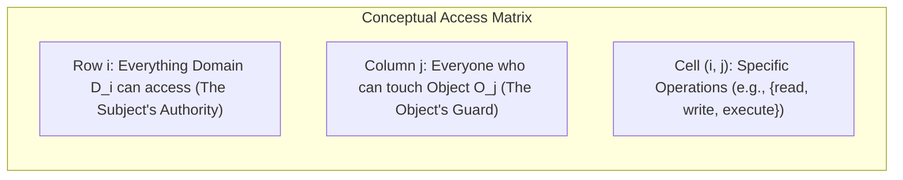
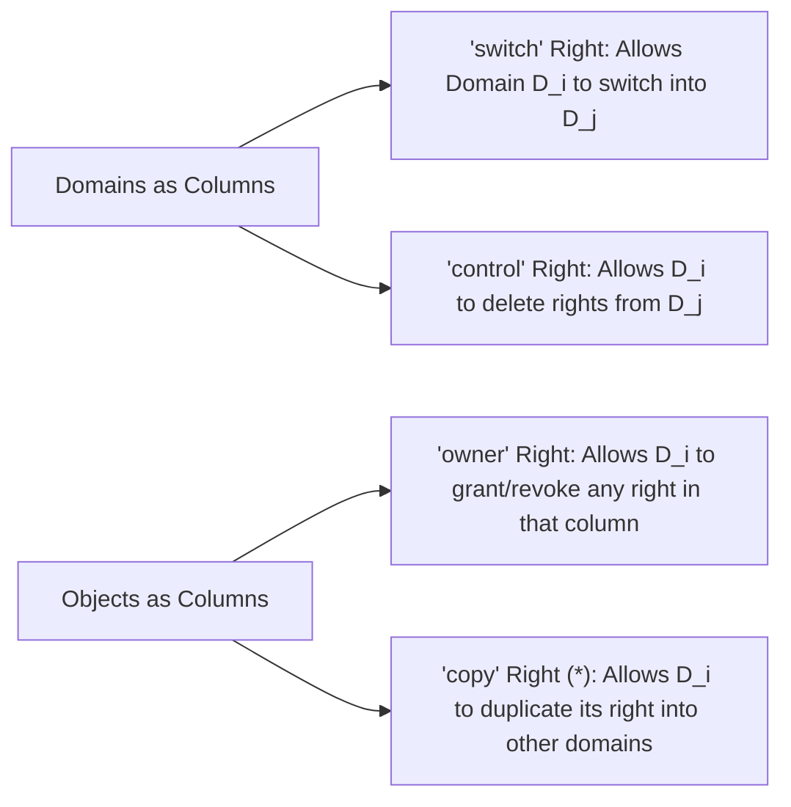
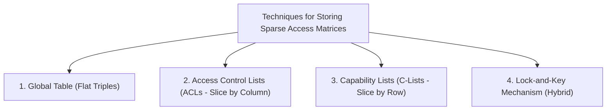
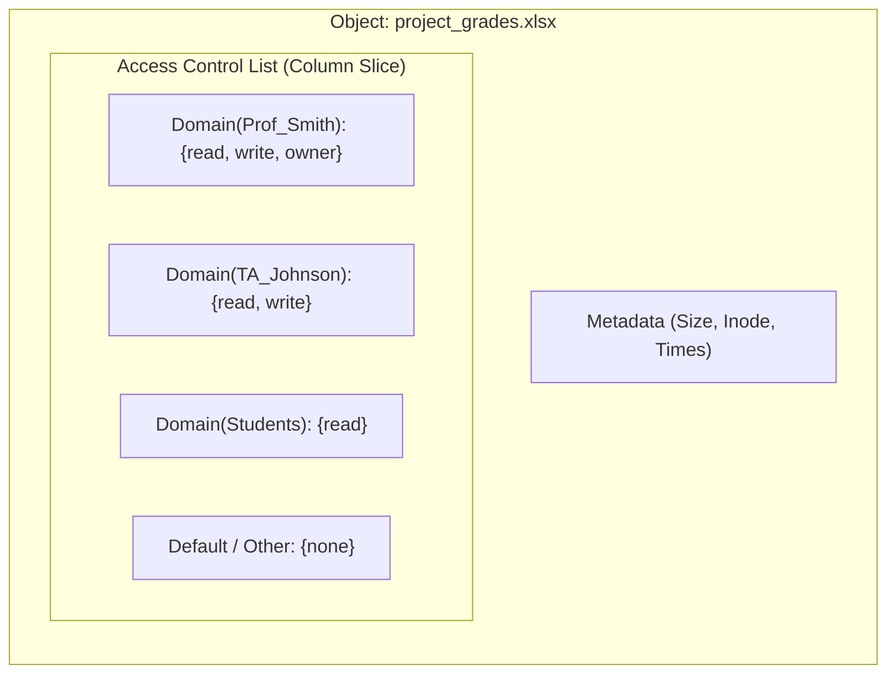
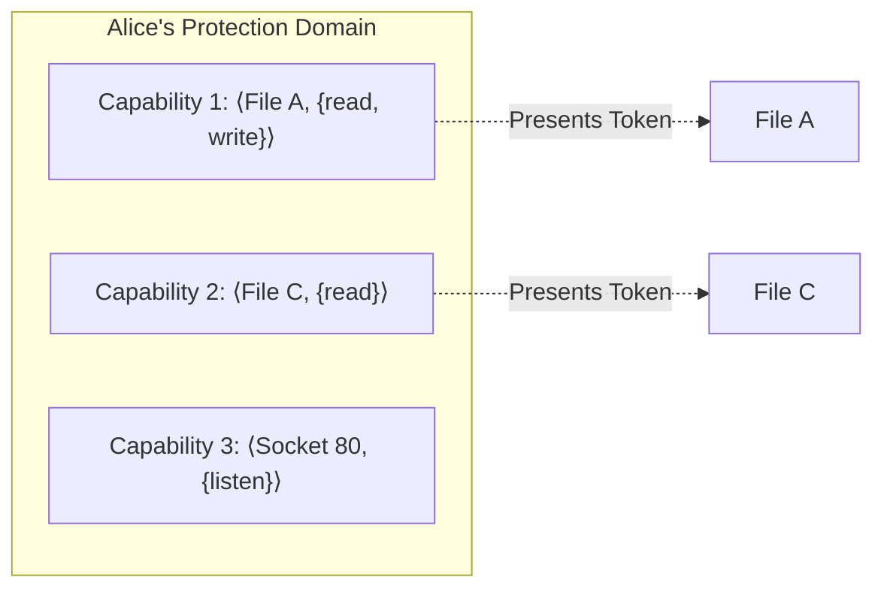
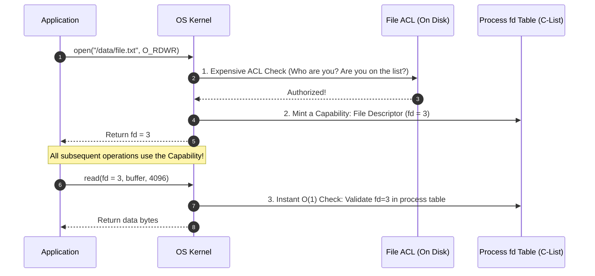
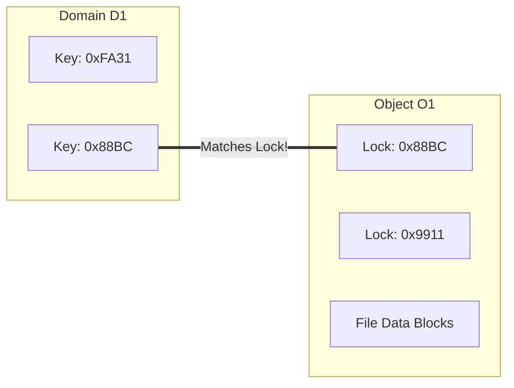
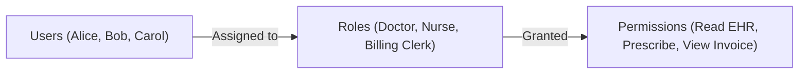
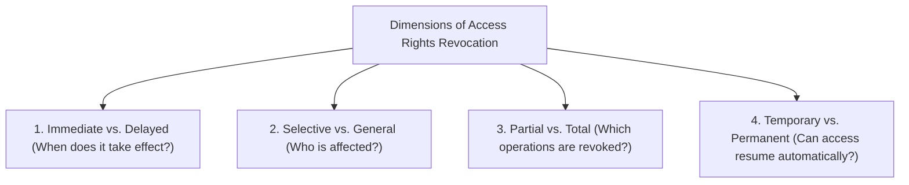

[OS Index](../README.md) / [Unit 4: Storage & Protection](Introduction.md)

---

In the previous lecture, we established the formal model of operating system protection: active subjects execute within **Protection Domains**, which contain sets of **Access Rights** granting permission to perform operations on passive **Objects**.

While this model is conceptually clean, an operating system designer immediately confronts a massive data structure challenge:

On a production multi-user computer, there might be 5,000 active protection domains (users, system daemons, sandboxed processes) and 10,000,000 passive objects (files, sockets, memory regions, devices). Every time an application invokes `open()`, `read()`, `write()`, or `send()`, the operating system must verify whether the calling domain possesses the required rights.

If this verification takes milliseconds, system throughput collapses. Furthermore, rights are not static: administrators grant permissions, employees leave companies, and access rights must be dynamically revoked.

How does an operating system represent, store, evaluate, and dynamically mutate access rights with maximum efficiency?

In this lecture, we examine the **Access Matrix Model**, investigate how the matrix is stored via **Access Control Lists (ACLs)** and **Capability Lists**, trace the **Lock-and-Key Hybrid Mechanism**, study **Role-Based Access Control (RBAC)**, and analyze the four dimensions of **Access Rights Revocation**.

---

## The Access Matrix Model

The theoretical model for representing protection in an operating system is a two-dimensional grid called the **Access Matrix**:

- **Rows** correspond to **Protection Domains** ($D_1, D_2, \dots, D_n$).
- **Columns** correspond to **Objects** ($O_1, O_2, \dots, O_m$).
- Each cell $\text{Access}(i, j)$ contains the set of **Access Rights** that Domain $D_i$ holds over Object $O_j$.
- An **empty cell** indicates zero rights (strict default-deny policy).

### Canonical Access Matrix Example
Let us examine a concrete example with four domains ($D_1$ to $D_4$) and four files ($F_1$ to $F_3$, plus a Printer):

| Domain | File $F_1$ | File $F_2$ | File $F_3$ | Printer |
| :--- | :--- | :--- | :--- | :--- |
| **$D_1$** | `read` | | `read` | |
| **$D_2$** | | | | `print` |
| **$D_3$** | `read` | `execute` | | |
| **$D_4$** | `read, write` | | `read, write` | |

From this single matrix:
- Domain $D_3$ can read $F_1$ and execute $F_2$, but cannot touch $F_3$ or the Printer.
- File $F_1$ can be read by $D_1$, $D_3$, and $D_4$, but written to *only* by $D_4$.
- The Printer is strictly accessible to $D_2$.

---

## Dynamic Operations: Modifying the Matrix Itself

In a real operating system, permissions are not carved in stone. A file owner needs to grant access to a collaborator; a parent process needs to control its child; a process needs to transition into a more privileged domain.

How can the Access Matrix model dynamic rights modification without inventing a separate, ad-hoc metadata system?

The elegant solution: **Treat domains themselves as objects!**

By adding the domains as columns in the matrix, dynamic privilege operations can be expressed directly as standard access rights within the matrix cells:

### 1. Domain Switching via the `switch` Right
If cell $\text{Access}(D_i, D_j)$ contains the right `switch`, a process executing in Domain $D_i$ is permitted to transition its execution context into Domain $D_j$.

| Domain | File $F_1$ | File $F_2$ | Domain $D_1$ | Domain $D_2$ | Domain $D_3$ |
| :--- | :--- | :--- | :--- | :--- | :--- |
| **$D_1$** | `read` | | | `switch` | |
| **$D_2$** | | `write` | | | `switch` |
| **$D_3$** | `read, write`| `read` | | | |

In this matrix:
- A process starting in $D_1$ can switch into $D_2$, and from $D_2$ it can switch into $D_3$.
- But a process in $D_3$ has zero outgoing switch rights—it is trapped in $D_3$.

### 2. Copying Rights (`copy` or `*`)
If a domain holds a right with an asterisk (e.g., $\text{execute}^*$), it has the right to copy that permission to any other domain in that object's column.
- **Transitive Copy:** If $D_1$ copies $\text{read}^*$ to $D_2$, $D_2$ receives the asterisk and can copy it further to $D_3$.
- **Non-Transitive Copy:** $D_1$ can choose to copy `read` (without the asterisk) to $D_2$, preventing $D_2$ from propagating the right any further.

### 3. The `owner` Right
If Domain $D_i$ holds the `owner` right for Object $O_j$, $D_i$ is the master authority for column $j$. It may arbitrarily add new rights to, or delete existing rights from, **any cell in that entire column**.

### 4. The `control` Right
The `control` right applies strictly over other domains. If Domain $D_i$ possesses `control` over Domain $D_k$, processes running in $D_i$ have the authority to **delete any access rights from row $k$**. This allows supervisor processes to strip rights from misbehaving child processes.

---

## Why the Access Matrix is Never Stored Literally

While the Access Matrix is an outstanding mathematical model, **no practical operating system stores it as a literal two-dimensional array**.

Consider the scale of a real system:
$$\text{Domains } N = 5,000 \quad \times \quad \text{Objects } M = 10,000,000 \quad = \quad 50,000,000,000 \text{ cells!}$$

If each cell required just 4 bytes, a flat matrix would consume **200 Gigabytes of RAM** just to store permissions!

Furthermore, the access matrix is **extraordinarily sparse**: over $99.999\%$ of the cells are completely empty, because an individual user or process only ever touches a microscopic fraction of the files on a computer.

To implement the access matrix efficiently, operating systems decompose the sparse matrix using three practical techniques:

---

## 1. Global Table

The simplest decomposition is to store a single global list of ordered triples:
$$\langle \text{Domain } D_i, \; \text{Object } O_j, \; \text{Rights Set } R_{ij} \rangle$$
Whenever a process in $D_i$ requests operation $r$ on $O_j$, the kernel scans the global table for a matching $\langle D_i, O_j \rangle$ entry.

### Drawbacks
- The global table is still massive and must reside in kernel memory.
- Scanning a million-entry table on every I/O operation causes severe lookup latency.
- It cannot express wildcard rules, default permissions, or user groups easily.

---

## 2. Access Control Lists (ACLs) — Slicing by Column

Instead of a single global table, the operating system can **slice the Access Matrix vertically by column**.

Every object stores its own private list of authorized subjects and their permissions:
$$\text{ACL}(O_j) = \{ \langle D_1, R_1 \rangle, \; \langle D_2, R_2 \rangle, \; \dots, \; \langle D_k, R_k \rangle \}$$

### The Fast vs. Slow Asymmetry of ACLs
- **Blazing Fast Question:** *"Who is allowed to access Object $O_j$?"* 
  - The kernel inspects the ACL attached directly to $O_j$'s inode. Done.
- **Trivial Revocation:** If an administrator wants to strip Bob's access to `file.txt`, they open `file.txt`'s ACL and delete Bob's entry. Revocation is instantaneous and localized.
- **Painfully Slow Question:** *"What total set of objects can Domain $D_i$ access?"*
  - To answer this, the operating system must recursively traverse **every single object on the entire storage disk** and scan every ACL!

### Real-World Example: Unix 9-Bit Permissions
The classic Unix permission model (`rwxr-xr--`) is simply a heavily compressed, hardcoded Access Control List:
- It collapses millions of potential domains into three fixed classes: **Owner**, **Group**, and **Other** (everyone else).
- The `other` field represents the **default entry**, ensuring that billions of non-existent explicit permissions do not consume disk space.
- Modern enterprise Unix (POSIX.1e ACLs) and Windows NTFS allow arbitrary lists of users and groups attached to any file.

---

## 3. Capability Lists (C-Lists) — Slicing by Row

The dual approach is to **slice the Access Matrix horizontally by row**.

Each protection domain possesses a private, unforgeable list of tokens called **Capabilities**:
$$\text{C-List}(D_i) = \{ \langle O_1, R_1 \rangle, \; \langle O_2, R_2 \rangle, \; \dots, \; \langle O_k, R_k \rangle \}$$

A capability is an unforgeable ticket:
$$\text{Possession of the capability is itself proof of authorization.}$$

### Security Requirement: Capabilities Must Be Unforgeable
If a user process could fabricate or edit capabilities in user space, it could forge a capability granting `owner` rights to `/etc/shadow`.

Therefore, the operating system protects capabilities using one of two hardware/kernel mechanisms:
1. **Kernel-Space Storage:** Capabilities are stored exclusively in kernel memory. The user process is given only an opaque integer index (a handle).
2. **Tagged Architecture:** Hardware memory words carry an extra architectural tag bit that only the CPU in kernel mode (Ring 0) can write.

### The Fast vs. Slow Asymmetry of Capabilities
- **Blazing Fast Checking:** When a process presents a capability, the kernel does not search any ACLs or verify user identities. It checks the token directly in $O(1)$ time.
- **Blazing Fast Question:** *"What objects can Domain $D_i$ access?"*
  - The kernel simply inspects $D_i$'s private capability list.
- **The Fatal Flaw of Capabilities: Revocation is Torment.**
  - If you want to revoke all access to `File A`, how do you find who holds capabilities to it?
  - You must search the private capability lists of **every single process and domain across the entire operating system**!

### The Real-World Synthesis: ACL at `open()`, Capability at `read()`
Look at how modern operating systems (Linux, Unix, Windows) achieve perfection by combining both approaches:

1. When you call `open()`, the kernel uses the **Access Control List (ACL)** to authenticate your domain and verify permissions.
2. If authorized, the kernel creates an entry in your per-process open-file table and returns an integer **File Descriptor (`fd`)**.
3. **The file descriptor is a capability!** For every subsequent `read()` and `write()`, the kernel never touches the ACL again. It simply validates the descriptor token in $O(1)$ time.

> [!NOTE]
> This architectural division explains a famous Unix behavior: if an administrator changes the permissions of a file on disk (or deletes it) while a process has it open, the process can continue reading and writing to it without error! The ACL changed, but the process's active capability remains valid.

---

## 4. The Lock-and-Key Mechanism (Hybrid)

To strike a compromise between ACLs and capabilities, some systems employ a **Lock-and-Key Mechanism**:

- **Locks on Objects:** Every object maintains a list of unique, unforgeable bit patterns called **Locks**.
- **Keys in Domains:** Every protection domain maintains a list of bit patterns called **Keys**.
- **Rule of Access:** A process executing in domain $D_i$ can access object $O_j$ if and only if **Domain $D_i$ holds a key that matches one of the locks on Object $O_j$**.

### Why Lock-and-Key is Powerful
- Checking is fast like capabilities: the process simply presents its keys.
- **Revocation is instant and localized:** To revoke access from *all* holders of key `0x88BC`, the object owner simply executes `set-key`, changing the object's lock to `0x1122`. Instantly, every outstanding key held across all domains becomes invalid in $O(1)$ time!

---

## Role-Based Access Control (RBAC)

In modern enterprise corporations, users do not map cleanly to fixed operating system domains:
- An organization has 50,000 employees and 200,000 resources.
- If administrators grant permissions directly to individual users, managing $50,000 \times 200,000 = 10^{10}$ individual access rights is impossible.
- When an employee changes jobs or takes on new duties, older permissions are rarely revoked, leading to **Privilege Creep**.

The universal enterprise solution is **Role-Based Access Control (RBAC)**:

### The RBAC Model
Instead of granting permissions to users:
1. **Roles are Defined:** A role corresponds to a specific job function or competency within the organization (e.g., *Radiologist*, *Branch Manager*, *Auditor*).
2. **Permissions are Assigned to Roles:** Access rights to objects are granted exclusively to roles.
3. **Users are Assigned to Roles:** Users are placed into roles matching their current job responsibilities.

### Mathematical Efficiency
If there are $U$ users, $R$ roles, and $P$ permissions:
- Direct assignment requires up to $U \times P$ mappings.
- RBAC requires $U + (R \times P)$ mappings.
- When employee Alice transfers from *Pediatrics* to *Oncology*, the administrator does not adjust hundreds of file permissions; they simply remove Alice from the *Pediatrics* role and add her to the *Oncology* role. Alice's entire privilege envelope shifts cleanly with zero privilege creep.

### The Challenge: Role Explosion
If an organization creates overly specialized roles for every minor task (e.g., *Pediatric_Nurse_Nightshift_Floor3*), the number of roles approaches the number of users ($R \approx U$). 

This condition is called **Role Explosion**, and it negates all benefits of RBAC. Organizations combat role explosion using **Role Hierarchies** (e.g., *Doctor* inherits all permissions of *Medical Staff*) and assigning users multiple orthogonal roles simultaneously.

---

## Revocation of Access Rights

Revoking access rights is vastly more complex than granting them. 

To evaluate any revocation scheme, operating systems classify revocation across **four independent dimensions**:

1. **Immediate vs. Delayed:**
   - *Immediate:* The right is cancelled instantaneously; any operation attempted one microsecond later fails.
   - *Delayed:* Existing sessions or open descriptors are allowed to finish, but no new accesses are permitted.
2. **Selective vs. General:**
   - *Selective:* Revokes the right from one specific domain (e.g., stripping Bob's access while Alice retains hers).
   - *General:* Revokes the right from all domains across the system.
3. **Partial vs. Total:**
   - *Partial:* Strips a subset of operations (e.g., revoking `write` while keeping `read`).
   - *Total:* Strips all rights to the object entirely.
4. **Temporary vs. Permanent:**
   - *Temporary:* The right is suspended and can be reinstated without re-authorization.
   - *Permanent:* The right is completely deleted.

### Capability Revocation Mechanisms
As we observed earlier, revoking capabilities is difficult because capabilities are scattered across domains. Systems employ four ingenious techniques to solve this:

| Mechanism | Operating Principle | Immediate? | Selective? | Architectural Overhead |
| :--- | :--- | :--- | :--- | :--- |
| **Reacquisition (Expiration)** | Capabilities carry an expiration timestamp. When expired, the process must re-request the capability from the kernel. | No (Delayed until timeout) | Yes | Continuous token refresh traffic |
| **Back-Pointers** | The object maintains a list of pointers pointing directly to every capability issued. To revoke, the kernel follows back-pointers and deletes them. | **Yes** | **Yes** | High memory overhead tracking pointers |
| **Indirection Table** | Capabilities do not point to the object directly; they point to an intermediate table slot, which points to the object. To revoke, the kernel clears the table slot. | **Yes** | No (General to all holders) | Extra indirection lookup on every I/O |
| **Keys (Lock-Key)** | Each capability holds a unique key matching the object's lock. To revoke, the object changes its lock pattern. | **Yes** | No (General) | Managing key bit patterns |

---

## Master Comparison: ACLs vs. Capability Lists

| Dimension | Access Control Lists (ACLs) | Capability Lists (C-Lists) |
| :--- | :--- | :--- |
| **Matrix Slice** | Vertical (by column) | Horizontal (by row) |
| **Stored With** | The passive object (e.g., inside inode) | The active domain (e.g., process table) |
| **Access Verification** | "Who are you?" (Identity check) | "What do you hold?" (Token check) |
| **Lookup Speed** | Slower (requires searching user/group in list) | Ultra-fast ($O(1)$ token index validation) |
| **Query: "Who can access $O$?"** | Trivial ($O(1)$ read of object's list) | Pathological ($O(N)$ sweep of all domains) |
| **Query: "What can $D$ access?"** | Pathological ($O(M)$ sweep of all objects) | Trivial ($O(1)$ read of domain's list) |
| **Revocation Complexity** | Simple and immediate | Hard (requires indirection, keys, or back-pointers) |
| **Real-World Manifestation** | File system permissions (`chmod`, Windows ACL) | Unix File Descriptors, POSIX IPC handles |

---

## Key Takeaways

- The **Access Matrix** is a 2D protection model where rows represent domains, columns represent objects, and cells contain access rights.
- Dynamic operations are modeled within the matrix by treating domains as columns: `switch` allows domain transitions, `owner` controls an object's column, and `control` controls another domain's row.
- Literal access matrices are never stored because they are massive and sparse ($>99.99\%$ empty).
- **Access Control Lists (ACLs)** slice the matrix by column, attaching authorized subjects to each object. They excel at revocation and "who can touch this object," but make querying a domain's total authority slow.
- **Capability Lists** slice the matrix by row, distributing unforgeable tokens to domains. They deliver ultra-fast $O(1)$ access checks, but make rights revocation notoriously difficult.
- Modern operating systems combine both: an expensive **ACL check** during `open()`, returning a high-speed **Capability (File Descriptor)** for subsequent `read()` and `write()` calls.
- **Role-Based Access Control (RBAC)** groups permissions into job roles and assigns users to roles, preventing privilege creep and eliminating $U \times P$ direct permission clutter.
- Revocation operates across four dimensions: **Immediate vs. Delayed**, **Selective vs. General**, **Partial vs. Total**, and **Temporary vs. Permanent**.

---

We have now established both the concepts and data structures of operating system protection. But protection assumed that users and processes inside the machine were already authenticated and trustworthy. What happens when an active adversary attacks the system from the outside? In the next lecture, we confront [**L12 - Security**](L12%20-%20Security.md), exploring threat models, malware, Trojan horses, buffer overflows, and the role of cryptography and authentication in defending computer systems.
