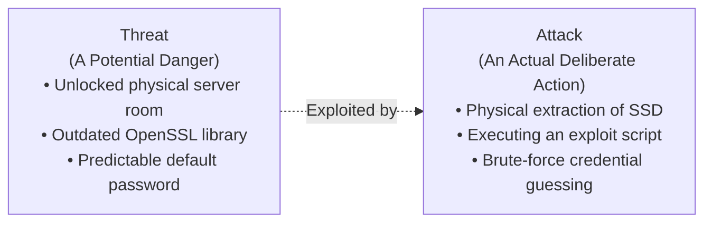
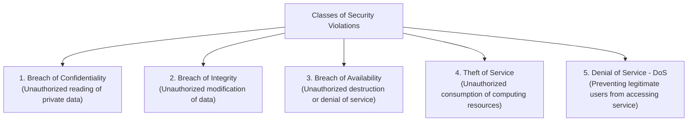
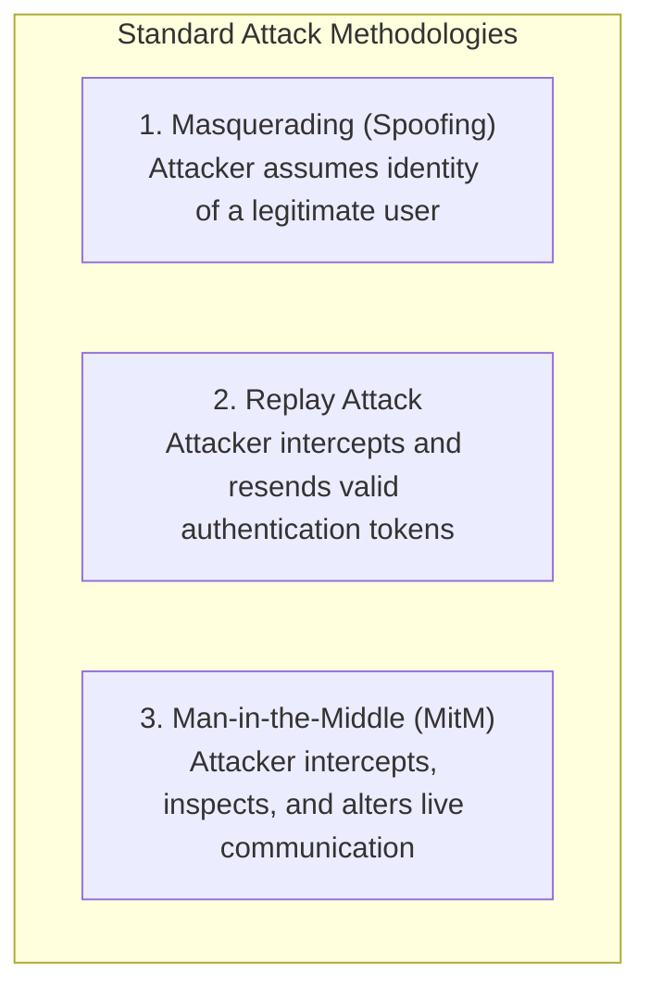
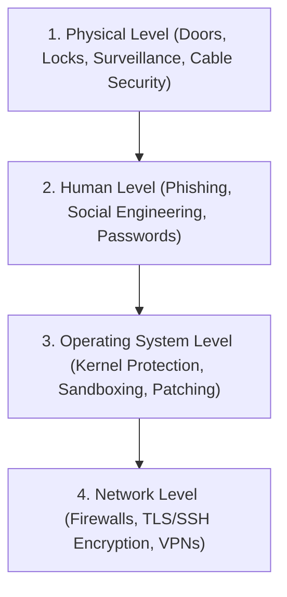
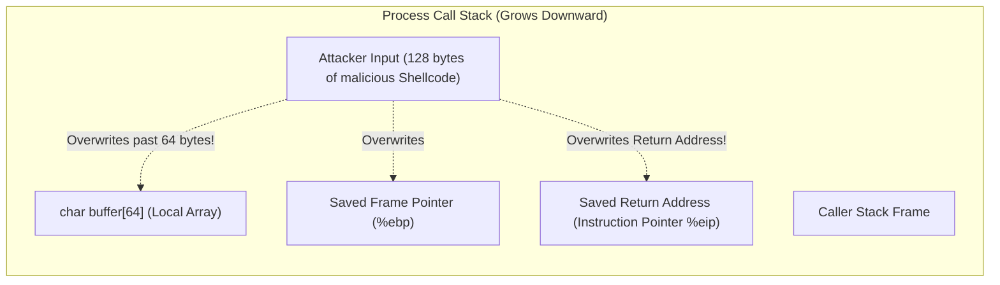
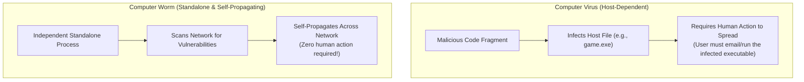
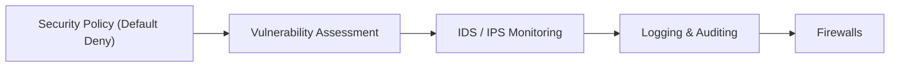

[OS Index](../README.md) / [Unit 4: Storage & Protection](Introduction.md)

---

In the previous two lectures, we constructed the operating system's internal protection apparatus: protection domains, access rights, access control lists, and capabilities.

All of that protection machinery, however, relied on a critical foundational assumption:
- We assumed that when a process says it belongs to user `alice`, it is genuinely `alice`.
- We assumed the executable code stored on disk has not been surreptitiously altered by an intruder.
- We assumed the network cables and WiFi links carrying data to and from the machine cannot be eavesdropped or spoofed.

Those assumptions are precisely where **Operating System Security** begins.

While **Protection** is an internal mechanism that manages access between verified entities within the computer, **Security** is the comprehensive defense of the entire computing environment against outside adversaries, malicious software, and catastrophic human error.

In this lecture, we examine the formal taxonomy of **Security Threats and Violations**, dissect the physical and human **Levels of Security**, analyze infamous threats including **Trojan Horses, Trap Doors, Buffer Overflows, Viruses, and Worms**, and explore the defensive pillars of **Cryptography, Authentication, Intrusion Detection (IDS/IPS), and Firewalls**.

---

## Security Fundamentals: Threats vs. Attacks

Before examining technical mechanisms, we must distinguish between two core terms that are frequently confused:



- **Threat:** A potential vulnerability or condition in the system that *could* be exploited to cause harm. A threat exists even if no adversary is actively attacking.
- **Attack:** The deliberate, active attempt by an adversary to bypass security controls and exploit a vulnerability to breach the system.

Furthermore, security is not exclusively concerned with malicious hackers. An administrator accidentally running `rm -rf /` or a power surge burning out a RAID controller produces the exact same loss of availability as a coordinated nation-state cyberattack. Security encompasses protection from both **malicious attacks and accidental human/hardware failures**.

---

## The Taxonomy of Security Violations

Security violations are categorized into five fundamental classes based on which property of the system is violated:



### 1. Breach of Confidentiality
- **Definition:** The unauthorized disclosure or reading of restricted information.
- **Examples:** An attacker copying credit card numbers from an e-commerce database, intercepting unencrypted network traffic, or an unauthorized employee reading executive salary sheets.

### 2. Breach of Integrity
- **Definition:** The unauthorized modification, tampering, or deletion of data.
- **Examples:** Altering grades in a university registrar database, modifying source code in a GitHub repository, or tampering with financial account balances.

### 3. Breach of Availability
- **Definition:** The unauthorized destruction or deliberate suppression of system access.
- **Examples:** Wiping an enterprise database, sabotaging a backup storage array, or physical damage to server hardware.

> [!NOTE]
> The three categories above—**Confidentiality, Integrity, and Availability**—form the famous **CIA Triad**, the governing framework of modern cybersecurity.

### 4. Theft of Service
- **Definition:** The unauthorized consumption of system resources without necessarily stealing or destroying data.
- **Examples:** An attacker hijacking an enterprise AWS cloud account to mine cryptocurrency, or using a corporate server as an unauthorized proxy to host illegal files. In theft of service, nothing is read or modified; the owner is simply billed for stolen compute cycles.

### 5. Denial of Service (DoS)
- **Definition:** Deliberately overwhelming or crashing a system so that legitimate users are blocked from accessing it.
- **Examples:** Flooding a web server with billions of bogus SYN packets to exhaust TCP connection tables, or launching a local **Fork Bomb** to exhaust the operating system's process table.

---

## Standard Attack Methodologies

Attackers employ three classical structural techniques to compromise operating systems and networks:



### 1. Masquerading (Spoofing)
The attacker pretends to be a legitimate user or system component. For example, an attacker steals Alice's login credentials or spoof's Alice's IP address, executing actions under Alice's security context.

### 2. Replay Attack
Notice an insidious property of network communication: **Encryption alone does not prevent a replay attack!**
- Suppose Alice sends an encrypted message to her bank: `E_key("Transfer $1000 to Bob")`.
- Mallory intercepts the raw encrypted ciphertext. Mallory cannot decrypt it because she lacks the key.
- However, Mallory does not need to decrypt it! She simply **retransmits the exact same encrypted packet to the bank 50 times**.
- The bank decrypts the 50 valid packets and transfers $50,000 to Bob!
- **Countermeasure:** Replay attacks are defeated by including **Cryptographic Nonces** (numbers used once), monotonic sequence numbers, and strict expiration timestamps in every message.

### 3. Man-in-the-Middle (MitM)
The attacker positions themselves directly in the active network communication path between two parties (e.g., between a laptop and a WiFi router). The attacker impersonates the server to the client, and impersonates the client to the server, silently intercepting and modifying packets in transit. MitM attacks are defeated by **mutual cryptographic authentication and Digital Certificates (TLS)**.

---

## The Four Levels of Security Defense

A computer system is not an isolated CPU; it sits within a physical room, operated by humans, running an operating system, connected to a global network.

A vulnerability at *any* level completely invalidates the defenses of every other level:



$$\text{A computer system is only as secure as its }\mathbf{weakest\text{ level}}.$$

1. **Physical Level:** If an attacker can physically unscrew the server chassis, steal the SSD, or insert a malicious PCIe DMA dongle, software permissions are irrelevant.
2. **Human Level:** Almost universally the **weakest link in modern security**. Attackers bypass multi-million-dollar cryptographic firewalls by simply calling an employee, pretending to be IT support, and asking for their password (**Social Engineering / Phishing**).
3. **Operating System Level:** Enforcing process isolation, memory protection, avoiding buffer overflows, running with least privilege, and patching kernel vulnerabilities promptly.
4. **Network Level:** Using encrypted communication channels (TLS, SSH) to prevent packet sniffing and configuring firewalls to block unauthorized ports.

---

## Program and System Threats

Software vulnerabilities allow adversaries to hijack control of processes. Let us examine the four classical program threats and system threats:

### 1. Trojan Horse
- **Definition:** A software program that overtly presents itself as useful and benign (such as a calculator app, an image editor, or a video codec), but secretly harbors hidden, unauthorized malicious functionality.
- When an unsuspecting user downloads and launches the Trojan horse, it executes with the user's full permissions, silently scanning their home directory for SSH private keys or installing spyware.

### 2. Trap Door (Backdoor)
- **Definition:** A hidden, secret entry point deliberately written into software that bypasses all standard security checks and authentication routines.
- A rogue programmer might write code into a banking login module:
  ```c
  if (strcmp(username, "admin_master_override") == 0) {
      grant_root_access();
  }
  ```
- Trap doors are exceptionally dangerous because they are invisible to normal runtime testing; they can only be caught through rigorous code audits and static analysis.

### 3. Buffer Overflow
The most famous, persistent, and destructive vulnerability in computer science history is the **Buffer Overflow**.

It occurs in programming languages that do not enforce automatic array bounds checking (primarily C and C++):



#### How a Buffer Overflow Hijacks Control
1. A function allocates a fixed 64-byte buffer on the stack: `char buffer[64];`.
2. The program uses an unsafe input function like `gets(buffer)` or `strcpy(buffer, user_input)` that reads data without verifying length.
3. The attacker supplies 128 bytes of input.
4. The excess bytes overflow past the buffer boundary, smash through the saved frame pointer, and **overwrite the Saved Return Address** stored on the stack!
5. When the function returns, the CPU pops the overwritten return address into the instruction pointer register (`%eip` / `%rip`).
6. Instead of returning to the caller, the CPU jumps directly into the attacker's supplied machine code (**Shellcode**), executing arbitrary commands with the privileges of the running process!

#### Modern Operating System Defenses Against Buffer Overflows
- **Memory-Safe Languages:** Moving away from C/C++ to languages that enforce bounds checking (Rust, Go, Java).
- **Stack Canaries:** The compiler inserts a random secret integer (a "canary") immediately before the return address. Before returning, the function verifies the canary. If an overflow occurred, the canary is corrupted, and the kernel terminates the process immediately (`SIGABRT`).
- **Non-Executable Stack (NX / DEP - Data Execution Prevention):** Hardware MMU page table bits mark the stack and heap as Non-Executable. Even if an attacker injects shellcode onto the stack, attempting to execute it triggers a CPU hardware fault.
- **Address Space Layout Randomization (ASLR):** The kernel randomly shuffles the base addresses of the stack, heap, and libraries on every execution, making it impossible for attackers to predict return target addresses.

---

### 4. Virus vs. Worm: The Fundamental Distinction

Examinations and industry certifications frequently test the distinction between a **Computer Virus** and a **Network Worm**:



| Dimension | Computer Virus | Network Worm |
| :--- | :--- | :--- |
| **Structure** | A parasitic code fragment; **requires a host file** to attach to. | A **standalone, complete process**; requires no host file. |
| **Propagation Trigger** | **Requires human action** (user must launch an infected executable, open an infected document, or insert an infected USB drive). | **Completely automated**; scans networks and propagates on its own without any human interaction. |
| **Mechanism** | Modifies existing host binaries on disk, inserting its payload at the entry point. | Exploits remote network service vulnerabilities (e.g., open ports, buffer overflows in web/SMB servers). |
| **Historical Examples** | CIH, Melissa, ILOVEYOU macro viruses. | Morris Worm (1988), SQL Slammer, Conficker, WannaCry. |

---

## Defensive Pillars: Cryptography and Authentication

To repel attacks, operating systems rely on two foundational defense mechanisms:

### 1. Cryptography
Cryptography transforms plaintext data into unintelligible ciphertext using mathematical algorithms and secret keys.
- **Symmetric Cryptography (Private Key):** Both parties share a single secret key. Used for high-speed bulk data encryption (e.g., **AES - Advanced Encryption Standard**).
- **Asymmetric Cryptography (Public Key):** Uses mathematically linked key pairs: a **Public Key** (available to the world) and a **Private Key** (kept strictly secret). Anyone can encrypt using the public key, but only the private key holder can decrypt (e.g., **RSA**, **Elliptic Curve Cryptography**).
- **Kerckhoffs's Principle:** The security of a cryptographic system must depend solely on the secrecy of the key, **never on the secrecy of the algorithm**. Systems relying on "security through obscurity" fail rapidly.

### 2. Authentication vs. Authorization
- **Authentication:** Verifies **WHO you are** (validating identity).
- **Authorization:** Determines **WHAT you may do** (enforcing access rights after authentication succeeds).

#### The Three Authentication Factors
Authentication mechanisms fall into three independent categories:
1. **Something You Know:** Passwords, PINs, passphrases. (Vulnerable to guessing, phishing, shoulder surfing).
2. **Something You Have:** Hardware security keys (YubiKey), smartcards, authenticator apps (TOTP), SMS codes. (Vulnerable to physical theft).
3. **Something You Are (Biometrics):** Fingerprints, facial geometry, retina scans. 
   - *Crucial Biometric Caveat:* Unlike a password or smartcard, **a biometric cannot be revoked or changed if compromised**. If your fingerprint scan is leaked, you cannot change your finger!

**Multi-Factor Authentication (MFA)** requires providing credentials from **at least two different categories** (e.g., a password *and* a hardware token). Requiring two passwords is not MFA; it is simply two single factors.

---

## Implementing Security Defenses: Tools and Controls

To achieve defense-in-depth, modern operating systems deploy five practical control systems:



### 1. Security Policy and Default Deny
A security policy defines what is permitted on the machine. The fundamental principle is **Default Deny**:
$$\text{All access is forbidden by default, unless explicitly authorized by a specific rule.}$$

### 2. Vulnerability Assessment
Automated auditing tools scan operating systems for configuration flaws:
- Scanning for default or weak passwords.
- Identifying unpatched software packages with known CVE vulnerabilities.
- Checking for world-writable system files or unauthorized `setuid` binaries.
- Verifying the integrity of system binaries using cryptographic hash checksums (e.g., Tripwire).

### 3. Intrusion Detection Systems (IDS) vs. Intrusion Prevention Systems (IPS)
- **Intrusion Detection System (IDS):** Passively monitors network traffic and system logs, detecting anomalous patterns (e.g., port scans, signature matches) and generating alerts for administrators. An IDS sits out-of-band; it observes but does not block.
- **Intrusion Prevention System (IPS):** Sits **inline directly in the communication path**. When it detects malicious activity, it drops the connection and blocks the offending IP address in real time. Because an IPS actively intervenes, a false positive can cause an accidental network outage.

### 4. Logging and Auditing
Every authentication attempt, file modification, privilege elevation, and network connection must be recorded in system audit logs.
- **Crucial Rule:** Audit logs must be **cryptographically protected and write-only** (often streamed to an immutable offsite log server).
- If an attacker compromises a server, their first action is to delete `/var/log` to erase their tracks. Offsite append-only logging guarantees non-repudiation and forensic recovery.

### 5. Firewalls
A firewall acts as a security barrier between network interfaces:
- Inspects incoming and outgoing network packets.
- Filters traffic based on IP addresses, port numbers, protocols, and connection states (Stateful Packet Inspection).
- Enforces default deny: all incoming ports are closed except explicitly allowed services (e.g., Port 443 for HTTPS, Port 22 for SSH).

---

## Key Takeaways

- A **Threat** is a potential system vulnerability; an **Attack** is an active attempt to exploit that vulnerability.
- Security violations encompass the CIA Triad—**Breach of Confidentiality** (reading data), **Breach of Integrity** (altering data), and **Breach of Availability** (destroying data)—alongside **Theft of Service** (unauthorized compute) and **Denial of Service** (flooding resources).
- Encryption alone does not stop **Replay Attacks**; defenses require nonces, timestamps, and sequence numbers.
- Security must hold across four levels: **Physical**, **Human** (almost always the weakest link), **Operating System**, and **Network**.
- A **Trojan Horse** hides malicious functionality inside a benign app; a **Trap Door** is a secret backdoor bypassing authentication.
- A **Buffer Overflow** overwrites stack memory to replace a function's return address with attacker shellcode; countered by stack canaries, non-executable stacks (NX/DEP), and ASLR.
- A **Virus** requires a host binary and human execution to spread; a **Worm** is a standalone, automated process that self-propagates across networks.
- Cryptography provides confidentiality and integrity (never availability). **Kerckhoffs's Principle** dictates that security must rest entirely on key secrecy.
- **Authentication** verifies identity across three factors (know, have, are); **Multi-Factor Authentication (MFA)** requires credentials from two or more distinct factors.
- Network defenses include **Default-Deny Firewalls**, **Passive IDS** (alerting), **Inline IPS** (blocking), and tamper-proof **Audit Logging**.

---

We have now completed the entire theoretical journey of modern operating systems: virtualization of CPU and memory, synchronization and deadlocks, file system structures, disk mechanics, RAID arrays, and operating system protection and security. But how does a systems programmer or administrator actually interact with files, parse logs, filter process lists, and automate text transformations in the real Unix shell? In our final lecture of the course, we study the two quintessential Unix text-processing powerhouses: [**L13 - AWK and SED**](L13%20-%20AWK%20and%20SED.md).
