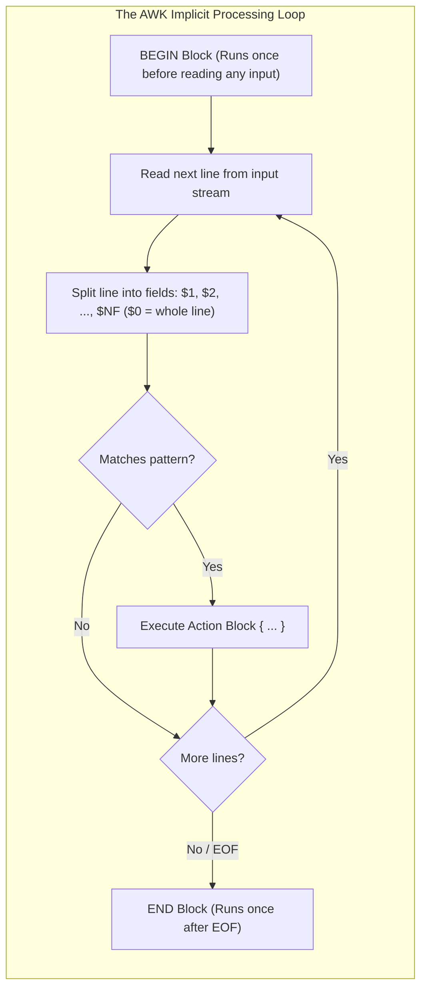
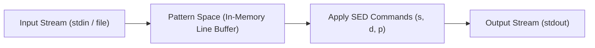
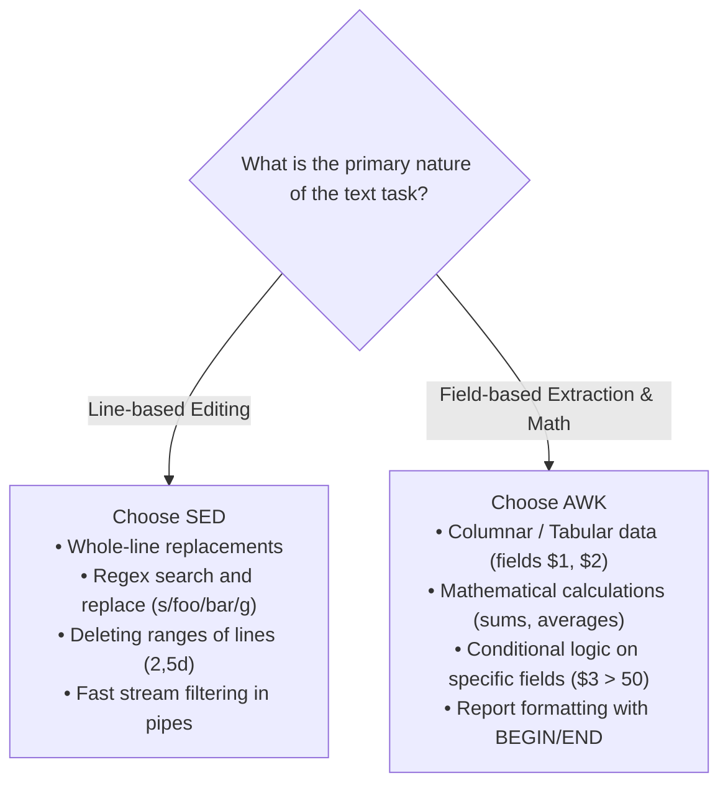

---

Throughout Unit 4, we explored the complete lifecycle of storage: from abstract files and directories, to on-disk inode layouts and allocation algorithms, down to the mechanical physics of spinning platters, RAID arrays, and security boundaries.

Now we return to the command line to examine how systems engineers and administrators actually interact with this storage.

In the Unix philosophy:
$$\text{"Everything is a file, and text is the universal interface."}$$

Configuration files (`/etc/passwd`, `/etc/fstab`), system log streams (`/var/log/syslog`), process tables (`ps aux`), directory listings (`ls -la`), and kernel diagnostics (`/proc/cpuinfo`) are all exposed as structured, line-oriented text.

Instead of writing complex compiled programs in C or Python just to inspect system state, Unix provides two specialized, stream-oriented text-processing powerhouses: **AWK** (for pattern scanning and field computation) and **SED** (the Stream Editor for line-by-line transformations).

In this final lecture of the course, we master **AWK and SED**: their architectural execution loops, syntax models, built-in variables, text filtering idioms, and comparative trade-offs.

---

## 1. AWK: The Pattern Scanning and Processing Language

Developed at Bell Labs in 1977 by **Alfred Aho**, **Peter Weinberger**, and **Brian Kernighan** (whose initials give the tool its name), **AWK** is a complete, Turing-complete domain-specific programming language designed specifically for processing structured, tabular data.



### The Implicit Execution Loop
Unlike general-purpose languages where you must explicitly write a `while (fgets(...))` file loop, allocate memory, and split tokens, **AWK's main loop is completely implicit**:
1. AWK automatically reads the input stream **one record (line) at a time**.
2. It automatically splits each line into whitespace-delimited **fields (columns)**.
3. It evaluates each line against your defined rules, executing matching actions.
4. When EOF is reached, it terminates cleanly.

### Fundamental Syntax
An AWK program consists of a sequence of **Pattern-Action pairs**:

```bash
awk 'pattern { action }' input_file
```

> [!IMPORTANT]
> Always enclose AWK programs in **single quotes** (`'...'`). This prevents the Bash shell from prematurely intercepting and expanding AWK's special variable symbols (like `$1`, `$2`, and `{}`).

There are four structural variations of this rule:
1. `pattern { action }`: If the current line satisfies `pattern`, execute `action`.
2. `{ action }`: If `pattern` is omitted, the `action` executes unconditionally on **every single line**.
3. `pattern`: If `action` is omitted, AWK executes the default action: `{ print }` (prints the entire matching line).
4. `BEGIN { ... }` and `END { ... }`: Special hooks that execute before the first line is read, and after the final line has been processed.

---

## AWK Built-in Variables and Field Notation

AWK automatically exposes a set of pre-initialized internal variables:

| Variable | Meaning | Example / Purpose |
| :--- | :--- | :--- |
| **`$0`** | The **entire current line** as an un-split string. | `print $0` (prints the full line) |
| **`$1, $2, ...`** | The **individual fields** of the current line. | `print $1, $3` (prints 1st and 3rd column) |
| **`NF`** | **Number of Fields** on the current line. | `print NF` (tells how many columns exist) |
| **`$NF`** | The **last field** on the current line. | If $NF=5$, `$NF` evaluates to `$5` |
| **`NR`** | **Number of Records** (the current line number). | Inside `END`, `NR` equals total line count |
| **`-F`** | Flag to specify a custom **Field Separator**. | `awk -F: '{print $1}' /etc/passwd` |

---

## Working with AWK: Concrete Examples

To demonstrate AWK's capabilities, consider a sample database file named `employee.txt`:

```text
ajay    manager    account    45000
sunil   clerk      account    25000
varun   manager    sales      50000
amit    manager    account    47000
tarun   peon       sales      15000
deepak  clerk      sales      23000
sunil   peon       sales      13000
satvik  director   purchase   80000
```

### 1. Extracting Specific Columns
Print only the employee's name (column 1) and their salary (column 4):

```bash
awk '{ print $1, $4 }' employee.txt
```
*Output:*
```text
ajay 45000
sunil 25000
varun 50000
amit 47000
tarun 15000
deepak 23000
sunil 13000
satvik 80000
```

### 2. Pattern Matching with Regular Expressions
Find all employees holding the title of `manager` and print their names:

```bash
awk '/manager/ { print $1 }' employee.txt
```
*Output:*
```text
ajay
varun
amit
```

### 3. Numerical Filtering on Fields
Print the name and salary of every employee earning more than $40,000$:

```bash
awk '$4 > 40000 { print $1, $4 }' employee.txt
```
*Output:*
```text
ajay 45000
varun 50000
amit 47000
satvik 80000
```

### 4. Arithmetic and Aggregation
AWK variables require no declaration; numeric variables initialize automatically to `0`. We can compute the **Total and Average Salary** across the entire company using an accumulator:

```bash
awk '{ sum += $4 } END { print "Total:", sum, "| Average:", sum / NR }' employee.txt
```
*Output:*
```text
Total: 328000 | Average: 41000
```

Notice how `sum += $4` accumulates silently on every line, and the `END` block runs once to print the aggregate result.

---

## 2. SED: The Stream Editor

While AWK is a full programming language designed for columnar data, **SED (Stream EDitor)** is a lightweight, high-speed text transformer designed to perform non-interactive, line-by-line substitutions, deletions, and insertions within Unix pipelines.



### Stream Editor Philosophy
1. **Single Pass:** SED streams through the input text in a single forward pass with a minimal, constant memory footprint. It can easily process a 100 GB log file without running out of RAM.
2. **Non-Destructive by Default:** SED reads from input and outputs to `stdout`. It does **not** modify the original file on disk unless explicitly invoked with the in-place editing flag (`-i`).

### General Syntax
```bash
sed '[address]command' input_file
```

- **Address (Optional):** Specifies *which lines* the command applies to:
  - Omitted: Applies to **every line**.
  - Single line number: `3` (applies only to line 3).
  - Range: `2,5` (applies to lines 2 through 5 inclusive).
  - Last line: `$` (represents the final line of the input).
  - Regex pattern: `/error/` (applies only to lines matching the regex).
- **Command:** The operation to perform (`s` for substitute, `d` for delete, `p` for print).

---

## Essential SED Operations

Consider a sample text file named `f.txt`:

```text
hello world
hello there hello
line three
line four
line five
line six
line seven
```

### 1. The Substitute Command (`s`)
The most common SED operation is string substitution:

```bash
sed 's/old/new/' file
```

#### The First-Occurrence vs. Global Trap
Look at what happens when we substitute `hello` with `world` on `f.txt`:

```bash
sed 's/hello/world/' f.txt
```
On line 2 (`hello there hello`), the output is:
```text
world there hello
```
Notice that **only the first occurrence** on the line was replaced! 

To replace **all occurrences across the entire line**, you must append the **global flag (`g`)**:

```bash
sed 's/hello/world/g' f.txt
```
Now line 2 becomes: `world there world`.

### 2. The Delete Command (`d`)
The delete command strips matching lines from the output stream:

- Delete line 2:
  ```bash
  sed '2d' f.txt
  ```
- Delete lines 4 through 6:
  ```bash
  sed '4,6d' f.txt
  ```
- Delete all blank lines:
  ```bash
  sed '/^$/d' f.txt
  ```
- Delete all commented lines in a configuration file:
  ```bash
  sed '/^#/d' /etc/nginx/nginx.conf
  ```

### 3. The Print Command (`p`) and the `-n` Flag
To print only specific lines, we use the `p` command. 

However, notice what happens if you run:
```bash
sed '2p' f.txt
```
Line 2 is printed **twice**, and all other lines are printed once! Why? 

Because SED prints every line to `stdout` by default, and `2p` tells it to print line 2 an *additional* time.

To suppress default printing, you **must use the `-n` flag**:
```bash
sed -n '2p' f.txt
```
*Output:*
```text
hello there hello
```
Only line 2 is emitted!

---

## Architectural Comparison: AWK vs. SED

Students frequently ask: *"Both tools process text. How do I know which one to choose?"*



| Dimension | SED (Stream Editor) | AWK (Pattern Processing Language) |
| :--- | :--- | :--- |
| **Tool Category** | Lightweight stream editor | Full domain-specific programming language |
| **Primary Focus** | Line-by-line text transformation | Data extraction, formatting, and analysis |
| **Fundamental Unit** | Operates primarily on **Lines** | Operates primarily on **Fields (Columns)** |
| **Computational Ability** | Zero arithmetic capabilities (cannot sum or average) | Full arithmetic, variables, arrays, and loops |
| **Syntax Style** | Compact, regex-heavy ed-style commands | C-like programming syntax (`if`, `printf`, `{}`) |
| **Memory Footprint** | Extremely minimal, near-zero buffer | Minimal, but stores associative arrays in RAM |
| **Rule of Thumb** | *"Search, replace, or delete lines in a pipe."* | *"Extract columns, filter by value, or compute totals."* |

---

## Key Takeaways

- In the Unix philosophy, text streams are the universal interface connecting files, processes, and tools.
- **AWK** is an interpreted programming language designed for pattern scanning and columnar data processing.
- AWK's execution loop is implicit: it reads each line, automatically splits fields by delimiter, and executes matching pattern-action rules.
- AWK variables: `$0` is the full line, `$1...$k` are fields, `NF` is the field count, `NR` is the line number, and `-F` defines custom field separators.
- `BEGIN { ... }` runs before input processing; `END { ... }` runs after EOF, ideal for computing and displaying cumulative totals and averages.
- **SED** is a single-pass, constant-memory stream editor designed for non-interactive text transformations.
- The `s/old/new/` command replaces the first match per line; append `g` (`s/old/new/g`) for global line substitution.
- To print specific lines with `p`, always pass the `-n` flag (`sed -n '3p'`) to suppress SED's default line-echoing behavior.
- Use **SED** for stream filtering and global string substitutions; use **AWK** when data is structured into columns or requires numerical computation.

---

This concludes our comprehensive study of the **Operating Systems Coursework**:
1. In **Unit 1**, we explored Computer System Organization, Dual-Mode Operations, System Calls, and the foundational Process Concept with CPU Scheduling (FCFS, SJF, Priority, Round Robin, Multilevel Queues).
2. In **Unit 2**, we tackled Inter-Process Communication (Shared Memory vs. Message Passing), POSIX Threads and Concurrency, Software and Hardware Synchronization (Peterson's algorithm, Test-and-Set, Semaphores, Monitors), Deadlocks, and Signals.
3. In **Unit 3**, we crossed into Memory Management: Hardware Address Translation, Contiguous Swapping, Segmentation, Paging, Hierarchical Page Tables, Virtual Memory, and Page Replacement Algorithms.
4. In **Unit 4**, we unraveled Storage: File Concept and Directory Hierarchies, Inodes and the VFS Layer, Disk Space Allocation, Free-Space Bitmaps, Mass-Storage Physics, Disk Scheduling Algorithms, RAID Fault Tolerance, Operating System Protection Domains, Security Threats, and Unix Text Processing with AWK and SED.
